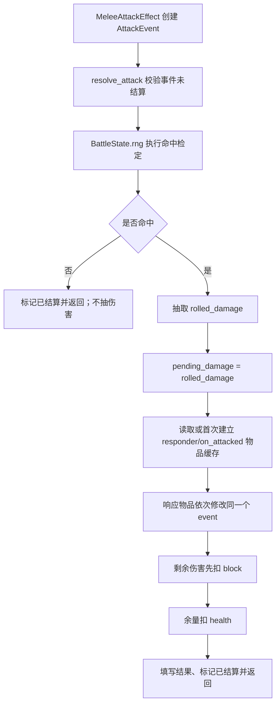
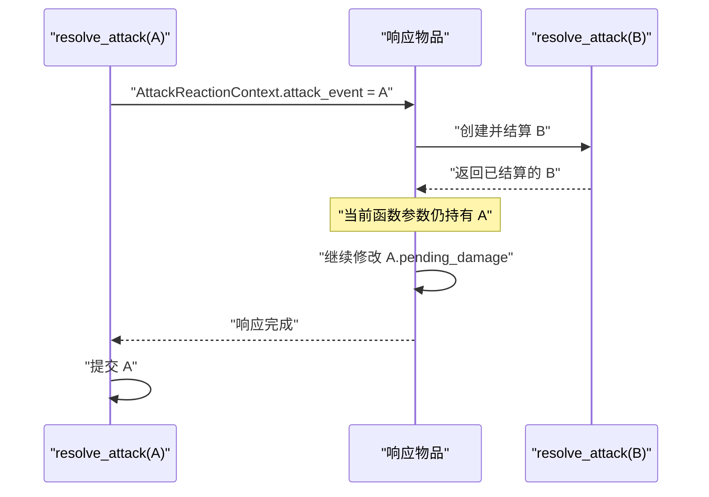

# AttackEvent 攻击结算与响应流程 SPEC

状态：已确认并实现（2026-07-22）。

实现验证：`python -m unittest discover -s tests` 共 128 项测试通过，其中 40 项为攻击结算专项测试。

审阅修订：攻击字段仅存在于 `AttackReactionContext(BattleContext)`；基础 `BattleContext` 与普通 `BattleItem` 不增加攻击专用属性。攻击响应物品列表按 responder 和 attack phase 在 `BattleState` 内惰性缓存。

本文档描述一次武器攻击如何允许其他物品在伤害生效前作出响应。这里的 `AttackEvent` 不是 combat log，也不是全局事件总线；它只是一次攻击在同步结算期间使用的局部、可变结算单。

## 1. Requirements（需求）

### 1.1 功能目标

当前木剑设计中的 `MeleeAttackEffect` 会在命中后直接扣除 `block` 和 `health`。该流程无法支持 Wooden Buckler（下文简称木盾）一类“被攻击时，在伤害实际生效前修改本次攻击”的物品。

本 SPEC 的目标是：

1. 将一次武器攻击表示为独立的 `AttackEvent` 实例。
2. 命中后先把同一个 `AttackEvent` 显式传给防守方响应物品。
3. 响应物品可以修改 `pending_damage`，也可以执行移除攻击者耐力等其他效果。
4. 所有响应完成后，由 `BattleState` 统一把剩余伤害结算到 `block` 和 `health`。
5. 所有命中、伤害和响应概率检定都使用该 `BattleState` 的同一个 RNG。
6. 嵌套攻击使用各自独立的 `AttackEvent`，不得通过 `BattleState.current_attack` 一类全局临时字段传递。

### 1.2 `AttackEvent` 的含义

`AttackEvent` 是“这一刀目前结算到哪里”的 Python 对象。它包含：

- 谁攻击谁；
- 哪件物品发起攻击；
- 攻击类型、命中率和伤害区间；
- 是否命中、实际掷出的伤害；
- 响应物品修改后的待结算伤害；
- 最终消耗了多少护盾、扣除了多少生命。

它具有以下生命周期：

```text
MeleeAttackEffect 创建 AttackEvent
    -> BattleState.resolve_attack(event)
        -> 命中判定
        -> 伤害抽取
        -> 显式传给防守方响应物品
        -> 统一提交剩余伤害
    -> resolve_attack 返回已经结算的同一个 event
```

`AttackEvent` 只存在于上述调用链及持有它的局部变量中。`BattleState` 负责结算它，但不把它保存为“当前攻击”。

### 1.3 用户故事

- 作为普通武器 effect，我可以创建一份攻击结算单并交给统一结算器，不直接操作对手生命。
- 作为防守方响应物品，我可以在一次已命中的攻击生效前读取并修改该次攻击的待结算伤害。
- 作为具体物品实现者，我仍在 `run_own_effect()` 中解释 trigger 结果、决定 effect 调用顺序及是否运行 linked items。
- 作为模拟器使用者，我可以注入固定 RNG，使命中、伤害和木盾概率均可复现。
- 作为后续反击物品实现者，我可以在处理攻击 A 时发起攻击 B；B 结算完后仍可继续修改 A，不发生覆盖。
- 作为战斗引擎维护者，我只在某个 responder 的某个攻击阶段第一次被派发时扫描一次 trigger，后续攻击直接复用物品列表缓存。

### 1.4 行为要求

- WHEN `MeleeAttackEffect.apply(context)` 被调用，THEN SHALL 创建一个新的 `AttackEvent` 并调用 `context.battle_state.resolve_attack(event)`。
- WHEN 攻击未命中，THEN SHALL 不抽取伤害、不派发 `on_attacked`、不修改防守方 `block` 或 `health`。
- WHEN 攻击命中，THEN SHALL 先抽取基础伤害，再派发 `on_attacked`，最后提交伤害。
- WHEN 防守物品响应 `on_attacked`，THEN SHALL 通过本次调用的 `AttackReactionContext.attack_event` 获得准确的事件实例。
- 普通 `BattleContext` SHALL 保持现有字段，不增加 `attack_phase` 或 `attack_event`。
- 普通 `BattleItem` SHALL 不增加 `attack_reaction_phases`、`attack_phase` 或 `attack_event`。
- WHEN `dispatch_attack_reactions()` 遍历一个没有攻击响应 trigger 的普通物品，THEN SHALL 安全跳过该物品，不读取任何不存在的攻击属性，也不调用其 `run_effects()`。
- WHEN 某个 `(responder, attack_phase)` 第一次被派发，THEN SHALL 扫描该 responder 的物品和 trigger，并把匹配物品按插入顺序写入 `BattleState` 内部缓存。
- WHEN 同一 `(responder, attack_phase)` 后续再次被派发，THEN SHALL 直接读取缓存，不再读取任何 trigger 的 `attack_phase`。
- WHEN 第一次扫描没有找到匹配物品，THEN SHALL 缓存空 tuple；后续派发不得因为结果为空而重复扫描。
- 缓存 SHALL 只保存物品 tuple，不保存 `AttackReactionContext` 或 `AttackEvent`；每次攻击仍须创建新的响应 context。
- WHEN 某响应物品改变伤害，THEN SHALL 只修改该事件的 `pending_damage`，不得提前扣除 `block` 或 `health`。
- WHEN 所有响应物品处理完毕，THEN SHALL 先用剩余伤害消耗 `block`，再用余量扣除 `health`。
- WHEN 多个物品响应同一攻击，THEN SHALL 按防守方 `items` 的插入顺序逐个处理，并共享同一个事件实例。
- WHEN `pending_damage` 已经降为 0，THEN SHALL 仍继续检查其余响应物品，因为后续物品还可能执行移除耐力等非伤害效果。
- WHEN 木盾的检定成功，THEN SHALL 最多阻止 7 点本次攻击伤害，并尝试从攻击者移除 0.3 耐力；耐力最低为 0。
- WHEN 木盾检定成功但当前待结算伤害已经为 0，THEN SHALL 仍执行移除 0.3 耐力的 effect。
- WHEN 木盾检定失败，THEN SHALL 不修改事件和攻击者耐力。
- WHEN 某响应 effect 内同步发起攻击 B，THEN SHALL 为 B 新建事件；B 完整返回后继续处理外层攻击 A。
- WHEN 同一 `AttackEvent` 被第二次提交给 `resolve_attack()`，THEN SHALL 抛出 `ValueError`，避免重复扣血。
- 每个基础 trigger 仍返回一个 bool，`BattleItem.update_triggers()` 仍返回与 trigger 等长的 bool 列表；具体响应物品的 trigger 组合、effect 顺序和 linked item 决策仍只写在 `run_own_effect()` 中。

### 1.5 Wiki 事实依据

查询日期：2026-07-22。

- [Accuracy](https://backpackbattles.wiki.gg/wiki/Accuracy)：武器成功激活后进行攻击；`On attack` 不要求命中，`On hit` 只在命中时触发，Wooden Buckler 一类 `On attacked` 效果也只在武器命中时触发。
- [Weapon](https://backpackbattles.wiki.gg/wiki/Weapon)：武器支付耐力后进行命中判定，命中后在伤害区间内抽取伤害。
- [Shield](https://backpackbattles.wiki.gg/wiki/Shield)：Wooden Buckler 当前效果为被近战攻击时有 30% 概率阻止 7 点伤害，并从对手移除 0.3 耐力。
- [Effect](https://backpackbattles.wiki.gg/wiki/Effect)：effect damage 通常不是武器攻击，通常不与盾牌和尖刺交互。
- 本地知识库 `docs/backpack_battles_knowledge_base.md`：护盾每层抵挡 1 点伤害；武器伤害类型包括 `melee`、`ranged` 和 `effect`；战斗随机过程由 `BattleState` 统一控制。

### 1.6 首轮实现范围

首轮只实现验证木剑与木盾响应所需的最小闭环：

- `AttackEvent` 数据模型；
- `BattleState.rng`；
- 近战命中、伤害抽取、`on_attacked` 派发和伤害提交；
- `AttackReactionContext(BattleContext)` 显式携带攻击事件和阶段；
- 响应 trigger 声明自己对应的攻击阶段，普通物品不增加攻击响应字段；
- `BattleState` 按 responder 与 attack phase 惰性缓存响应物品 tuple；
- `MeleeAttackEffect` 改为调用统一攻击结算；
- 可复用的 `OnAttackedTrigger`、`PreventAttackDamageEffect` 和 `RemoveOpponentStaminaEffect`；
- 使用木盾式测试物品验证完整响应，不在本任务中登记完整 Wooden Buckler item factory。

### 1.7 非目标

- 不实现 combat log。
- 不实现通用 `EventBus`、异步消息队列、全局事件栈或观察者注册中心。
- 不在 `BattleState` 增加 `current_attack`、`current_event` 等临时字段。
- 不在基础 `BattleContext` 或基础 `BattleItem` 上增加攻击专用字段。
- 首轮不支持战斗开始后增删物品、替换 trigger 或改变 trigger 的 `attack_phase`；出现该机制时必须为响应物品缓存增加明确失效入口。
- 不实现 Wooden Buckler 的完整 metadata、JSON catalog 条目或默认工厂注册。
- 不实现 ranged attack、effect damage 的统一结算器。
- 不实现 Luck/Blind、Empower、暴击、减伤/增伤、无敌等完整计算顺序。
- 不实现 `On attack`、`before miss`、`On miss`、`On hit`、Spikes 或 Vampirism 阶段；数据模型应允许以后在 `resolve_attack()` 中按明确顺序增加这些阶段。
- 不处理会无限互相反击的规则循环；出现首个此类物品时再依据游戏规则设计终止条件。
- 不修改 `AGENTS.md`。

## 2. Design（设计）

### 2.1 核心决策：局部可变结算单

**是什么**

每次攻击创建一个独立、可变的 `AttackEvent`。结算器和响应物品通过函数参数传递同一个对象，响应结束后统一提交伤害。

**为什么**

- 直接扣血时，防守物品没有“伤害尚未生效”的响应窗口。
- 把事件放在 `BattleState.current_attack` 中时，响应攻击 A 期间若触发攻击 B，B 会覆盖该字段。B 返回后，A 的响应代码可能错误修改 B，或无法继续找到 A。
- 当前只需要攻击流程，通用事件总线会引入注册、优先级、取消传播和生命周期等尚未需要的复杂度。

**怎么做**

```python
event_a = AttackEvent(...)
battle_state.resolve_attack(event_a)

# resolve_attack 内部
context = battle_state.build_attack_reaction_context(
    shield,
    attack_phase="on_attacked",
    attack_event=event_a,
)
shield.run_effects(context)
```

“显式传入”指 `event_a` 沿函数参数进入每一层。它放在本次攻击响应调用专属的 `AttackReactionContext` 中，不能放在普通 `BattleContext` 或整个战斗共享的临时字段中。

### 2.2 责任边界

| 组件 | 负责 | 不负责 |
| --- | --- | --- |
| `MeleeAttackEffect` | 根据自身参数创建攻击事件并请求结算；返回是否命中 | 直接扣除防守方 `block` 或 `health` |
| `AttackEvent` | 保存一次攻击的输入、中间值和最终结果 | 主动遍历物品或执行 effect |
| `BattleState.resolve_attack` | 固定攻击阶段、调用 RNG、派发响应、提交伤害 | 编写具体盾牌逻辑 |
| `BattleState._get_attack_reaction_items` | 首次按 responder/phase 扫描 trigger 并缓存匹配物品，后续直接返回缓存 | 缓存 context、event 或物品运行结果 |
| `BattleState.dispatch_attack_reactions` | 从缓存取得响应物品，以确定顺序创建本次 context 并调用现有调度入口 | 重复扫描 trigger、解释物品 trigger/effect 结果或遇到 0 伤害提前停止 |
| `BattleContext` | 承担普通逐帧和 linked item 调用所需的通用字段 | 携带攻击专用字段 |
| `AttackReactionContext` | 把事件与阶段显式传给攻击 trigger/effect/linked item | 保存跨攻击的全局状态 |
| 响应物品 `run_own_effect` | 组合 trigger、排列 effect、解释 effect 返回值、决定 linked items | 直接提交最终伤害 |
| `PreventAttackDamageEffect` | 安全减少本次事件的 `pending_damage` | 自行进行概率检定或停止后续 effect |

### 2.3 `AttackEvent` 数据模型

建议放在 `battle_module_v1.py`：

```python
@dataclass
class AttackEvent:
    attacker: PlayerState
    defender: PlayerState
    source_item: BattleItem
    attack_types: tuple[str, ...]
    min_damage: int
    max_damage: int
    accuracy: float
    hit: bool | None = None
    rolled_damage: int = 0
    pending_damage: int = 0
    prevented_damage: int = 0
    block_damage: int = 0
    health_damage: int = 0
    is_resolved: bool = False
```

字段约束：

- `attacker`、`defender` 和 `source_item` 在事件创建后不变。
- `attack_types` 使用知识库中的标准小写值；木剑固定为 `("melee",)`。
- `accuracy` 使用当前木剑设计的百分数口径 `[0, 100]`。
- `rolled_damage` 是 RNG 抽出的原始伤害，响应物品不得改写。
- `pending_damage` 在命中并抽取伤害后等于 `rolled_damage`，响应 effect 只修改该字段。
- `prevented_damage` 记录实际阻止量，不得大于此前可用的 `pending_damage`。
- `block_damage` 和 `health_damage` 仅由统一提交步骤填写。
- `is_resolved` 在一次完整结算结束时设为 `True`，防止重复结算。

不增加 `attack_id`、时间戳、历史列表或日志字段。若以后实现 combat log，应从结算结果生成独立日志记录，而不是让本对象承担日志职责。

### 2.4 `AttackReactionContext` 子类

基础 `BattleContext` 保持现状：

```python
@dataclass
class BattleContext:
    battle_state: BattleState
    item: BattleItem
    owner: PlayerState
    opponent: PlayerState
```

只有攻击响应调用使用子类：

```python
@dataclass
class AttackReactionContext(BattleContext):
    attack_phase: str
    attack_event: AttackEvent
```

约定：

- 普通逐帧物品仍收到 `BattleContext`，该对象根本没有 `attack_phase` 或 `attack_event`。
- 只有攻击响应物品收到 `AttackReactionContext`。
- 对木盾而言，`owner` 是防守者，`opponent` 是攻击者，`attack_event` 是正在结算的攻击。
- `AttackReactionContext.for_item()` 覆盖基础实现，返回新的 `AttackReactionContext`，并保留完全相同的 `attack_event` 对象，使响应链中的 linked item 仍处于同一攻击阶段。
- 需要攻击字段的 trigger/effect 必须先用 `isinstance(context, AttackReactionContext)` 判断 context 类型，再读取子类字段。

这样普通 context 不承担无关字段，也不需要用两个 `None` 表示“当前不是攻击响应”。

### 2.5 响应阶段由 trigger 声明

基础 `BattleItem` 不增加任何攻击专用属性。首轮只定义一个阶段常量：

```python
ATTACK_PHASE_ON_ATTACKED = "on_attacked"
SUPPORTED_ATTACK_REACTION_PHASES = (ATTACK_PHASE_ON_ATTACKED,)
```

只有攻击响应 trigger 声明其阶段，例如：

```python
class OnAttackedTrigger(Trigger):
    attack_phase = ATTACK_PHASE_ON_ATTACKED
```

某个 responder/phase 的缓存第一次建立时检查 trigger，而不是读取物品属性：

```python
has_matching_trigger = any(
    getattr(trigger, "attack_phase", None) == phase
    for trigger in item.triggers
)
```

`getattr(..., None)` 是必需的：`CooldownTrigger` 等普通 trigger 根本没有 `attack_phase`。若物品的所有 trigger 都没有该字段，或字段不匹配当前阶段，首次扫描不会把该物品放入缓存。缓存建立后不再读取 trigger。

首轮不支持把逐帧 cooldown trigger 和攻击响应 trigger 混在同一件混合物品里。等出现实际需要时，再为同一物品内不同 trigger 的更新范围设计单独 SPEC；当前不会为所有 trigger 增加通用事件接口。

### 2.6 攻击结算阶段

首轮固定流程：



首轮明确采用以下结算顺序：

1. 命中；
2. 抽取伤害；
3. 木盾等 `on_attacked` 响应；
4. Block；
5. Health。

因此木盾的“阻止 7 点伤害”发生在 Block 之前。更完整的伤害增减、暴击和无敌顺序需在相关机制进入开发时依据 Wiki 单独补充，不能偷偷塞入本函数。

### 2.7 响应物品缓存、派发与顺序

用户提出的 `responder.$(attack_phase)_item_cache` 在代码中使用一个结构化内部字典表示：

```python
self._responder_item_cache[responder.player_id][attack_phase]
```

这与为每个 responder 动态创建 `on_attacked_item_cache` 等属性具有相同的分区语义，但避免动态属性名，也不会污染 `PlayerState`。缓存属于单个 `BattleState`，不同战斗不共享。

缓存值是按 `responder.items` 插入顺序排列的不可变 tuple：

```python
tuple[BattleItem, ...]
```

因此某 responder/phase 的首次 lookup 成本为扫描全部物品及其 trigger，后续派发只遍历缓存中的响应物品，不再与普通物品数量或普通 trigger 数量相关。

第一次获取：

```text
phase_cache = BattleState 中该 responder 的内部缓存
if attack_phase 尚未缓存:
    扫描 responder.items
    对每件物品扫描 trigger.attack_phase
    把匹配物品 tuple 写入 phase_cache[attack_phase]
return phase_cache[attack_phase]
```

后续派发：

```text
items = _get_attack_reaction_items(responder, attack_phase)
for item in items:
    context = build_attack_reaction_context(item, attack_phase, event)
    item.run_effects(context)
```

设计口径：

- 使用 `PlayerState.items` 的插入顺序，保证同一输入和 RNG 下结果确定。
- 首次建立的 tuple 同时承担稳定快照；后续不再扫描 `responder.items` 或 trigger。
- 正在结算的 `event` 是 `dispatch_attack_reactions()` 的显式参数；派发器不从物品或某个普通 context 上寻找 `attack_event`。
- 普通物品及普通 trigger 不需要定义 `attack_phase` 或 `attack_event`；首次扫描中的 `getattr(..., None)` 会安全处理属性完全不存在的情况。
- 只有至少一个 trigger 的 `attack_phase` 与当前阶段相等时，物品才进入该阶段的缓存。
- 空 tuple 也是有效缓存值，必须通过“phase 是否为字典键”判断命中，不能用 tuple 的真假判断是否重新扫描。
- 缓存只保存 item 引用，绝不保存当前 event 或 context；每次循环都为当前攻击创建新的 `AttackReactionContext`。
- 每个匹配物品在该阶段最多调用一次，即使它有多个匹配 trigger 也只调用一次 `run_effects()`。
- 不读取 `run_effects()` 的 bool 来决定是否继续下一个响应物品。该 bool 只决定该物品自己的 linked items。
- 不因 `pending_damage == 0` 停止，因为其余物品仍可能移除耐力、施加状态或触发 linked items。
- `linked_items` 仍表示物品自己的连接关系，不被改造成全局攻击监听列表。
- 当前战斗模型在战斗开始后不改变 `PlayerState.items`、`item.triggers` 或 trigger 阶段，因此首轮不需要缓存失效逻辑。未来若允许这些结构变化，修改入口必须同步清除对应 responder/phase 缓存。

如果后续确认游戏存在不同的盾牌优先级，应只替换这里的明确排序规则，不改变显式事件传递模型。

### 2.8 嵌套攻击不会覆盖



如果使用 `BattleState.current_attack`，进入 B 时该字段会从 A 变成 B；如果 B 内还有攻击，则会继续覆盖。显式参数让 Python 调用栈自然保存每一层的事件引用，不需要自行维护全局栈。

### 2.9 木盾式响应组合

首轮用以下可复用组件表达木盾行为：

```python
class WoodenBucklerLikeItem(BattleItem):
    def __init__(self, **kwargs):
        super().__init__(
            triggers=[
                OnAttackedTrigger(
                    attack_types=("melee",),
                    chance=0.30,
                ),
            ],
            effects=[
                PreventAttackDamageEffect(amount=7),
                RemoveOpponentStaminaEffect(amount=0.3),
            ],
            **kwargs,
        )

    def run_own_effect(self, trigger_results, context):
        if not trigger_results[0]:
            return False

        self.effects[0].apply(context)
        self.effects[1].apply(context)
        return True
```

关键点：

- `OnAttackedTrigger` 同时检查阶段、攻击类型和概率，只有类型符合时才消耗一次 RNG。
- 不拆成“类型 trigger + 独立概率 trigger”，因为当前 `update_triggers()` 必须更新全部 trigger；拆开后 ranged/effect 攻击也会无意义地消耗木盾概率 RNG，改变后续随机序列。
- `PreventAttackDamageEffect` 返回 `False` 只表示实际没有阻止到正数伤害，不代表木盾没有激活。
- `RemoveOpponentStaminaEffect` 返回 `False` 只表示攻击者当时没有可移除的耐力。
- 木盾的 `run_own_effect()` 不用上述 effect 返回值做短路。概率检定成功后两项 effect 都执行，并返回 `True` 允许本物品的 linked items 响应本次激活。

完整 Wooden Buckler 工厂不在本 SPEC 范围；上述类只作为接口示例和测试辅助物品。

### 2.10 RNG 归属

`BattleState` 增加：

```python
rng: random.Random = field(default_factory=random.Random)
```

单次命中攻击的 RNG 调用顺序固定为：

1. `rng.random()` 判定命中；
2. 命中后 `rng.randint(min_damage, max_damage)` 抽取伤害；
3. 各响应物品按派发顺序执行自己的概率检定。

未命中时不调用 `randint()`，也不进行木盾概率检定。测试可以注入记录调用顺序的假 RNG；生产默认值仍是每个 `BattleState` 独立的 `random.Random()`。

### 2.11 返回值语义

`MeleeAttackEffect.apply(context) -> bool` 保持现有 effect 契约：

- 命中返回 `True`；
- 未命中返回 `False`；
- 即使伤害被木盾完全阻止，只要命中仍返回 `True`。

这是“是否命中”，不是“是否扣到生命”或“最终伤害是否大于 0”。木剑可以继续用它决定 linked item 的命中语义。

### 2.12 待审阅口径

以下不是已确认 Wiki 结论，而是本项目首轮建议，请审阅时重点确认：

1. `on_attacked` 响应发生在 Block 之前。
2. 多个响应物品按 `PlayerState.items` 插入顺序处理。
3. 伤害已经被阻止到 0 时，后续响应物品仍会进行检定并执行非伤害效果。
4. 木盾概率成功就视为物品激活并运行 linked items，不要求实际阻止到伤害或实际移除到耐力。
5. `MeleeAttackEffect` 的 bool 表示命中，完全阻止伤害仍返回 `True`。
6. 首轮只实现 `on_attacked`，其他攻击阶段以后逐项增加。

## 3. Realize（逐函数、逐测试实现设计）

### 3.1 `AttackEvent`

位置：`battle_module_v1.py`。

接口：使用第 2.3 节 dataclass 字段，不编写事件总线方法。

初始化后约束：

```text
hit is None
rolled_damage == 0
pending_damage == 0
prevented_damage == 0
block_damage == 0
health_damage == 0
is_resolved is False
```

事件参数合法性由创建它的 `MeleeAttackEffect.__init__()` 和消费它的 `resolve_attack()` 双边保证，不额外引入验证器类。

### 3.2 `AttackReactionContext`

位置：`battle_module_v1.py`，定义在 `BattleContext` 之后。

接口：

```python
@dataclass
class AttackReactionContext(BattleContext):
    attack_phase: str
    attack_event: AttackEvent
```

基础 `BattleContext` 的字段和构造函数签名均不修改。普通 context 上执行 `hasattr(context, "attack_phase")` 和 `hasattr(context, "attack_event")` 应均为 `False`。

### 3.3 `BattleContext.for_item`

接口及现有实现保持不变：

```python
def for_item(self, item: BattleItem) -> BattleContext
```

普通 context 仍返回普通 `BattleContext`。本函数不读取、不复制也不创建任何攻击字段。

### 3.4 `AttackReactionContext.for_item`

覆盖接口：

```python
def for_item(self, item: BattleItem) -> AttackReactionContext
```

伪代码：

```python
base_context = super().for_item(item)
return AttackReactionContext(
    battle_state=base_context.battle_state,
    item=base_context.item,
    owner=base_context.owner,
    opponent=base_context.opponent,
    attack_phase=self.attack_phase,
    attack_event=self.attack_event,
)
```

必须使用同一个 `attack_event` 引用，不能复制事件。

### 3.5 `BattleState.build_attack_reaction_context`

保留现有 `build_context(item) -> BattleContext` 不变，新增专用接口：

```python
def build_attack_reaction_context(
    self,
    item: BattleItem,
    attack_phase: str,
    attack_event: AttackEvent,
) -> AttackReactionContext
```

伪代码：

```python
if attack_phase not in SUPPORTED_ATTACK_REACTION_PHASES:
    raise ValueError
if attack_event is None:
    raise ValueError

base_context = self.build_context(item)
return AttackReactionContext(
    battle_state=base_context.battle_state,
    item=base_context.item,
    owner=base_context.owner,
    opponent=base_context.opponent,
    attack_phase=attack_phase,
    attack_event=attack_event,
)
```

只有本函数和 `AttackReactionContext.for_item()` 创建攻击响应 context。

### 3.6 `BattleState.rng`

位置：`battle_module_v1.py`。

字段：

```python
rng: random.Random = field(default_factory=random.Random)
```

同时增加 `import random`。必须使用 `default_factory`，保证不同 `BattleState` 不共享 RNG 对象。构造函数允许测试直接传入假 RNG 或固定 seed 的 `random.Random`；本 SPEC 不修改 JSON 输入格式。

### 3.7 `BattleState._responder_item_cache`

位置：`battle_module_v1.py`。

内部字段：

```python
_responder_item_cache: dict[
    object,
    dict[str, tuple[BattleItem, ...]],
] = field(default_factory=dict, init=False, repr=False)
```

第一层键为 `responder.player_id`，第二层键为 `attack_phase`，值为匹配物品 tuple。使用 `default_factory` 保证每个 `BattleState` 独立持有缓存；`init=False` 表示外部不能把缓存作为战斗输入注入；`repr=False` 避免打印战斗状态时递归展开物品。

首轮 JSON 中的 `player_id` 是可哈希标量。缓存不放在 `PlayerState`，也不为 responder 动态创建属性。

### 3.8 `BattleState._get_attack_reaction_items`

新增内部接口：

```python
def _get_attack_reaction_items(
    self,
    responder: PlayerState,
    attack_phase: str,
) -> tuple[BattleItem, ...]
```

伪代码：

```python
if attack_phase not in SUPPORTED_ATTACK_REACTION_PHASES:
    raise ValueError
if self.get_player(responder.player_id) is not responder:
    raise ValueError

phase_cache = self._responder_item_cache.setdefault(
    responder.player_id,
    {},
)
if attack_phase in phase_cache:
    return phase_cache[attack_phase]

matching_items = tuple(
    item
    for item in responder.items.values()
    if any(
        getattr(trigger, "attack_phase", None) == attack_phase
        for trigger in item.triggers
    )
)
phase_cache[attack_phase] = matching_items
return matching_items
```

必须使用 `if attack_phase in phase_cache`，使空 tuple 也能命中缓存。只有缓存未命中分支可以读取 `responder.items` 和 `trigger.attack_phase`。

### 3.9 `BattleState.resolve_attack`

新增接口：

```python
def resolve_attack(self, event: AttackEvent) -> AttackEvent
```

伪代码：

```python
if event.is_resolved:
    raise ValueError("attack event is already resolved")
if event.attacker is event.defender:
    raise ValueError("attack requires different players")
if self.get_player(event.attacker.player_id) is not event.attacker:
    raise ValueError("attacker is not part of this battle")
if self.get_player(event.defender.player_id) is not event.defender:
    raise ValueError("defender is not part of this battle")

event.hit = self.rng.random() * 100 < event.accuracy
if not event.hit:
    event.is_resolved = True
    return event

event.rolled_damage = self.rng.randint(
    event.min_damage,
    event.max_damage,
)
event.pending_damage = event.rolled_damage

self.dispatch_attack_reactions(
    phase=ATTACK_PHASE_ON_ATTACKED,
    responder=event.defender,
    event=event,
)
self.commit_attack_damage(event)
event.is_resolved = True
return event
```

`resolve_attack()` 不调用 `check_battle_end()`。当前框架仍在帧末统一检查胜负，避免一次物品调用中改变既有结束时点。

### 3.10 `BattleState.dispatch_attack_reactions`

新增接口：

```python
def dispatch_attack_reactions(
    self,
    phase: str,
    responder: PlayerState,
    event: AttackEvent,
) -> None
```

伪代码：

```python
if phase not in SUPPORTED_ATTACK_REACTION_PHASES:
    raise ValueError
if event.is_resolved:
    raise ValueError

items = self._get_attack_reaction_items(responder, phase)
for item in items:
    context = self.build_attack_reaction_context(
        item,
        attack_phase=phase,
        attack_event=event,
    )
    item.run_effects(context)
```

首次调用时，helper 建立缓存；后续调用不再扫描物品或读取 trigger。即使缓存为空，本函数也直接结束。每次循环仍创建新的 `AttackReactionContext`，所以两次攻击以及嵌套攻击不会复用旧事件。本函数不读取 `run_effects()` 的返回值，也不检查当前伤害是否为 0。

### 3.11 `BattleState.commit_attack_damage`

新增接口：

```python
def commit_attack_damage(self, event: AttackEvent) -> None
```

伪代码：

```python
if event.is_resolved:
    raise ValueError
if event.hit is not True:
    raise ValueError
if event.pending_damage < 0:
    raise ValueError

blocked = min(event.defender.block, event.pending_damage)
health_damage = event.pending_damage - blocked

event.defender.block -= blocked
event.defender.health -= health_damage
event.block_damage = blocked
event.health_damage = health_damage
```

`pending_damage` 在提交后保留为“进入 Block/Health 结算的伤害”，便于调用方检查结果；`is_resolved` 由外层 `resolve_attack()` 在提交完成后统一设置。

### 3.12 `MeleeAttackEffect.__init__`

位置：`item_factory_registry_v1.py`。

接口：

```python
def __init__(
    self,
    min_damage: int,
    max_damage: int,
    accuracy: float,
) -> None
```

伪代码：

```python
if min_damage < 0:
    raise ValueError
if max_damage < min_damage:
    raise ValueError
if not 0 <= accuracy <= 100:
    raise ValueError

self.min_damage = min_damage
self.max_damage = max_damage
self.accuracy = accuracy
```

### 3.13 `MeleeAttackEffect.apply`

接口：

```python
def apply(self, context: BattleContext) -> bool
```

伪代码：

```python
event = AttackEvent(
    attacker=context.owner,
    defender=context.opponent,
    source_item=context.item,
    attack_types=("melee",),
    min_damage=self.min_damage,
    max_damage=self.max_damage,
    accuracy=self.accuracy,
)
resolved_event = context.battle_state.resolve_attack(event)
return resolved_event.hit is True
```

本函数不得直接修改 `context.opponent.block` 或 `health`。

### 3.14 `OnAttackedTrigger`

位置：`item_factory_registry_v1.py`。

类级阶段声明：

```python
attack_phase = ATTACK_PHASE_ON_ATTACKED
```

该字段只存在于攻击响应 trigger，不添加到基础 `Trigger` 或 `BattleItem`。

接口：

```python
def __init__(
    self,
    attack_types: tuple[str, ...],
    chance: float = 1.0,
) -> None

def update(self, context: BattleContext) -> bool
```

构造校验：

```text
attack_types 非空
每个 attack_type 属于 melee/ranged/effect
0 <= chance <= 1
```

`update()` 伪代码：

```python
if not isinstance(context, AttackReactionContext):
    return False
if context.attack_phase != self.attack_phase:
    return False

event = context.attack_event
if event.hit is not True:
    return False
if no configured attack type occurs in event.attack_types:
    return False

return context.battle_state.rng.random() < self.chance
```

类型或阶段不符合时不得消耗 RNG。

### 3.15 `PreventAttackDamageEffect`

位置：`item_factory_registry_v1.py`。

接口：

```python
def __init__(self, amount: int) -> None
def apply(self, context: BattleContext) -> bool
```

伪代码：

```python
if amount < 0 at construction:
    raise ValueError

if not isinstance(context, AttackReactionContext):
    raise ValueError
if context.attack_phase != ATTACK_PHASE_ON_ATTACKED:
    raise ValueError

event = context.attack_event
if event.is_resolved:
    raise ValueError

prevented = min(self.amount, event.pending_damage)
event.pending_damage -= prevented
event.prevented_damage += prevented
return prevented > 0
```

### 3.16 `RemoveOpponentStaminaEffect`

位置：`item_factory_registry_v1.py`。

接口：

```python
def __init__(self, amount: float) -> None
def apply(self, context: BattleContext) -> bool
```

伪代码：

```python
if amount < 0 at construction:
    raise ValueError

old_stamina = context.opponent.stamina
context.opponent.stamina = max(0.0, old_stamina - self.amount)
return context.opponent.stamina != old_stamina
```

它不修改 `max_stamina`，也不要求存在攻击事件，因此以后可以被其他移除对手耐力的物品复用。

### 3.17 `WoodenBucklerLikeItem.run_own_effect`

该类只放在测试辅助代码中，不注册到 `DEFAULT_ITEM_FACTORIES`。

接口：

```python
def run_own_effect(
    self,
    trigger_results: list[bool],
    context: BattleContext,
) -> bool
```

伪代码：

```python
if not trigger_results[0]:
    return False

self.effects[0].apply(context)
self.effects[1].apply(context)
return True
```

这正好验证“effect 返回结果由具体物品解释”：第一个 effect 没有实际阻止到伤害时，第二个 effect 仍执行。

### 3.18 测试辅助类

- `SequenceRng`：按给定序列返回 `random()` 和 `randint()` 结果，并记录调用顺序。
- `RecordingAttackTrigger`：只在该测试 trigger 上声明 `attack_phase`，并记录收到的 `AttackReactionContext`。
- `CountingAttackPhaseTrigger`：通过 property 记录 `attack_phase` 被读取的次数，用于证明缓存命中后不会再次扫描 trigger。
- `RecordingReactionItem`：包含 `RecordingAttackTrigger`，记录收到的阶段和事件对象身份；物品本身不声明攻击字段。
- `NestedAttackEffect`：保存外层事件引用，结算一个新事件，再继续修改外层事件。
- `WoodenBucklerLikeItem`：按第 2.9 节组合真实 trigger/effect。

## 4. Tasks（任务拆解）

1. T1：在 `battle_module_v1.py` 增加攻击阶段常量与 `AttackEvent` dataclass。
2. T2：新增 `AttackReactionContext(BattleContext)` 并覆盖其 `for_item()`；基础 `BattleContext` 保持不变。依赖 T1。
3. T3：新增 `BattleState.build_attack_reaction_context()`；现有 `build_context()` 保持不变。依赖 T2。
4. T4：为 `BattleState` 增加逐实例 RNG、`_responder_item_cache` 和惰性 `_get_attack_reaction_items()`。依赖 T1-T3。
5. T5：实现只读取响应物品缓存的 `dispatch_attack_reactions()`，再实现 `commit_attack_damage()` 和 `resolve_attack()`。依赖 T4。
6. T6：在 `item_factory_registry_v1.py` 实现 `MeleeAttackEffect`，将木剑攻击接入统一结算器。依赖 T5。
7. T7：实现 `OnAttackedTrigger`、`PreventAttackDamageEffect` 和 `RemoveOpponentStaminaEffect`。依赖 T3-T5。
8. T8：在测试中实现 `SequenceRng`、可记录 `attack_phase` 读取次数的 trigger、记录响应物品、嵌套攻击 effect 和木盾式物品。依赖 T1-T7。
9. T9：按第 5 节增加逐函数测试，并运行相关测试文件。依赖 T8。
10. T10：运行仓库全部测试，确认现有 cooldown、耐力、trigger/effect、linked item、初始化器和背包行为无回归。依赖 T9。
11. T11：实现通过后更新 `docs/wooden_sword_item_factory_design.md` 中“直接扣除 block/health”的旧伪代码，使其引用本攻击结算流程。依赖 T10。

## 5. Acceptance Criteria / Tests（验收标准）

### 5.1 `AttackEvent` 与上下文

1. `test_attack_event_starts_with_unresolved_result_fields`
   - 创建事件。
   - 断言命中、伤害和结算字段使用第 3.1 节初始值。

2. `test_base_context_and_item_have_no_attack_fields`
   - 创建普通 `BattleContext` 和普通 `BattleItem`。
   - 断言 context 不是 `AttackReactionContext`，且不存在 `attack_phase` 和 `attack_event` 属性。
   - 断言 item 不存在 `attack_reaction_phases`、`attack_phase` 和 `attack_event` 属性。

3. `test_build_attack_reaction_context_returns_specialized_context`
   - 使用合法 phase 和 event 调用专用构造函数。
   - 断言返回 `AttackReactionContext`，owner/opponent 正确，并携带传入的阶段和事件。

4. `test_attack_reaction_context_for_item_preserves_subclass_and_event_reference`
   - 在攻击响应 context 上调用 `for_item()`。
   - 断言结果仍是 `AttackReactionContext`，事件使用 `is` 指向原对象，阶段不变。

### 5.2 基础攻击结算

5. `test_resolve_attack_miss_does_not_roll_or_apply_damage`
   - 假 RNG 令攻击未命中。
   - 断言只调用一次 `random()`，不调用 `randint()`，不改变 block/health，不派发响应。

6. `test_resolve_attack_hit_rolls_damage_then_consumes_block_then_health`
   - 命中并固定抽出 5 点伤害，防守方有 3 Block。
   - 断言 Block 减 3、Health 减 2，事件结果分别记录 3 和 2。

7. `test_resolve_attack_without_block_applies_all_pending_damage_to_health`
   - 命中且 Block 为 0。
   - 断言全部剩余伤害进入 Health。

8. `test_resolve_attack_rejects_already_resolved_event`
   - 同一事件调用两次。
   - 第二次抛出 `ValueError`，状态不再改变。

9. `test_resolve_attack_rejects_players_outside_battle`
   - 事件引用不属于当前 `BattleState` 的玩家。
   - 断言抛出 `ValueError`。

10. `test_melee_attack_effect_returns_false_on_miss`
    - 断言返回 `False`，且不修改对手状态。

11. `test_melee_attack_effect_returns_true_when_hit_damage_is_fully_prevented`
    - 命中但响应物品将伤害降至 0。
    - 断言 effect 仍返回 `True`。

12. `test_melee_attack_effect_does_not_directly_mutate_damage_before_resolver`
    - 使用记录型 resolver 捕获事件。
    - 断言 effect 交给 resolver 的初始事件尚未填写命中和伤害结果。

### 5.3 响应派发

13. `test_on_attacked_is_dispatched_only_after_hit`
    - 分别执行命中与未命中攻击。
    - 断言响应物品只在命中分支被调用。

14. `test_dispatch_passes_same_event_to_every_responder`
    - 防守方放置两个记录型响应物品。
    - 断言二者收到的事件均与 resolver 中事件对象相同。

15. `test_dispatch_uses_defender_item_insertion_order`
    - 以确定顺序插入三个响应物品。
    - 断言调用记录顺序一致。

16. `test_dispatch_skips_items_whose_triggers_have_no_attack_phase`
    - 混合只有普通 trigger 的物品和含攻击响应 trigger 的物品。
    - 普通 trigger、普通物品和普通 context 均没有攻击专用属性。
    - 断言派发器不会抛出 `AttributeError`，普通物品未被调用，CooldownTrigger 没有额外推进。

17. `test_dispatch_continues_after_pending_damage_reaches_zero`
    - 第一个响应把伤害降至 0，第二个响应只记录调用。
    - 断言第二个响应仍执行。

18. `test_dispatch_ignores_item_link_decision_for_next_responder`
    - 第一个响应物品 `run_effects()` 返回 `False`。
    - 断言下一个响应物品仍执行。

19. `test_attack_response_linked_item_receives_same_event`
    - 响应物品返回 `True` 并运行 linked item。
    - 断言 linked item 得到相同阶段和事件引用。

### 5.4 木盾式 trigger/effect

20. `test_on_attacked_trigger_rolls_for_matching_melee_attack`
    - 构造已命中的 melee 事件并提供成功概率值。
    - 断言 trigger 返回 `True` 且恰好使用一次 RNG。

21. `test_on_attacked_trigger_handles_base_or_wrong_phase_context_without_rng`
    - 分别传入根本没有攻击字段的普通 `BattleContext`，以及其他 phase 的 `AttackReactionContext`。
    - 断言两种情况都返回 `False`，不抛出 `AttributeError`，且不调用 RNG。

22. `test_on_attacked_trigger_rejects_non_matching_attack_type_without_rng`
    - 事件类型为 ranged。
    - 断言返回 `False` 且不调用 RNG。

23. `test_prevent_attack_damage_caps_at_pending_damage`
    - 待结算伤害 5，阻止量 7。
    - 断言伤害降为 0，`prevented_damage` 增加 5，而不是 7。

24. `test_prevent_attack_damage_rejects_base_context_or_resolved_event`
    - 分别使用根本没有攻击字段的普通 `BattleContext` 和携带已结算事件的 `AttackReactionContext`。
    - 断言抛出 `ValueError`。

25. `test_remove_opponent_stamina_clamps_at_zero`
    - 对手只有 0.1 耐力，移除 0.3。
    - 断言结果为 0，`max_stamina` 不变。

26. `test_wooden_buckler_like_item_prevents_seven_and_removes_stamina`
    - 固定命中、伤害 10、木盾概率成功。
    - 断言进入 Block/Health 的伤害为 3，攻击者耐力减少 0.3。

27. `test_wooden_buckler_like_item_still_removes_stamina_when_damage_is_zero`
    - 前一个响应已将伤害降至 0，木盾概率成功。
    - 断言阻止 effect 返回 `False` 不会阻止耐力 effect。

28. `test_wooden_buckler_like_item_does_nothing_when_chance_fails`
    - 固定木盾概率失败。
    - 断言待结算伤害和攻击者耐力均不变，linked item 不运行。

### 5.5 RNG 与嵌套攻击

29. `test_attack_rng_call_order_is_hit_damage_then_reactions`
    - 使用 `SequenceRng` 记录调用。
    - 断言顺序为 `random`, `randint`, `random`。

30. `test_missed_attack_does_not_consume_damage_or_reaction_rng`
    - 第一项命中检定失败。
    - 断言后续 RNG 序列未被消费。

31. `test_battle_states_own_independent_rng_instances`
    - 默认构造两个 `BattleState`。
    - 断言 RNG 对象不共享。

32. `test_nested_attack_uses_distinct_event_and_resumes_outer_event`
    - 响应攻击 A 时同步创建并结算攻击 B。
    - 断言 A 与 B 不是同一对象；B 完成后仍能修改 A；两个事件各自只结算一次。

33. `test_nested_attack_never_reads_battle_state_current_attack`
    - 使用仅通过 context 参数保存事件的测试 effect。
    - 断言完整嵌套流程不需要也不创建 `BattleState.current_attack`。

### 5.6 响应物品缓存

34. `test_first_reaction_item_lookup_scans_triggers_and_populates_cache`
    - 为 responder 放入普通物品和两个匹配响应物品。
    - 第一次调用 `_get_attack_reaction_items()`。
    - 断言只返回两个匹配物品，并在 `_responder_item_cache[responder.player_id][phase]` 保存同一顺序的 tuple。

35. `test_second_reaction_item_lookup_does_not_read_attack_phase_again`
    - 使用 `CountingAttackPhaseTrigger` 记录缓存建立时的属性读取次数。
    - 对同一 responder/phase 调用 lookup 两次。
    - 断言第二次返回同一个 tuple 对象，且 trigger 的 `attack_phase` 读取次数没有增加。

36. `test_empty_reaction_item_lookup_is_cached`
    - responder 没有匹配物品。
    - 连续 lookup 两次。
    - 断言第一次写入空 tuple，第二次直接返回该 tuple，不再次扫描普通 trigger。

37. `test_reaction_item_cache_is_separate_for_each_responder`
    - 分别为两个玩家建立同一 phase 的缓存。
    - 断言两者位于不同的 responder 键下，内容互不污染。

38. `test_cached_reaction_items_preserve_responder_item_order`
    - 按确定顺序插入多个匹配物品。
    - 断言缓存 tuple 和后续派发顺序均与插入顺序一致。

39. `test_cached_items_reuse_list_but_dispatch_builds_fresh_context_per_attack`
    - 对同一 responder/phase 连续派发事件 A 和事件 B。
    - 断言物品 tuple 来自同一缓存；两次收到的 context 不是同一对象，分别携带 A 和 B。

40. `test_battle_states_own_independent_reaction_item_caches`
    - 默认构造两个 `BattleState`，只在第一个状态中建立缓存。
    - 断言两个内部缓存不是同一对象，第二个状态仍为空。

### 5.7 回归验收

41. 现有 `CooldownTrigger` 的开局、逐帧累积、Heat/Cold 抵消和溢出进度测试全部继续通过。
42. 现有 `StaminaConsumptionEffect`、每秒耐力恢复和 JSON 玩家耐力输入测试全部继续通过。
43. 现有 `BattleItem.update_triggers -> run_own_effect -> linked_items` 调度测试全部继续通过。
44. 没有任何 trigger 声明当前 `attack_phase` 的物品在首次扫描后不会进入缓存，也不会在攻击期间被额外调用。
45. 仓库全部测试通过。
46. 基础 `BattleContext` 和基础 `BattleItem` 没有攻击专用字段；代码中不存在 `BattleState.current_attack`、通用事件总线或 combat log。

整项完成标准：`MeleeAttackEffect` 不再直接扣除对手状态；命中攻击可以被多个防守物品在提交前修改；响应物品只在首次 lookup 时扫描并按 responder/phase 缓存；每次派发仍创建新 context；木盾式行为、RNG 顺序和嵌套攻击均由测试覆盖；所有既有测试无回归。
