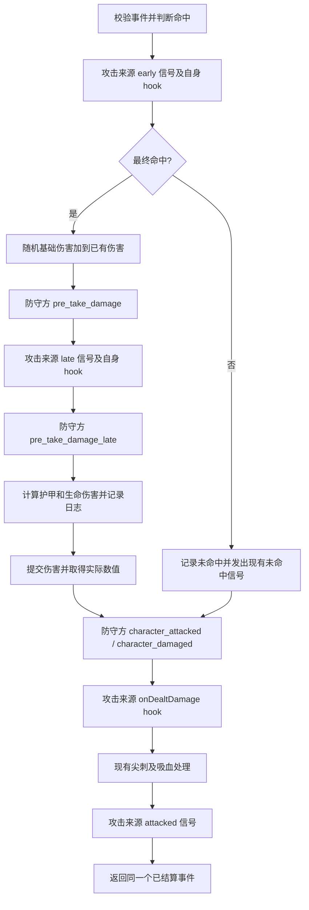

# 攻击阶段的运行与接线修复

## 1. Requirements（需求）

本轮完成用户草稿的运行入口和连接，使现有物品实际进入新攻击流程。

1. 所有新增攻击阶段都能创建 `AttackReactionContext`，并通过现有总线传递同一个 `AttackEvent`。
2. 现有 `AttackEffect.apply` 调用的 `resolve_attack` 执行新流程；删除没有调用者的 `resolve_attack_new` 草稿。
3. 实际武器类拥有三个自身 hook；效果伤害和没有 hook 的来源也能正常结算。
4. 命中与未命中均有日志、确定的返回结果及 `is_resolved`；消除未定义变量。
5. 现有盾牌减伤监听和减伤 Effect 连接到 `pre_take_damage`；Broom 的现有未命中连接继续工作。
6. 验证攻击阶段顺序、发射者、上下文共享、未命中修正及现有物品运行。

本轮范围是运行与接线。减伤累计公式、盾牌两阶段效果拆分、Broom 具体效果迁移、伤害 flags/暴击/抗性、动态伤害范围刷新、死亡和尖刺完整一致性另行实现。现有死亡退出规则可能使致命攻击在事后信号前退出，不能用本轮测试宣称已经复现完整原版。

## 2. Design（设计）

### 2.1 入口与数据模型

- 保留公开接口 `BattleState.resolve_attack(event) -> AttackEvent`，现有调用者无须另选入口。
- 继续使用 `AttackEvent` 与 `AttackReactionContext`，监听者通过 `for_item` 切换视角，共享事件对象。
- 用常量声明新增阶段：`pre_deal_damage_early`、`pre_take_damage`、`pre_deal_damage_late`、`pre_take_damage_late`、`character_attacked`、`character_damaged`、`attacked`。
- `ATTACK_PHASE_ON_ATTACKED` 及其调用处改为语义准确的 `ATTACK_PHASE_PRE_TAKE_DAMAGE`。不重复广播旧的 `on_attacked`。
- 保留现有派生信号 `on_attack_missed`，用于现有 `AttackMissTrigger`；本轮不迁移它的监听语义。
- 引擎用伤害类型中的 melee/ranged 判断武器攻击阶段，按原版在来源支持对应方法时调用自身 hook。通过普通 `getattr` 检查方法，无须运行时导入物品模块。
- Broom、WoodenSword、Shortbow、Stone、Pan 改为继承用户已有的 `Weapon`。这只为它们补齐默认 hook。

### 2.2 流程



图中的事后阶段遵守当前提交函数的死亡退出行为。普通非致命命中和未命中都走完整事后阶段。

原版依据：`Backpack Battles/Core/Character.gd:530-653`、`Backpack Battles/Items/Item.gd:4115-4124`。早期处理可以改变命中；基础伤害叠加早期增加的伤害；只有 melee/ranged 进入来源攻击阶段，效果伤害仍可发出防守方的伤害信号。

### 2.3 具体函数接口与伪代码

#### BattleState.build_attack_reaction_context(self, item: BattleItem, attack_phase: str, attack_event: AttackEvent) -> AttackReactionContext

```text
校验阶段属于扩展后的支持列表，事件非空
用 item 建立其所属双方视角
返回含指定阶段和原事件引用的 AttackReactionContext
```

函数体保留，更新支持列表即可。

#### BattleState.resolve_attack(self, event: AttackEvent) -> AttackEvent

```text
校验事件未结算，双方不同且属于当前战斗
final_damage = 0
根据当前规则进行命中随机判断
若类型含 melee/ranged：
    由 source_item 发出 pre_deal_damage_early
    来源有 onPreDealDamage_early 时直接调用
若 early 后最终命中：
    抽取基础伤害，pending_damage += rolled_damage
    由 defender 发出 pre_take_damage
    若为攻击：由 source_item 发出 pre_deal_damage_late，再调用其可用 late hook
    由 defender 发出 pre_take_damage_late
    校验事件仍可提交、仍命中、伤害非负
    计算护甲及生命伤害，设置 is_resolved
    创建攻击日志，得到 log_handle
    调用现有 commit_health_reduction，写入实际结果并计算 final_damage
否则：
    创建未命中攻击日志
    由 attacker 发出 on_attack_missed
    校验监听者未提前结算事件或修改本次最终未命中结果
    设置 is_resolved
由 defender 依次发出 character_attacked 和 character_damaged
若为攻击且来源有 onDealtDamage：以 source_item 的视角调用
调用现有 _apply_melee_hit_statuses(event, final_damage)
若为攻击：由 source_item 发出 attacked
返回 event
```

`onDealtDamage` 使用 source_item 的 `character_attacked` 上下文，避免沿用最后的 `character_damaged` 阶段。`is_resolved` 表示伤害已结算，事后监听者不可再次提交该事件。

#### BattleState.resolve_attack_new(self, event: AttackEvent) -> AttackEvent

删除。其阶段顺序移入上述唯一运行入口。

#### OnAttackedTrigger.update(self, context: BattleContext) -> bool

```text
拒绝非 AttackReactionContext 或非 pre_take_damage 阶段
校验命中和伤害类型匹配
沿用现有一次概率判断与日志，返回 bool
```

#### OnAttackedTrigger.connect_bus(self, context: BattleContext) -> None

```text
将 (self.item, self.idx) 连接到 context.owner 的 pre_take_damage
```

上述两个函数体保持现有逻辑，通过类的阶段常量迁移连接。

#### PreventAttackDamageEffect.apply(self, context: BattleContext) -> bool

```text
校验为 pre_take_damage 上下文，事件未结算且当前伤害非负
沿用现有减伤数值与日志计算
返回本次是否实际减少伤害
```

本轮只更改阶段约束及错误说明。

#### AttackEffect.apply(self, context: BattleContext, attack_type: str) -> bool

```text
沿用当前伤害范围、命中参数和事件构造
调用接入新阶段的 resolve_attack
返回事件是否命中
```

此函数接口和函数体保持现状。

#### Weapon 的接口

```python
def __init__(self, item_id: str | None = None, item_key: str | None = None,
             player_id: int | None = None, is_active_item: bool = True,
             triggers: list = [], effects: list = []): ...
def onPreDealDamage_early(self, context: BattleContext) -> None: ...
def onPreDealDamage_late(self, context: BattleContext) -> None: ...
def onDealtDamage(self, context: BattleContext) -> None: ...
```

```text
构造函数将现有参数交给 BattleItem
三个默认 hook 无操作，由具体武器按需覆盖
```

本轮不改 Weapon 实现；五个具体武器仅更改继承关系，其构造与 run_effect 接口、参数和既有伪代码流程保持现状。

### 2.4 新增验证代码的接口及伪代码

验证代码放入 `tests/test_attack_resolution_v1.py`，沿用现有造战斗、造事件及固定 RNG 辅助函数。

- `RecordingStageTrigger.__init__(self, emitter, attack_phase)`：保存实际发射者对象与阶段，初始化现有记录辅助基类。
- `RecordingStageTrigger.connect_bus(self, context)`：连接到保存的实际发射者。
- `RecordingStageTrigger.update(self, context) -> bool`：记录匹配阶段上下文，返回是否匹配。
- `RecordingWeapon.__init__(self, observed, early_action=None, **kwargs)`：用现有静态 Trigger/Effect 创建武器，保存共享轨迹列表及可选 early 操作。
- `RecordingWeapon.onPreDealDamage_early(self, context) -> None`：记录 early hook；按测试配置修正命中或增加伤害。
- `RecordingWeapon.onPreDealDamage_late(self, context) -> None`：记录 late hook。
- `RecordingWeapon.onDealtDamage(self, context) -> None`：记录自身事后 hook。
- `AttackResolutionV1Test.make_stage_battle(self, *, hit_roll=0.0, accuracy=100, attacker_health=20, early_action=None, attack_types=("melee",))`：按给定初始生命创建记录武器、双方状态、固定 RNG 及各阶段监听者；统一 prepare 一次，返回战斗、事件和轨迹。轨迹冻结当时双方生命及结算状态，同时保留上下文引用。
- `test_attack_stages_use_correct_emitters_order_and_shared_event(self)`：由准备连接进入实际攻击，验证阶段顺序、各方视角、共享事件及扣血前后数值。
- `test_miss_completes_post_signals_without_damage_roll(self)`：验证 miss 跳过命中阶段、仍发出事后信号并正确标记已结算。
- `test_early_hook_can_turn_miss_into_hit_and_preserves_added_damage(self)`：验证初始 miss 可被修正，早期增加的伤害没有被随机基础伤害覆盖。
- `test_effect_damage_skips_weapon_hooks_and_source_signals(self)`：验证效果来源即使带有同名 hook，也不会进入武器攻击阶段；防守方阶段仍执行。
- `test_registered_weapons_inherit_default_hooks(self)`：验证五个具体武器继承 Weapon，准备后通过真实 AttackEffect 入口完成攻击，默认 hook 不阻断结算。

测试实现可根据已有辅助类复用程度收窄；新增辅助函数时同步补充本节接口与伪代码。

## 3. Tasks（任务拆解）

1. T1：保存本 SPEC，核对现有调用和原版阶段。已完成。
2. T2：补齐阶段常量，将新流程放入 resolve_attack，修复日志与分支结束状态。依赖 T1。已完成。
3. T3：迁移旧减伤监听及 Effect 阶段，接入具体武器继承。依赖 T2。已完成。
4. T4：迁移现有测试的阶段引用，增加真实入口的阶段验证。依赖 T3。已完成。
5. T5：运行相关测试及全套现有测试，检查导入和 diff。依赖 T4。已完成。

## 4. Acceptance Criteria / Tests（验收标准）

- 实际 AttackEffect 和具体物品的攻击进入同一个新流程，无未定义变量和不支持阶段错误。
- 普通命中、未命中、零伤害、嵌套攻击均正常完成，日志准确且事件不可重复结算。
- 现有盾牌监听仍有效；不重复广播原来的 on_attacked。
- 非致命攻击的来源与防守方信号、三个自身 hook 顺序正确，共享事件且视角正确。
- 初始未命中允许 early 修正，早期伤害可与基础伤害叠加。
- 效果伤害不无条件调用 Weapon hook。
- 所有原有测试及必要新增验证通过。
- 不将本轮完成解释为伤害公式或死亡时机已完全对齐原版。

### 验证结果（2026-10-05）

- 使用用户指定的 Python 3.11：原有 495 个测试和新增 5 个阶段验证全部通过，共 500 个。
- 六个模块分别作为首个入口，在独立进程中导入其余模块，全部成功。
- `git diff --check` 通过；生产代码和测试中无旧阶段常量、旧 on_attacked 信号或 resolve_attack_new 引用。
- 已验证来源与防守方阶段顺序、监听视角、事件共享、扣血前后状态、尖刺/吸血后的来源通知、miss 的日志与事后通知、early 修正命中、效果伤害跳过武器阶段及现有武器实际攻击。
