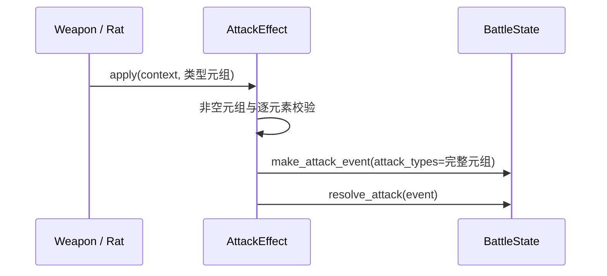

# 攻击类型元组接口修复 SPEC

日期：2026-11-08。状态：实现完成，验收通过。用户已授权修复，武器保留元组攻击类型。

## 1. Requirements（需求）

统一 AttackEffect 的攻击类型输入为非空 `tuple[str, ...]`，支持单类型和多类型；修复目前 tuple 被整体校验拒绝、字符串被当成字符序列传入事件构造器的问题。不添加字符串兼容入口，不将 Weapon.attack_types 回退成字符串。

保持攻击类型顺序、原有 flags 优先级、类型伤害加成和效果执行顺序；扫帚、老鼠及测试调用同步使用元组。无需修改伤害结算架构。

## 2. Design（设计）

原版 `Items/Item.gd`、`Utility/DamageSource.gd:setItem` 支持多个伤害类型；现有 `make_attack_event` 已能接收类型元组，按 melee → ranged → self_damage → 首类型确定基础 flags，随后保留完整类型序列。本批只修正上游接口。

| 修改函数接口 | 伪代码 |
| --- | --- |
| `AttackEffect.apply(self, context: BattleContext, attack_type: tuple[str, ...]) -> bool` | 若不是 tuple、为空、或任何元素不在 SUPPORTED_ATTACK_TYPES 中，抛 ValueError；校验先于状态修改；然后保留既有伤害修饰、准确率逻辑；把完整元组传给 make_attack_event；调用 resolve_attack，返回是否命中 |
| `Broom.run_effect(self, trigger_results: list[bool], context: BattleContext) -> None` | 保留未命中加伤、体力、攻击、激活及清理顺序；攻击调用从字符串改为 self.attack_types，沿用 Weapon 的元组声明 |
| `Rat.run_effect(self, trigger_results: list[bool], context: BattleContext) -> None` | 仅将攻击参数改为 ("effect",)；保留伤害、两次概率与激活顺序 |

`Weapon.__init__`、`Weapon.run_effect`、`make_attack_event` 的实现不变。AttackEffect 参数名继续使用 attack_type，避免无关的关键字参数改名。

## 3. Tasks（任务拆解）

1. [x] 修正 AttackEffect 类型注解及校验，迁移扫帚和老鼠调用。
2. [x] 将现有攻击测试中的字符串参数改成单元素元组；变量型单类型参数包装成元组（依赖1）。
3. [x] 新增 `tests/test_attack_type_tuple_v1.py`，覆盖非法输入、混合类型、武器与老鼠真实攻击（依赖1）。
4. [x] 同步石头旧测试中的 Effect 下标：体力0、攻击1、破甲2；日志断言纳入当前公共 Weapon 流程的零点体力支出记录。仅调整已过时断言，不改生产行为。运行专项与全套测试并回填结果（依赖2、3）。

## 4. Acceptance Criteria / Tests（验收标准）

- 所有受支持类型均可通过单元素元组传入；空元组、字符串、list、未知类型及混合非法元素被拒绝，且不改变 Effect 准备状态、不调用结算器。
- 多类型元组顺序完整保留，flags 优先级沿用现有实现；类型加成按现有管线累加，不只取首类型。
- 木剑、短弓、平底锅、扫帚、石头及老鼠能进入原有攻击流程；武器类型字段始终保留 tuple。
- 体力消耗、未命中仍激活、扫帚临时加伤清理、老鼠概率顺序不因接口修复变化。
- 相关旧测试迁移到新接口；完整测试集通过。字符串不作为合法兼容输入保留。

验收记录：2026-11-08，新增5个元组接口测试（含全部受支持类型、非法输入、多类型真实伤害与 flags 优先级、扫帚及老鼠调用），全套581个 unittest 通过。`git diff --check` 通过。未进行 Godot 运行时对照。
