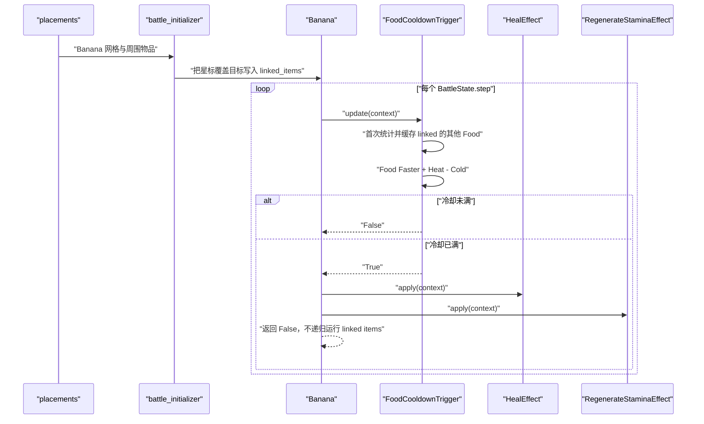

# Banana item factory SPEC

状态：已实现并验证（2026-07-23）。

查询日期：2026-07-23。

## 1. Requirements（需求）

### 1.1 功能目标

在现有 `BattleItem`、背包 marker link、冷却 trigger 和默认物品工厂框架中实现 Banana（香蕉），使其可以通过默认目录和默认工厂从战斗 JSON 中实例化并参与逐帧战斗。

Banana 必须：

- 作为 `is_active_item=True` 的主动物品进入 `BattleState.active_items`。
- 使用 5 秒基础冷却，战斗开始时冷却进度为 0，不立即激活。
- 每次激活时治疗拥有者 4 点生命值，但不得超过拥有者的最大生命值。
- 每次激活时恢复拥有者 1 点耐力，但不得超过 `max_stamina`。
- 即使治疗没有产生实际变化，也仍尝试恢复耐力；反之亦然。
- 每个由 Banana 星标连接、物品类型包含 `Food`、且 `item_id` 不等于 `banana` 的物品实例，使该 Banana 触发快 10%。
- 两个同种的非 Banana 食物只要是两个不同实例并分别占用星标，就各提供 10% 加速。
- 另一件 Banana 不提供 Food 加速。
- 未被 Banana 星标连接的食物不提供加速。
- 星标连接的非 Food 物品不提供加速。
- 同一物品实例即使覆盖多个星标，也只计算一次；现有 `BattleItem.add_linked_item()` 的去重契约负责保证这一点。
- Food 连接在战斗中不会变化；`FoodCooldownTrigger` 第一次运行时统计一次符合条件的 Food 数量，之后复用缓存，不再扫描连接。
- Food 加速必须与 Heat/Cold 按现有冷却公式相加并互相抵消。
- Banana 的星标关系只用于计算 Food 加速；Banana 激活时不得递归激活星标连接的物品。
- 每个 Banana 实例拥有独立的冷却 trigger 和 effect 实例。

### 1.2 Wiki 事实快照

#### 1.2.1 来源

本 SPEC 只使用项目允许的 `backpackbattles.wiki.gg` 及其 MediaWiki/Cargo API：

- [Banana](https://backpackbattles.wiki.gg/wiki/Banana?oldid=10720)：修订 `10720`，修订时间 `2025-09-17T19:44:51Z`。
- [Food](https://backpackbattles.wiki.gg/wiki/Food?oldid=8089)：修订 `8089`，修订时间 `2024-03-20T09:25:43Z`。
- [Cooldown](https://backpackbattles.wiki.gg/wiki/Cooldown?oldid=12142)：修订 `12142`，修订时间 `2026-05-09T06:49:02Z`。
- [Heal](https://backpackbattles.wiki.gg/wiki/Heal?oldid=8408)：修订 `8408`，修订时间 `2024-03-28T10:19:22Z`。
- [Cargo `Items` 查询](https://backpackbattles.wiki.gg/api.php?action=cargoquery&format=json&tables=Items&fields=name%2Cclass%2Crarity%2Ccost%2Citemtype%2Cicontype%2Ctags%2Ceffect&where=name%3D%22Banana%22)：
  `tables=Items&fields=name,class,rarity,cost,itemtype,icontype,tags,effect&where=name="Banana"`。

Cargo 在查询日返回：

```text
name=Banana
class=""
rarity=Common
cost=3
itemtype=Food
icontype=nature
tags=Heal
effect=Every 5s: Heal for 4 and regenerate 1 stamina.
```

Banana 页面模板中的原始网格为：

```text
-2--
212-
2112
-22-
```

其中 `1` 是 Banana 占格，`2` 是星标格。它对应仓库现有的三格 L 形和七个星标。

Food 页面补充了 Cargo 单行没有表达的通用 Food 规则：

- 每个星标连接的不同 Food 物品使当前 Food 快 10%。
- 相同 `item_id` 的 Food 不互相加速。
- 多个同种的其他 Food 实例可以分别提供加速。
- 同一物品实例不能因为覆盖多个星标而重复计数。

Cooldown 页面规定所有 Faster/Slower 来源相加后再互相抵消。当前仓库已经使用与该页面一致的分段公式；本 SPEC 只把 Food 加速接入现有计算。

Heal 页面将 Heal 与“增加最大生命值”区分开。为防止普通治疗永久提高生命上限，Banana 使用显式 `max_health` 截断治疗。Wiki 当前还定义了治疗增幅/削减，但仓库尚无该状态；见“范围外”。

#### 1.2.2 标准化元数据

| 字段 | 建模值 | 依据 |
| --- | --- | --- |
| `item_id` | `"banana"` | 仓库命名约定 |
| `display_name` | `"Banana"` | Wiki/Cargo |
| `item_classes` | `("Neutral",)` | Cargo `class` 为空，按项目知识库归一化 |
| `rarity` | `"Common"` | Cargo |
| `cost` | `3` | Cargo |
| `item_types` | `("Food",)` | Cargo |
| `icon_types` | `("nature",)` | Cargo |
| `is_active_item` | `True` | 每 5 秒周期激活 |
| `socket_count` | `0` | 页面未列出 Sockets；按现有物品建模约定推断为 0 |
| 基础冷却 | `5.0` 秒 | Wiki/Cargo |
| 治疗 | `4` | Wiki/Cargo |
| 耐力恢复 | `1.0` | Wiki/Cargo |

Cargo 的 `tags=Heal` 暂不加入 `BattleItem` 公共字段，因为当前公共元数据没有 `tags`，且 Banana 运行逻辑不依赖该字段。

### 1.3 用户故事

- 作为战斗 JSON 使用者，我可以在 `placements` 中放置 `banana`，默认初始化流程会创建真实 `Banana` 实例。
- 作为摆盘模型使用者，我可以通过 Banana 周围的星标位置摆放其他 Food，使 Banana 的实际触发速度发生可重复计算的变化。
- 作为战斗模拟调用者，我可以观察 Banana 在受伤和缺少耐力时周期性恢复两种资源，且不会超过对应上限。
- 作为后续 Food 实现者，我可以复用同一个 `FoodCooldownTrigger`，无需在每种 Food 中复制星标计数和 Heat/Cold 合并公式。
- 作为后续治疗物品实现者，我可以复用 `HealEffect`，无需直接修改 `PlayerState.health`。

### 1.4 验收场景

1. 一个没有相邻 Food 的 Banana 在累计 5 秒后第一次激活。
2. 一个星标连接 Garlic 的 Banana 每秒累计 1.1 秒冷却进度。
3. 一个星标连接两个 Garlic 实例的 Banana 每秒累计 1.2 秒冷却进度。
4. 一个星标连接另一件 Banana 和一个非 Food 的 Banana 每秒仍只累计 1.0 秒冷却进度。
5. 一个星标连接 Garlic 且拥有 5 层 Cold 的 Banana，10% Food Faster 与 10% Cold Slower 抵消，每秒累计 1.0 秒进度。
6. 拥有者 `health=5, max_health=10, stamina=2, max_stamina=5` 时，Banana 激活后变为 `health=9, stamina=3`。
7. 拥有者 `health=9, max_health=10, stamina=4.5, max_stamina=5` 时，Banana 激活后变为 `health=10, stamina=5`。
8. 生命已满但耐力未满时仍恢复耐力；耐力已满但生命未满时仍治疗。
9. Banana 激活时不调用星标连接物品的 `run_effects()`。
10. 第一次运行完成后，即使测试代码修改连接列表，Banana 仍使用首次保存的 Food 数量；Heat/Cold 变化仍实时生效。

### 1.5 范围外

- 不实现商店、合成、配方或局外成长。
- 不实现 Spicy Banana 对“Banana activates”或“stamina used”的监听。
- 不新增物品激活事件、事件总线或 combat log。
- 不实现治疗增幅、治疗削减、吸血或 overheal 事件。
- 不实现战斗中动态移动物品、动态增删物品或 marker link 重建。
- 不修改 `data/item_catalog_v1.json` 中现有 Banana 网格，除非实现时回归测试证明它与上述 Wiki 网格不一致。
- 不修改 `AGENTS.md`。
- 不借 Banana 顺带重构所有 marker link 类型。
- Cooldown 页面当前记录的 Faster/Slower 1000% 上限不在本物品 SPEC 中修正；它会改变现有所有冷却物品的语义，应另立通用冷却 SPEC。

## 2. Design（设计）

### 2.1 当前仓库状态与缺口

查询本地仓库后，当前状态为：

- `data/item_catalog_v1.json` 已有 Banana 的三格 L 形和七个 `star_cells`。
- `basic_backpack_v1.py` 已能旋转该形状、发现星标覆盖并生成 marker links。
- `battle_initializer_v1.py` 已把 marker links 转为 `BattleItem.linked_items`，并按 `is_active_item` 构建逐帧物品列表。
- `CooldownTrigger` 已实现基础冷却、Heat/Cold 抵消和溢出进度保留。
- `PlayerState` 已有 `health`、`stamina` 和 `max_stamina`，但没有 `max_health`。
- 当前没有可复用的治疗 effect、耐力恢复 effect 或 Food 冷却 trigger。
- `DEFAULT_ITEM_FACTORIES` 当前只有 `wooden_sword` 和 `wooden_buckler`。
- 修改前全仓库基线为 162 项测试通过。

因此最小实现只需要：

1. 为标准战斗输入和 `PlayerState` 补充显式最大生命值。
2. 给 `CooldownTrigger` 增加一个默认返回 0 的额外 Faster 扩展点。
3. 实现可复用 `FoodCooldownTrigger`。
4. 实现可复用 `HealEffect` 和 `RegenerateStaminaEffect`。
5. 用上述三个组件组装 `Banana`。
6. 注册 Banana 并补充针对现有目录数据的回归测试。

### 2.2 文件变更边界

| 文件 | 计划变更 |
| --- | --- |
| `battle_module_v1.py` | `PlayerState` 新增 `max_health` 字段，不做隐式推导 |
| `battle_initializer_v1.py` | 要求 `player_specs.max_health` 并显式传给 `PlayerState` |
| `main_v1.py` | `battle_run_v1` 要求、校验、转发并序列化 `max_health` |
| `item_factory_registry_v1.py` | 扩展 `CooldownTrigger`；新增 `FoodCooldownTrigger`、`HealEffect`、`RegenerateStaminaEffect`、`Banana`；注册工厂 |
| `tests/test_battle_module_v1.py` | 最大生命值显式字段测试 |
| `tests/test_battle_initializer_v1.py` | 最大生命值必填和转发测试 |
| `tests/test_main_v1.py` | 输入校验、normalize 和结果序列化测试 |
| `tests/test_item_factory_registry_v1.py` | 新组件、Food 加速、Banana 工厂和运行逻辑测试 |
| `tests/test_basic_backpack_v1.py` | Banana Wiki 网格回归测试 |
| `data/minimal_wooden_battle_v1.json` | 为双方补充显式 `max_health` |
| `README.md` | 在输入/输出示例和必填字段中记录 `max_health` |
| `data/item_catalog_v1.json` | 预期不修改 |

### 2.3 `PlayerState.max_health`

新增：

```python
max_health: int = 0
```

设计理由：

- `health` 与 `max_health` 是两个不同状态，不能从当前生命值隐式推导最大生命值。
- 与 `stamina` / `max_stamina` 一致，标准战斗输入必须同时显式提供当前值和上限。
- `PlayerState` 保留与其他数值字段相同的 `0` 数据类默认值，便于低层对象构造；生产初始化路径不得依赖该默认值。
- 测试或未来最大生命值机制可以显式构造 `PlayerState(health=6, max_health=10)`。
- 不修改 `PlayerState.__setattr__()` 的“禁止直接减血、允许加血”保护；具体治疗上限由 `HealEffect` 负责。

`max_health` 是逐玩家的标量，不得使用类级共享状态。

`battle_run_v1` 每个玩家新增必填字段：

```json
{
  "health": 25,
  "max_health": 25,
  "stamina": 5.0,
  "max_stamina": 5.0
}
```

输入校验：

- `health` 和 `max_health` 都必须是正整数，`bool` 不合法。
- `health` 不得大于 `max_health`。
- 本 SPEC 不强制 `health == max_health`，允许用同一标准输入构造受伤状态的确定性治疗测试。
- `normalize_player_specs()` 必须保留 `max_health`。
- `initialize_battle()` 必须通过 `_required_field()` 读取 `max_health` 并传给 `PlayerState`。
- `_serialize_player()` 必须输出 `max_health`，使结果可以解释最终 `health`。

### 2.4 通用冷却扩展点

`CooldownTrigger` 增加：

```python
def get_additional_faster(self, context: BattleContext) -> float:
    return 0.0
```

`CooldownTrigger.update()` 把当前 Heat Faster、Cold Slower 与该扩展点合并：

```python
faster = context.owner.buffs.Heat * 0.02
faster += self.get_additional_faster(context)
slower = context.owner.debuffs.Cold * 0.02
net_faster = faster - slower
```

之后沿用现有分段推进公式：

```python
if net_faster >= 0:
    multiplier = 1.0 + net_faster
else:
    multiplier = 1.0 / (1.0 + -net_faster)
```

这个扩展点是什么、为什么需要、如何使用：

- 是什么：`CooldownTrigger` 上一个只返回额外 Faster 比例的小型可覆写方法。
- 为什么：Food 数量需要从首次运行时的 `context.item.linked_items` 和 `context.owner.items` 取得，构造 Banana 时还没有完整玩家上下文；直接复制整个 `update()` 会让 Food 与普通冷却公式漂移。
- 如何：普通 `CooldownTrigger` 继续得到 0；`FoodCooldownTrigger` 首次调用覆写方法时统计并缓存 Food 数量，后续返回缓存对应的加速，基础冷却进度仍完全由父类维护。

不引入 callback registry、速度来源对象列表或新的抽象层。

### 2.5 `FoodCooldownTrigger`

新增：

```python
class FoodCooldownTrigger(CooldownTrigger):
    def __init__(self, cooldown_seconds: float):
        ...

    def get_additional_faster(
        self,
        context: BattleContext,
    ) -> float:
        ...
```

Food 加速基于 `context.item.linked_items`，而不是扫描整个 `context.owner.items`：

- `linked_items` 来自 Banana 星标实际覆盖的物品。
- 全背包中没有接触 Banana 的 Food 不应提供加速。
- 初始化器已经使用 `add_linked_item()` 去重，因此多格物品不会被重复计数。
- 初始化器会在 Banana 进入 `BattleState.active_items` 前完成全部 marker link 装配，因此第一次逐帧运行时可以安全固定该计数。

实例状态：

```python
self.qualifying_food_count: int | None = None
```

- `None` 表示尚未在完整战斗上下文中统计。
- 第一次 `get_additional_faster()` 调用时扫描连接并保存整数计数。
- 后续调用只读取该整数，不再遍历 `linked_items` 或 `owner.items`。
- 每个 Food trigger 实例独立缓存，不能使用类属性共享。

过滤规则：

```python
linked_item = context.owner.items[linked_key]
is_food = "Food" in linked_item.item_types
is_same_food_type = linked_item.item_id == context.item.item_id
qualifies = is_food and not is_same_food_type
```

每个符合条件的实例贡献 `0.10`。这里的“不同 type”按 Wiki 示例解释为与来源 Food 的 `item_id` 不同，不是要求所有相邻 Food 彼此不同：两个 Garlic 实例都能加速 Banana。

### 2.6 `HealEffect`

新增：

```python
class HealEffect(Effect):
    def __init__(self, amount: int):
        ...

    def apply(self, context: BattleContext) -> bool:
        ...
```

语义：

- `amount` 必须是非负整数。
- 实际治疗量为：

```python
min(amount, context.owner.max_health - context.owner.health)
```

- 生命已满时不改变状态并返回 `False`。
- 实际增加至少 1 点生命时返回 `True`。
- 不修改 `max_health`。
- 不处理治疗增幅/削减；这需要玩家级治疗修正状态和独立 SPEC。
- 不通过 `commit_health_reduction()`；该入口只允许扣血，治疗是现有 `PlayerState.__setattr__()` 明确允许的生命增加。

### 2.7 `RegenerateStaminaEffect`

新增：

```python
class RegenerateStaminaEffect(Effect):
    def __init__(self, amount: float):
        ...

    def apply(self, context: BattleContext) -> bool:
        ...
```

语义：

- `amount` 必须是非负数，且 `bool` 不视为合法数值。
- 新耐力为：

```python
min(
    context.owner.max_stamina,
    context.owner.stamina + amount,
)
```

- 耐力已满时不改变状态并返回 `False`。
- 实际恢复大于 0 时返回 `True`。
- 不修改 `max_stamina`。
- 它与 `BattleState.regenerate_stamina()` 的每秒自然恢复是两条独立路径。

### 2.8 `Banana` 组件组合

在 `item_factory_registry_v1.py` 中新增：

```python
class Banana(BattleItem):
    item_id = "banana"
    display_name = "Banana"
    item_classes = ("Neutral",)
    rarity = "Common"
    cost = 3
    item_types = ("Food",)
    icon_types = ("nature",)
    is_active_item = True
    socket_count = 0
```

每个实例在构造函数中创建独立组件：

```python
triggers = [
    FoodCooldownTrigger(cooldown_seconds=5.0),
]
effects = [
    HealEffect(amount=4),
    RegenerateStaminaEffect(amount=1.0),
]
```

effect 顺序与 Wiki 文案一致：先治疗，再恢复耐力。两个 effect 不互相短路。

### 2.9 Banana 的 linked item 决策

当前 `BattleItem.run_own_effect()` 的布尔返回值表示“是否调用 `run_linked_items()`”，不是通用的“本物品是否激活”事件。

Banana 的星标连接是冷却修饰关系，不是“Banana 激活时触发相邻物品”。因此：

```python
def run_own_effect(self, trigger_results, context):
    if not trigger_results[0]:
        return False

    self.effects[0].apply(context)
    self.effects[1].apply(context)
    return False
```

即使 Banana 已成功执行治疗/耐力效果，仍返回 `False`，明确禁止 `BattleItem.run_effects()` 递归调用星标连接物品。

这不会妨碍相邻 Food 自己作为 `active_item` 在 `BattleState.step()` 中推进冷却。未来 Spicy Banana 需要的是独立的“物品激活事件”，不能把 `run_linked_items()` 错当成该事件。

### 2.10 数据流与关键流程



## 3. Realize（逐函数实现）

### 3.1 显式 `max_health` 数据链

#### 3.1.1 `PlayerState.max_health`

位置：`battle_module_v1.py`。

字段：

```python
max_health: int = 0
```

不新增 `__post_init__()`，不执行 `max_health = health` 或任何其他隐式推导。

#### 3.1.2 `_validate_run_config`

位置：`main_v1.py`。

现有接口不变：

```python
def _validate_run_config(run_config):
```

新增伪代码：

```text
每个 player 的必填字段列表加入 "max_health"
校验 health 是正整数
校验 max_health 是正整数
若 health > max_health：
    抛出 ValueError
```

复用现有 `_validate_positive_int()`，不得把 `bool` 当作整数。

#### 3.1.3 `normalize_player_specs`

位置：`main_v1.py`。

现有接口不变：

```python
def normalize_player_specs(run_config):
```

玩家转换结果新增：

```python
player_spec = {
    "player_id": player["player_id"],
    "health": player["health"],
    "max_health": player["max_health"],
    "stamina": player["stamina"],
    "max_stamina": player["max_stamina"],
    "placements": player["placements"],
}
```

不得从 `health` 生成或覆盖 `max_health`。

#### 3.1.4 `initialize_battle`

位置：`battle_initializer_v1.py`。

现有接口不变：

```python
def initialize_battle(
    player_specs,
    item_factories,
    item_catalog=ITEM_CATALOG,
) -> BattleState:
```

逐玩家新增伪代码：

```text
max_health = _required_field(player_spec, "max_health")

创建 PlayerState 时同时传入：
    health=health
    max_health=max_health
```

初始化器只要求字段存在并转发；数值合法性由标准入口 `_validate_run_config()` 负责，低层直接调用的测试自行提供合法值。

#### 3.1.5 `_serialize_player`

位置：`main_v1.py`。

现有接口不变：

```python
def _serialize_player(player, metadata):
```

输出中在 `health` 附近新增：

```python
"max_health": player.max_health,
```

不得用最终 `health` 重新计算该值。

### 3.2 `CooldownTrigger.get_additional_faster`

位置：`item_factory_registry_v1.py`。

接口：

```python
def get_additional_faster(
    self,
    context: BattleContext,
) -> float:
```

伪代码：

```text
返回 0.0
```

普通木剑继续使用这个默认实现，行为不变。

### 3.3 `CooldownTrigger.update`

现有接口不变：

```python
def update(self, context: BattleContext) -> bool:
```

新伪代码：

```text
faster = owner.Heat * 0.02
faster += get_additional_faster(context)
slower = owner.Cold * 0.02
net = faster - slower

若 net >= 0：
    multiplier = 1 + net
否则：
    multiplier = 1 / (1 + abs(net))

cooldown_progress += frame_delta * multiplier

若 cooldown_progress < cooldown_seconds：
    返回 False

cooldown_progress -= cooldown_seconds
返回 True
```

必须保留：

- 每帧重新读取 Heat 和 Cold。
- Food 加速通过 `get_additional_faster()` 取得；该方法在首次统计后返回缓存值。
- 冷却完成后只减去一轮基础冷却，保留溢出进度。
- 不检查、不消耗耐力。

### 3.4 `FoodCooldownTrigger`

位置：`item_factory_registry_v1.py`。

#### 3.4.1 `FoodCooldownTrigger.__init__`

接口：

```python
def __init__(self, cooldown_seconds: float):
```

伪代码：

```text
调用 CooldownTrigger.__init__(cooldown_seconds)
self.qualifying_food_count = None
```

`qualifying_food_count` 必须是实例字段。两个 Banana 的缓存不得互相影响。

#### 3.4.2 `FoodCooldownTrigger.get_additional_faster`

接口：

```python
def get_additional_faster(
    self,
    context: BattleContext,
) -> float:
```

伪代码：

```text
若 self.qualifying_food_count is None：
    qualifying_food_count = 0

    对 context.item.linked_items 中的每个 linked_key：
        linked_item = context.owner.items[linked_key]
        若 "Food" 不在 linked_item.item_types：
            continue
        若 linked_item.item_id == context.item.item_id：
            continue
        qualifying_food_count += 1

    self.qualifying_food_count = qualifying_food_count

返回 self.qualifying_food_count * 0.10
```

不得：

- 扫描未连接的 owner items。
- 按 `item_id` 对其他 Food 再去重。
- 修改 `linked_items`。
- 修改任何玩家或物品状态。
- 第一次统计完成后再次扫描连接。

### 3.5 `HealEffect.__init__`

位置：`item_factory_registry_v1.py`。

接口：

```python
def __init__(self, amount: int):
```

伪代码：

```text
若 type(amount) is not int 或 amount < 0：
    抛出 ValueError
self.amount = amount
```

### 3.6 `HealEffect.apply`

接口：

```python
def apply(self, context: BattleContext) -> bool:
```

伪代码：

```text
old_health = context.owner.health
new_health = min(
    context.owner.max_health,
    old_health + self.amount,
)
context.owner.health = new_health
返回 new_health > old_health
```

若已有非法状态 `health > max_health`，该 effect 不负责修复；测试和初始化应维持合法输入。

### 3.7 `RegenerateStaminaEffect.__init__`

位置：`item_factory_registry_v1.py`。

接口：

```python
def __init__(self, amount: float):
```

伪代码：

```text
若 amount 是 bool、不是 int/float 或 amount < 0：
    抛出 ValueError
self.amount = float(amount)
```

### 3.8 `RegenerateStaminaEffect.apply`

接口：

```python
def apply(self, context: BattleContext) -> bool:
```

伪代码：

```text
old_stamina = context.owner.stamina
new_stamina = min(
    context.owner.max_stamina,
    old_stamina + self.amount,
)
context.owner.stamina = new_stamina
返回 new_stamina > old_stamina
```

### 3.9 `Banana.__init__`

位置：`item_factory_registry_v1.py`。

接口：

```python
def __init__(
    self,
    item_id: str | None = None,
    item_key: str | None = None,
    player_id: int | None = None,
):
```

伪代码：

```text
调用 BattleItem.__init__：
    转发 item_id、item_key、player_id
    明确 is_active_item=True
    新建 FoodCooldownTrigger(5.0)
    新建 HealEffect(4)
    新建 RegenerateStaminaEffect(1.0)
```

不得把 trigger/effect 放在类属性中共享。

### 3.10 `Banana.run_own_effect`

接口：

```python
def run_own_effect(
    self,
    trigger_results: list[bool],
    context: BattleContext,
) -> bool:
```

伪代码：

```text
若 trigger_results[0] 为 False：
    返回 False

调用 HealEffect，不根据返回值短路
调用 RegenerateStaminaEffect，不根据返回值短路
返回 False
```

最终 `False` 只表示“不递归运行 linked items”。

### 3.11 `DEFAULT_ITEM_FACTORIES`

保留现有注册并新增：

```python
DEFAULT_ITEM_FACTORIES = {
    "banana": Banana,
    "wooden_buckler": WoodenBuckler,
    "wooden_sword": WoodenSword,
}
```

字典具体排列顺序不参与战斗顺序；不得删除或覆盖现有工厂。

### 3.12 Banana 目录回归

`data/item_catalog_v1.json` 当前预期保持：

```json
"banana": {
  "item_id": "banana",
  "shape_cells": [[0, 1], [0, 0], [1, 0]],
  "star_cells": [
    [0, 2],
    [-1, 1],
    [1, 1],
    [-1, 0],
    [2, 0],
    [0, -1],
    [1, -1]
  ]
}
```

实现任务只增加测试固定该事实，不进行无意义重排。

## 4. Tasks（任务拆解）

1. T1：审阅并批准本 Banana SPEC。
2. T2：在 `PlayerState` 增加无隐式推导的 `max_health` 字段；依赖 T1。
3. T3：让 `battle_run_v1` 校验、normalize、initializer 和结果序列化显式传递 `max_health`，并更新现有 JSON/README/测试输入；依赖 T2。
4. T4：给 `CooldownTrigger` 增加额外 Faster 扩展点，确认全部现有冷却测试不变；依赖 T1。
5. T5：实现并测试 `FoodCooldownTrigger` 的首次统计缓存、星标过滤、重复实例计数和 Heat/Cold 合并；依赖 T4。
6. T6：实现并测试 `HealEffect`；依赖 T2-T3。
7. T7：实现并测试 `RegenerateStaminaEffect`；依赖 T1。
8. T8：实现 `Banana` 类和 `run_own_effect()`；依赖 T5-T7。
9. T9：把 `banana` 注册进 `DEFAULT_ITEM_FACTORIES`；依赖 T8。
10. T10：增加 Banana 目录网格、初始化、组件独立性和“不递归触发 linked items”测试；依赖 T8-T9。
11. T11：运行 Banana 定向测试与全量测试，确认修改前 162 项测试经显式字段适配后和所有新增测试全部通过；依赖 T2-T10。
12. T12：实现完成后仅把实际通过状态和必要设计决议回填本 SPEC；不更新与 Banana 无关的文档；依赖 T11。

## 5. Acceptance Criteria / Tests（验收标准）

### 5.1 `tests/test_battle_module_v1.py`

1. `test_player_state_stores_explicit_max_health`
   - `PlayerState(health=6, max_health=10)` 保持两个显式值不变。

2. `test_player_state_does_not_infer_max_health_from_health`
   - `PlayerState(health=10)` 的 `max_health` 保持字段默认值 0，而不是隐式变成 10。
   - 该测试只验证低层数据对象无隐式推导；标准战斗输入仍禁止缺少 `max_health`。

3. `test_player_states_own_independent_max_health_values`
   - 修改一个玩家的 `max_health` 不影响另一个玩家。

4. 调整现有 `test_player_state_allows_direct_health_increase`
   - 显式使用足够大的 `max_health`。
   - 继续证明 `__setattr__()` 没有把合法生命增加当成扣血拦截。

### 5.2 `tests/test_battle_initializer_v1.py` 与 `tests/test_main_v1.py`

5. `test_initializer_requires_max_health`
   - 任一 `player_spec` 缺少 `max_health` 时抛出 `ValueError`。

6. `test_initializer_passes_explicit_max_health_to_player_state`
   - 输入 `health=6, max_health=10`。
   - 断言初始化后的两个字段仍分别为 6 和 10。

7. `test_missing_max_health_player_field_fails`
   - `battle_run_v1` 任一玩家缺少 `max_health` 时校验失败。

8. `test_health_and_max_health_must_be_positive_ints`
   - 0、负数、浮点数、布尔值和字符串均失败。

9. `test_health_cannot_exceed_max_health`
   - `health=11, max_health=10` 时校验失败。

10. `test_normalize_player_specs_keeps_explicit_max_health`
    - normalize 后仍包含输入的 `max_health`，没有从 `health` 重建。

11. `test_run_battle_serializes_max_health`
    - 成功结果中每个玩家都包含最终 `max_health`。

12. 更新所有既有标准输入夹具：
    - `tests/test_main_v1.py`、`tests/test_battle_initializer_v1.py`、`tests/test_item_factory_registry_v1.py` 中通过标准初始化路径的 player specs。
    - `data/minimal_wooden_battle_v1.json`。
    - `README.md` 输入和输出示例。

### 5.3 `tests/test_basic_backpack_v1.py`

13. `test_banana_catalog_matches_wiki_grid`
   - 断言三个 `shape_cells` 与七个 `star_cells`。
   - 断言 0 度放置后的 occupied/marker 坐标与 Wiki `grid` 一致。
   - 断言没有 diamond/triangle 标记。

14. `test_banana_star_link_counts_multicell_target_once`
   - 让一个多格目标覆盖 Banana 的多个星标。
   - 经 initializer/link attachment 后，Banana 的 `linked_items` 只包含一个目标 key。

### 5.4 `CooldownTrigger` 与 `FoodCooldownTrigger`

15. 保留全部现有 `CooldownTrigger` 测试原样通过，证明默认 `get_additional_faster()` 没有改变木剑冷却。

16. `test_food_cooldown_trigger_counts_each_linked_other_food_instance`
   - 连接两个 Garlic 实例。
   - `frame_delta=1.0` 时进度增加 `1.2`，不是 `1.1`。

17. `test_food_cooldown_trigger_ignores_linked_same_food`
   - 连接另一件 Banana。
   - 进度只增加 `1.0`。

18. `test_food_cooldown_trigger_ignores_linked_non_food`
    - 连接 Wooden Sword。
    - 进度只增加 `1.0`。

19. `test_food_cooldown_trigger_ignores_unlinked_food`
    - 玩家拥有 Garlic，但 Banana 没有链接它。
    - 进度只增加 `1.0`。

20. `test_food_cooldown_trigger_counts_one_linked_instance_once`
    - 对同一 key 调用两次 `add_linked_item()`。
    - link 列表只有一个 key，进度增加 `1.1`。

21. `test_food_cooldown_trigger_combines_food_faster_and_cold_additively`
    - 一个有效 Food 提供 10% Faster，5 Cold 提供 10% Slower。
    - 两者抵消后 `frame_delta=1.0` 只增加 `1.0`。

22. `test_food_cooldown_trigger_caches_link_count_after_first_update`
    - 第一次更新时统计有效 linked Food，并保存 `qualifying_food_count`。
    - 第一次更新后改变测试对象的 `linked_items` 或 `owner.items`。
    - 第二次更新仍使用第一次的计数，且 Food 加速不变。
    - Heat/Cold 在第二次更新前改变时仍立即影响该帧，证明只缓存 Food 数量，不缓存总速度。

### 5.5 `HealEffect`

23. `test_heal_effect_increases_health_by_amount`
    - `health=5, max_health=10, amount=4` 后为 9，返回 `True`。

24. `test_heal_effect_caps_health_at_max_health`
    - `health=9, max_health=10, amount=4` 后为 10，返回 `True`。

25. `test_heal_effect_returns_false_at_full_health`
    - `health=max_health=10` 时状态不变，返回 `False`。

26. `test_heal_effect_rejects_negative_or_non_integer_amount`
    - 负数、浮点数、布尔值和字符串均抛出 `ValueError`。

### 5.6 `RegenerateStaminaEffect`

27. `test_regenerate_stamina_effect_increases_stamina_by_amount`
    - `stamina=2, max_stamina=5, amount=1` 后为 3，返回 `True`。

28. `test_regenerate_stamina_effect_caps_at_max_stamina`
    - `stamina=4.5, max_stamina=5, amount=1` 后为 5，返回 `True`。

29. `test_regenerate_stamina_effect_returns_false_at_full_stamina`
    - 满耐力时状态不变，返回 `False`。

30. `test_regenerate_stamina_effect_rejects_invalid_amount`
    - 负数、布尔值和字符串抛出 `ValueError`。

### 5.7 Banana 工厂与运行逻辑

31. `test_banana_is_registered_with_metadata_and_components`
    - 默认 registry 可以创建 Banana。
    - 断言 identity、标准化元数据、`is_active_item=True`、`socket_count=0`。
    - 断言一个 `FoodCooldownTrigger`、一个 `HealEffect`、一个 `RegenerateStaminaEffect`，参数分别为 5.0、4、1.0。
    - 断言 trigger 初始 `qualifying_food_count is None`。

32. `test_bananas_own_independent_component_instances`
    - 两件 Banana 的 trigger/effect 不是同一对象。
    - 修改第一件的 `cooldown_progress` 或 `qualifying_food_count` 不影响第二件。

33. `test_initializer_builds_banana_as_active_item_with_star_links`
    - 使用默认目录和默认 registry 初始化。
    - Banana 出现在拥有者 `items` 和 `BattleState.active_items`。
    - 星标覆盖的物品 key 出现在 Banana `linked_items`。

34. `test_banana_does_not_activate_before_cooldown`
    - 冷却不足时不改变 health/stamina。

35. `test_banana_heals_and_regenerates_stamina_after_cooldown`
    - 冷却恰好完成时治疗 4 并恢复 1 耐力。

36. `test_banana_runs_stamina_effect_when_heal_has_no_effect`
    - 满生命、缺耐力时仍恢复耐力。

37. `test_banana_runs_heal_effect_when_stamina_has_no_effect`
    - 缺生命、满耐力时仍治疗。

38. `test_banana_caps_both_resources`
    - 同一次激活中 health 和 stamina 分别截断到各自上限。

39. `test_banana_does_not_run_star_linked_items`
    - Banana 冷却完成且 linked item 带有记录调用的 trigger/effect。
    - 断言 Banana 两个自身 effect 已执行。
    - 断言 linked item 的 `run_effects()` 未被调用。
    - 断言 Banana `run_effects()` 返回 `False`，并注明这是 linked-item 决策。

40. `test_battle_step_applies_natural_stamina_regen_before_banana`
    - 预设 Banana 即将在本帧完成冷却。
    - 断言本帧先执行 `BattleState.regenerate_stamina()`，再执行 Banana 的 1 点恢复，并共同受 `max_stamina` 截断。

### 5.8 回归与完成标准

- 修改前已有的 162 项测试全部继续通过。
- 上述新增测试全部通过。
- `battle_run_v1` 的每个玩家必须显式提供 `health` 和 `max_health`，不得由一个字段推导另一个。
- 初始化器、战斗状态和结果序列化必须原样传递 `max_health`。
- `data/item_catalog_v1.json` 的 Banana 数据保持不变。
- Wooden Sword 的基础冷却、Heat/Cold 和攻击行为保持不变。
- Wooden Buckler 的被攻击响应行为保持不变。
- Banana 的星标只影响自己的冷却速度，不递归激活周围物品。
- Banana 第一次运行后固定使用当时统计的有效 Food 数量，不在后续帧重新扫描连接。
- 治疗和耐力恢复互不短路，且都不超过上限。
- 不引入第三方依赖、事件总线、callback registry 或新的目录层级。

## 6. 已确认决策

本次实现采用以下三个已确认决定：

1. 为正确限制治疗，`PlayerState` 新增独立 `max_health` 字段；`battle_run_v1` 把它作为玩家必填字段，标准初始化链显式转发，禁止从 `health` 隐式设置。
2. 为复用现有冷却公式，只给 `CooldownTrigger` 增加一个默认返回 0 的 `get_additional_faster()` 覆写点；`FoodCooldownTrigger` 首次运行时把 `qualifying_food_count` 缓存在实例中，后续只复用计数，不引入更复杂的速度来源架构。
3. Banana 激活后 `run_own_effect()` 返回 `False`，因为当前布尔契约控制的是 linked item 递归，而 Food 星标是加速关系；Spicy Banana 所需的激活事件另行设计。

## 7. 实施结果

- 已按本 SPEC 完成 `max_health` 显式输入链、Food 冷却缓存、治疗/耐力恢复效果和 Banana 工厂。
- 已同步最小战斗示例与 README；`data/item_catalog_v1.json` 未修改。
- 完整测试集共 194 项，全部通过。
