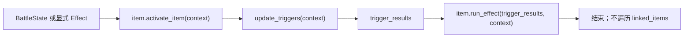

# BattleItem activation interface refactor SPEC

状态：已实施并通过验收。

编写日期：2026-07-24。

仓库基线：现有 271 项测试全部通过。

## 1. Requirements（需求）

### 1.1 功能目标

重构 `BattleItem` 的通用激活接口，使框架只负责：

1. 更新当前物品的 triggers。
2. 把完整 trigger 结果交给当前物品自己的效果调度。

框架不再根据具体物品的返回值自动激活 `linked_items`。

接口变更：

| 旧接口 | 新接口 | 处理 |
| --- | --- | --- |
| `BattleItem.run_effects(context)` | `BattleItem.activate_item(context)` | 重命名并移除 bool 返回语义 |
| `BattleItem.run_own_effect(trigger_results, context)` | `BattleItem.run_effect(trigger_results, context)` | 重命名并改为 `None` 返回 |
| `BattleItem.run_linked_items(context)` | 无 | 从基类删除 |

重构后必须满足：

- `activate_item(context)` 始终先调用 `update_triggers(context)`。
- 即使全部 trigger 都返回 `False`，仍调用一次 `run_effect(trigger_results, context)`，保留 NOT/OR 等物品级组合能力。
- `activate_item()` 不读取、验证或转发 `run_effect()` 的返回值。
- `activate_item()` 的公共返回类型为 `None`。
- `run_effect()` 的公共返回类型为 `None`；具体物品使用 bare `return` 进行提前结束。
- `run_linked_items()` 从 `BattleItem` 中彻底删除，不保留兼容别名。
- `run_effects()` 和 `run_own_effect()` 也不保留兼容别名；所有 Python 调用点一次性迁移。
- `BattleState.step()` 使用 `active_item.activate_item(context)`。
- `BattleState.dispatch_attack_reactions()` 使用 `item.activate_item(context)`。
- `linked_items` 列表与 `add_linked_item()` 保留，因为连接关系仍用于 Food 冷却、Pan 增伤及后续个性化空间效果。
- `BattleContext.for_item()` 和 `AttackReactionContext.for_item()` 保留，供未来显式激活连接物品的 effect 构造正确 context。
- `Effect.apply(context) -> bool` 契约不变；effect 返回值仍可由当前物品的 `run_effect()` 用于耐力失败短路、命中/未命中分支等内部业务逻辑。
- 当前 Wooden Buckler、Broom、Wooden Sword、Banana、Garlic、Pan 的战斗数值和 RNG 顺序保持不变。

### 1.2 设计动机

当前实现把 `run_effect()` 的物品级业务结果复用为“是否递归激活所有 linked items”：

```python
will_run_linked_items = self.run_own_effect(
    trigger_results,
    context,
)
if will_run_linked_items:
    self.run_linked_items(context)
```

随着 Banana、Garlic、Pan、Broom 等物品落地，连接关系已经表现出多种不同语义：

- Food：连接的不同 Food 修改冷却速度。
- Pan：连接的 Food 修改 Pan 的攻击伤害。
- Broom：没有连接激活语义。
- Wooden Buckler：攻击响应效果与连接关系无关。

“物品命中/成功”不等于“把所有连接物品完整激活一次”。继续保留通用递归会让具体物品为了避免错误传播而普遍返回 `False`，返回值因此不再表达物品自身的有用结果。

新的职责划分为：

```text
BattleItem.activate_item
    只负责统一调度当前物品

BattleItem.run_effect
    只负责当前物品的 trigger/effect 组合

Effect.apply
    负责一个可复用的基础效果

未来显式 linked activation effect
    负责某件物品特有的连接目标、条件、次数与 context
```

### 1.3 用户故事

- 作为物品实现者，我只需要在 `run_effect()` 中表达当前物品的业务流程，不需要返回一个与业务结果无关的 linked-item 布尔值。
- 作为框架维护者，我可以从方法名区分“激活一件物品的完整入口”与“运行该物品自己的效果逻辑”。
- 作为空间效果实现者，我仍可以读取 `linked_items`，但连接关系不会自动产生激活行为。
- 作为未来特殊物品实现者，我可以在一个专用 `Effect` 中显式选择连接目标并调用其 `activate_item()`，而不是依赖基类的无条件递归。
- 作为测试维护者，我不再需要验证 `run_effect()` 返回值类型或通用递归传播，只验证当前物品状态变化与显式 effect 行为。

### 1.4 范围外

- 本轮不实现生产级 `ActivateLinkedItemsEffect`，因为当前已实现物品没有这种需求。
- 不删除 `linked_items`、`add_linked_item()` 或初始化器的 marker link 构建。
- 不改变 trigger bool 契约。
- 不改变 `Effect.apply()` 的 bool 契约。
- 不改变 cooldown、stamina、attack、buff/debuff 或攻击响应机制。
- 不增加事件总线、callback 注册表、递归深度限制或 visited 集合。
- 不为旧方法提供 deprecation wrapper 或兼容转发。
- 不逐篇重写历史设计文档；本 SPEC 明确取代其中关于旧激活接口和通用 linked-item 递归的描述。

## 2. Design（设计）

### 2.1 新的两层物品接口

`BattleItem` 的激活流程改为：

```python
def activate_item(self, context: BattleContext) -> None:
    trigger_results = self.update_triggers(context)
    self.run_effect(trigger_results, context)

def run_effect(
    self,
    trigger_results: list[bool],
    context: BattleContext,
) -> None:
    raise NotImplementedError(
        "concrete items must run their effect logic"
    )
```

流程图：



接口含义：

- `activate_item()`：框架或其他 effect 激活一件物品时调用的唯一公共入口。
- `run_effect()`：具体 `BattleItem` 子类解释 trigger 结果并编排自身 effects 的内部覆写点。
- `Effect.apply()`：一个基础 effect 的可复用执行入口。

`run_effect()` 名称虽然为单数，但表示“运行当前物品定义的整体 effect 逻辑”，其中仍可按顺序调用多个 `self.effects`。

### 2.2 返回值契约

`activate_item()` 和 `run_effect()` 都不再提供框架级业务返回值。

新实现：

```python
def activate_item(self, context):
    trigger_results = self.update_triggers(context)
    self.run_effect(trigger_results, context)
```

不得：

```python
return self.run_effect(trigger_results, context)
```

也不得：

```python
result = self.run_effect(trigger_results, context)
if type(result) is not bool:
    ...
```

原因：

- `run_effect()` 的命中、治疗成功、概率成功或耐力支付结果不存在统一含义。
- 具体物品如 Broom 仍需要使用 `MeleeAttackEffect.apply()` 的 bool 来决定是否清空临时伤害和进行致盲检定；这是物品内部逻辑，不应泄露到 `activate_item()`。
- 不再验证 bool，才能真正移除旧的 linked-item 决策契约。

具体物品的提前结束使用：

```python
if not trigger_results[0]:
    return
```

函数自然返回 `None`。

### 2.3 删除通用 linked-item 激活

从 `BattleItem` 删除：

```python
def run_linked_items(self, context):
    for linked_key in self.linked_items:
        linked_item = context.owner.items[linked_key]
        linked_context = context.for_item(linked_item)
        linked_item.run_effects(linked_context)
```

`activate_item()` 不读取 `self.linked_items`。

保留：

```python
self.linked_items: list[str]

def add_linked_item(self, linked_key: str) -> None:
    ...
```

保留连接数据的原因：

- `FoodCooldownTrigger.prepare_speed_modifiers()` 读取 `context.item.linked_items`。
- `FoodLinkedMeleeAttackEffect.prepare_damage_modifier()` 读取 `context.item.linked_items`。
- 初始化器仍需要把星标/菱形/三角形空间关系映射到物品实例。
- 后续个性化效果仍需要这份拓扑数据。

### 2.4 未来 effect 层显式激活

本轮不新增生产类，但未来需要“激活连接物品”的具体物品时，可以实现专用 effect：

```python
class ActivateSelectedLinkedItemsEffect(Effect):
    def apply(self, context: BattleContext) -> bool:
        activated_any = False
        for linked_key in self.select_targets(context):
            linked_item = context.owner.items[linked_key]
            linked_context = context.for_item(linked_item)
            linked_item.activate_item(linked_context)
            activated_any = True
        return activated_any
```

该 effect 必须由具体需求决定：

- 哪些 marker 或物品类型可被选择；
- 一次激活全部、一个还是固定数量；
- 是否允许重复目标；
- 是否基于命中、概率、资源或其他状态触发；
- 环状连接如何限制递归。

不在 `BattleItem` 基类预设这些规则。

测试层会提供一个最小的测试专用 effect，证明显式 effect 仍可通过 `context.for_item()` 调用 linked item 的完整 `activate_item()` 管线；该测试辅助类不进入生产代码。

### 2.5 `BattleState` 两个入口迁移

#### 2.5.1 逐帧主动激活

旧：

```python
for active_item in list(self.active_items):
    context = self.build_context(active_item)
    active_item.run_effects(context)
```

新：

```python
for active_item in list(self.active_items):
    context = self.build_context(active_item)
    active_item.activate_item(context)
```

`BattleState.step()` 仍：

- 不按 trigger 结果做粗筛；
- 只直接遍历 `active_items`；
- 保持物品顺序与战斗结束短路不变。

#### 2.5.2 攻击响应激活

旧：

```python
for item in self._get_attack_reaction_items(responder, phase):
    context = self.build_attack_reaction_context(item, phase, event)
    item.run_effects(context)
```

新：

```python
for item in self._get_attack_reaction_items(responder, phase):
    context = self.build_attack_reaction_context(item, phase, event)
    item.activate_item(context)
```

响应物品之间继续互不依赖返回值；第一件物品提前结束自己的 `run_effect()` 不影响下一件响应物品。

### 2.6 六个生产物品的迁移

所有生产物品只进行接口与 bare-return 迁移，不改变 component 组合。

#### 2.6.1 `WoodenBuckler.run_effect`

```python
def run_effect(self, trigger_results, context) -> None:
    if not trigger_results[0]:
        return
    self.effects[0].apply(context)
    self.effects[1].apply(context)
```

成功触发后不再返回 `True`；不会隐式激活人工添加的 linked item。

#### 2.6.2 `Broom.run_effect`

```python
def run_effect(self, trigger_results, context) -> None:
    if trigger_results[1]:
        self.miss_damage_bonus += 2
        self.effects[1].stack_damage_modifier(2)
        return
    if not trigger_results[0]:
        return
    if not self.effects[0].apply(context):
        return
    if not self.effects[1].apply(context):
        return

    if self.miss_damage_bonus > 0:
        self.effects[1].stack_damage_modifier(
            -self.miss_damage_bonus
        )
        self.miss_damage_bonus = 0
    if context.battle_state.rng.random() < 0.33:
        self.effects[2].apply(context)
```

命中 bool 仍由 Broom 内部使用，外部看不到。

#### 2.6.3 `WoodenSword.run_effect`

```python
def run_effect(self, trigger_results, context) -> None:
    if not trigger_results[0]:
        return
    if not self.effects[0].apply(context):
        return
    self.effects[1].apply(context)
```

不再把攻击命中 bool 返回给框架。

#### 2.6.4 `Banana.run_effect`

```python
def run_effect(self, trigger_results, context) -> None:
    if not trigger_results[0]:
        return
    self.effects[0].apply(context)
    self.effects[1].apply(context)
```

连接 Food 只继续影响 cooldown。

#### 2.6.5 `Garlic.run_effect`

```python
def run_effect(self, trigger_results, context) -> None:
    if not trigger_results[0]:
        return
    self.effects[0].apply(context)
    if context.battle_state.rng.random() < 0.30:
        self.effects[1].apply(context)
```

30% 概率与 RNG 顺序不变。

#### 2.6.6 `Pan.run_effect`

```python
def run_effect(self, trigger_results, context) -> None:
    if not trigger_results[0]:
        return
    if not self.effects[0].apply(context):
        return
    self.effects[1].apply(context)
```

连接 Food 只继续影响攻击 damage modifier。

### 2.7 测试辅助物品迁移

以下测试辅助子类必须同步覆写 `run_effect()`：

| 文件 | 测试辅助类 | 迁移 |
| --- | --- | --- |
| `tests/test_battle_module_v1.py` | `RecordingItem` | 删除 `will_run_linked_items`，记录 `run_effect_calls` |
| `tests/test_battle_module_v1.py` | `DecisionItem` | `run_effect()` 调用测试 callback，但不转发 callback 返回值 |
| `tests/test_attack_resolution_v1.py` | `ConfigurableItem` | 删除 `will_run_linked_items`，改为无返回的 `run_effect()` |
| `tests/test_main_v1.py` | `DamageItem` | 命中 trigger 后调用伤害 effect，无返回 |
| `tests/test_battle_initializer_v1.py` | `TestBattleItem` | 空 `run_effect()`，无返回 |

测试命名中的：

- `run_effects` 改为 `activate_item`；
- `run_own_effect` 改为 `run_effect`；
- `will_run_linked_items` / `link_decision` 改为当前业务含义或删除。

### 2.8 不提供兼容别名

迁移后应满足：

```python
hasattr(BattleItem, "activate_item") is True
hasattr(BattleItem, "run_effect") is True
hasattr(BattleItem, "run_effects") is False
hasattr(BattleItem, "run_own_effect") is False
hasattr(BattleItem, "run_linked_items") is False
```

不保留旧方法的原因：

- 当前仓库调用点数量有限，可以一次性迁移。
- 兼容别名会延长两个术语体系并存的时间。
- `run_effects()` 若继续转发，会让外部代码误以为 bool/linked 语义仍存在。
- 删除后，遗漏调用点会立即以明确的 `AttributeError` 暴露。

### 2.9 文档关系

实施时更新 `docs/backpack_battles_knowledge_base.md` 中当前的 trigger/effect 组合决定：

- `run_effects` 改为 `activate_item`。
- `run_own_effect` 改为 `run_effect`。
- 删除通用 linked-item 返回值与递归描述。
- 加入“显式 linked activation 由专用 effect 实现”。

下列文档记录了旧架构形成时的历史设计，本轮不逐篇改写正文：

- `docs/trigger_effect_result_chaining_spec.md`
- `docs/battle_module_v1_design.md`
- `docs/battle_initializer_v1_design.md`
- 各已实现物品的旧 SPEC

从本 SPEC 实施完成起，以上文档中与激活接口冲突的段落均由本 SPEC 取代；代码继续作为最终事实来源。

## 3. Realize（逐函数实现）

### 3.1 `BattleItem.activate_item`

文件：`battle_module_v1.py`

接口：

```python
def activate_item(
    self,
    context: BattleContext,
) -> None:
```

伪代码：

```text
trigger_results = self.update_triggers(context)
self.run_effect(trigger_results, context)
隐式返回 None
```

验收点：

- triggers 只更新一次。
- trigger 顺序保持不变。
- 全 False 仍调用 `run_effect()`。
- 不读取 `linked_items`。
- 不验证 `run_effect()` 返回类型。
- 不返回 `run_effect()` 的值。

### 3.2 `BattleItem.run_effect`

文件：`battle_module_v1.py`

接口：

```python
def run_effect(
    self,
    trigger_results: list[bool],
    context: BattleContext,
) -> None:
```

基类伪代码：

```text
抛出 NotImplementedError(
    "concrete items must run their effect logic"
)
```

六个生产子类和五个测试辅助子类必须覆写新名称。

### 3.3 删除旧方法

文件：`battle_module_v1.py`

完全删除：

```python
run_effects
run_own_effect
run_linked_items
```

不得留下：

- wrapper；
- alias assignment；
- deprecation warning；
- 旧错误消息；
- `will_run_linked_items` 局部变量。

### 3.4 `BattleState.step`

文件：`battle_module_v1.py`

接口不变：

```python
def step(self):
```

唯一接口迁移：

```text
active_item.run_effects(context)
变为
active_item.activate_item(context)
```

其他 frame、stamina、fatigue 和 battle-end 逻辑不变。

### 3.5 `BattleState.dispatch_attack_reactions`

文件：`battle_module_v1.py`

接口不变：

```python
def dispatch_attack_reactions(
    self,
    phase: str,
    responder: PlayerState,
    event: AttackEvent,
) -> None:
```

循环中的唯一接口迁移：

```text
item.run_effects(context)
变为
item.activate_item(context)
```

不读取激活结果，继续遍历全部响应物品。

### 3.6 `WoodenBuckler.run_effect`

文件：`item_factory_registry_v1.py`

接口：

```python
def run_effect(
    self,
    trigger_results: list[bool],
    context: BattleContext,
) -> None:
```

伪代码见 2.6.1。所有 `return False/True` 改为 bare `return` 或自然结束。

### 3.7 `Broom.run_effect`

文件：`item_factory_registry_v1.py`

接口同 3.6。

伪代码见 2.6.2。保留：

- attack miss 响应分支；
- stamina 短路；
- melee hit bool 内部判断；
- miss bonus 生命周期；
- 33% Blind RNG。

只移除对外 bool 返回。

### 3.8 `WoodenSword.run_effect`

文件：`item_factory_registry_v1.py`

接口同 3.6。

伪代码见 2.6.3。最后调用 melee effect 后自然结束。

### 3.9 `Banana.run_effect`

文件：`item_factory_registry_v1.py`

接口同 3.6。

伪代码见 2.6.4。Heal 和 stamina effect 返回值仍不用于互相短路。

### 3.10 `Garlic.run_effect`

文件：`item_factory_registry_v1.py`

接口同 3.6。

伪代码见 2.6.5。概率只在 cooldown trigger 成功后读取。

### 3.11 `Pan.run_effect`

文件：`item_factory_registry_v1.py`

接口同 3.6。

伪代码见 2.6.6。攻击命中结果不再被返回。

### 3.12 测试辅助接口

#### `RecordingItem.run_effect`

```python
def run_effect(self, trigger_results, context) -> None:
    self.run_effect_calls += 1
    self.received_trigger_results.append(list(trigger_results))
    if not trigger_results[0]:
        return
    self.effects[0].apply(context)
```

删除 `will_run_linked_items`。

#### `DecisionItem.run_effect`

```python
def run_effect(self, trigger_results, context) -> None:
    self.log.append("run")
    self.received_trigger_results.append(list(trigger_results))
    self.decision(self, trigger_results, context)
```

callback 可以用 effect bool 决定后续调用，但其 Python 返回值不由 `DecisionItem` 转发。

#### `ConfigurableItem.run_effect`

```python
def run_effect(self, trigger_results, context) -> None:
    self.run_calls += 1
    self.contexts.append(context)
    if self.decision is not None:
        self.decision(self, trigger_results, context)
        return
    if not any(trigger_results):
        return
    for effect in self.effects:
        effect.apply(context)
```

删除 `will_run_linked_items`。

#### `DamageItem.run_effect`

```python
def run_effect(self, trigger_results, context) -> None:
    if not trigger_results[0]:
        return
    self.effects[0].apply(context)
```

#### `TestBattleItem.run_effect`

```python
def run_effect(self, trigger_results, context) -> None:
    return
```

### 3.13 测试专用显式 linked activation effect

文件：`tests/test_battle_module_v1.py`

只在测试中新增：

```python
class ActivateLinkedItemEffect(Effect):
    def __init__(self, linked_key):
        self.linked_key = linked_key

    def apply(self, context):
        linked_item = context.owner.items[self.linked_key]
        linked_item.activate_item(
            context.for_item(linked_item)
        )
        return True
```

用途仅为证明 effect 层可以显式激活指定连接物品；不加入生产 registry。

### 3.14 本地知识库更新

文件：`docs/backpack_battles_knowledge_base.md`

把“项目中的触发器/效果组合决定”更新为：

```text
BattleItem.activate_item(context)
    -> update_triggers(context)
    -> run_effect(trigger_results, context)

run_effect 无框架级返回值
linked_items 不自动激活
显式连接激活由具体 Effect 实现
```

游戏事实部分不改。

## 4. Tasks（任务拆解）

1. T1：确认本 SPEC 的新接口、无兼容别名与无返回值契约。
2. T2：在 `BattleItem` 中实现 `activate_item()` 和抽象 `run_effect()`；依赖 T1。
3. T3：删除 `run_effects()`、`run_own_effect()`、`run_linked_items()`；依赖 T2。
4. T4：把 `BattleState.step()` 和 `dispatch_attack_reactions()` 改为调用 `activate_item()`；依赖 T2。
5. T5：迁移 Wooden Buckler、Broom、Wooden Sword、Banana、Garlic、Pan；依赖 T2-T3。
6. T6：迁移五个测试辅助 `BattleItem` 子类；依赖 T2-T3。
7. T7：重写 `tests/test_battle_module_v1.py` 的新接口契约测试；依赖 T6。
8. T8：迁移攻击响应测试，删除通用 linked 传播假设；依赖 T4、T6。
9. T9：机械迁移 item registry、initializer、main 测试中的调用名和返回断言；依赖 T5-T6。
10. T10：更新本地知识库的当前组合决定；依赖 T2-T5。
11. T11：用 `rg` 确认所有 `*.py` 中不存在旧方法名或 `will_run_linked_items`；依赖 T7-T9。
12. T12：运行相关测试、271 项完整回归、`git diff --check` 和标准 battle JSON 冒烟；依赖 T10-T11。
13. T13：把实测结果回写本 SPEC；依赖 T12。

## 5. Acceptance Criteria / Tests（验收标准）

本重构以替换和重命名现有测试为主：

- 删除 1 项只对通用递归成立的测试。
- 新增 1 项新接口存在性测试。
- 其余旧契约测试一对一重命名或改写。
- 无其他测试变化时，完整测试集仍应为 271 项。

### 5.1 `BattleItem` 新接口

文件：`tests/test_battle_module_v1.py`

1. 新增 `test_battle_item_exposes_new_activation_interface_only`
   - `BattleItem` 有 `activate_item` 和 `run_effect`。
   - 不存在 `run_effects`、`run_own_effect`、`run_linked_items`。

2. 重命名为 `test_activate_item_updates_triggers_before_run_effect`
   - 日志顺序为全部 trigger update 后一次 `run_effect`。
   - `run_effect` 收到完整结果列表。

3. 重命名为 `test_activate_item_calls_run_effect_when_all_triggers_are_false`
   - 两个 trigger 均为 False。
   - `run_effect` 仍调用一次并收到 `[False, False]`。
   - `activate_item()` 返回 `None`。

4. 保留并适配 `test_not_trigger_item_can_apply_effect_when_trigger_is_false`
   - NOT 条件仍由物品 callback 判断。
   - effect 调用一次。
   - 不再断言物品级 bool。

5. 用 `test_activate_item_returns_none_without_interpreting_run_effect_return` 替换旧的非 bool link-decision 校验：
   - 测试 callback 故意返回 `True`、`False`、`1` 和 `None`。
   - `DecisionItem.run_effect()` 不转发 callback 值。
   - `activate_item()` 每次都返回 `None`，且不抛出返回类型错误。

6. 保留并适配 `test_item_can_stop_own_effect_sequence_after_effect_failure`
   - 重命名为 `test_run_effect_can_stop_effect_sequence_after_failure`。
   - 第一个 effect False 后，第二个不调用。
   - 不再断言物品级返回值。

7. 保留并适配 `test_item_can_continue_own_effect_sequence_after_effect_failure`
   - 重命名为 `test_run_effect_can_continue_effect_sequence_after_failure`。
   - 两个 effect 都调用。
   - 不再断言物品级返回值。

8. `test_effect_apply_receives_only_context`
   - 调用入口改为 `activate_item()`。
   - effect 仍只收到 marker context。

### 5.2 linked data 与显式 effect 激活

文件：`tests/test_battle_module_v1.py`

9. `test_add_linked_item_stores_keys_once_in_first_seen_order`
   - 原测试不变，证明连接数据仍保留。

10. 用 `test_effect_can_explicitly_activate_linked_item` 改写旧递归测试：
    - source 的测试专用 effect 显式选择 `linked1`。
    - effect 调用 `linked.activate_item(context.for_item(linked))`。
    - linked item 完整执行 trigger update 和 `run_effect`。
    - 没有调用任何基类 `run_linked_items`。

11. 删除 `test_linked_item_with_false_trigger_still_runs_own_logic`
    - 该测试只对旧通用递归成立。

12. 把 `test_run_own_effect_false_skips_linked_items` 改为 `test_activate_item_does_not_implicitly_activate_linked_items`
    - source 保存 `linked1` key。
    - source 正常运行自身 effect。
    - linked item 的 trigger 和 `run_effect` 均不调用。
    - 不依赖 source 返回 False。

### 5.3 `BattleState.step`

文件：`tests/test_battle_module_v1.py`

13. `test_battle_state_step_updates_only_active_items_directly`
    - 日志仍只包含 active item 的 trigger 和 effect。
    - helper 记录字段改为 `run_effect_calls`。

14. 重命名为 `test_battle_state_step_calls_run_effect_for_all_false_triggers`
    - active item trigger False。
    - `run_effect` 仍调用一次。

15. 把 `test_false_link_decision_does_not_stop_other_active_items` 重命名为 `test_first_active_item_early_return_does_not_stop_other_active_items`
    - 第一件物品在自身 `run_effect` 中提前结束。
    - 第二件 active item 仍正常激活。

16. `test_lethal_health_reduction_stops_remaining_active_items`
    - 测试辅助类迁移后继续通过。
    - 战斗结束短路行为不变。

### 5.4 攻击响应

文件：`tests/test_attack_resolution_v1.py`

17. 把 `test_dispatch_ignores_item_link_decision_for_next_responder` 重命名为 `test_dispatch_continues_to_next_responder_after_first_run_effect`
    - 第一件响应物品运行后，第二件仍运行。
    - 不再配置 link decision。

18. 把 `test_attack_response_linked_item_receives_same_event` 改为 `test_attack_response_does_not_implicitly_activate_linked_item`
    - 响应物品保存一个人工 linked key。
    - 攻击响应只激活响应物品自身。
    - linked item 不收到 `AttackReactionContext`。

19. 把 `test_wooden_buckler_runs_linked_item_when_chance_succeeds` 改为 `test_wooden_buckler_does_not_implicitly_activate_linked_item`
    - 木盾概率成功、防伤与减耐力均正常。
    - 人工 linked item 不激活。

20. `test_wooden_buckler_does_nothing_when_chance_fails`
    - 删除 `will_run_linked_items` 相关配置。
    - 保留伤害、耐力和 RNG 断言。

21. 所有 on-attacked、on-attack-missed、嵌套攻击和响应缓存测试继续通过。

### 5.5 生产物品回归

文件：`tests/test_item_factory_registry_v1.py`

以下直接调用全部由 `.run_effects(context)` 机械迁移为 `.activate_item(context)`：

- Wooden Sword：
  - `test_wooden_sword_does_not_attack_at_battle_start`
  - `test_wooden_sword_pays_stamina_and_attacks_after_cooldown`
  - `test_wooden_sword_pays_stamina_but_returns_false_on_miss` 重命名为 `test_wooden_sword_pays_stamina_but_does_not_damage_on_miss`
  - `test_wooden_sword_skips_attack_and_restarts_cooldown_without_stamina`
- Banana：
  - `test_banana_does_not_activate_before_cooldown`
  - `test_banana_heals_and_regenerates_stamina_after_cooldown`
  - `test_banana_runs_stamina_effect_when_heal_has_no_effect`
  - `test_banana_runs_heal_effect_when_stamina_has_no_effect`
  - `test_banana_caps_both_resources`
  - `test_banana_does_not_run_star_linked_items` 重命名为 `test_banana_does_not_activate_star_linked_items`
- Garlic：
  - `test_garlic_does_not_activate_before_cooldown`
  - `test_garlic_gains_block_and_removes_vampirism_on_success`
  - `test_garlic_still_gains_block_when_removal_roll_fails`
  - `test_garlic_still_gains_block_when_opponent_has_no_vampirism`
  - `test_garlic_does_not_run_star_linked_items` 重命名为 `test_garlic_does_not_activate_star_linked_items`
- Pan：
  - `test_pan_does_not_activate_before_cooldown`
  - `test_pan_pays_stamina_and_attacks_with_base_damage`
  - `test_pan_adds_one_damage_per_linked_food`
  - `test_pan_combines_food_external_damage_modifier_and_empower`
  - `test_pan_accepts_external_damage_modifier_after_preparation`
  - `test_pan_food_links_do_not_speed_up_cooldown`
  - `test_pan_accepts_external_speed_modifier`
  - `test_pan_skips_attack_without_stamina`
  - `test_pan_does_not_run_star_linked_food_on_hit` 重命名为 `test_pan_does_not_activate_star_linked_food_on_hit`
  - `test_pan_repeated_attacks_do_not_stack_food_damage_again`
  - `test_pan_miss_still_pays_stamina_without_running_linked_food` 重命名为 `test_pan_miss_still_pays_stamina_without_activating_linked_food`
- Broom：
  - `test_broom_waits_for_cooldown_without_rng`
  - `test_broom_pays_stamina_and_attacks_with_base_damage`
  - `test_broom_applies_accumulated_bonus_then_clears_it_on_hit`
  - `test_broom_miss_retains_accumulated_bonus_and_skips_blind_roll`
  - `test_broom_retained_bonus_is_used_on_later_hit`
  - `test_broom_insufficient_stamina_retains_bonus_without_rng`
  - `test_broom_on_hit_inflicts_blind_when_chance_succeeds`
  - `test_broom_on_hit_does_not_inflict_blind_when_chance_fails`
  - `test_broom_clears_only_miss_bonus_and_preserves_external_modifier`
  - `test_brooms_own_independent_miss_bonus_state`

迁移规则：

- 删除所有针对物品激活入口返回 True/False 的断言。
- 需要验证无隐式 linked 激活的 mock 改为断言 `activate_item.assert_not_called()`。
- effect 自身返回值测试不变。
- 所有生命、Block、stamina、modifier、Blind 和 RNG 断言不变。

### 5.6 initializer 与 main 测试辅助

22. `tests/test_battle_initializer_v1.py`
    - `TestBattleItem.run_effect()` 替代 `run_own_effect()`。
    - active item 排序与实例化测试不变。

23. `tests/test_main_v1.py`
    - `DamageItem.run_effect()` 替代 `run_own_effect()`。
    - battle run、胜负、JSON 序列化和错误处理测试不变。

### 5.7 静态验收

24. 对所有 `*.py` 执行：

```powershell
rg -n "def run_effects|def run_own_effect|def run_linked_items|\.run_effects\(|\.run_own_effect\(|\.run_linked_items\(|will_run_linked_items" -g "*.py"
```

预期无结果。

25. 对生产代码执行：

```powershell
rg -n "activate_item|def run_effect" battle_module_v1.py item_factory_registry_v1.py
```

预期：

- `BattleItem.activate_item`
- `BattleItem.run_effect`
- `BattleState.step` 调用
- `dispatch_attack_reactions` 调用
- 6 个具体物品的 `run_effect`

26. `git diff --check` 通过。

### 5.8 完成标准

- 新接口名称与用户指定完全一致。
- `BattleItem` 不再包含通用 linked-item 激活方法。
- 激活入口与具体物品逻辑均无 linked bool 返回语义。
- trigger 和 effect 的原有 bool 契约分别保持。
- 当前所有物品战斗状态变化与 RNG 顺序不变。
- 连接数据仍可供 Food、Pan 和后续空间效果读取。
- 测试专用 effect 证明个性化 linked activation 可在 effect 层显式实现。
- Python 源码不存在旧接口定义或调用；契约测试仅以字符串形式断言旧接口不存在。
- 完整测试集预期仍为 271 项并全部通过。
- 标准 `battle_run_v1` 冒烟通过。
- 不新增第三方依赖。

## 6. 待确认实现决策

1. `activate_item(context) -> None` 是框架与 effect 激活物品的唯一公共入口。
2. `run_effect(trigger_results, context) -> None` 是具体物品的唯一业务覆写点。
3. 删除 `run_effects`、`run_own_effect`、`run_linked_items`，不提供兼容别名。
4. `activate_item()` 无条件执行 `update_triggers -> run_effect`，不读取 `run_effect` 的返回值。
5. `Effect.apply() -> bool` 保留，继续支持具体物品内部短路和分支。
6. `linked_items`、`add_linked_item()` 和 `context.for_item()` 保留，但框架不自动遍历。
7. 当前不预先实现生产级 linked-activation effect；待具体物品出现后按其目标和触发规则实现。
8. 本 SPEC 取代历史文档中的旧激活接口描述；实施时只更新当前本地知识库，不批量改写历史 SPEC。

## 7. 实施结果

实施日期：2026-07-24。

- T1-T10 已完成：`BattleItem`、两个框架入口、6 个生产物品、测试辅助类和当前知识库均已迁移。
- T11 已完成：所有 `*.py` 中不存在 `run_effects`、`run_own_effect`、`run_linked_items` 的定义或调用，也不存在 `will_run_linked_items`；旧名称只保留在新接口契约测试的 `hasattr(..., name)` 否定断言中。
- 新增的测试专用 `ActivateLinkedItemEffect` 已证明：未来专用 effect 可通过 `context.for_item()` 显式调用目标物品的完整 `activate_item()` 管线。
- 定向回归：189 项测试全部通过。
- 完整回归：271 项测试全部通过，数量与实施前基线一致。
- `git diff --check` 通过；仅输出仓库既有的 LF/CRLF 转换提示，无空白错误。
- 标准 `battle_run_v1` 冒烟通过：`data/minimal_wooden_battle_v1.json` 在第 125 帧正常决出玩家 `a`。
- 未新增第三方依赖，未增加生产级 linked-activation effect。
