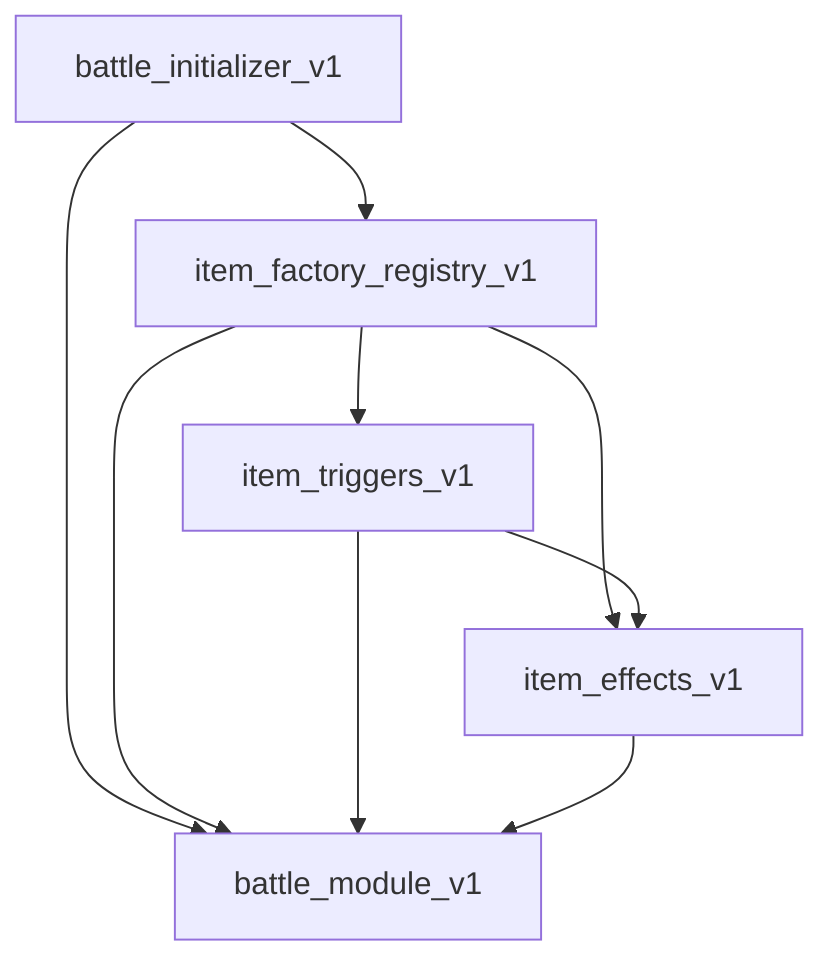

# BattleItem、Effect、Trigger 迁移后的导入依赖修复

## 1. Requirements（需求）

- `BattleItem` 和 `Weapon` 保留在 `item_factory_registry_v1.py`，以用户已经移动的实现为准。
- `Effect` 保留在 `item_effects_v1.py`，`Trigger` 保留在 `item_triggers_v1.py`，修复迁移后的旧导入。
- 解决战斗模块、物品模块、Trigger/Effect 模块之间的循环导入。
- 物品激活所需的 `ItemActivationContext`、标记类型常量等运行时名称必须明确可用。
- 初始化器及测试从基类所属模块导入同一个 `BattleItem`。
- 此次仅修复导入依赖；攻击流程草稿不在此次实现范围内。

## 2. Design（设计）

### 2.1 运行时依赖方向

箭头表示“导入”。



`battle_module_v1.py` 中的 `BattleItem` 仅用于类型注解，无须在运行时导入物品模块。使用已有的延迟注解和 `typing.TYPE_CHECKING` 保留类型检查信息。

`item_triggers_v1.py` 和 `item_effects_v1.py` 中的 `BattleItem` 仅用于基类或方法的注解，均采用延迟注解和 `TYPE_CHECKING` 导入。不新增公共模块或导入转发层。

`Effect` 和 `Trigger` 分别在其组件模块定义。物品模块从组件模块取得这两个基类，测试直接从基类所属模块导入。战斗模块不重新导出这些名称。

初始化器的 `isinstance(battle_item, BattleItem)` 是运行时检查，必须正常导入 `item_factory_registry_v1.BattleItem`，不能放在 `TYPE_CHECKING` 中。

### 2.2 各模块的导入伪代码

#### battle_module_v1.py

```text
保留 from __future__ import annotations
导入 TYPE_CHECKING
仅在 TYPE_CHECKING 为真时从 item_factory_registry_v1 导入 BattleItem
正常定义角色状态、战斗状态与上下文
```

#### item_factory_registry_v1.py

```text
显式导入 battle_module_v1 中的：
    BattleContext、BuffSlot
    ITEM_MARKER_TYPES、ItemActivationContext
从 item_effects_v1 取得 Effect 和具体 Effect
从 item_triggers_v1 取得 Trigger 和具体 Trigger
定义用户已经迁入的 BattleItem、Weapon 和具体物品
```

#### item_effects_v1.py

```text
增加 from __future__ import annotations
导入 TYPE_CHECKING
删除从 battle_module_v1 导入 Effect 的旧语句
仅在 TYPE_CHECKING 为真时从 item_factory_registry_v1 导入 BattleItem
保留实际使用的上下文和状态名称，正常定义用户迁入的 Effect
```

#### item_triggers_v1.py

```text
增加 from __future__ import annotations
导入 TYPE_CHECKING
从 battle_module_v1 的正常导入列表中删除 BattleItem 和 Trigger
仅在 TYPE_CHECKING 为真时从 item_factory_registry_v1 导入 BattleItem
保留上下文和常量的正常导入，正常定义用户迁入的 Trigger
```

#### battle_initializer_v1.py 与测试

```text
从 battle_module_v1 导入其所属的状态和上下文
从 item_factory_registry_v1 正常导入 BattleItem
测试从 item_effects_v1 导入 Effect，从 item_triggers_v1 导入 Trigger
不改变初始化、校验或测试断言
```

### 2.3 函数接口及伪代码

本次不新增函数或修改函数体。以下记录迁移后基类和运行时校验的现有接口及行为，作为导入修复的行为边界。

#### BattleItem.__init__

```python
def __init__(
    self, item_id: str | None = None, item_key: str | None = None,
    player_id: int | None = None, is_active_item: bool = False,
    triggers: Sequence[Trigger] | None = None,
    effects: Sequence[Effect] | None = None,
    linked_items: Sequence[str] | None = None,
    display_name: str | None = None,
    item_classes: tuple[str, ...] | None = None,
    rarity: str | None = None, cost: int | None = None,
    item_types: tuple[str, ...] | None = None,
    icon_types: tuple[str, ...] | None = None,
): ...
```

```text
读取显式参数或类元数据
复制 triggers、effects、linked_items 列表
按 ITEM_MARKER_TYPES 建立标记字典，初始化准备状态
检查 Trigger 和 Effect 非空
为 Trigger/Effect 绑定所属物品，为 Trigger 绑定索引
```

#### update_triggers(self, context: BattleContext, trigger_index: int | None = None) -> list[bool]

```text
新建全 False 的结果列表
只更新指定 Trigger，或依序更新全部 Trigger
检查每个结果为 bool，写回 trigger_results，并返回新列表
```

#### activate_item(self, context: BattleContext, trigger_index: int | None = None) -> None

```text
取得 update_triggers 的结果
调用具体物品的 run_effect
```

#### emit_activation(self, context: BattleContext) -> None

```text
校验 context.item 就是当前物品
记录激活日志
用当前战斗、物品、双方视角及 source_item 创建 ItemActivationContext
以当前物品为发射者发出 item_activation
```

#### run_effect(self, trigger_results: list[bool], context: BattleContext) -> None

```text
基类抛 NotImplementedError，具体物品负责实现
```

#### add_linked_item(self, linked_key: str)

```text
linked_key 未存在时追加到 linked_items
```

#### add_marker_item(self, marker_type: str, linked_key: str) -> None

```text
校验 marker_type 属于 ITEM_MARKER_TYPES
去重追加到对应 marker_items，再调用 add_linked_item
```

#### onPrepare(self, context: BattleContext) -> None

```text
拒绝重复准备
依序调用 Trigger.connect_bus
设置 has_prepared
```

#### _validate_battle_item(battle_item, item_id, item_key, player_id)

```text
以物品模块中的 BattleItem 做 isinstance 检查
依次校验物品 ID、实例 key 和 player_id
不匹配时抛 ValueError
```

#### Effect.__init__(self)

```text
将所属物品 self.item 初始化为 None，注解为 BattleItem | None
```

#### Effect.apply(self, context: BattleContext) -> bool

```text
基类抛 NotImplementedError，由具体 Effect 实现
```

#### Trigger.__init__(self)

```text
将索引 self.idx 和所属物品 self.item 初始化为 None
```

#### Trigger.update(self, context: BattleContext) -> bool

```text
基类抛 NotImplementedError，由具体 Trigger 实现
```

#### Trigger.connect_bus(self, context: BattleContext) -> None

```text
基类不执行操作，由需要总线连接的具体 Trigger 覆盖
```

`Weapon` 的构造及三个空 hook 保留现状；所有具体物品函数、Trigger/Effect 方法、战斗结算函数及测试函数的接口和实现均不变。

## 3. Tasks（任务拆解）

1. T1：保存本 SPEC。
2. T2：调整战斗模块和 Trigger/Effect 模块的类型导入。依赖 T1。
3. T3：补足物品模块运行时名称，删除旧基类导入，调整初始化器及全部测试的基类导入。依赖 T2。
4. T4：在独立 Python 进程中从不同入口导入，确认不存在对入口顺序的依赖。依赖 T3。
5. T5：运行现有测试，确认初始化、事件总线和物品行为保持一致。依赖 T4。

## 4. Acceptance Criteria / Tests（验收标准）

- 单独导入 battle_module_v1、item_factory_registry_v1、item_effects_v1、item_triggers_v1、battle_initializer_v1、main_v1 均成功。
- 不同入口顺序均成功；运行时依赖图不存在物品模块回到战斗模块再回物品模块的环。
- `BattleItem.__module__ == "item_factory_registry_v1"`。
- `Effect.__module__ == "item_effects_v1"`，`Trigger.__module__ == "item_triggers_v1"`，且具体组件及测试继承的是对应模块中的同一基类。
- 物品激活可以创建 ItemActivationContext；初始化器使用迁移后的同一个基类做实际类型校验。
- 测试不再从 battle_module_v1 导入 BattleItem、Effect 或 Trigger，现有测试全通过。
- 此次差异只包含本 SPEC、导入语句、延迟注解声明及迁移处空行末尾空格清理。

### 第一轮验证结果（2026-10-05，仅迁移 BattleItem）

- 六个模块分别作为首个入口，在独立 Python 进程中导入其余模块，全部成功。
- 已确认 `BattleItem.__module__ == "item_factory_registry_v1"`。
- 使用用户指定的 Python 3.11 执行现有测试：495 个全部通过。
- `git diff --check` 通过。

### 第二轮验证（迁移 Effect、Trigger）

- 六个模块分别作为首个入口，在独立 Python 进程中导入其余模块，全部成功。
- 三个基类的所属模块及物品模块使用的 Effect/Trigger 类身份已确认正确。
- 使用用户指定的 Python 3.11 执行现有测试：495 个全部通过。
