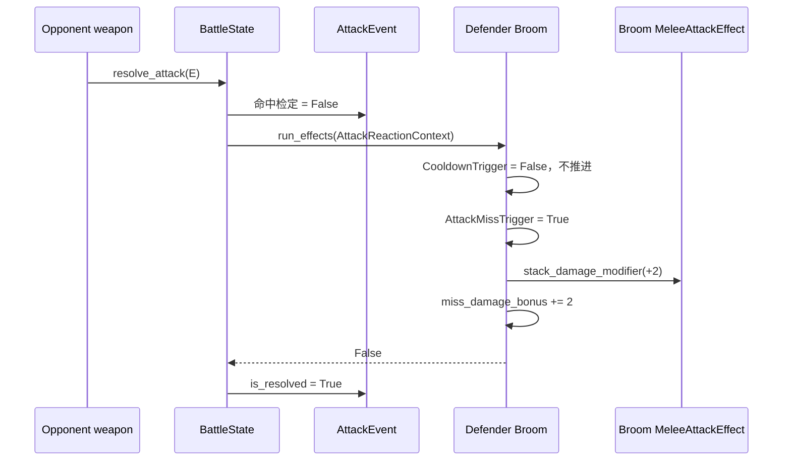
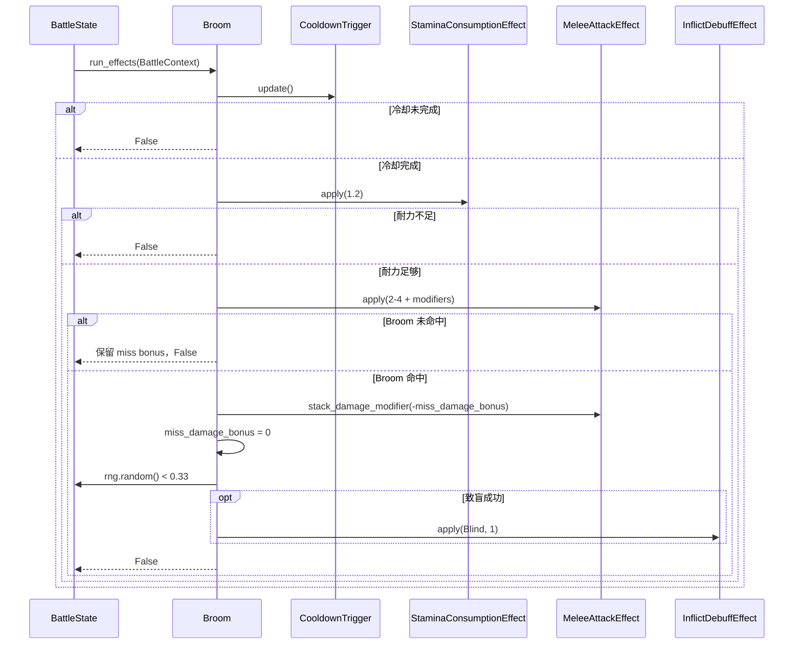

# Broom item factory SPEC

状态：已按本 SPEC 实现并验证。

查询日期：2026-07-24。

实施前仓库基线：现有 241 项测试全部通过。

## 1. Requirements（需求）

### 1.1 功能目标

在现有 `AttackEvent`、攻击响应派发、冷却、耐力消耗和近战攻击框架中实现 Broom（扫把），使其能够通过默认物品目录和默认工厂从标准 `battle_run_v1` JSON 中实例化并参与逐帧战斗。

Broom 必须：

- 作为 `is_active_item=True` 的主动物品进入 `BattleState.active_items`。
- 使用 1.7 秒基础冷却。
- 冷却完成后先消耗 1.2 点耐力；耐力不足时不攻击、不读取命中/伤害/致盲概率 RNG，并按现有武器规则重新累计冷却。
- 发起一次基础伤害为 2–4、基础命中率为 95% 的 melee 攻击。
- 每当对手的一次 `AttackEvent` 未命中 Broom 拥有者时，为该 Broom 累积 2 点临时攻击伤害。
- 多次对手未命中分别计数并累积；两次未命中提供 4 点，三次提供 6 点。
- 只响应“对手攻击 Broom 拥有者但未命中”的事件；Broom 自己未命中时不得给自己增加 2 点伤害。
- 对手的 melee、ranged 或 effect 攻击只要进入统一 `AttackEvent` 命中判定并未命中，均可触发该效果；本阶段不增加攻击类型过滤。
- Broom 攻击未命中时保留已经累积的临时伤害；下一次实际命中仍可使用。
- Broom 命中后清空全部由“对手攻击落空”累积的临时伤害。
- 清空临时伤害时，只从通用 `MeleeAttackEffect.damage_modifier` 中减去 Broom 自己记录的临时部分；其他物品通过 `stack_damage_modifier()` 添加的持久伤害 modifier 不得被清除。
- Food 等已有静态准备 modifier、外部持久 modifier 与动态 Empower 的职责继续保持分离；Broom 不改写 `min_damage` 或 `max_damage`。
- Broom 命中后使用 `BattleState.rng` 进行一次 33% 致盲概率检定；成功时向对手施加 1 层 `Blind`。
- 33% 概率归纳在 `Broom.run_own_effect()` 中，不新增 `ChanceTrigger`，也不覆写通用 trigger 的 `update()`。
- Broom 未命中、耐力不足或冷却未完成时均不得进行致盲概率检定。
- 两件 Broom 必须拥有相互独立的 trigger、effect 和临时伤害状态。

### 1.2 Wiki 事实快照

#### 1.2.1 来源

本 SPEC 只使用项目允许的 `backpackbattles.wiki.gg` 及其 MediaWiki/Cargo API：

- [Broom](https://backpackbattles.wiki.gg/wiki/Broom?oldid=10994)：修订 `10994`，修订时间 `2025-10-07T18:34:57Z`。
- [扫把](https://backpackbattles.wiki.gg/zh/wiki/%E6%89%AB%E6%8A%8A?oldid=7418)：中文名称与效果说明，页面最后编辑时间 `2026-05-05`。
- [Accuracy](https://backpackbattles.wiki.gg/wiki/Accuracy?oldid=12141)：修订 `12141`；页面将 Broom 列在只由未命中触发的机制中。
- [Cargo `Items` 查询](https://backpackbattles.wiki.gg/api.php?action=cargoquery&format=json&tables=Items&fields=name%2Cclass%2Crarity%2Ccost%2Citemtype%2Cicontype%2Ctags%2Ceffect&where=name%3D%22Broom%22)：
  `tables=Items&fields=name,class,rarity,cost,itemtype,icontype,tags,effect&where=name="Broom"`。
- [MediaWiki parse API](https://backpackbattles.wiki.gg/api.php?action=parse&format=json&page=Broom&prop=wikitext)：用于核对 infobox 数值与 `grid` 原始文本。

#### 1.2.2 建模值

| 字段 | 建模值 |
| --- | --- |
| `item_id` | `"broom"` |
| `display_name` | `"Broom"` |
| `item_classes` | `("Neutral",)`；Cargo 的空 `class` 按本地知识库规则归一化 |
| `rarity` | `"Common"` |
| `cost` | `4` |
| `item_types` | `("Weapon",)` |
| `icon_types` | `("melee",)` |
| `is_active_item` | `True` |
| `socket_count` | `1` |
| 基础伤害 | `2–4` |
| 耐力消耗 | `1.2` |
| 基础命中率 | `95%` |
| 基础冷却 | `1.7s` |
| 对手未命中效果 | 每次为 Broom 累积 `+2` 伤害 |
| 命中效果 | `33%` 概率施加 `1 Blind` |
| 网格 | 一列四格；原始 `grid` 为连续四行 `1` |
| 星标/其他标记 | 无 |

目录中的 0° 标准形状使用：

```json
{
  "item_id": "broom",
  "shape_cells": [[0, 0], [0, 1], [0, 2], [0, 3]],
  "star_cells": []
}
```

#### 1.2.3 临时伤害的语义解释

Wiki 的效果短句写作“下一次攻击获得 +2 伤害”，正文同时明确说明：

- Broom 攻击前，对手每次未命中都会分别累积 2 点。
- Broom 命中时，累积伤害归零。

本 SPEC 采用正文给出的“命中后归零”作为精确生命周期：

1. 对手未命中一次：Broom 临时伤害从 0 变为 2。
2. Broom 自己尝试攻击但未命中：临时伤害仍为 2。
3. Broom 后续命中：该次攻击使用这 2 点伤害，然后临时伤害归零。

这也避免把“攻击尝试”和 Wiki 明确写出的“命中后重置”混为一谈。

### 1.3 用户故事

- 作为战斗 JSON 使用者，我可以在 `placements` 中填写 `broom`，初始化器会创建真实 Broom 实例。
- 作为 Broom 拥有者，对手攻击落空会立即被事件监听器记录，而不需要轮询对手状态。
- 作为战斗模拟调用者，我可以注入固定 RNG，精确复现命中、伤害与 33% 致盲检定。
- 作为后续物品实现者，我可以复用 `AttackMissTrigger` 监听对手未命中，并复用 `InflictDebuffEffect` 施加结构化 debuff。
- 作为 modifier 实现者，我可以在 Broom 临时伤害产生前或产生后调用 `stack_damage_modifier()`；Broom 命中时不会错误清空我的持久 modifier。

### 1.4 范围外

- 不实现战斗日志。
- 不实现暴击、宝石安装、配方和商店逻辑。
- 不实现 debuff 的复制、抵抗、反弹、持续时间或保护机制；`InflictDebuffEffect` 只完成当前结构化层数增加。
- 不实现 `Before miss` 改写命中结果的阶段。
- 不实现 Fancy Fencing Rapier 等“自己的攻击未命中”效果；本轮 `AttackMissTrigger` 表示防守方监听“对手攻击自己未命中”。
- 不实现战斗中动态增删物品后的攻击响应缓存失效。
- 不新增事件总线、全局 `current_attack` 字段、临时 modifier 容器或 `ChanceTrigger`。

## 2. Design（设计）

### 2.1 复用当前攻击管线

当前代码已经提供：

- `AttackEvent`：保存 attacker、defender、source item、攻击类型、命中和伤害结果。
- `BattleState.resolve_attack()`：按 `命中 RNG -> 伤害 RNG -> on_attacked 响应 -> Block/Health` 结算命中攻击。
- `AttackReactionContext`：把当前 `AttackEvent` 显式传给响应物品。
- `_get_attack_reaction_items()`：按玩家和 `attack_phase` 缓存响应物品。
- `CooldownTrigger`、`StaminaConsumptionEffect`、`MeleeAttackEffect`：完成普通武器的基础行为。
- `MeleeAttackEffect.stack_damage_modifier()`：允许物品自身和其他物品向同一个攻击 effect 追加持久数值。

Broom 不复制命中或伤害结算。实现只补充一个未命中阶段、一个无 RNG 的事件 trigger、一个通用 debuff effect，以及 Broom 的组合逻辑。

### 2.2 新增未命中攻击阶段

在 `battle_module_v1.py` 中新增：

```python
ATTACK_PHASE_ON_ATTACK_MISSED = "on_attack_missed"

SUPPORTED_ATTACK_REACTION_PHASES = (
    ATTACK_PHASE_ON_ATTACKED,
    ATTACK_PHASE_ON_ATTACK_MISSED,
)
```

`BattleState.resolve_attack()` 完成命中 RNG 后：

```text
event.hit = 命中检定结果

若 event.hit 为 False：
    向 event.defender 派发 on_attack_missed
    派发期间 event.is_resolved 仍为 False
    验证响应没有提前 resolve 或改写 hit
    将 event.is_resolved 设为 True
    返回 event

若 event.hit 为 True：
    沿用现有伤害抽取与 on_attacked 管线
```

选择 `event.defender` 作为 responder 的原因是 Broom 的语义为“对手攻击落空”。因此：

- A 攻击 B 但未命中，只扫描 B 的 `on_attack_missed` 响应物品。
- A 自己的 Broom 不会因 A 这次未命中而增加伤害。
- B 的每件 Broom 都会收到同一个显式 `AttackEvent`。

未命中事件仍在 `event.is_resolved=False` 时派发，与 `on_attacked` 的现有约束一致。派发完成后才标记 resolved，避免同一事件被再次结算。

### 2.3 `AttackMissTrigger`

在 `item_factory_registry_v1.py` 中新增：

```python
class AttackMissTrigger(Trigger):
    attack_phase = ATTACK_PHASE_ON_ATTACK_MISSED
```

该 trigger：

- 只接受 `AttackReactionContext`。
- 只接受 `context.attack_phase == ATTACK_PHASE_ON_ATTACK_MISSED`。
- 只在 `context.attack_event.hit is False` 时返回 `True`。
- 不接收概率或攻击类型参数。
- 不读取 RNG。

攻击类型不在 trigger 中过滤，因为当前 Broom Wiki 写的是对手“攻击”落空，并未限定 melee；统一 `AttackEvent` 的三种已支持攻击类型都属于攻击。

### 2.4 混合主动/响应物品的冷却隔离

Wooden Buckler 只有事件 trigger；Broom 同时包含：

```python
triggers = [
    CooldownTrigger(cooldown_seconds=1.7),
    AttackMissTrigger(),
]
```

现有 `BattleItem.run_effects()` 会更新一个物品的全部 triggers。若不增加隔离，对手每次未命中并派发 Broom 时，Broom 的 `CooldownTrigger` 也会错误推进一次。

因此在通用 `CooldownTrigger.update()` 开头增加：

```python
if isinstance(context, AttackReactionContext):
    return False
```

此分支必须发生在 `prepare_speed_modifiers()` 和冷却推进之前，保证：

- 事件响应不会推进冷却。
- 事件响应不会提前把 `speed_modifiers_prepared` 设为 `True`。
- 正常 `BattleContext` 中的逐帧冷却行为完全不变。
- Wooden Buckler 触发 linked active item 时，也不会让 linked item 的冷却因同步响应而偷跑。

不修改 `BattleItem.update_triggers()` 的通用“按顺序更新全部 trigger”契约，也不为 Broom 覆写 trigger 更新函数。

### 2.5 通用 `InflictDebuffEffect`

在 `item_factory_registry_v1.py` 中导入 `DebuffSlot` 并新增：

```python
class InflictDebuffEffect(Effect):
    def __init__(self, debuff_name: str, amount: int):
        ...

    def apply(self, context: BattleContext) -> bool:
        ...
```

构造规则：

- `debuff_name` 必须是字符串且存在于 `DebuffSlot.__annotations__`。
- `amount` 必须是精确的非负 `int`；拒绝负数、`bool`、浮点数和字符串。

应用逻辑：

```python
old_stacks = getattr(
    context.opponent.debuffs,
    self.debuff_name,
)
application = self.amount
# Future duplicate/resist/reflect modifiers can adjust application here.
setattr(
    context.opponent.debuffs,
    self.debuff_name,
    old_stacks + application,
)
return application > 0
```

这里使用 `getattr`/`setattr` 是因为 effect 本身是通用的，具体字段由构造参数决定；Broom 构造时固定传入 `"Blind"`。`application = self.amount` 保留一个明确的后续修改点，将来实现复制、抵抗或反弹时可在 effect 内统一调整，而不需要改写 Broom。

本阶段没有抵抗或反弹，因此 `actual_application == amount`。

### 2.6 Broom 组件与实例状态

在 `item_factory_registry_v1.py` 中新增：

```python
class Broom(BattleItem):
    item_id = "broom"
    display_name = "Broom"
    item_classes = ("Neutral",)
    rarity = "Common"
    cost = 4
    item_types = ("Weapon",)
    icon_types = ("melee",)
    is_active_item = True
    socket_count = 1
```

每个实例独立创建：

```python
triggers = [
    CooldownTrigger(cooldown_seconds=1.7),
    AttackMissTrigger(),
]

effects = [
    StaminaConsumptionEffect(stamina_cost=1.2),
    MeleeAttackEffect(
        min_damage=2,
        max_damage=4,
        accuracy=95,
    ),
    InflictDebuffEffect(
        debuff_name="Blind",
        amount=1,
    ),
]

self.miss_damage_bonus = 0
```

固定索引含义：

| 索引 | trigger/effect | 用途 |
| ---: | --- | --- |
| `triggers[0]` | `CooldownTrigger` | 正常逐帧攻击冷却 |
| `triggers[1]` | `AttackMissTrigger` | 监听对手攻击 Broom 拥有者未命中 |
| `effects[0]` | `StaminaConsumptionEffect` | 支付 1.2 耐力 |
| `effects[1]` | `MeleeAttackEffect` | 2–4、95% melee 攻击及通用伤害 modifier |
| `effects[2]` | `InflictDebuffEffect` | 命中后可能施加 1 Blind |

`miss_damage_bonus` 只记录由该 Broom 的 miss trigger 加入 `damage_modifier` 的临时部分。它不复制 `damage_modifier` 的总值，也不记录外部 modifier 来源。

### 2.7 临时伤害与通用 modifier 的组合

当对手一次攻击未命中：

```python
self.miss_damage_bonus += 2
self.effects[1].stack_damage_modifier(2)
```

若在命中前：

- 外部物品已 stack `+4`；
- 对手又未命中两次，Broom 自身 stack `+4`；

则：

```text
MeleeAttackEffect.damage_modifier = 8
Broom.miss_damage_bonus = 4
```

Broom 命中后：

```python
self.effects[1].stack_damage_modifier(-self.miss_damage_bonus)
self.miss_damage_bonus = 0
```

结果为：

```text
MeleeAttackEffect.damage_modifier = 4
Broom.miss_damage_bonus = 0
```

因此 Broom 只回退自己添加的临时部分，不会把外部 modifier 一起归零。之后外部仍可继续调用 `stack_damage_modifier()`。

`MeleeAttackEffect.min_damage`、`max_damage` 始终保持 2 和 4；实际 `AttackEvent` 伤害继续由：

```text
基础伤害
+ damage_modifier（外部持久 modifier + 当前 Broom 临时 bonus）
+ 当前 Empower
```

组合得到。

### 2.8 `Broom.run_own_effect()` 双路径调度

`run_own_effect()` 先处理事件路径，再处理正常攻击路径。

伪代码：

```text
若 trigger_results[1] 为 True：
    miss_damage_bonus += 2
    对 effects[1] 调用 stack_damage_modifier(2)
    返回 False

若 trigger_results[0] 为 False：
    返回 False

若 effects[0] 支付耐力失败：
    返回 False

attack_hit = effects[1].apply(context)

若 attack_hit 为 False：
    保留 miss_damage_bonus 和已经 stack 的临时 damage_modifier
    返回 False

若 miss_damage_bonus > 0：
    对 effects[1] 调用 stack_damage_modifier(-miss_damage_bonus)
    miss_damage_bonus = 0

若 battle_state.rng.random() < 0.33：
    调用 effects[2].apply(context)

返回 False
```

关键顺序：

1. 对手未命中响应不支付 Broom 耐力，也不推进 Broom 冷却。
2. Broom 自己攻击时先支付耐力，再进行命中检定。
3. Broom 未命中不读取伤害 RNG，也不读取致盲概率 RNG，且不清空 bonus。
4. Broom 命中后，无论伤害是否被 Block 或盾牌完全阻止，都清空 miss bonus 并进行一次致盲概率检定。
5. `0.33` 采用现有严格小于语义：`0.329...` 成功，`0.33` 失败。
6. Broom 没有星标；两条路径最终均返回 `False`，不递归激活其他物品。

### 2.9 为什么不使用新的 modifier 容器

当前 `MeleeAttackEffect.damage_modifier` 已经是所有持久伤害修饰的统一入口。Broom 只需要额外记录“自己贡献了多少临时值”，即可在命中后精确回退。

本轮不新增：

- modifier 来源对象；
- modifier token；
- 临时 modifier 列表；
- 到期回调；
- observer/event bus。

这些结构都超出 Broom 当前需求。一个 `int miss_damage_bonus` 与现有 `stack_damage_modifier()` 已足够表达并验证生命周期。

### 2.10 数据与默认注册

默认工厂追加：

```python
DEFAULT_ITEM_FACTORIES = {
    ...
    "broom": Broom,
}
```

目录追加：

```json
"broom": {
  "item_id": "broom",
  "shape_cells": [[0, 0], [0, 1], [0, 2], [0, 3]],
  "star_cells": []
}
```

只记录 `socket_count=1`，不实现插槽行为。

### 2.11 关键流程

#### 2.11.1 对手攻击未命中



#### 2.11.2 Broom 主动攻击



## 3. Realize（逐函数实现）

### 3.1 `ATTACK_PHASE_ON_ATTACK_MISSED` 与支持列表

文件：`battle_module_v1.py`

接口：

```python
ATTACK_PHASE_ON_ATTACK_MISSED = "on_attack_missed"
SUPPORTED_ATTACK_REACTION_PHASES = (
    ATTACK_PHASE_ON_ATTACKED,
    ATTACK_PHASE_ON_ATTACK_MISSED,
)
```

实现要求：

- 保留现有 `ATTACK_PHASE_ON_ATTACKED` 字符串不变。
- `_get_attack_reaction_items()` 继续按 phase 分别缓存；不得把两个阶段混在一个 tuple 中。
- `build_attack_reaction_context()` 与 `dispatch_attack_reactions()` 通过扩展后的支持列表自然接受新阶段。

### 3.2 `BattleState.resolve_attack()`

文件：`battle_module_v1.py`

现有接口不变：

```python
def resolve_attack(self, event: AttackEvent) -> AttackEvent:
```

未命中分支伪代码：

```text
完成现有 event、attacker、defender 前置验证
event.hit = rng.random() * 100 < event.accuracy

若 event.hit 为 False：
    dispatch_attack_reactions(
        ATTACK_PHASE_ON_ATTACK_MISSED,
        event.defender,
        event,
    )
    若 event.is_resolved 已变为 True：
        抛出 ValueError
    若 event.hit 不再是 False：
        抛出 ValueError
    event.is_resolved = True
    返回 event

沿用现有命中分支
```

不得：

- 在未命中分支调用 `rng.randint()`。
- 修改 `rolled_damage`、`pending_damage`、Block 或 Health。
- 向 attacker 派发 defender 视角的 miss 响应。

### 3.3 `AttackMissTrigger`

文件：`item_factory_registry_v1.py`

接口：

```python
class AttackMissTrigger(Trigger):
    attack_phase = ATTACK_PHASE_ON_ATTACK_MISSED

    def update(self, context: BattleContext) -> bool:
```

伪代码：

```text
若 context 不是 AttackReactionContext：
    返回 False
若 context.attack_phase 不是 on_attack_missed：
    返回 False
返回 context.attack_event.hit is False
```

无构造参数、无实例可变状态、无 RNG。

### 3.4 `CooldownTrigger.update()`

文件：`item_factory_registry_v1.py`

接口不变：

```python
def update(self, context: BattleContext) -> bool:
```

新增最前置分支：

```text
若 context 是 AttackReactionContext：
    返回 False
否则：
    沿用现有一次性 prepare、Heat/Cold/外部 speed modifier 与冷却推进逻辑
```

响应路径不得改变：

- `cooldown_progress`
- `speed_modifiers`
- `speed_modifiers_prepared`
- `FoodCooldownTrigger.qualifying_food_count`

### 3.5 `InflictDebuffEffect.__init__()`

文件：`item_factory_registry_v1.py`

接口：

```python
def __init__(
    self,
    debuff_name: str,
    amount: int,
):
```

伪代码：

```text
若 debuff_name 不是 str 或不在 DebuffSlot.__annotations__：
    抛出 ValueError("unsupported debuff name")
若 amount 不是精确 int 或 amount < 0：
    抛出 ValueError("inflicted debuff amount must be a non-negative int")
保存 debuff_name
保存 amount
```

### 3.6 `InflictDebuffEffect.apply()`

文件：`item_factory_registry_v1.py`

接口：

```python
def apply(self, context: BattleContext) -> bool:
```

伪代码：

```text
读取 context.opponent.debuffs 的目标字段
application = self.amount
把目标字段写为 old_stacks + application
返回 application > 0
```

本阶段不读取 RNG；概率由物品层决定。

### 3.7 `Broom.__init__()`

文件：`item_factory_registry_v1.py`

接口：

```python
def __init__(
    self,
    item_id: str | None = None,
    item_key: str | None = None,
    player_id: int | None = None,
):
```

伪代码：

```text
调用 BattleItem.__init__：
    转发 item_id、item_key、player_id
    明确 is_active_item=True
    创建 CooldownTrigger(1.7)
    创建 AttackMissTrigger()
    创建 StaminaConsumptionEffect(1.2)
    创建 MeleeAttackEffect(2, 4, 95)
    创建 InflictDebuffEffect("Blind", 1)
设置 self.miss_damage_bonus = 0
```

不得把 trigger、effect 或 `miss_damage_bonus` 放到可变类级状态。

### 3.8 `Broom.run_own_effect()`

文件：`item_factory_registry_v1.py`

接口：

```python
def run_own_effect(
    self,
    trigger_results: list[bool],
    context: BattleContext,
) -> bool:
```

精确伪代码：

```text
若 trigger_results[1]：
    self.miss_damage_bonus += 2
    self.effects[1].stack_damage_modifier(2)
    返回 False

若非 trigger_results[0]：
    返回 False

若非 self.effects[0].apply(context)：
    返回 False

attack_hit = self.effects[1].apply(context)
若非 attack_hit：
    返回 False

若 self.miss_damage_bonus > 0：
    self.effects[1].stack_damage_modifier(
        -self.miss_damage_bonus
    )
    self.miss_damage_bonus = 0

若 context.battle_state.rng.random() < 0.33：
    self.effects[2].apply(context)

返回 False
```

不得：

- 在 event miss 路径调用耐力或攻击 effect。
- 在 Broom 自己 miss 后清空 bonus。
- 用 `damage_modifier = 0` 清空总 modifier。
- 在致盲概率失败时调用 debuff effect。
- 返回攻击命中结果并触发不存在的星标链接。

### 3.9 `DEFAULT_ITEM_FACTORIES`

文件：`item_factory_registry_v1.py`

追加：

```python
"broom": Broom,
```

保留 Banana、Garlic、Pan、Wooden Buckler 和 Wooden Sword 的现有注册。

### 3.10 `data/item_catalog_v1.json`

追加：

```json
"broom": {
  "item_id": "broom",
  "shape_cells": [[0, 0], [0, 1], [0, 2], [0, 3]],
  "star_cells": []
}
```

使用现有通用旋转函数生成 90°、180°、270° 形状，不新增 `shape_cells_by_rotation`。

## 4. Tasks（任务拆解）

1. T1：确认本 SPEC 中“Broom 自己未命中时保留 bonus，命中后清空”的 Wiki 解释。
2. T2：新增 `on_attack_missed` 常量并扩展攻击响应阶段支持列表；依赖 T1。
3. T3：在 `resolve_attack()` 的未命中分支向 defender 派发新阶段；依赖 T2。
4. T4：实现 `AttackMissTrigger`；依赖 T2。
5. T5：让 `CooldownTrigger` 忽略 `AttackReactionContext`，解决主动/响应混合物品的冷却偷跑；依赖 T2。
6. T6：新增通用 `InflictDebuffEffect`；依赖 T1。
7. T7：实现 `Broom` 元数据、组件、临时 bonus 状态和双路径 `run_own_effect()`；依赖 T3-T6。
8. T8：把 `broom` 注册进 `DEFAULT_ITEM_FACTORIES`；依赖 T7。
9. T9：加入 Broom 1×4 目录形状；依赖 T1。
10. T10：增加攻击阶段、trigger、冷却隔离和 debuff effect 单元测试；依赖 T3-T6。
11. T11：增加 Broom 工厂、初始化、目录和运行时测试；依赖 T7-T9。
12. T12：运行相关测试、完整测试集、`git diff --check` 和标准 `battle_run_v1` 冒烟测试；依赖 T10-T11。
13. T13：把实测测试数量与冒烟结果回写本 SPEC；依赖 T12。

## 5. Acceptance Criteria / Tests（验收标准）

已新增以下 30 项测试。与原有 241 项共同组成 271 项完整测试集。

### 5.1 攻击未命中阶段与 trigger

文件：`tests/test_attack_resolution_v1.py`

1. `test_supported_attack_reaction_phases_include_attack_missed`
   - 断言现有 `on_attacked` 和新增 `on_attack_missed` 均受支持。
   - 断言现有常量字符串未改变。

2. `test_attack_miss_is_dispatched_to_defender_before_event_is_resolved`
   - 固定攻击未命中。
   - defender 放置带 `AttackMissTrigger` 的记录物品。
   - 响应中观察到同一个 event、`hit is False`、`is_resolved is False`。
   - 派发结束后 `is_resolved is True`。

3. `test_attack_miss_is_dispatched_only_to_defender`
   - attacker 和 defender 都放置 miss 响应物品。
   - attacker 发起攻击并未命中。
   - 只有 defender 的响应物品运行。

4. `test_attack_miss_dispatch_does_not_roll_or_apply_damage`
   - RNG 只提供一次命中 random，不提供 `randint`。
   - miss 响应正常运行。
   - `rolled_damage`、`pending_damage`、Block、Health 不变。

5. `test_attack_miss_and_on_attacked_use_separate_phase_caches`
   - 同一 defender 同时放置 `OnAttackedTrigger` 和 `AttackMissTrigger` 物品。
   - 两个 phase lookup 返回各自物品。
   - 两个缓存 tuple 不是混合结果，第二次 lookup 复用各自缓存。

6. `test_attack_miss_trigger_accepts_matching_context_without_rng`
   - 构造 `on_attack_missed`、`event.hit=False` 的显式响应 context。
   - trigger 返回 `True`。
   - RNG 调用列表为空。

7. `test_attack_miss_trigger_rejects_base_wrong_phase_and_hit_context`
   - 普通 `BattleContext` 返回 `False`。
   - 错误 phase 返回 `False`。
   - `event.hit=True` 返回 `False`。
   - 三种情况均不读取 RNG。

8. `test_existing_on_attacked_item_does_not_run_on_attack_miss`
   - defender 放置真实 `WoodenBuckler`。
   - 攻击未命中。
   - 木盾不读取 30% RNG，不减耐力，结果只消费命中 RNG。

### 5.2 Cooldown 响应隔离与通用 debuff effect

文件：`tests/test_item_factory_registry_v1.py`

9. `test_cooldown_trigger_ignores_attack_reaction_context`
   - 使用未准备的 `CooldownTrigger` 和 `AttackReactionContext`。
   - 调用 `update()` 返回 `False`。
   - `cooldown_progress == 0`。
   - `speed_modifiers_prepared is False`。

10. `test_inflict_debuff_effect_adds_stacks_to_opponent`
    - 对手已有 2 Blind，应用 `InflictDebuffEffect("Blind", 1)`。
    - 返回 `True`，最终为 3。
    - owner 的 Blind 不变。

11. `test_inflict_debuff_effect_handles_zero_and_rejects_invalid_arguments`
    - amount 0 不改变层数并返回 `False`。
    - 不存在的字段、非字符串名称、负数、`True`、`1.5`、`"1"` 均抛出 `ValueError`。

### 5.3 Broom 工厂与初始化

文件：`tests/test_item_factory_registry_v1.py`

12. `test_broom_is_registered_with_metadata_and_components`
    - 默认 registry 创建 `Broom`。
    - 断言全部标准化元数据、`socket_count=1` 和 `is_active_item=True`。
    - triggers 依次为 `CooldownTrigger(1.7)`、`AttackMissTrigger()`。
    - effects 依次为 `StaminaConsumptionEffect(1.2)`、`MeleeAttackEffect(2, 4, 95)`、`InflictDebuffEffect("Blind", 1)`。
    - `miss_damage_bonus == 0`。

13. `test_brooms_own_independent_components_and_bonus_state`
    - 创建两个 Broom。
    - 两个 trigger、三个 effect 均不共享实例。
    - 修改第一个的冷却、damage modifier 和 miss bonus 不影响第二个。

14. `test_initializer_builds_broom_as_active_and_attack_miss_responder`
    - 使用默认目录与 registry 初始化 Broom。
    - Broom 同时存在于 owner items 与 `BattleState.active_items`。
    - `on_attack_missed` lookup 包含 Broom。
    - `on_attacked` lookup 不包含 Broom。

### 5.4 Broom 目录

文件：`tests/test_basic_backpack_v1.py`

15. `test_broom_catalog_matches_wiki_vertical_grid`
    - 0° 占据 `(x,y)`、`(x,y+1)`、`(x,y+2)`、`(x,y+3)`。
    - 无 star/diamond/triangle 标记。

16. `test_broom_catalog_rotates_four_cell_line`
    - 精确断言 90°、180°、270° 后仍为连续四格。
    - 四个旋转没有重复占格或额外 marker。

### 5.5 Broom 运行逻辑

文件：`tests/test_item_factory_registry_v1.py`

17. `test_broom_waits_for_cooldown_without_rng`
    - `frame_delta < 1.7`。
    - 不扣耐力、不读取 RNG、不造成伤害、不施加 Blind。

18. `test_broom_gains_two_damage_when_opponent_melee_attack_misses`
    - 对手 melee 攻击未命中 Broom owner。
    - `miss_damage_bonus == 2`，攻击 effect 的 `damage_modifier == 2`。
    - Broom 耐力和冷却进度不变。
    - 除对手命中检定外不增加 RNG 调用。

19. `test_broom_attack_miss_trigger_accepts_ranged_and_effect_attacks`
    - 分别创建 ranged/effect 未命中事件。
    - 每次都为 Broom 增加 2 点。
    - 最终 bonus 和 damage modifier 均为 4。

20. `test_broom_multiple_opponent_misses_stack`
    - 连续三个对手 miss。
    - `miss_damage_bonus == 6`、`damage_modifier == 6`。
    - 基础 `min_damage=2`、`max_damage=4` 未变。

21. `test_broom_ignores_opponent_hits`
    - 对手攻击命中。
    - Broom 的 miss trigger 不运行。
    - bonus 和 damage modifier 不变。

22. `test_broom_pays_stamina_and_attacks_with_base_damage`
    - 无 bonus，冷却完成且耐力足够。
    - 耐力减少 1.2。
    - 攻击 RNG 范围为 2–4，命中率为 95。
    - 无论是否施加 Blind，`run_effects()` 固定返回 `False`。

23. `test_broom_applies_accumulated_bonus_then_clears_it_on_hit`
    - 先累积两次 miss，得到 +4。
    - Broom 命中时攻击 RNG 范围为 6–8。
    - 命中结算后 `miss_damage_bonus == 0`、`damage_modifier == 0`。

24. `test_broom_miss_retains_accumulated_bonus_and_skips_blind_roll`
    - 先累积 +4，再让 Broom 自己未命中。
    - 支付 1.2 耐力。
    - 只读取 Broom 命中 RNG，不读取伤害或 33% RNG。
    - bonus 和 damage modifier 仍为 4，对手 Blind 不变。

25. `test_broom_retained_bonus_is_used_on_later_hit`
    - 在测试 24 的状态基础上完成下一次冷却并命中。
    - 下一次伤害范围仍为 6–8。
    - 命中后 bonus 清零。

26. `test_broom_insufficient_stamina_retains_bonus_without_rng`
    - 先累积 +2，冷却完成但耐力小于 1.2。
    - 不读取命中、伤害或致盲 RNG。
    - 不清空 bonus；冷却已经进入下一周期。

27. `test_broom_on_hit_inflicts_blind_when_chance_succeeds`
    - 固定命中、固定伤害，并令致盲 random 为 `0.329`。
    - 对手 Blind 增加 1。
    - RNG 顺序为命中 random、伤害 randint、致盲 random。

28. `test_broom_on_hit_does_not_inflict_blind_when_chance_fails`
    - 固定命中、固定伤害，并令致盲 random 为边界值 `0.33`。
    - 对手 Blind 不变。
    - 仍只进行一次致盲概率检定。

29. `test_broom_clears_only_miss_bonus_and_preserves_external_modifier`
    - 外部先 `stack_damage_modifier(5)`，对手再 miss 两次增加 4。
    - 本次命中使用总 `damage_modifier=9`，伤害范围为 11–13。
    - 命中后只减去 4，最终 `damage_modifier == 5`。
    - 下一次无 miss 攻击继续使用外部 +5。

30. `test_brooms_own_independent_miss_bonus_state`
    - 同一玩家拥有两件 Broom。
    - 两者都会响应同一次对手 miss，各自得到 +2。
    - 第一件命中后只清空自己的 bonus；第二件仍保留 +2。

### 5.6 回归与完成标准

- 修改前已有的 241 项测试全部继续通过。
- 上述 30 项新增测试全部通过；无其他测试变化时完整测试集为 271 项。
- `resolve_attack()` 的现有命中路径、Wooden Buckler 和 Pan 行为保持不变。
- 未命中攻击只消费命中 RNG，不消费伤害 RNG；Broom miss 响应本身不消费 RNG。
- Broom 在逐帧 active items 和 defender 的 miss 响应缓存中各承担明确职责。
- 同步 attack reaction 不推进任何 `CooldownTrigger`。
- Broom 的临时 miss bonus 可叠加、在自身未命中时保留、在自身命中时清空。
- 清空 Broom 临时 bonus 不影响外部 `stack_damage_modifier()`。
- 33% 致盲概率只在 Broom 命中后由 `run_own_effect()` 判断。
- `data/item_catalog_v1.json` 除新增 `broom` 外无其他变化。
- Broom 可从标准 `battle_run_v1` 的 `placements` 经默认目录和 registry 初始化并完整运行。
- 不新增第三方依赖、全局攻击字段、事件总线、ChanceTrigger 或 modifier 容器。

## 6. 已确认实现决策

1. 新增独立的 `ATTACK_PHASE_ON_ATTACK_MISSED`，只向未命中攻击的 defender 派发；不复用只处理命中攻击的 `on_attacked` 阶段。
2. `AttackMissTrigger` 表示“对手攻击当前 owner 未命中”，不表示 source item 自己未命中；未来实现自己的 on-miss 物品时另行设计 attacker 侧阶段。
3. Broom 作为主动/响应混合物品，使用普通 `CooldownTrigger + AttackMissTrigger`；通用 `CooldownTrigger` 在任何 `AttackReactionContext` 中返回 `False` 且不推进。
4. 每次对手 miss 通过现有 `stack_damage_modifier(2)` 累积；Broom 用 `miss_damage_bonus` 精确记录自身临时贡献。
5. Broom 自己未命中时保留 bonus，实际命中后才减去 `miss_damage_bonus` 并归零；外部 damage modifier 永久保留。
6. 新增通用 `InflictDebuffEffect("Blind", 1)`；未来复制、抵抗和反弹直接在该 effect 的 `application` 计算处扩展。
7. 33% 致盲判断直接写在 `Broom.run_own_effect()` 中，不新增 ChanceTrigger。
8. Broom 没有星标，两条运行路径都返回 `False`。

## 7. 实施与验证结果

实施日期：2026-07-24。

- 已在 `battle_module_v1.py` 新增 `on_attack_missed` 阶段，并在攻击未命中、事件尚未 resolved 时向 defender 派发。
- 已实现无 RNG 的 `AttackMissTrigger`，并保持 `on_attacked` 与 `on_attack_missed` 的响应缓存相互独立。
- 已让 `CooldownTrigger` 忽略 `AttackReactionContext`，防止 Broom 或 linked active item 在同步攻击响应中错误推进冷却。
- 已实现通用 `InflictDebuffEffect`，Broom 使用它施加 1 层 `Blind`。
- 已实现并注册 `Broom`，加入 1×4 标准目录形状、主动攻击链路、miss bonus 累积/保留/精确回退和 33% 命中致盲。
- 已新增本 SPEC 第 5 节列出的 30 项测试；原有 241 项与新增测试组成的 271 项完整测试集全部通过。
- 已用标准 `battle_run_v1` 配置完成默认目录和默认 registry 冒烟验证：Broom 成功初始化为 `broom1`，首帧时间推进至 1.7 秒，消耗 1.2 耐力并正常完成攻击结算，结果返回 `battle_result_v1`。
- `git diff --check` 通过；未新增第三方依赖。
