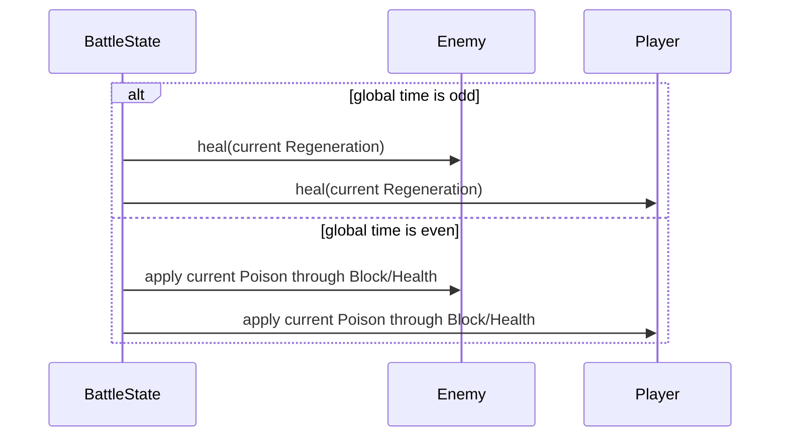
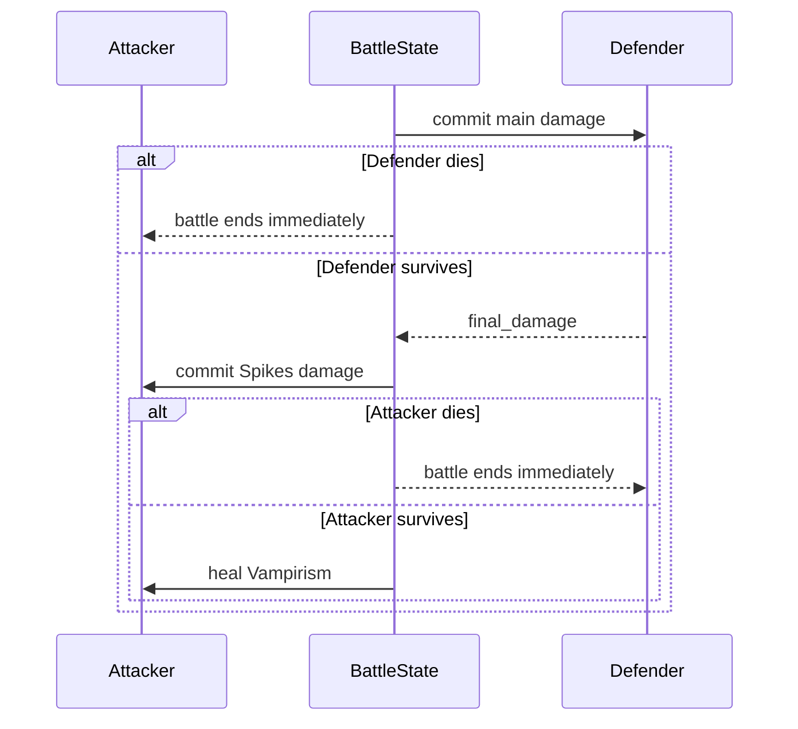
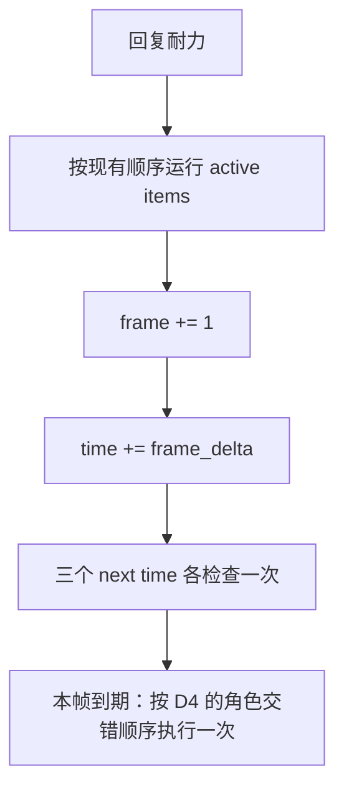

# Buff / Debuff 内建效果完整实现 SPEC

状态：已批准并实现；第 1.6 节 D1-D6 均已按确认规则落地。

实施前仓库基线为 271 项测试全部通过；实施完成后为 315 项测试全部通过。
`battle_module_v1.py` 中原有的用户未提交修改已保留。

## 1. Requirements（需求）

### 1.1 目标

在当前 V1 战斗框架中，使 `BuffSlot` 的 7 种 Buff 和 `DebuffSlot` 的
3 种 Debuff 不再只是可序列化的整数，而是在对应战斗流程中产生 Wiki
规定的内建效果：

| 类型 | 状态 | Wiki 规定的内建效果 | 当前仓库状态 | 本轮结论 |
| --- | --- | --- | --- | --- |
| Buff | `Empower` | 每层使武器伤害 +1 | 已生效 | 本轮不修改 |
| Buff | `Heat` | 每层使所有物品快 2% | `CooldownTrigger` 已生效 | Heat-Cold 合并后限幅 |
| Buff | `Luck` | 每层命中率 +5% | 已生效 | 本轮不修改 |
| Buff | `Mana` | 魔法物品使用的资源 | 只有整数状态 | 增加可复用的获得/使用入口 |
| Buff | `Regeneration` | 每 2 秒每层恢复 1 生命；本项目已确认在全局奇数秒结算 | 未生效 | 增加奇数秒全局结算 |
| Buff | `Spikes` | 被近战武器命中并造成伤害时反伤，最多等于该次伤害 | 未生效 | 接入攻击结算 |
| Buff | `Vampirism` | 近战武器命中并造成伤害时治疗，最多等于该次伤害 | 未生效 | 接入攻击结算 |
| Debuff | `Blind` | 每层命中率 -5% | 已生效 | 本轮不修改 |
| Debuff | `Cold` | 每层使所有物品慢 2% | `CooldownTrigger` 已生效 | Heat-Cold 合并后限幅 |
| Debuff | `Poison` | 每 2 秒每层造成 1 伤害；本项目已确认在全局偶数秒结算 | 未生效 | 增加偶数秒全局结算 |

用户故事：

1. 作为战斗模拟调用者，我设置任意已有 Buff/Debuff 层数后，可以观察到
   与 Wiki 定义一致的伤害、命中、冷却、治疗或周期伤害结果。
2. 作为后续物品实现者，我可以复用简单 effect 获得/使用 Buff、施加/净化
   Debuff，不需要在每个物品类中直接操作字段。
3. 作为测试和强化学习环境维护者，我可以用固定帧长和固定 RNG 重放相同的
   Buff/Debuff 结算顺序。
4. 作为项目维护者，我可以继续使用结构化的 `BuffSlot` / `DebuffSlot`，
   不引入事件总线、通用规则引擎或状态类继承树。

### 1.2 Wiki 查询结果与版本

查询日期：2026-07-24。资料只来自项目允许的
`backpackbattles.wiki.gg` 及其 MediaWiki API。

| 页面 | URL | 修订 ID | Wiki 修订时间（UTC） | 用途 |
| --- | --- | ---: | --- | --- |
| Game Mechanics | https://backpackbattles.wiki.gg/wiki/Game_Mechanics | 12566 | 2026-07-22 15:48:39 | 10 种状态总览 |
| Buff | https://backpackbattles.wiki.gg/wiki/Buff | 8394 | 2024-03-28 10:18:42 | 7 种 Buff、可叠加、默认持续整场 |
| Debuff | https://backpackbattles.wiki.gg/wiki/Debuff | 8402 | 2024-03-28 10:19:02 | 3 种 Debuff、可叠加、默认持续整场 |
| Empower | https://backpackbattles.wiki.gg/wiki/Empower | 8395 | 2024-03-28 10:18:45 | 武器伤害 +1/层 |
| Heat | https://backpackbattles.wiki.gg/wiki/Heat | 8396 | 2024-03-28 10:18:47 | 所有物品快 2%/层 |
| Luck | https://backpackbattles.wiki.gg/wiki/Luck | 8397 | 2024-03-28 10:18:50 | 命中率 +5%/层 |
| Mana | https://backpackbattles.wiki.gg/wiki/Mana | 8398 | 2024-03-28 10:18:52 | 魔法物品资源 |
| Regeneration | https://backpackbattles.wiki.gg/wiki/Regeneration | 8399 | 2024-03-28 10:18:54 | 每 2 秒治疗 1/层 |
| Spikes | https://backpackbattles.wiki.gg/wiki/Spikes | 8400 | 2024-03-28 10:18:57 | 近战受击反伤与伤害上限 |
| Vampirism | https://backpackbattles.wiki.gg/wiki/Vampirism | 8401 | 2024-03-28 10:18:59 | 近战命中治疗与伤害上限 |
| Blind | https://backpackbattles.wiki.gg/wiki/Blind | 8403 | 2024-03-28 10:19:05 | 命中率 -5%/层 |
| Cold | https://backpackbattles.wiki.gg/wiki/Cold | 8404 | 2024-03-28 10:19:07 | 所有物品慢 2%/层 |
| Poison | https://backpackbattles.wiki.gg/wiki/Poison | 8405 | 2024-03-28 10:19:09 | 每 2 秒伤害 1/层 |
| Accuracy | https://backpackbattles.wiki.gg/wiki/Accuracy | 12141 | 2026-05-09 06:48:10 | 命中、未命中、Spikes/Vampirism 触发前提 |
| Cooldown | https://backpackbattles.wiki.gg/wiki/Cooldown | 12142 | 2026-05-09 06:49:02 | 加速/减速公式及 ±1000% 上限 |
| Effect | https://backpackbattles.wiki.gg/wiki/Effect | 10452 | 2024-11-08 15:28:59 | effect damage 通常不与尖刺或盾牌交互 |

补丁页提供了四个对实现很重要的历史澄清：

- [Patch 0.2.1](https://backpackbattles.wiki.gg/wiki/Patch_0.2.1)
  明确 Spikes 和 Vampirism 只对 Melee Weapon 生效。
- [Patch 0.3.5](https://backpackbattles.wiki.gg/wiki/Patch_0.3.5)
  明确 Spikes 以 incoming damage 为上限，Vampirism 以 dealt damage 为上限。
- [Patch 0.6.0](https://backpackbattles.wiki.gg/wiki/Patch_0.6.0)
  明确 0 伤害/0 治疗不再显示 Spikes/Vampirism 激活；实现中也不应报告
  实际状态变化。
- [Patch 0.3.0](https://backpackbattles.wiki.gg/wiki/Patch_0.3.0)
  明确 Poison/Fatigue 不受 Blind 影响，非武器来源不能误入命中检定。

### 1.3 已证实规则

1. Buff 和 Debuff 都可叠加，除非物品另有说明，否则持续到战斗结束。
2. `Empower` 只增加 Weapon damage，不增加 Poison、Spikes、Fatigue 等伤害。
3. `Luck` 与 `Blind` 分别以每层 `+5` / `-5` 百分点修改 accuracy。
4. `Heat` 与 `Cold` 先相减并单独限幅，再加现有物品速度修饰：
   - `status_faster = clamp((Heat - Cold) * 0.02, -10.0, 10.0)`；
   - `net_faster = status_faster + speed_modifiers`；
   - 净加速 `x >= 0`：冷却推进倍率为 `1 + x`；
   - 净减速 `x < 0`：冷却推进倍率为 `1 / (1 + abs(x))`；
   - `speed_modifiers` 在状态限幅之后相加，不参与 Heat-Cold 的 ±1000% 限幅。
5. `Mana` 本身不周期变化，只是可获得、可检查、可使用的 Buff 资源。
6. Wiki 规定 `Regeneration` 和 `Poison` 各自每 2 秒读取一次当时层数。
7. 用户于 2026-07-24 确认的游戏机制：
   - Regeneration 在全局第 `1、3、5、7……` 秒结算；
   - Poison 在全局第 `2、4、6、8……` 秒结算；
   - 两条时钟始终推进，结算时是否存在对应状态不影响下次时间；
   - 每次均先处理敌人，再处理玩家。
8. `Spikes` 和 `Vampirism`：
   - 只在命中的 Melee Weapon 确实造成正伤害时触发；
   - 不对 ranged/effect attack 生效；
   - 数值都是 `min(对应 Buff 层数, 本次最终正伤害)`；
   - 最终正伤害统一取自 `commit_health_reduction()` 的返回值；
   - 结算顺序严格为 Spikes 反伤在先、Vampirism 治疗在后；
   - 未命中或最终伤害为 0 时均不生效。
9. Poison 是固定周期伤害，不进行 accuracy 检定。

### 1.4 本轮范围

本轮包含：

1. 10 种现有 Buff/Debuff 的内建效果闭环。
2. `GainBuffEffect`、`UseBuffEffect`、`CleanseDebuffEffect` 三个最小通用 effect。
3. 现有 `BuffRemovalEffect`、`InflictDebuffEffect` 的回归验证。
4. 统一治疗入口，使普通治疗、Regeneration、Vampirism 使用同一生命上限逻辑。
5. Regeneration、Poison、Fatigue 与物品一致的逐帧阈值触发。
6. Heat/Cold/外部速度修饰的 Wiki 上限。
7. Spikes/Vampirism 与现有攻击响应、Block、Health 的组合测试。
8. 统一伤害提交入口与 `final_damage` 返回合同。

### 1.5 本轮非目标

以下机制在 Wiki 中属于 Other 或物品专属机制，不是 10 种状态的内建效果：

- duplicate buff、nullify、buff steal、buff removal protection；
- duplicate debuff、resist、reflect、cleanse protection；
- random buff/debuff 的随机选择策略；
- 带持续时间的临时 Buff/Debuff 及到期队列；
- Stun、Invulnerability、Reincarnate、Battle Rage；
- 治疗增幅、治疗削减、overheal 事件；
- 暴击、通用伤害类型/增伤/减伤流水线；
- 尚不存在的 ranged weapon effect；
- 战斗日志。

不在本轮引入：

- 事件总线；
- `StatusEffect` 基类或每种状态一个类；
- 通用调度器/优先队列；
- 为未来机制预先设计的 modifier 策略对象；
- 对 `BuffSlot` / `DebuffSlot` 的数据结构替换。

以后实现 duplicate/nullify/resist/reflect 时，直接在本 SPEC 规定的少数通用
effect 边界扩展；在真实物品出现以前不预先构建复杂管线。

### 1.6 Wiki 未明确、实施前必须确认的工程口径

以下六项最初由 Wiki 缺失细节产生，现已全部由用户在 2026-07-24 根据游戏
机制确认。实现采用用户确认的规则，不再沿用此前对 D3/D6 的推测。

#### D1：Poison 是否绕过现有 `block`（已确认）

确认规则：Poison 不穿透 `block`。每次先由 Block 吸收，余量再扣 Health：

```text
damage = current Poison stacks
blocked_damage = min(target.block, damage)
health_damage = damage - blocked_damage
commit_health_reduction(target, blocked_damage, health_damage)
```

#### D2：Regeneration / Poison 的相位与目标顺序（已确认）

确认规则：

- Regeneration 只在全局奇数秒结算；
- Poison 只在全局偶数秒结算；
- 两者不会在同一个时间戳结算，因此不存在“同 tick 谁先”的问题；
- 每个 Regeneration tick：敌人先恢复，玩家再恢复；
- 每个 Poison tick：敌人先中毒，玩家再中毒。

#### D3：同一次近战命中的 Vampirism / Spikes 顺序（已确认）

确认规则：所有符合触发条件的攻击都先被 Spikes 反伤，再执行 Vampirism
治疗。完整复合结算顺序为：

1. 完成主攻击的 shield response；
2. 提交主攻击伤害；若致命，立即结束战斗，不再结算后续效果；否则取得
   `final_damage`；
3. 以 `final_damage` 计算并提交 Spikes；若致命，立即结束战斗，不再结算
   Vampirism；
4. 以同一个 `final_damage` 计算 Vampirism，并通过统一治疗入口恢复；

因此：

- 任何一次扣血使 `Health <= 0` 时，`commit_health_reduction()` 都立即设置
  胜者并抛出终止信号；当前 V1 会把过量伤害截断到 0，不保留负生命；
- 不存在“致命中间态继续结算”或“0 Health 后被 Vampirism 救回”的规则；
- 主攻击致命时不触发 Spikes/Vampirism；
- 主攻击未致命但 Spikes 致命时，不触发 Vampirism。

#### D4：周期状态与夜幕疲惫同时间的顺序（已确认）

确认规则：active items 之后先正常推进当前时间，再检查本帧到期的系统效果；
同一帧状态与 Fatigue 同时到期时，必须按以下角色交错顺序结算，不能先完成
整类状态再完成整类 Fatigue。

奇数秒（Regeneration + Fatigue）：

```text
敌人 Regeneration
敌人 Fatigue
玩家 Fatigue
玩家 Regeneration
```

偶数秒（Poison + Fatigue）：

```text
敌人 Poison
敌人 Fatigue
玩家 Fatigue
玩家 Poison
```

正常 `1/30` 秒帧长下，17、19、21……秒使用第一种顺序；18、20、22……秒
使用第二种顺序。系统不为过大的 `frame_delta` 回放跨过的每个历史时间戳。

#### D5：周期时钟是否受当前层数影响（已确认）

确认规则：

- `next_regeneration_time` 从 1 秒开始，此后固定加 2；
- `next_poison_time` 从 2 秒开始，此后固定加 2；
- 到点时即使对应层数为 0，也完成本次空结算并推进下一时间；
- 战斗中途获得状态不会重置或平移时钟，只会影响下一次固定全局 tick 读取到的
  层数；
- 每只时钟每帧最多触发一次；触发后对应 `next_*_time` 只增加一个 interval；
- 不使用 `while` 补算，不把 `BattleState.time` 改回历史触发时刻。

#### D6：Block 与 Spikes / Vampirism 的伤害基数（已确认）

确认规则：

- 非致命的 `BattleState.commit_health_reduction()` 返回该次提交的
  `final_damage`；致命时在 return 前立即终止；
- `final_damage` 是经过当前截断以及未来在该方法内加入的易伤/抗性等修饰
  后，实际减少的 `Block + Health` 总量；
- 主攻击的 Spikes 和 Vampirism 都只使用这一个返回值，不再分别读取
  `pending_damage` 或自行相加事件字段；
- 两者的请求值均为
  `min(对应 Buff 层数, final_damage)`；
- 防守者 Block 实际吸收的伤害计入 `final_damage`，超过防守者剩余
  `Block + Health` 的 overkill 不计入；
- Spikes 不穿透攻击者的 Block；Spikes 自身造成的伤害也通过同一个统一扣血
  入口提交，但其返回值不反向改变本次 Vampirism 的基数。

这样以后只需在 `commit_health_reduction()` 内加入易伤、抗性或其他最终伤害
修饰，Spikes/Vampirism 会自动跟随真实结果，不需要分别复制伤害规则。

### 1.7 验收摘要

完成后必须满足：

1. 所有 10 种状态至少有一个直接证明其内建效果的测试。
2. 0 层状态不改变玩家状态，也不额外消费 RNG；Regeneration/Poison 的全局
   时钟仍按 D5 推进。
3. 默认 `frame_delta=1/30` 秒；Regeneration 在当前时间达到
   1、3、5……秒阈值时结算，Poison 在达到 2、4、6……秒阈值时结算。
4. 三只系统时钟每帧最多各触发一次；过大帧长不使用 while 补算，也不把
   `BattleState.time` 回拨到历史触发时刻；0 层仍推进对应时钟。
5. Poison、主攻击和 Spikes 都先计算 Block/Health 分配，再由统一扣血入口
   提交。
6. `commit_health_reduction()` 返回实际减少的 Block + Health；Spikes 与
   Vampirism 均以该次主攻击返回的 `final_damage` 为上限。
7. 未命中、ranged/effect、`final_damage=0` 均不触发 Spikes/Vampirism。
8. 合格且未致命的攻击按“主伤害 → Spikes → Vampirism”结算；主伤害致命
   立即截断全部派生效果，Spikes 致命立即截断 Vampirism。
9. 17 秒起，Regeneration/Poison 与 Fatigue 按 D4 的敌我交错顺序结算。
10. 所有 Block/Health 伤害继续只通过
   `BattleState.commit_health_reduction()`。
11. 所有治疗统一受 `max_health` 截断。
12. 所有现有 271 项测试继续通过。

## 2. Design（设计）

### 2.1 最小架构决策

保留当前结构：

```text
BuffSlot / DebuffSlot
        │
        ├── 被现有战斗与冷却流程读取
        ├── 被通用 Effect 增加、使用、移除或净化
        └── 被 BattleState 的周期/攻击结算读取
```

状态层数仍是 `int`。内建效果不保存到物品实例中，而是在实际结算点读取
玩家当前层数，确保战斗中途获得/移除状态会立即影响后续事件。

### 2.2 状态操作边界

本轮只提供五类简单操作：

| 动作 | 目标 | 规则 |
| --- | --- | --- |
| `GainBuffEffect` | owner | 指定 Buff 增加指定层数 |
| `UseBuffEffect` | owner | 层数足够才一次性扣除；不足时不扣 |
| `BuffRemovalEffect` | opponent | 最多移除已有层数 |
| `InflictDebuffEffect` | opponent | 指定 Debuff 增加指定层数 |
| `CleanseDebuffEffect` | owner | 最多移除已有层数 |

这些 effect 继续直接读写结构化 slot，不新增 manager。未来 duplicate/nullify
只修改 `GainBuffEffect.apply()`；resist/reflect 只修改
`InflictDebuffEffect.apply()`；保护移除/净化分别修改已有的 removal/cleanse
局部变量。

### 2.3 统一治疗

新增：

```python
BattleState.heal(target: PlayerState, amount: int) -> int
```

返回实际恢复量，而不是只返回 bool。三个调用方：

- `HealEffect.apply()`：把实际恢复量转换为 `> 0`；
- Regeneration tick：按当前层数请求治疗；
- Vampirism：按伤害上限请求治疗。

这样生命上限、目标归属和以后可能加入的治疗修饰只需要一个入口。本轮入口
不实现治疗增减或治疗事件。

### 2.3.1 统一扣血与 `final_damage`

保留现有 Block/Health 拆分参数，只增加返回值：

```python
BattleState.commit_health_reduction(
    target: PlayerState,
    blocked_damage: int,
    health_damage: int,
) -> int
```

是什么：

- 调用方仍按现有规则提供准备提交的 Block/Health 伤害；
- 方法内部保留未来易伤/抗性修饰点，并执行剩余资源截断；
- 返回值是实际减少的 Block 与 Health 之和，即 `final_damage`。

为什么：

- 不改造现有调用接口，只给 Spikes/Vampirism 一个统一、可随未来易伤/抗性
  逻辑变化的结果；
- 派生效果不得根据 `pending_damage` 或自行相加未经入口确认的值。

怎么做：

```text
final_blocked_damage = blocked_damage
final_health_damage = min(target.health, health_damage)
# future: 在提交前统一应用易伤、抗性并更新以上 final 值
提交 Block/Health 减少
final_damage = final_blocked_damage + final_health_damage
stop_if_battle_ended()
return final_damage
```

`stop_if_battle_ended()` 永远发生在 return 之前。非致命伤返回
`final_damage`；致命伤立即设置胜者并抛出 `_BattleFinishedSignal`，调用方不会
取得返回值，也不会继续任何后续结算。

### 2.4 周期状态

采用已确认的 D2/D5，`BattleState` 新增两只互相错开的全局时钟：

```python
next_regeneration_time: float = 1.0
next_poison_time: float = 2.0
```

两者此后都固定增加 2 秒：

```text
Regeneration: 1, 3, 5, 7, ...
Poison:       2, 4, 6, 8, ...
```

时钟与当前层数无关。到点时即使两名玩家对应层数均为 0，也必须推进该时钟；
战斗中途获得状态只会被下一次固定 tick 读取，不建立逐 stack 计时器。

默认时间步统一为：

```python
frame_delta = 1.0 / 30.0
```

即每秒 30 帧。`BattleState.frame_delta`、`BattleState.run()` 的默认参数和
`main_v1.DEFAULT_FRAME_DELTA` 都使用该值。调用者仍可显式覆盖，但系统不为
过大时间步提供跨历史 tick 的完整补偿。

Fatigue 未同秒到期时，已确认的目标顺序：



每类 tick 都按“敌人 → 玩家”处理。若 Poison 先击败敌人，已有终止信号会
立即停止玩家的同秒 Poison 和后续 tick。

Fatigue 同秒到期时不复用上面的完整状态 tick 后再运行 Fatigue，而是使用
D4 的角色交错顺序：

```text
odd:  Enemy Regeneration → Enemy Fatigue → Player Fatigue → Player Regeneration
even: Enemy Poison       → Enemy Fatigue → Player Fatigue → Player Poison
```

Regeneration、Poison 与 Nightfall Fatigue 使用与现有物品相同的每帧单次检查：

```text
regeneration_due = time >= next_regeneration_time
poison_due = time >= next_poison_time
fatigue_due = time >= next_nightfall_fatigue_time
```

每个到期时钟先把自己的 next time 增加一个 interval，再执行一次效果。没有
`while`、`min(next_event_time)`、历史事件回放或 `time` 回拨。

### 2.5 冷却速度

不新增函数。`CooldownTrigger.update()` 在现有位置直接计算：

```text
status_faster = min(
    10.0,
    max(
        -10.0,
        (owner.buffs.Heat - owner.debuffs.Cold) * 0.02,
    ),
)
net_faster = status_faster + self.speed_modifiers
if net_faster >= 0:
    trigger_speed_multiplier = 1.0 + net_faster
else:
    trigger_speed_multiplier = 1.0 / (1.0 + abs(net_faster))
```

限幅只作用于 Heat-Cold 的状态部分；Food 等已有
`self.speed_modifiers` 在限幅后相加。

### 2.6 Spikes / Vampirism

`AttackEvent.pending_damage` 在现有 shield response 全部完成后，只表示请求
提交的伤害。`resolve_attack()` 把该值交给统一扣血入口并保存其返回的
`final_damage`；Spikes/Vampirism 只使用返回值，不自行推导最终伤害。

触发条件：

```text
event.hit is True
and "melee" in event.attack_types
and final_damage > 0
```

结算值：

```text
spikes_damage = min(
    event.defender.buffs.Spikes,
    final_damage,
)
vampirism_heal = min(
    event.attacker.buffs.Vampirism,
    final_damage,
)
```

主攻击提交后严格执行：

```text
event.block_damage = min(defender.block, event.pending_damage)
event.health_damage = event.pending_damage - event.block_damage
final_damage = commit_health_reduction(
    defender,
    event.block_damage,
    event.health_damage,
)

spikes_block_damage = min(attacker.block, spikes_damage)
spikes_health_damage = spikes_damage - spikes_block_damage
commit_health_reduction(attacker, spikes_block_damage, spikes_health_damage)

actual_vampirism_heal = heal(attacker, vampirism_heal)
```

Spikes 明确消耗 Block，但仍不递归创建 `AttackEvent`，因此不会触发新的
Spikes/Vampirism。主伤害致命时，第一处扣血立即终止；Spikes 致命时，第二处
扣血立即终止，Vampirism 不执行。



### 2.7 每帧顺序



active item 仍按现有方式在系统 tick 之前运行。系统检查期间不修改
`BattleState.time`；过大的 `frame_delta` 跨过多个边界时，每只时钟本帧仍最多
触发一次。

### 2.8 预计文件影响

| 文件 | 预计变更 |
| --- | --- |
| `battle_module_v1.py` | 默认帧长、现有扣血入口返回值、奇数秒恢复/偶数秒中毒时钟、统一治疗、三时钟逐帧单次检查、Spikes/Vampirism |
| `item_factory_registry_v1.py` | 在现有 `CooldownTrigger.update()` 内修正状态限幅顺序；增加三个通用 effect；迁移 `HealEffect` |
| `tests/test_battle_module_v1.py` | 治疗、周期状态、时钟顺序和终局测试 |
| `tests/test_item_factory_registry_v1.py` | Cooldown、Buff gain/use、Debuff cleanse 和现有物品回归 |
| `tests/test_attack_resolution_v1.py` | Spikes/Vampirism、实际伤害字段和攻击类型组合 |
| `main_v1.py` | 默认 `frame_delta` 改为 `1/30` 秒 |
| `tests/test_main_v1.py` | 默认帧长、周期状态端到端结果与终局序列化 |

`battle_initializer_v1.py`、`basic_backpack_v1.py` 预计无需修改。

## 3. Realize（逐函数实现设计）

### 3.1 常量

位置：`battle_module_v1.py`。

```python
STATUS_TICK_INTERVAL = 2.0
FIRST_REGENERATION_TIME = 1.0
FIRST_POISON_TIME = 2.0
```

只增加以上直接表达周期规则的常量，不建立配置对象。

### 3.2 `CooldownTrigger.update`

保留当前接口：

```python
def update(self, context: BattleContext) -> bool
```

修改后的伪代码：

```text
if context 是 AttackReactionContext:
    return False
按现有规则首次准备 speed_modifiers
status_faster = min(
    10.0,
    max(-10.0, (Heat - Cold) * 0.02),
)
net_faster = status_faster + speed_modifiers
if net_faster >= 0:
    multiplier = 1.0 + net_faster
else:
    multiplier = 1.0 / (1.0 + abs(net_faster))
cooldown_progress += frame_delta * multiplier
if cooldown_progress < cooldown_seconds:
    return False
cooldown_progress -= cooldown_seconds
return True
```

限幅只包住 `(Heat - Cold) * 0.02`，不得把 `speed_modifiers` 放进
`min/max`。

### 3.3 `GainBuffEffect.__init__`

位置：`item_factory_registry_v1.py`。

```python
def __init__(self, buff_name: str, amount: int)
```

伪代码：

```text
buff_name 必须是精确 str 且存在于 BuffSlot.__annotations__
amount 必须是非负精确 int
保存 buff_name、amount
```

### 3.4 `GainBuffEffect.apply`

```python
def apply(self, context: BattleContext) -> bool
```

伪代码：

```text
old = getattr(context.owner.buffs, buff_name)
application = amount
setattr(context.owner.buffs, buff_name, old + application)
return application > 0
```

预留局部变量 `application`，未来 duplicate/nullify 在写回前调整它。

### 3.5 `UseBuffEffect.__init__`

```python
def __init__(self, buff_name: str, amount: int)
```

与 `GainBuffEffect` 使用相同参数验证，但错误信息明确为 used buff。

### 3.6 `UseBuffEffect.apply`

```python
def apply(self, context: BattleContext) -> bool
```

伪代码：

```text
available = getattr(context.owner.buffs, buff_name)
if available < amount:
    return False
setattr(context.owner.buffs, buff_name, available - amount)
return True
```

`amount=0` 时返回 `True`，与“使用 0 资源总能成功”的全有或全无资源语义一致。
若用户更希望 0 返回 `False`，需在实施前改 SPEC 和测试。

### 3.7 现有 `BuffRemovalEffect.apply`

接口不变。继续：

```text
old_stacks = opponent 指定 Buff
removal = amount
actual_removal = min(old_stacks, removal)
写回 old_stacks - actual_removal
return actual_removal > 0
```

本轮只补覆盖测试，不接入 removal protection。

### 3.8 现有 `InflictDebuffEffect.apply`

接口不变。继续：

```text
old_stacks = opponent 指定 Debuff
application = amount
写回 old_stacks + application
return application > 0
```

本轮只补跨状态覆盖测试，不接入 duplicate/resist/reflect。

### 3.9 `CleanseDebuffEffect.__init__`

```python
def __init__(self, debuff_name: str, amount: int)
```

伪代码：

```text
debuff_name 必须是精确 str 且存在于 DebuffSlot.__annotations__
amount 必须是非负精确 int
保存 debuff_name、amount
```

### 3.10 `CleanseDebuffEffect.apply`

```python
def apply(self, context: BattleContext) -> bool
```

伪代码：

```text
old_stacks = getattr(context.owner.debuffs, debuff_name)
cleansing = amount
actual_cleansing = min(old_stacks, cleansing)
写回 old_stacks - actual_cleansing
return actual_cleansing > 0
```

局部变量 `cleansing` 是未来 cleanse protection 的唯一扩展点。

### 3.11 `BattleState.commit_health_reduction`

位置：`battle_module_v1.py`。

保留现有参数，只把返回类型从 `None` 改为 `int`：

```python
def commit_health_reduction(
    self,
    player: PlayerState,
    blocked_damage: int,
    health_damage: int,
) -> int
```

伪代码：

```text
校验 player 属于本场战斗
校验 blocked_damage / health_damage 是非负精确 int
校验 blocked_damage 不超过当前 Block

final_blocked_damage = blocked_damage
final_health_damage = health_damage
# future damage vulnerability/resistance modifiers are applied here
final_health_damage = min(player.health, final_health_damage)

player.block -= final_blocked_damage
绕过 PlayerState 的直接减血保护写入：
    player.health -= final_health_damage

final_damage = final_blocked_damage + final_health_damage
stop_if_battle_ended()
return final_damage
```

返回值合同：

- 包括实际消耗的 Block 与 Health；
- 不包括超过剩余 Block + Health 的 overkill；
- 将来易伤/抗性改变局部 final 值后，返回修饰与截断全部完成后的数值；
- `stop_if_battle_ended()` 无条件在 return 前调用；
- 致命时设置胜者并抛出 `_BattleFinishedSignal`，因此没有返回值；这正是所有
  致命伤立即截断后续结算的合同。

现有调用点的参数形式均不修改。只有 `resolve_attack()` 接收非致命主伤害的
返回值，作为 Spikes/Vampirism 的唯一伤害基数。

### 3.12 `BattleState.heal`

位置：`battle_module_v1.py`。

```python
def heal(self, target: PlayerState, amount: int) -> int
```

伪代码：

```text
校验 target 属于本场战斗
校验 amount 是非负精确 int
old_health = target.health
target.health = min(target.max_health, old_health + amount)
return target.health - old_health
```

生命增加不触发 `PlayerState.__setattr__` 的减血保护。

### 3.13 `HealEffect.apply`

接口不变：

```text
actual_healing = context.battle_state.heal(context.owner, amount)
return actual_healing > 0
```

删除自身重复的生命上限计算。

### 3.14 `BattleState._apply_regeneration_tick`

```python
def _apply_regeneration_tick(self, target: PlayerState) -> int
```

伪代码：

```text
stacks = target.buffs.Regeneration
return heal(target, stacks)
```

返回实际恢复量。0 层或满血返回 0。

### 3.15 `BattleState._apply_poison_tick`

```python
def _apply_poison_tick(self, target: PlayerState) -> int
```

伪代码：

```text
damage = target.debuffs.Poison
if damage == 0:
    return 0
blocked_damage = min(target.block, damage)
health_damage = damage - blocked_damage
return commit_health_reduction(target, blocked_damage, health_damage)
```

致命时立即抛出终止信号，不执行 return。

### 3.16 `BattleState.inflict_fatigue`

接口与返回语义保持不变：

```python
def inflict_fatigue(
    self,
    target: PlayerState,
    *,
    nightfall: bool,
) -> int
```

只迁移统一扣血调用：

```text
校验 target
next_damage = calculate_next_fatigue_damage(...)
target.fatigue_damage = next_damage
blocked_damage = min(target.block, next_damage)
health_damage = next_damage - blocked_damage
commit_health_reduction(target, blocked_damage, health_damage)
return next_damage
```

该方法仍返回本次 Fatigue 的等级伤害 `next_damage`，不是统一入口返回的
`final_damage`；现有调用方依赖的是 Fatigue 等级递增。默认终局检查保持
Fatigue 单次伤害后立即终止。

### 3.17 `BattleState._apply_system_triggers`

```python
def _apply_system_triggers(self) -> None
```

伪代码：

```text
if 玩家数不是 2:
    return

regeneration_due = time >= next_regeneration_time
poison_due = time >= next_poison_time
fatigue_due = time >= next_nightfall_fatigue_time

if regeneration_due:
    next_regeneration_time += STATUS_TICK_INTERVAL
if poison_due:
    next_poison_time += STATUS_TICK_INTERVAL
if fatigue_due:
    next_nightfall_fatigue_time += NIGHTFALL_FATIGUE_INTERVAL

enemy = players[1]
player = players[0]

if regeneration_due:
    _apply_regeneration_tick(enemy)
if poison_due:
    _apply_poison_tick(enemy)
if fatigue_due:
    inflict_fatigue(enemy, nightfall=True)
    inflict_fatigue(player, nightfall=True)
if poison_due:
    _apply_poison_tick(player)
if regeneration_due:
    _apply_regeneration_tick(player)
```

这一个函数直接表达所有已确认顺序：

- 只有 Regeneration：敌人恢复 → 玩家恢复；
- 只有 Poison：敌人中毒 → 玩家中毒；
- 只有 Fatigue：敌人疲惫 → 玩家疲惫；
- Regeneration + Fatigue：敌人恢复 → 敌人疲惫 → 玩家疲惫 → 玩家恢复；
- Poison + Fatigue：敌人中毒 → 敌人疲惫 → 玩家疲惫 → 玩家中毒。

每只时钟每帧只检查一次、最多推进一个 interval。时钟仍在效果前推进，确保
致命效果不会在下一帧重复当前 tick。函数中没有循环、epsilon、历史
`event_time` 或任何 `self.time` 赋值。

### 3.18 `BattleState.step`

在现有 active item 与 fatigue 之间插入周期状态：

```text
regenerate_stamina()
try:
    运行 active_items
    frame += 1
    time += frame_delta
    _apply_system_triggers()
except _BattleFinishedSignal:
    return winner
return winner
```

不得改变 active item、玩家或 item 的现有顺序。系统触发检查只读取已经推进的
当前 `time`，不传入或构造历史 `frame_end_time/event_time`。

同时把以下默认值统一改为 `1.0 / 30.0`：

```python
BattleState.frame_delta
BattleState.run(max_frames, frame_delta=1.0 / 30.0)
```

### 3.19 `BattleState._apply_melee_hit_statuses`

```python
def _apply_melee_hit_statuses(
    self,
    event: AttackEvent,
    final_damage: int,
) -> None
```

伪代码：

```text
if event.hit is not True:
    return
if "melee" not in event.attack_types:
    return
if final_damage <= 0:
    return

spikes_damage = min(
    event.defender.buffs.Spikes,
    final_damage,
)
vampirism_heal = min(
    event.attacker.buffs.Vampirism,
    final_damage,
)

if spikes_damage > 0:
    spikes_block_damage = min(
        event.attacker.block,
        spikes_damage,
    )
    spikes_health_damage = spikes_damage - spikes_block_damage
    commit_health_reduction(
        event.attacker,
        spikes_block_damage,
        spikes_health_damage,
    )
heal(event.attacker, vampirism_heal)
```

Spikes 通过统一扣减入口先消耗 Block、再消耗 Health，不递归创建
`AttackEvent`。它必须出现在 Vampirism 之前；两者都只读取主攻击传入的同一个
`final_damage`。Spikes 自己的实际伤害返回值不替换该基数；Spikes 致命时统一
入口立即抛出终止信号，所以下一行 Vampirism 不会执行。

### 3.20 `BattleState.resolve_attack`

保留命中、伤害抽取、attack reaction 以及现有 Block/Health 拆分流程：

```text
event.block_damage = min(defender.block, event.pending_damage)
event.health_damage = event.pending_damage - event.block_damage
event.is_resolved = True
final_damage = commit_health_reduction(
    defender,
    event.block_damage,
    event.health_damage,
)
_apply_melee_hit_statuses(event, final_damage)
return event
```

`final_damage` 只能来自这次 `commit_health_reduction()` 的返回值。不得用
`pending_damage`、`event.block_damage + event.health_damage` 或再次计算来替代。
主伤害致命时该调用直接抛出终止信号，命中后结算函数不执行；主伤害未致命
才取得返回值并进入 Spikes → Vampirism。

### 3.21 `main_v1` 与初始化器

- 不修改输入 schema。
- `DEFAULT_FRAME_DELTA = 1.0 / 30.0`。
- 不增加周期计时器序列化字段。
- 继续由 `_serialize_player()` 通过 `asdict()` 输出全部 Buff/Debuff 层数。
- `battle_initializer_v1.py` 继续创建零层 slot；本轮不支持从 JSON 注入初始层数。

## 4. Tasks（任务拆解）

1. T1：修正现有冷却速度计算。
   - 依赖：无。
   - 内容：在 `CooldownTrigger.update()` 原地计算
     `clamp((Heat-Cold)*0.02) + speed_modifiers` 及倍率，不新增函数。
   - 验证：正负状态限幅、限幅后外部 modifier、正负倍率公式。
2. T2：补齐最小通用状态 effect。
   - 依赖：T1 无强依赖。
   - 内容：`GainBuffEffect`、`UseBuffEffect`、`CleanseDebuffEffect`。
   - 验证：构造验证、目标、全有或全无、下限测试。
3. T3：集中生命变化入口。
   - 依赖：无。
   - 内容：保持 `commit_health_reduction()` 参数不变，新增
     `final_damage` 返回值；增加 `BattleState.heal()` 并迁移 `HealEffect`。
   - 验证：扣血归属、参数、Block/Health、overkill、非致命返回值、致命立即
     终止；治疗归属、参数、上限和现有 Banana 测试。
4. T4：实现 Regeneration / Poison 周期 tick。
   - 依赖：T3。
   - 内容：默认帧长改为 `1/30`；奇数秒 Regeneration、偶数秒 Poison 与
     Fatigue 在 `_apply_system_triggers()` 中逐帧各检查一次；删除 while
     补算、历史时间回拨和五个整组/组合 tick helper；接入 `step()`。
   - 验证：1/2 秒首 tick、奇偶相位、0 层时钟推进、每帧最多一次、不回拨
     `time`、致命顺序、与 Fatigue 重合。
5. T5：实现 Spikes / Vampirism。
   - 依赖：T3。
   - 内容：把主攻击 `final_damage` 传给命中后结算函数，按 Spikes →
     Vampirism 顺序接入 `resolve_attack()`。
   - 验证：攻击类型、命中、shield response、统一返回值、伤害上限、Block、
     主攻击致命立即截断、Spikes 致命立即截断 Vampirism。
6. T6：集成回归。
   - 依赖：T1-T5。
   - 内容：运行全部测试和最小端到端战斗。
   - 验证：现有 271 项及新增测试全部通过。

建议按 T1 → T2 → T3 → T4 → T5 → T6 顺序实现。T1/T2 虽可并行，但当前
文件较小，顺序实现更容易审查且不会引入并发编辑冲突。

## 5. Acceptance Criteria / Tests（逐测试验收）

### 5.1 `tests/test_item_factory_registry_v1.py`

1. `test_cooldown_clamps_positive_heat_cold_difference`
   - `(Heat-Cold)*0.02 > 10` 时，状态部分按 10 计算。
2. `test_cooldown_clamps_negative_heat_cold_difference`
   - `(Heat-Cold)*0.02 < -10` 时，状态部分按 -10 计算。
3. `test_cooldown_adds_positive_speed_modifier_after_status_cap`
   - 状态部分已经到 +10 后再加正 modifier，最终 `net_faster` 可以大于 10。
4. `test_cooldown_adds_speed_modifier_after_negative_status_cap`
   - 状态部分已经到 -10 后再加正 modifier，证明 modifier 不参与状态限幅。
5. `test_cooldown_uses_inline_faster_formula`
   - 最终 `net_faster=0.20` 时，本帧冷却推进量为 `frame_delta * 1.20`。
6. `test_cooldown_uses_inline_slower_formula`
   - 最终 `net_faster=-0.20` 时，本帧冷却推进量为
     `frame_delta / 1.20`。
7. `test_gain_buff_effect_adds_named_buff_to_owner`
   - `Mana=2, amount=3` 后 owner 为 5，opponent 不变，返回 `True`。
8. `test_gain_buff_effect_supports_all_buff_names`
   - 表驱动覆盖 `BuffSlot.__annotations__` 的全部 7 个名称。
9. `test_gain_buff_effect_zero_is_no_change`
   - 返回 `False`。
10. `test_gain_buff_effect_rejects_invalid_arguments`
    - 非法名称、负数、bool、float、字符串 amount 均失败。
11. `test_use_buff_effect_consumes_only_when_sufficient`
    - `Mana=5, amount=3` 后为 2，返回 `True`。
12. `test_use_buff_effect_is_all_or_nothing`
    - `Mana=2, amount=3` 保持 2，返回 `False`。
13. `test_use_zero_buff_succeeds_without_change`
    - `amount=0` 返回 `True`，层数不变。
14. `test_use_buff_effect_rejects_invalid_arguments`
    - 与 gain 相同的严格验证。
15. `test_cleanse_debuff_effect_removes_from_owner_only`
    - owner `Poison=4`、opponent `Poison=7`，净化 3 后为 1/7。
16. `test_cleanse_debuff_effect_caps_at_available_stacks`
    - 1 层净化 3 后为 0，返回 `True`。
17. `test_cleanse_debuff_effect_returns_false_with_no_stacks`
    - 0 层保持 0。
18. `test_cleanse_debuff_effect_supports_all_debuff_names`
    - 表驱动覆盖 3 种 Debuff。
19. `test_cleanse_debuff_effect_rejects_invalid_arguments`
    - 非法名称和 amount 全部失败。
20. 现有 `InflictDebuffEffect`、`BuffRemovalEffect` 测试继续通过。
21. 现有 Cooldown、Food、Pan、Broom、Garlic、Banana 测试继续通过。

### 5.2 `tests/test_battle_module_v1.py`

22. `test_commit_health_reduction_returns_final_block_plus_health_damage`
    - `block=3, health=10, blocked_damage=2, health_damage=4` 后 Block 为 1、
      Health 为 6，返回 6。
23. `test_commit_health_reduction_return_includes_block_only_and_health_only`
    - 分别验证纯 Block 伤害与非致命纯 Health 伤害的返回值。
24. `test_commit_health_reduction_lethal_overkill_stops_before_return`
    - Health 伤害超过剩余生命时截断到 0，立即设置胜者并抛出终止信号；不存在
      可供后续效果使用的返回值。
25. `test_commit_health_reduction_rejects_invalid_values_and_foreign_target`
    - 现有负数、bool、float、超额 Block 和非本战玩家验证继续通过。
26. `test_heal_returns_actual_amount_and_caps_at_max_health`
    - `health=8, max_health=10, amount=5`，返回 2，生命为 10。
27. `test_heal_returns_zero_at_full_health`
    - 生命不变。
28. `test_heal_rejects_invalid_amount_and_foreign_target`
    - 负数、bool、float、非本战玩家失败。
29. `test_regeneration_tick_heals_current_stacks`
    - `Regeneration=3`，缺血至少 3，实际治疗 3。
30. `test_regeneration_tick_reads_latest_stack_count`
    - 第一次 tick 后把层数从 1 改为 4，第二次治疗 4。
31. `test_poison_tick_consumes_block_before_health`
    - `Poison=3, block=10` 后 Block 为 7、Health 不变；
    - `Poison=5, block=2` 后 Block 为 0、Health 减 3。
32. `test_regeneration_first_ticks_at_one_second`
    - `time<1` 不恢复；首个满足 `time >= 1` 的帧按当时 Regeneration 结算一次。
33. `test_poison_first_ticks_at_two_seconds`
    - `time<2` 不造成 Poison；首个满足 `time >= 2` 的帧按当时 Poison
      结算一次。
34. `test_regeneration_repeats_only_on_odd_seconds`
    - 1、3、5 秒各恢复一次，2、4、6 秒不恢复。
35. `test_poison_repeats_only_on_even_seconds`
    - 2、4、6 秒各造成一次伤害，1、3、5 秒不中毒。
36. `test_status_clocks_advance_when_stacks_are_zero`
    - 0 层运行到 4 秒后，next Regeneration 为 5、next Poison 为 6。
37. `test_gaining_status_does_not_reset_global_clock`
    - 1 秒空 Regeneration tick 后在 2 秒获得层数，首次恢复仍在 3 秒；
    - 2 秒空 Poison tick 后在 3 秒受到层数，首次中毒仍在 4 秒。
38. `test_system_clocks_trigger_at_most_once_per_frame`
    - 单帧从 0 跨到 6 秒时，Regeneration 与 Poison 各只执行一次；
    - 两只 next time 各只增加一个 interval，不使用 while 补齐 1-6 秒。
39. `test_regeneration_tick_targets_enemy_before_player`
    - 用记录型 `heal()` 证明每个奇数秒严格先敌人、后玩家。
40. `test_poison_tick_targets_enemy_before_player`
    - 两人都会被 Poison 击败时，敌人先死亡，玩家胜出。
41. `test_lethal_poison_stops_remaining_targets_and_ticks`
    - 终局后另一玩家和后续 tick 不变。
42. `test_regeneration_and_fatigue_use_confirmed_role_interleaving`
    - 17 秒顺序严格为：敌人恢复、敌人疲惫、玩家疲惫、玩家恢复。
43. `test_poison_and_fatigue_use_confirmed_role_interleaving`
    - 18 秒顺序严格为：敌人中毒、敌人疲惫、玩家疲惫、玩家中毒。
44. `test_system_trigger_check_never_rewinds_battle_time`
    - 单帧从 16 跨到 19 秒时，所有本帧触发回调观察到的 `time` 都是 19；
    - 不把 `time` 依次改成 17、18、19，也不回放三个历史 tick。
45. `test_system_tick_timers_advance_before_lethal_effect`
    - Poison 或 Fatigue 致命时，本帧所有 due clock 已各推进一次，未到期时钟
      不被错误推进。
46. `test_system_ticks_with_non_two_player_state_only_advance_time`
    - 保留当前空/非标准测试 BattleState 的兼容行为，三只系统时钟不推进。
47. `test_empty_status_ticks_do_not_change_players_or_rng`
    - 0 层不改生命、Block、RNG，但 Regeneration/Poison 时钟照常推进。
48. `test_battle_state_and_run_default_to_thirty_frames_per_second`
    - `BattleState.frame_delta` 与 `BattleState.run()` 的默认帧长均为 `1/30`；
    - 不传帧长运行一帧后，`time` 只增加 `1/30`。

### 5.3 `tests/test_attack_resolution_v1.py`

49. `test_melee_statuses_use_commit_returned_final_damage`
    - 用可记录/替换的统一扣血入口让主攻击请求值与返回值不同；
    - 断言 Spikes 与 Vampirism 都只以返回的 `final_damage` 为基数，不读取
      `pending_damage` 或重新相加事件字段。
50. `test_vampirism_caps_at_stack_count`
    - 2 层 Vampirism、最终伤害 7，治疗 2。
51. `test_vampirism_caps_at_missing_health`
    - 请求 5、只缺 1，实际治疗 1。
52. `test_melee_statuses_use_final_damage_across_block_and_health`
    - 防守者 Block 2、生命充足，主攻击实际扣除 2 Block + 5 Health 并返回
      7；Spikes/Vampirism 都以 7 为基数。
53. `test_spikes_caps_at_stack_count`
    - 2 层 Spikes、最终伤害 7，攻击者生命减 2。
54. `test_shield_prevention_reduces_spikes_and_vampirism_cap`
    - rolled 10、shield prevent 7，二者上限使用 3。
55. `test_defender_block_reduction_counts_in_final_damage`
    - 请求 5 全被防守者 Block 吸收，统一入口返回 5；Vampirism 与 Spikes
      都以 5 为基数。
56. `test_attack_event_damage_fields_keep_current_nonlethal_split`
    - 非致命主攻击的现有 `block_damage` / `health_damage` 字段保持原有含义；
      Spikes/Vampirism 不把字段之和当作最终伤害来源。
57. `test_spikes_consumes_attacker_block_before_health`
    - Spikes 伤害 5、攻击者 Block 3 时，Block 清零且 Health 只减 2；
    - Block 足够时 Health 不变。
58. `test_melee_hit_applies_spikes_before_vampirism`
    - 用记录型扣血/治疗入口证明调用顺序严格为 Spikes 后 Vampirism；Spikes
      保持非致命。
59. `test_fatal_main_attack_skips_spikes_and_vampirism`
    - 防守者被主攻击降到 0 后立即结束，攻击者不承受 Spikes，也不获得
      Vampirism 治疗。
60. `test_miss_does_not_apply_spikes_or_vampirism`
    - 只消费现有命中 RNG。
61. `test_zero_final_damage_does_not_apply_spikes_or_vampirism`
    - shield 完全阻止伤害。
62. `test_ranged_or_effect_attack_does_not_apply_melee_statuses`
    - 表驱动覆盖两类。
63. `test_mixed_attack_with_melee_type_applies_melee_statuses`
    - `("melee", "effect")` 仍触发。
64. `test_lethal_spikes_immediately_skips_vampirism`
    - 主攻击未击败防守者，Spikes 将攻击者降到 0 后立即判定防守者胜出；
      即使攻击者具有 Vampirism，也不执行治疗。
65. `test_nonlethal_spikes_continues_to_vampirism`
    - Spikes 后攻击者仍存活，随后才按主攻击 `final_damage` 治疗。
66. `test_melee_statuses_do_not_create_nested_attack_event`
    - responder cache 与 reaction 次数不增加。
67. 现有 51 项 attack resolution 测试继续通过。

### 5.4 `tests/test_main_v1.py`

68. `test_main_default_frame_delta_is_one_thirtieth`
    - `DEFAULT_FRAME_DELTA == 1.0 / 30.0`；
    - 配置未显式提供 `frame_delta` 时把该值传给 `BattleState.run()`。
69. `test_run_battle_serializes_interleaved_status_results`
    - 使用至少运行到 2 秒的最小配置，验证 1 秒恢复、2 秒中毒后的最终 Health
      与层数。
70. `test_lethal_poison_returns_winner_result`
    - Poison 终局返回 `"winner"`，不是 `"max_frames_reached"`。
71. 现有 Buff/Debuff JSON 字段形状不变；现有 271 项测试继续通过。

### 5.5 端到端验收

固定两个当前已注册的 active item，直接在初始化后的 `PlayerState` 设置状态：

```text
Player:
  Heat=3, Regeneration=2, Vampirism=3
  Cold=3
Opponent:
  Spikes=2
  Poison=2
```

验证：

1. Heat 与 Cold 的状态部分先抵消，再加物品 `speed_modifiers`。
2. 命中后 Spikes 与 Vampirism 按同一个最终伤害限幅，并严格按该顺序结算。
3. 1 秒按 D2/D5 结算 Regeneration，2 秒按 D2/D5 结算 Poison。
4. 若战斗运行到 17/18 秒，分别按 D4 处理 Regeneration/Fatigue 与
   Poison/Fatigue 的同时间顺序。
5. 相同 seed、frame_delta、配置得到相同结果。
6. `python -m unittest discover -s tests -v` 全部通过。

## 6. 风险与实施门槛

1. D1-D6 已全部确认，本 SPEC 已由用户批准并完成实现。
2. 若用户要求支持临时状态，必须先扩展本 SPEC；简单整数 slot 无法表达不同
   来源和不同到期时间的 stack。
3. 若用户要求 duplicate/nullify/resist/reflect 与本轮同时实现，需要另写对应
   的逐层 RNG、抵消和反射终止规则；不能把它们偷偷塞进本轮。
4. 若后续允许来源对这些细节给出更明确规则，以新证据更新知识库、SPEC 和
   测试。
5. `commit_health_reduction()` 必须始终在 return 前检查终局；不得增加延迟
   终局参数、致命中间态续算或 0 Health 后治疗。
6. 系统时钟明确不保证大 `frame_delta` 下的完整历史 tick 回放；正确模拟依赖
   默认或显式设置的细帧长，默认值为 `1/30` 秒。
7. 实现时必须保留用户对 `battle_module_v1.py` 的现有未提交修改，不得重置或
   覆盖工作区。

## 7. 实施结论

推荐用“现有结构化 slot + 少量通用 effect + BattleState 两个结算点”完成：

- 冷却属性：Heat-Cold 状态部分先限幅，再加现有物品速度修饰，全部在
  `CooldownTrigger.update()` 原地计算；
- 资源属性：Mana 通过 gain/use effect 读写；
- 周期属性：Regeneration 在全局奇数秒、Poison 在全局偶数秒结算，两只时钟
  不受当前层数影响；与 Fatigue 一样每帧最多触发一次，不补算、不回拨时间；
- 伤害边界：保留 `commit_health_reduction()` 的 Block/Health 参数并增加
  `final_damage` 返回值；任何致命伤都在 return 前立即终止；
- 命中属性：Spikes、Vampirism 都按主攻击的 `final_damage` 限幅，严格按
  Spikes → Vampirism 顺序结算；任一步致命都会截断后续效果；
- 不增加状态对象层级、事件总线或通用调度框架。

这覆盖当前 Wiki 定义的全部 7 Buff + 3 Debuff 内建效果。Poison/Spikes 的
Block 交互、奇偶秒时钟和与 Fatigue 的角色交错顺序均已按用户确认机制定稿；
Spikes/Vampirism 顺序和最终伤害基数也已定稿，并已按 T1-T6 完成实现。
