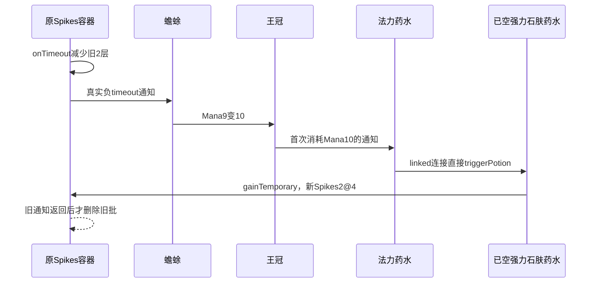

# 自然物品到期重入引擎实验 SPEC

2026-11-10 · **基础两组及N6均已完成，原工程已恢复，Python未实施。**本文先于各阶段脚本修改及运行。已读本地知识库及[T0实验结果](buff_stage2_t0_engine_results.md)，自然重入、断链对照及自然错删实测见[本轮报告](buff_natural_reentry_engine_results.md)。原随机顺序没有被改写，N6首进程即命中目标分支。

## 1. Requirements（需求）

本轮“自然摆盘”指格位合法、职业匹配，战斗层数与计数完全由原物品效果产生；不验证第2或第5回合能通过商店凑齐这些物品，不扩局外获取审核。

用真实摆盘闭合以下链，而不是用API预设层数或计数：

> Strong Stone Skin Potion的Spikes2到期 → Toad累计负变化达到10 → Mana9变10 → Crown首次消耗Mana10 → Mana Potion饮用 → 连接的已空Strong Stone Skin Potion再次被触发 → 新Spikes2@4秒，发生在旧到期函数删除批次之前。

基础两组独立进程：`natural_linked`按规定连接法力药水；`natural_unlinked`只移动法力药水，使其不连接强力石肤药水，其他物品、朝向和流程一致。对照须同样自然走到Toad/Crown/Mana Potion链；随机未达到前置不能算对照成立。基础闭环得到实证后，单独增加`natural_wrong_remove`，不改已保存的前两组证据。

使用`E:/godotsteam/godotsteam.362.editor.win64.exe`，SHA256 `100B76E344A040D2CA50D1B4D03B097A259C35B32D5865043F33486A666EDA1C`。记录实际GodotSteam3.6.2、Game1.1.8、60Hz及time_scale=1；这不是零售3.6.0证据。原工程不复制，不动安装PCK/exe，允许临时只读观察及autoload，结束恢复原字节、输入、环境及哈希。

禁止直接设置HP、胜负、Buff数量/组成、计数器、冷却、概率、随机种子或随机结果；测试驱动不调用gain/use/lose等机制API。基础两组先让双方纯皮包首战自然疲惫结束，走原商店流程进入基础HP35的第二场，再摆规定物品。若实际基础生命不足35，记录未满足前置，不补写HP；N6暖身次数与生命门槛另见2.5。

## 2. Design（设计）

### 2.1 两场流程与隔离

复用`tests/buff_stage2_t0_run.ps1`和`tests/buff_stage2_t0_battle.gd`，不另复制脚本或工程作为执行副本。自然case运行时明确传入，不与旧T0 case混跑。每case独立PID、APPDATA/LOCALAPPDATA，证据路由`data/buff_natural_reentry/<RunId>/`。重复未覆盖场景使用新RunId/PID，保留前次结果。

私有case字段均为int，仅驱动原正常流程，不修改战斗数值：基础两组`warmup_rounds=1, main_round=2, wall_deadline=105`；N6为`4,5,225`。`wall_deadline`单位秒，Node比较对应毫秒。PS入口参数不增加；N6使用已有`-TimeoutSeconds 240`，基础两组沿120。每次暖身终局都走原商店/cleanse，私有流程标记重新准备，直至main_round才摆目标物品和切换第二份对手输入。

己方用原角色选择`Game.instanceCharacter(1)`选Reaper，初始HP25；Toad为该职业正常物品，其他物品为中立或正常合成。对手仍用Ranger输入class0/HP25。首场双方12只皮包，由原疲惫自然终局。首场原事件在离开战斗前存档；正常`Game.switchToShop()`，等待原延后`Character.cleanse`完成。确认同角色实例、实际商店生命及第二场基础生命，再用Inventory原摆放接口替换己方布局。对手第二场为12皮包加Leather Armor，避免饥饿之刃前两次潜在暴击提前结束战斗；全额被护甲挡下的命中仍能在护甲预算前消费Regen，原hasHit不要求生命伤害。

对手输入须按两场切换：PS先生成并备份纯袋首场输入，另保存`opponent_second.json`及SHA。Node在商店清理后核该文件指纹，用`get_buffer(get_len())`读取原始字节，再用`store_buffer`写已备份的原`data/custom_opponent.json`，复核SHA并记录`fixture_input_switch`，之后才摆第二场、开战；不用会改变换行字节的文本往返。PS最终恢复该JSON时仅接受本case预生成的首场/第二场两个已知SHA；其他源文件仍只接受本轮明确探针SHA，不能覆盖并发修改。

原探针保持T0的4文件、11函数，不加观察点，不改Game/EventBus或任何公式/Timer/RNG。先字符串PreviewOnly生成prepared/diff/位置清单，原工程不写入、不启动；审核后才正常执行。每轮保存当时两份小测试脚本及SHA、相较T0脚本的修改差异，不用后续修改覆盖旧证据；四原文件prepared指纹应与T0同点位版本一致。第二场正常观察9秒，未达到前置可到12秒截止并标未覆盖，不在原回调未完成时退出。

### 2.2 第二场冻结布局

坐标为左上格，全部朝上`face=0`；8×6区域。实际运行必须通过原`canAddItemOrBag`并导出占格、影响格和实例ID，静态坐标不是运行通过的替代品。

| 物品/ID | 己方坐标 |
| --- | --- |
| Leather Bag / 11 | x=0,2,4,6与y=0,2,4的组合，唯独不放(4,2)，共11只 |
| Fanny Pack / 26 | 两只，各2×1，(4,2)、(4,3)，填补上述2×2区域 |
| Leather Armor / 17 | (0,0)，2×3 |
| Heart Container / 232 | (4,0)，2×2 |
| Hungry Blade / 28 | (6,2)，1×3 |
| Strong Stone Skin Potion / 46 | (2,2)，1×2 |
| Toad / 274 | (4,3)，1格，放在下方Fanny内 |
| Crown / 217 | (0,3)，2×1 |
| Healing Herbs / 7 | (0,4)、(1,4)、(0,5)、(1,5)，共4只 |
| Blueberries / 22 | (2,0)、(3,0)、(2,1)、(3,1)、(3,2)、(4,2)、(5,2)、(3,3)，共8只 |
| Mana Potion / 172，linked | (2,4)，上方连接格(2,3)命中强力石肤药水 |
| Mana Potion / 172，unlinked | 仅改为(7,3)，上方连接格(7,2)无Potion |

第二场对手：12只Leather Bag覆盖8×6，Leather Armor /17在(0,0)。没有攻击物品、鹿图腾或其他状态来源。Toad的四个影响点应命中Heart Container的(4,1)、Strong Potion的(2,3)、Hungry Blade的(6,3)及空格(4,5)，不命中Crown或Mana Potion。Fanny正常影响内部Toad及两颗Blueberries；不得改写速度。

### 2.3 原物品链与必须实测的门槛

下表为源码预测，不能直接写成实验结果。物品参数来自原CSV及脚本：Herbs第9行、Hungry第46行、Mana Potion第66行、Strong Potion第83行、Crown第109行、Heart Container第111行、Toad第234行；Blueberries第24行、Fanny第37行。

| 阶段 | 原机制及要保存的实际值 |
| --- | --- |
| 开局永久状态 | 4Herbs各给Regen2；Heart Container达7后消耗7，正常增加临时最大生命100并给Empower2；负Regen事件来源须为HC，进入Toad used累计 |
| 第一瓶 | Leather Armor开局Block45满足Strong Potion阈值45，原饮用损15生命、给Block35与临时Spikes2@4。基础生命≥35时，即使先扣15也不低于原50%血线，Mana Potion应仍满；实际先后和生命门槛必须记录 |
| 预充Toad | Hungry前两次正常攻击约在1.52–1.68、3.04–3.36秒，至少一次正常命中消耗Regen1；HC在3秒左右再给1 Regen，可能再被消耗。原Toad used应为8或9，不提前满10 |
| 预充Mana | 8Blueberries第一轮各给1 Mana；两颗受上方Fanny正常加速，其他第一轮也应在3.675秒前。下方Fanny使Toad速度约1.1，首轮3.8秒冷却预计3.2818–3.6273秒触发，给Mana1；在旧Spikes到期前实际应为Mana9，Crown仍Inactive、Mana Potion仍满 |
| 到期转换 | Strong Potion来源的Spikes实际到期−2，使Toad used达10或11；Toad给Lucky1、Mana1，Mana9→10。Toad本身miniActivate仅动画，不把它当真实激活 |
| 同步饮用 | Crown达Mana10且角色可受伤，首次进入Active、先无敌再消耗Mana10。满瓶Mana Potion接该负Mana通知立即饮用。linked通过Potion连接直接触发已空Strong Potion；`triggerPotion`无空瓶守卫，原Strong先healthToBlock再加Spikes2@4 |

如果饥饿之刃前两击均未正常命中，或其他实际参数使前置未到达，记录“未覆盖”及原随机结果；不补一次命中、不重设层数。两组分别核门槛，不要求同种子或同一攻击轨迹。

### 2.4 怎么证明是自然同步重入

不能只看第二次出现了Spikes。核心证据同时满足：

1. 原`Buff.onTimeout`进入，选中旧Strong Potion临时Spikes批，实际减少2，并发出原负timeout事件。
2. 同一调用尚未退出、原`timeout_before_remove`尚未发生时，真实物品链触发同一角色、同一Buff实例的`gainTemporary`及`gain_batch_added`，新来源仍是场内Strong Potion实例，新数量2、duration4；旧批在数组中仍可辨认。
3. 观察递增序号、私有祖先调用栈及实际Engine物理帧证明嵌套，随后记录原删除及最终数组。`on_stack_changed`只记录通知，不执行机制操作。

新层不一定有旧timeout父事件：Potion连接的`triggerPotion()`省略父事件。不得凭parent为空漏认真实链，也不得凭相同时间戳冒充嵌套。观察函数只维护测试私有的调用ID/标签/Buff实例映射，不改游戏状态。

unlinked必须同样发生旧Spikes到期、Toad门槛、Crown首次消耗和Mana Potion饮用，但没有同栈新Spikes批。记录连接目标确实为空，而不是把“前置未达所以没发生”当对照通过。前两组的自然重入与N6错删分别验收，不能互相代替。

### 2.5 N6：自然较长批先插、到期重入后错删

本扩展先等前两组完成及原工程恢复，再修改driver/生成preview。完整主布局不动，新增Strong Stone Skin Potion B（id46）在(4,4)，1×2；Time Melting（id382）在(5,5)，1格。原(2,2)药水称A，Mana Potion仍连接A。Time Melting仅影响B，将原duration4增加55%至6.2；A仍4。A保留私有键`Strong Stone Skin Potion`，B用`Long Strong Stone Skin Potion`作测试别名，实例化名称仍是原物品名。每瓶输出角色别名、实例及实际`getP_m('dur')`，不能因同名覆盖引用。

先完成4场双方纯袋的自然疲惫战，正常进入第5场，核实际基础HP≥65再摆目标布局。65只是最低门槛，本轮实际基础生命序列为25/35/45/55/70，主场70；不能将65写成实测值。两瓶开局各损15，最低65起点也能保证HC尚未加生命时剩35、不低于50%血线，不能直接补HP。Time Melting同时正常给Heat5，不能关掉：Toad速度预计1.2，首轮3.008–3.325秒、第二轮最早6.016；Hungry速度约1.1，前两击最迟3.055、第三击最早4.145；蓝莓在4秒前仍每颗一次，HC仍有一次补Regen。旧Toad used8/9、Mana9、药水满等门槛继续逐项实测；B的正Spikes可触发Toad治疗，但不会直接增加Mana或used。

目标是原随机监听顺序令A先喝：A的healthToBlock递归触发尚满的B，B先完成Spikes2@6.2进入数组index0；返回后A的Spikes2@4进入index1。原shuffle必须照常，实际数组不是B先/A后则保留为正常插序样本或未覆盖，另起PID重试，不改顺序/种子/监听。

在A实际到期时，沿已证自然链新增A的Spikes2@4；原Timer启动可能将next改0，旧onTimeout随后错删B。硬验收看同一调用选中A批、remove前index和列表、remove后B批消失但旧A仍在，随后同旧A批再次到期，以及B没有在原6.2秒期限产生自己的到期事件。两分支最终都可能归0，不能以最终残留判定；记录约4至6.2秒的实际Spikes。若称“少2”，应明确相对未错删时B与新A均仍有效应有4层的规则推断，或另有同摆盘正常插序实测对照。

N6仍只用原物品和原四文件11点探针；没有直接构造长批/短批API。暖身、重试和原随机结果逐进程留档；当前阶段不增加第四个场景或新的机制框架。

### 2.6 全部函数接口与伪代码

**PowerShell。**不新增函数或参数，只扩case路由和两场输入：

| 完整接口 | 伪代码 |
| --- | --- |
| 入口`param([string]$RunId=<时间戳>,[string[]]$Cases=@('all'),[int]$RepeatCount=3,[int]$TimeoutSeconds=120,[switch]$PreviewOnly,[double]$EqualDuration=0.2)` | 保留旧参数校验；接受上述3个自然case，禁止与旧case混跑，显式指定；按case写warmup_rounds/main_round/wall_deadline，N6调用现TimeoutSeconds240。建立唯一目录、固定exe，备份10路径，生成纯袋/目标场对手输入及两个SHA、原四文件preview和脚本存档。审核后各case独立PID/环境运行；finally恢复源/输入/环境、重算10路径，拒覆盖未知并发修改 |
| `Get-T0Hashes([string[]]$Paths) -> hashtable` | 复用，只读逐文件SHA256返回字典，不称整工程哈希 |
| `Write-T0Utf8([string]$Path,[string]$Text) -> void` | 复用，UTF8无BOM写明确证据/已备份输入或探针目标 |
| `Add-T0Observation([string]$Text,[string]$Needle,[string]$Replacement) -> string` | 复用，仅标记恰出现1次时插原只读探针，否则停止 |

**测试Node。**沿用13函数签名，不增加自然层数/计数预设函数：

| 完整接口 | 伪代码 |
| --- | --- |
| `_ready() -> void` | 读case/第二场输入指纹，独立保存实际exe、3.6.2/Game1.1.8、源SHA、隔离路径、flags/物理频率/scale；连接原开战事件，不符则失败 |
| `_process(_delta: float) -> void` | 自然case用原instanceCharacter(1)选Reaper；按case.warmup_rounds走自然终局/商店循环。主场通常观察9秒，门槛未达等至12秒后保存未覆盖；若先自然结束则保存。墙钟守卫读取wall_deadline秒（基础105/N6 225），不等停止的战斗时钟，不判胜或补状态 |
| `_physics_process(_delta: float) -> void` | 复用，调用场景流程run_actions，不操作Buff/Timer |
| `setup_layout() -> void` | 暖身各场纯袋；main_round前用原Inventory重建冻结布局，N6再加B和Time Melting。按坐标保存A/B独立引用，输出实际期限、占格/影响/连接/Fanny内部物品；不改属性数值 |
| `add_item(name: String,x: int,y: int,f: int=0) -> Item` | 复用原实例化、定向、canAddItemOrBag/addItemByTopLeft，非法摆放失败 |
| `start_case() -> void` | 每场只登记角色身份、通知监听和初始快照，重置测试私有流程标记；不调用gain/use/lose/reset或改冷却。main_round核基础HP≥35或N6≥65及实际状态，不符未覆盖 |
| `run_actions() -> void` | 每场暖身原疲惫终局后归档事件，原switchToShop并等cleanse；未到main_round则纯袋再开战。到目标场前核输入SHA，原字节buffer切换原JSON并复核，setup_layout后原switchToCombat。只用正常流程/摆盘输入，不刺激机制 |
| `on_stack_changed(amount: int,event: CombatEvent) -> void` | 只保存原通知/来源/used/timeout/实际量与自然链状态，不在回调给层、用层或触发药水 |
| `new_call_id() -> int` | 复用，仅私有观察计数递增 |
| `observe(label: String,call_id: int,subject: Object,payload: Dictionary={}) -> void` | 原只读探针入私有调用栈，关联标签/Buff/来源；新批检查同Buff onTimeout祖先。严格绑定同一个已满足前置的旧A调用、Strong A来源/2层/4秒、旧批未remove；N6另关联选中/实际删除B、旧A再次到期的批ID，不调用游戏行为 |
| `snapshot(label: String,payload: Dictionary={}) -> void` | 只读原组成/批ID/来源/Timer/多时钟，Toad/Crown/药水状态、连接、HC/剑/8蓝莓参数及实际HP/伤害；N6分别输出A/B角色别名与实际dur、Time Melting影响及Heat5，不增原probe点 |
| `capture(label: String) -> void` | 复用，保存当前viewport；图作摆盘/HUD辅助，不代替同调用实际量 |
| `finish(status: String,message: String='') -> void` | 保存所有暖身/主场原事件、输入/随机结果、完整观察；基础组严格判嵌套/断链，N6另判旧A选中却删B、重复A/无B到期与中段数量。顺序未命中记未覆盖，最终同为0不作错删证据；自己退出，不把退出码代验收 |

**原工程探针完全复用T0，无新增点或接口。**`Buff.gainTemporary(amount:int,duration:float,item=null,triggerEvent=null,reflect:bool=false)`、`loseStacks(amount:int,item=null,triggerEvent=null,used=false)`、`changeCurrentLogShowLabel(isTimeout:bool,amount:int,item=null,triggerEvent=null,used:bool=false)`、`onTimeout()`、`reset()`、`combatEnd()`；`Character.combatStart()`、`combatEnd()`、`cleanse()`、`onTick()`；`Item.trigger()`。伪代码均为原入口/原局部/原返回处只读observe，保留原公式、随机调用、索引、Timer及同步通知顺序；必要return仅等价展开，细节见[T0接口与探针位置](buff_stage2_t0_engine_spec.md)。Game/EventBus/Potion等机制文件不改。

### 2.7 恢复证据

原字节备份与10路径清单沿T0：project.godot、Buff.gd、Character.gd、Item.gd、Game.gd、SteamHelper.gd、明文/加密ItemData、原custom_opponent.json、所选GodotSteam.exe。仅前4项临时probe及原JSON输入可写。原JSON缺失则恢复缺失；当前已知首/二场输入指纹以外的变化不得覆盖。

保留每轮preview及实际diff/位置、原/观察版SHA、当时tests脚本版本、两场输入、合法布局、实际HP与自然随机结果、stdout/Godotlog/stderr、原事件、调用栈、进程起止/退出及restoration。最后独立重算10路径、查无probe/PID残留、还原环境；不是整工程逐文件核验。

## 3. Tasks（任务拆解）

1. [x] N1：固定本SPEC、两布局、自然前置和完整接口。
2. [x] N2（N1）：扩现两测试脚本及输入切换，生成PreviewOnly；独立审四文件diff仍只读、未写原工程，再运行。首轮输入换行失败留档，改原字节传递后重跑。
3. [x] N3（N2）：linked自然首战→第二场，逐项前置及旧timeout未删批时同Buff新批均已实证；无机制API刺激。
4. [x] N4（N2）：unlinked同样达到Crown/药水链但无同栈新Spikes；只移动Mana Potion。
5. [x] N5（N3/N4）：独立核原调用/事件/实际帧、恢复10路径和环境，基础两组结果已交；未实装Python。错删另按独立N6执行。
6. [x] N6（N5）：按2.5扩独立natural_wrong_remove，preview审查后运行；4场自然暖身→第5场双瓶/Time Melting，原shuffle首PID即B先/A后。已核真实选A删B、同旧A重复扣量、B原期限无到期及中段数量；正常未错删应有4是规则推断，不冒称同摆盘正常插序对照。独立复核、10路径和环境恢复完成，未实施Python。

## 4. Acceptance Criteria / Tests（验收标准）

- 实际E盘3.6.2/Game1.1.8、原工程、60Hz/scale1/隔离存档及原/观察版指纹明确；无复制工程、安装修改、机制/RNG/数量/计数器/HP干预。
- 首场纯袋自然疲惫结束，走原商店/cleanse至第二场，身份及真实基础HP≥35可核；第二场布局和影响/连接通过原API，不能只靠预设坐标。
- linked逐项实测：HC用7 Regen、Hungry前两击至少一次用1、Toad used8或9、Mana9、Crown未用、Mana Potion满、Strong首瓶已空及旧Spikes实际到期2。自然Crown消耗10后法力药水真实饮用，连接Strong触发。
- 原onTimeout调用仍在栈内且尚未删除旧批时，同角色/同Buff实例出现新Strong来源Spikes2@4批，观察顺序和Engine帧可核；不能要求被原调用丢弃的parent字段，也不能拿下一物理帧行为冒充同步重入。
- unlinked前置同样达标，只因移位不连接而没有该同栈新Spikes；随机未达前置记未覆盖，不算反证。基础两组不要求错删或总量异常。
- N6需自然4场暖身后主场base≥65，A实际4/B6.2且仅B受Time Melting影响；Heat5等自然副作用保留。原shuffle确使B先入/A后入；同旧A到期通知重入后，真实删除B批、旧A再次到期、B原期限无自身到期事件均可核。记录中段数量，不把最终0当无异常，也不把正常插序样本冒充目标分支。
- 每轮输入/HP/原随机结果和脚本版本留档，四源probe保持只读；全部原字节/JSON/环境恢复、10路径SHA一致、本PID退出，无探针残留。结果限定此版本和实测链，不推广全部临时层场景。
