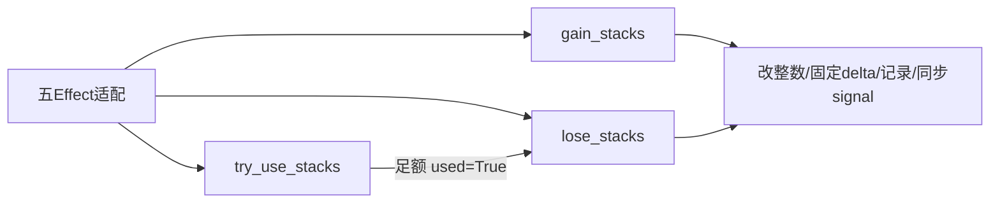

# Buff层操作对齐 SPEC

2026-11-09 · **方案草案，未实施**。本轮仅审计并写本文，未改代码/测试/数据，未运行测试或引擎；全部宝石工作暂停，旧宝石SPEC不改。

后续已用原exe与真实物品摆盘核实本文的负left/满cap提前返回两项异常，见[原引擎实测结果](buff_engine_edge_verification_results.md)。此证据补充不改变本文设计或实施状态；临时批次等其他验证门槛仍保留。

## 1. Requirements（需求）

审查并改进现有五类状态Effect：`GainBuffEffect`、`UseBuffEffect`、`BuffRemovalEffect`、`InflictDebuffEffect`、`CleanseDebuffEffect`。目标是沿用当前基座，按本期范围复现原版顺序，保留已有调用者的构造/布尔合同，并分清请求量、实际量和原版事件返回。

依据先读`docs/backpack_battles_knowledge_base.md`，再以`Backpack Battles/`当前1.1.8解包为准。旧`docs/buff_debuff_intrinsic_effects_spec.md:116-139,287-301`有意排除抵抗/放大/反弹/保护/临时层；本批是扩范围，不以旧Wiki设计裁决源码。

**分两阶段**：首期仅现有7 Buff（Empower、Heat、Luck、Mana、Regeneration、Spikes、Vampirism）和3 Debuff（Poison、Blind、Cold）的永久层、即时事件、五Effect适配。临时层、Delayed队列、Block关联迁移另期。所有测试在tests、输出在data、文档在docs；不接入宝石、狂怒或局外功能。

### 1.1 现有行为与调用合同

五构造都要求名称是受支持的精确str、amount为非负精确int，拒绝bool/float；`apply(context: BattleContext) -> bool`。位置为`item_effects_v1.py:215-425`。

| Effect | 当前目标与写入 | bool / 零值 |
| --- | --- | --- |
| GainBuff | owner.buffs += request | request>0；0=False |
| InflictDebuff | opponent.debuffs += request | request>0；0=False |
| UseBuff | owner足额才全扣，不足不扣 | 足额True，含0=True |
| BuffRemoval | opponent Buff扣min(current,request) | actual>0；0=False |
| CleanseDebuff | owner Debuff扣min(current,request) | actual>0；0=False |

目前无上限/抵抗/放大/保护/反弹/层变化signal；每次apply含失败/零值都写原action、request/final/success日志。五处setattr是根生产代码全部Buff/Debuff运行时写点；其他模块读slot，测试还会直接赋初值。`BuffSlot/DebuffSlot`为7/3整数，`__annotations__`用于合法名称和遍历，不能把修饰参数塞进这些slot。

唯一依赖五类bool的现生产调用者是`MagicForDummies.run_effect:604`：Use成功才加生命，缺蓝仍激活；Wand及其他物品忽略这五类返回。`CleanseDebuffEffect`暂无生产调用者。现测试锁定上述合同（`tests/test_item_factory_registry_v1.py:2559-2737,3847-3886`），日志测试还锁定原action顺序和零变化记录（`tests/test_battle_logging_v1.py:294-364,632-655`）。

## 2. Design（设计）

### 2.1 源码的三层语义

1. **物品施加**：`Items/Item.gd:4941-4948`先检查原amount>0，再`godot_round(amount*item.buffPowers[type])`，带直接source=self进入角色/Buff；不是所有操作都乘power。
2. **状态增减**：`Core/Buff.gd:71-196`处理gain；`:199-315`处理lose。底层`used=True`的use允许部分扣现有量且跳过保护。`Item.tryUseMana:5067-5072`等上层才检查足额。现UseBuffEffect保留这种**try-use项目适配**，不改成底层部分use。
3. **包装返回**：原底层通常返回成功CombatEvent或null，不是bool；source=None仍可改层但不创建成功事件/不发signal。`Item.cleansePoison/Blind/Cold:4993-5000,5008-5015,5080-5087`返回的是移除前min库存请求量，即使保护阻止也可能正值；现Cleanse bool表示actual>0，不能冒充该返回。

**gain流程**（逐语句按`Buff.gd:76-196`）：

```text
N=请求层数；amount=N；resisted=0
c=目标resistChance - (有Item且非反弹入站 ? 来源amplification : 0)
c>0：按原N次普通roll累计resisted
c<0：按原N次普通roll，成功则amount+=1；c=0不做该roll
left=amount-resisted
若Debuff且非反弹入站：
    按放大后的amount次roll反弹（不是left；默认0%也抽）
    left扣概率反弹，再按正left消耗角色debuffReflectStacks
    amount扣总反弹量
若Debuff：先min(left,该类型resistStacks)，再正left时角色debuffResistStacks
仅resisted>0时：amount-=resisted，再记录抵抗；否则不减
amount>0时按10000-current截断；截断恰0直接return，跳过待反弹
实际正量写current、固定delta、记录并同步发成功事件（仅有Item来源）
原目标回调完成后，再给对手续发反弹：同type/数量/source/parent，reflected=True
反弹入站仍受目标抵抗/抵抗层，不再来源放大或再次反弹
```

普通roll是`rng.random() <= percent/100`，不钳制、不用Balanced、不做端点短路（`Utility/Util.gd:1007-1014`）；0%抽到精确0也必须真实反弹。抵抗与反弹重叠可使left负，源码min(left,resistStacks)的负消耗可能增加抵抗层；不得擅自max(0)修正。满cap提前return、负left等先照源码实现，作为原引擎验证门槛。视觉标签也消耗原全局RNG（`Character.gd:688-691`），本批只对齐机制随机次数，不宣称完整seed同轨。

**lose流程**：先cap=min(current,request)。非used时按cap层对cleanseProtection正概率增加保护、负概率扩大移除，再clamp到0..current；扣该类型resistStacks保护（Buff/Debuff均适用），再扣角色buffProtectStacks（仅Buff且非Block）。记录正量Protect事件，实际扣层后发负成功事件。used跳过全部保护/保护层，但仍最多扣已有量。首期没有临时组成量；保护并非全有或全无检定。

### 2.2 最小结构与范围边界

保留`BuffSlot/DebuffSlot`整数为首期唯一层数。增加普通数据对象和三个操作入口，不替换成每状态对象/属性代理，不引入signed change_stacks、策略框架或新调度层。

| 所属 / 数据 | 作用与默认 |
| --- | --- |
| `StackState` | 每类型仅`resist_chance_percent:float=0, resist_stacks:int=0, reflect_chance_percent:float=0, cleanse_protection_chance_percent:float=0`；无current/permanent/temp |
| `PlayerState` | `stack_states:dict[str,StackState]={}`，按需建立；全局`debuff_resist_stacks/debuff_reflect_stacks/buff_protect_stacks:int=0`，不复制进每类型 |
| `BattleItem` | `stack_powers:dict[str,float]={}`（缺省1），`stack_amplification_chances:dict[str,float]={}`（缺省0）；五Effect施加适配读取来源 |
| `StackResult` | `delta:int, event:StackChangeContext\|None`；delta是**本次局部实际变化**，在signal前固定 |
| `StackChangeContext(BattleContext)` | `target:PlayerState, stack_name:str, amount:int, source_item:BattleItem\|None, used:bool, reflected:bool, timeout:bool, trigger_log_handle:LogHandle\|None, log_handle:LogHandle`；首期timeout=False |

target与source独立，不随`for_item`切换owner/opponent而改变。source是本次直接施加Item，不继承根攻击者（`Core/CombatEvent.gd:63-64; CombatLog.gd:722-774`）。Luck保留现字段名，但signal映射原版`character_lucky_changed`；其余按原枚举名小写。source=None可返回非零delta而event=None；不能以bool(event)或emit后总量差判断成败。

**总线不改**：现`connect/emit_signal`的int listener与Trigger足以订阅新context；`for_item`已保留子类载荷。通知沿连接顺序同步，日志先于signal；不要为直接handler加入str/callable协议。

**首期不迁移Block**：原版Block同容器且isBuff=True、cap100000；本期入口仅10类型、cap10000，不宣称支持11类型却让GainBlockEffect/RemoveOpponentBlockEffect/攻击吸收继续绕开。原吸收Block调用source=None、used=False的loseBlock，healthDamage已预先计算（`Character.gd:589-597`）；保护对扣Block的影响留二期，不改现攻击接口。

### 2.3 返回、来源链与日志单写者

五构造及`apply(context)->bool`保持。Gain/Inflict/Remove/Cleanse按本次delta正负判断实际发生，Use按try足额合同，0仍True。低层返回StackResult，不丢失source=None变化或同步重入前的实际量。

core是成功Stack/Resist/Protect事件唯一写者：成功写`action="stack_change"`及actual、target、source、used/reflected/timeout、显式parent；抵抗/保护分别写`stack_resisted/stack_protected`。只有成功且有Item的Stack事件发层变化signal。五Effect保留旧action（gain_buff/use_buff/remove_buff/inflict_debuff/cleanse_debuff）为**effect_attempt诊断**，含request/final/success、`event_kind="effect_attempt", contributes_to_stack_totals=False`；不再统计一次成功变化，测试不得把诊断当第二份Stack事件。core及回调先完成，adapter再记诊断；旧日志条数/顺序相应更新，无兼容框架。

core保留显式`trigger_log_handle`入口，不从AttackContext自动猜父链。首期不为补父日志链加last_result或改无关Effect/物品：原Broom致盲父攻击（`Broom.gd:28-33`）、Rat毒/盲父伤害（`Exclusive/Rat.gd:17-24`）、Wand Empower父使用事件（`Exclusive/Wand.gd:22-23`）、Book临时生命父使用事件（`Exclusive/BookofBasics.gd:18-23`）尚未接齐，明确为本期限制；直接origin仍正确。未来需事件的调用者可直接用core结果，不通过共享可变last_result。

Wand即时永久路径属于主验收：`Exclusive/Wand.gd:11-24`调用`giveLeastBuffs/removeMostBuffs`，这两个wrapper（`Item.gd:5538-5544,5569-5590`）**没有Delayed**。其最低值给予→重读当前值→阈值→最多值used消耗→Empower顺序保留，不能因内部随机并列选择而排到二期。

### 2.4 逐函数接口与伪代码

下表类型缩写仅供文档：`PS=PlayerState, BI=BattleItem, BC=BattleContext, SC=StackChangeContext, LH=LogHandle, Seq=Sequence`；`R=godot_round`为已有函数。`StackState/StackResult/SC`使用上述字段的dataclass构造，无隐藏算法。拟新增/修改函数全部列下，未列函数保持。

**构造接口保持**：

```text
GainBuffEffect.__init__(self,buff_name:str,amount:int)
UseBuffEffect.__init__(self,buff_name:str,amount:int)
BuffRemovalEffect.__init__(self,buff_name:str,amount:int)
InflictDebuffEffect.__init__(self,debuff_name:str,amount:int)
CleanseDebuffEffect.__init__(self,debuff_name:str,amount:int)
```

五者伪码相同：验证精确str且在对应slot注解，amount是非负精确int；保存名称/数量。继续复用，不放宽输入。

`BattleItem.__init__`保留完整签名，只加两个每实例字典：

```text
(self,item_id:str|None=None,item_key:str|None=None,player_id:int|None=None,
 is_active_item:bool=False,triggers:Seq[Trigger]|None=None,
 effects:Seq[Effect]|None=None,linked_items:Seq[str]|None=None,
 display_name:str|None=None,item_classes:tuple[str,...]|None=None,
 rarity:str|None=None,cost:int|None=None,item_types:tuple[str,...]|None=None,
 icon_types:tuple[str,...]|None=None)
```

伪码：沿用初始化，建立独立stack_powers和stack_amplification_chances。PlayerState字典用default_factory=dict，无新定制构造。

| `BattleState`具体函数 / 完整接口 | 伪代码 |
| --- | --- |
| `_stack_slot(self,target:PS,stack_name:str) -> BuffSlot\|DebuffSlot` | 验证target属于本battle、名称是10类型；返回对应slot；Block拒绝，不引入名字枚举对象 |
| `_stack_state(self,target:PS,stack_name:str) -> StackState` | 校验slot；缺metadata时建默认StackState并保存；返回同一对象，不复制current |
| `_commit_stack_delta(self,target:PS,stack_name:str,delta:int,*,source_item:BI\|None=None,used:bool=False,reflected:bool=False,trigger_log_handle:LH\|None=None) -> StackResult` | 写slot；先固定本次delta和结果；delta非0且有Item时创建/记录Stack事件，建固定target/source的SC后同步emit；返回固定结果；无Item不造成功event |
| `gain_stacks(self,target:PS,stack_name:str,amount:int,*,source_item:BI\|None=None,trigger_log_handle:LH\|None=None,reflected:bool=False) -> StackResult` | 先验证，result=StackResult(0,None)；amount==0返回result；按2.1流程，仅resisted>0才减amount后记抵抗；正剩余赋值result=_commit；cap恰0提前return；回调后续发反弹，原source/parent、reflected=True；返回原目标result，不二次power |
| `lose_stacks(self,target:PS,stack_name:str,amount:int,*,source_item:BI\|None=None,trigger_log_handle:LH\|None=None,used:bool=False) -> StackResult` | cap=min(current,amount)；used跳过保护，否则按2.1保护概率/专用层/全局层；仅protected>0先记Protect；actual=min(current,最终amount)，以-actual提交；无变化StackResult(0,None) |
| `try_use_stacks(self,target:PS,stack_name:str,amount:int,*,source_item:BI\|None=None,trigger_log_handle:LH\|None=None) -> StackResult` | 足额检查；不足不改任何层/保护参数，返回(0,None)；足额调用lose_stacks(used=True)；amount0同样零delta，adapter另给True |

gain/lose/try入口先验证target/name及amount为非负精确int，拒bool/float/负数，仅零请求无操作；复用get_player/record_log/emit_signal/for_item，不加验证框架。metadata默认正常；异常源码分支不擅自clamp。

五`apply`签名均为`(self,context:BC)->bool`，不加隐式父事件或新keyword。下表`attempt`表示该函数用既有record_log写2.3诊断，不是新增辅助函数；`result.delta`必须取core的固定值。

| 具体函数 | 伪代码 |
| --- | --- |
| `GainBuffEffect.apply` | power=1（item=None）或item.stack_powers.get(name,1)；scaled=R(amount×power)；正scaled时gain_stacks(owner,name,scaled,source_item=context.item)，否则零结果；success=delta>0；attempt并return |
| `InflictDebuffEffect.apply` | 同Gain缩放/None源默认1/正量守卫，目标opponent；scaled<=0用零结果、不调用core；success=delta>0；attempt并return |
| `UseBuffEffect.apply` | try_use_stacks(owner,buff,amount,source_item=context.item)，不乘power；success=(amount==0 or delta==-amount)；attempt并return |
| `BuffRemovalEffect.apply` | lose_stacks(opponent,buff,amount,source_item=context.item,used=False)；success=delta<0；attempt并return |
| `CleanseDebuffEffect.apply` | lose_stacks(owner,debuff,amount,source_item=context.item,used=False)；success=delta<0；attempt并return；不当作原cleanse预截量返回 |

所有bool显式为布尔表达式，不能直接返回delta整数。core最初gain请求已经是物品缩放后的整数；反弹直接续发core并跳过来源amplification，目标自身抵抗仍保留。



### 2.5 二期的数据归属与分期理由

**原版事实**：`Buff.gd`分别保存总层数、永久层数量和临时批次。到期处理先减总数并通知，通知引发的反应结束后再删除到期批次（`:317-340`）。有界检索未发现其他脚本或物品直接访问这几个批次字段。这说明原版采用冗余记账；尚不能据此断言模拟器也必须复制其存储结构或内部删除顺序。

**二期优先设计**：由`PlayerState`保存永久层数量和各临时批次；每批记录数量、到期时间和来源物品。总数由永久量加当前批次剩余量求和，避免独立维护另一份总数。到期处理先移除对应批次，固定本次变化量，再通知物品；普通移除仍遵循永久优先、临时批次最晚到期优先。具体读取接口的迁移在二期SPEC列出，本期整数接口不改。

必须区别两种计算方向：用总数减临时量反推永久量，在原版通知期间可能算错；保存永久量与临时批次、用它们求总数，不受此前反例影响。例如永久1、当前到期2、稍后到期3共6层，先移除到期批次后总数为4；通知期间使用永久1后总数为3；稍后3层到期后归零。此前用这个例子否定批次模型的结论撤回。

所有物品读取同一个实时`PlayerState`，不复制或分发另一份状态清单。`StackChangeContext`只描述本次变化量、来源等事实，并引用同一目标角色，不承担角色状态存储。需要对齐的是物品实际读取到的层数、消耗选择、通知顺序和战斗结果；不能把内部字段布局相同当作等价性的必要条件。

分期用于先验收永久层规则，再验证批次模型能否复现临时到期与连锁行为。此前例子已能正确处理，完整等价性仍须用Godot轨迹检查，尤其是同一时刻多批到期、通知期间继续增减、原版临时索引和重置疑点；有可观察差异时再依据证据调整，不预设额外兼容机制。首期不加空临时字段。

原版延后通知同样不延后数值修改：先改同一角色的状态，再排队发送本次变化消息；发送时物品仍读取最新状态。发送开始前先复制并清空消息队列，新反应可插入旧消息之间（`Utility/EventBus.gd:14-96`）。随机批量处理有此需求，现Wand没有；首期不新增队列。

## 3. Tasks（任务拆解）

全部未实施。

| 任务 / 依赖 | 产物与验证 |
| --- | --- |
| [ ] T1 / 无 | 固定五Effect现合同、源码流程和10类型边界；先列兼容/日志变化 |
| [ ] T2 / T1 | 普通metadata、SC与StackResult、slot/state查询及commit；验证固定target/source/delta及无Item事件规则 |
| [ ] T3 / T2 | gain/lose/try-use、逐层抵抗/放大/反弹/保护/上限；保留异常控制流 |
| [ ] T4 / T3 | 五Effect接入、一次power缩放、bool兼容与单写者日志；Wand/Book等现路径专项 |
| [ ] T5 / T4 | 增加tests下专项、必要回归；更新随机fixtures和日志断言，再跑受影响模块/全套unittest |
| [ ] T6 / T5 | 匹配Godot3.6/1.1.8核实首期异常、事件/机制RNG；证据data、结论docs |
| [ ] 后续二期 / T6及另写SPEC | 永久量/临时批次求总数、读取接口迁移与到期连锁验证，Delayed、Block整条迁移及未接父链；不以首期完成替代 |

## 4. Acceptance Criteria / Tests（验收标准）

1. **现接口兼容**：五构造验证不变；Gain/Inflict/Remove/Cleanse的0=False，Use0=True；Use不足不扣、raw used允许部分扣。Magic书缺蓝仍激活、足蓝消费后加生命，Wand即时给予→消耗→Empower不误入Delayed。
2. **增层**：7/3类型、cap10000、source power只在物品适配乘一次并R；正/负/零总抵抗及批量放大，Debuff概率/全局层反弹→专用/全局抵抗层顺序。反弹不再power/amp/反弹，但可再抵抗；直接source不换成目标或根攻击者。
3. **减层**：最多现有量；正/负保护概率、专用抵抗层、全局Buff保护；used全部跳过。保护成功时项目Cleanse bool=False，不把原包装预cap返回误判为actual。
4. **随机/异常**：统计机制draw次序含默认0%反弹及精确0真实命中；与旧Inflict同seed后续序列允许改变，更新fixtures而非强保旧路径。负left及满cap提前return照源码，Godot核实前不宣称完全等价。
5. **事件/重入**：先写值并固定delta再记录成功event/signal；双方监听者改owner视角但target/source不变，Luck发lucky信号；回调再改同层不影响外层delta。五Effect的item=None仍支持数值/bool/attempt，power默认1，无成功event/signal；反弹在原目标回调后。
6. **日志**：Stack/Resist/Protect由core单写；Effect attempt单列且不双计；零/失败无成功signal。核心显式parent保留，不自动借攻击context；现Broom/Rat/Wand/Book未补父链和二期边界写明。
7. **范围/验证**：不改Block、攻击、总线接口或宝石文档；临时/Delayed入口不假装可用。使用AGENTS指定本机Python绝对路径，专项→受影响模块→全套回归；本轮不执行。静态审计、Python验证、原引擎验证分别记录，未核实项不标“原版全部等价”。
