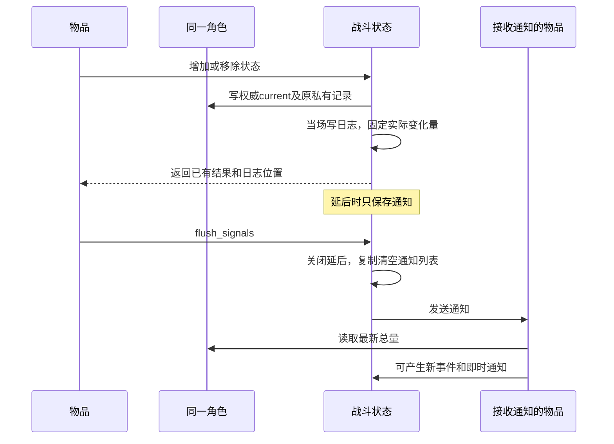

# Buff层操作二期 SPEC

设计：2026-11-10 · 实施验证：2026-11-11 · **二期Python实现完成，664项全回归通过；T0与自然摆盘实验已完成。**承接[一期方案](buff_stack_alignment_spec.md)，实施前609项完整基线通过。本期保留会影响单场真实战斗的原版到期异常，已完成核心、Effect与父事件接入及测试迁移；历史原引擎实验报告保持不变。

## 1. Requirements（需求）

完成7种增益、3种减益和护甲（Block）这11种状态的永久数量、临时批次、到期、移除与消耗；补齐护甲路径，以及扫帚（Broom）、老鼠（Rat）、平衡魔杖（WandOfEquilibrium）和魔法书（MagicForDummies）的父事件传递。

所有物品读取同一个PlayerState的现有整数总量：BuffSlot、DebuffSlot和block继续保留。永久量、临时批次与计时字段只用于原增减/到期算法，不能用它们的和覆盖总量，也不能反推补账。沿用普通数据类、列表和现战斗循环，不增加代理、兼容层、调度框架或模式开关；不扩宝石、狂怒、商店或没有当前调用需求的批量效果。

**本期采用更简单的日志规则：日志立即写入，只延后通知。**日志函数不改战斗状态、不抽战斗随机数、不发通知；战斗代码不读取日志来推导下一步战斗。日志顺序不追求逐条复刻原版，具体差异在2.3说明。既有布尔返回约定保持，例如消耗0层成功、数量不足时不消耗。

保留已有实测行为：[原exe3.6.0的负left和满层反弹边界](buff_engine_edge_verification_results.md)、[GodotSteam3.6.2中专用抵抗层挡自身净化](buff_cleanse_resistance_engine_results.md)。本次另完成[T0到期与生命周期实验](buff_stage2_t0_engine_results.md)，使用GodotSteam3.6.2/Game1.1.8，不混称零售3.6.0证据；未验证的护甲保护链仍保留边界。魔法书现有永久最大生命近似保持，本期只补父事件，不改成完整BookofBasics临时最大生命。

后续[自然物品补测](buff_natural_reentry_engine_results.md)已在合法格位、Reaper职业匹配的战斗中触发同Buff到期重入，以及选短批却删长批、同短批重复到期。此次修订保留这条单场算法，不再采用按对象提前删批的求和模型。证据限GodotSteam3.6.2/Game1.1.8，未测胜负分歧，不审核第2/5回合商店获取；跨场历史不纳入本期。

## 2. Design（设计）

### 2.1 保留现有总量，另存原算法所需私有数据

例如原自然链选中A批到期，先扣总量并发通知；通知新增临时批时改了共享索引，返回后可能删掉B，下一帧又扣同一A。此时原总量与永久量加批次数量可能不一致，物品仍必须读原总量；自动重算会改变战斗。

保留`BuffSlot`、`DebuffSlot`、`PlayerState.buffs/debuffs/block`和全部现有读点、两处序列化。现`_stack_slot`仅改为返回普通二元组“容器、属性名”：增益/减益沿原字段，Block返回`(player,'block')`。没有新增get_stacks或状态代理。Luck沿用现拼写，通知仍为lucky；Block属于增益，但不加入随机增益候选。

固定`_STACK_TIMER_ORDER=("Block","Luck","Regeneration","Vampirism","Spikes","Mana","Empower","Heat","Poison","Blind","Cold")`，对应原注册顺序。构造与计时遍历用这个普通元组，不按BuffSlot注解顺序、第一次gain顺序或临时批到期时间全局排序。

| 数据 | 字段与用途 |
| --- | --- |
| `PhysicsTimerState` | 普通数据记录：`wait_time:float=1.0`、`time_left:float=-1.0`、`processing:bool=False`。wait按原float32保存，left以Python浮点保存原double运算；不是节点、事件或调度器 |
| `TemporaryStackBatch`，普通数据类且`eq=False` | `amount:int`为该批剩余量，`expires_at:float`为名义期限，`source_item:BattleItem\|None=None`为原来源。列表保插入顺序，不合并；不存父事件或反弹标志。到期删除使用共享索引，不按对象身份纠正 |
| `StackState` | 构造仍只有一期4个抵抗/保护参数；新增均为`init=False`：`permanent_stacks:int=0`、`temporary_stacks:list[TemporaryStackBatch]=field(default_factory=list)`、`next_temporary_index:int=0`、`timer:PhysicsTimerState=field(default_factory=PhysicsTimerState)`。不加StackState.current；权威总量仍在旧slots/block |
| `PlayerState` | 原总量和构造参数保留；新增`__post_init__`一次播种11状态永久量，保留预配置抵抗，不重播种。另有私有`status_tick_timer:PhysicsTimerState`和`status_tick_counter:int=0`，均`init=False`、记录用factory |
| `StackChangeContext` | 保留一期字段，末尾增加`duration:float=-1.0`。`amount`是本次实际变化量，`source_item`是直接来源物品，`trigger_log_handle`是明确传入的父事件位置；`target`仍引用同一角色 |
| `LogHandle` | **保持当前结构**：`battle_state:BattleState, sequence:int`。`sequence`继续是日志数组下标，不增加创建编号、计数器或日志字典引用 |
| `BattleState` | 新增`signals_delayed:bool=False`、`_pending_signals:list[tuple]`和`fatigue_start_timer/fatigue_tick_timer:PhysicsTimerState`，均`init=False`；列表/计时记录用factory。只队列通知、不队列日志。删除旧3个next_regeneration/poison/nightfall_fatigue_time字段及旧系统tick入口，不留双调度 |

`_stack_state`仅在状态尚不存在时新建，并从当时原整数总量播种永久量；通常构造时已齐。已存在状态绝不重播种。生产不支持临时初值；测试异常夹具可在构造后明确设置私有字段，普通初值用PlayerState构造或正常gain，不为旧测试裸写增加自动同步。

现伤害、速度、平衡魔杖与两处序列化继续读取同一整数总量，不迁移读点，不展开含物品引用的私有状态。历史仍为总量轨迹，不能重建全部批次；专项测试直接核私有字段及事件。不新增初值或历史协议，不把导出历史分发给物品。

### 2.2 临时增减、到期与结束

一次移除4层时，如果有永久1层和临时两批，先移除永久1，再从最晚到期的批次移除3；只移除一部分时，保留该批原到期时刻和来源。同期限取先插入批。这对应原`Buff.gd:199–280`。

`duration`采用原接口的有限浮点秒数，默认−1；小于0表示永久，非负表示临时。0也建立临时批次，但增加事件类别仍为普通Stack（`Buff.gd:179–185`）。不把旧草案的None约定带入实现。名义期限为当前战斗时刻加duration，真正触发由下面的计时字段决定。

复用`_commit_stack_delta`：减少时先取`min(当前总量,请求减少量)`，写现整数总量；非零且有来源物品时，立即记一次成功日志并取得LogHandle，再创建上下文和发通知，返回已固定的实际变化量。没有来源物品仍写总量，但不创建成功事件/通知。永久/临时私有记录由gain/lose维护，不在这个函数重新求和；不增加另一套发布函数。

增加保留一期抵抗、放大、反弹、负left及满层裁0提前返回。记录变化的函数返回后立即继续结算反弹，保留持续时间、来源物品和父事件，不再次乘来源倍率。通知立即发送时，原目标的通知处理已完成；通知延后时，反弹也立即改对方数量，只是双方通知都尚未执行。Block上限100000，其余10000。没有来源物品仍能改量，但没有成功变化事件或通知；抵抗/保护日志按原规则保留。

gain成功后增加私有永久量，或追加独立临时批。临时计时器按原查询剩余值<=0判断“已停”，不是只看processing；此时启动并设next为0。否则新duration严格小于查询剩余值才重启、把next指向新批，其余保留原next。普通lose在保护后先减永久，再减最晚到期批（相同期限取先插）；批部分减少保原期限/来源，完整减少按当时索引删除。**普通lose不修next、不重新排计时器**，只有临时数组清空才停表。

为复用现_commit，gain可以先写私有记录/Timer再写current：这些写之间没有物品回调，cap按旧current计算，进入通知前全部完成。私有量不足时，普通lose按原诊断并中止私有扣量循环，仍按原current截量提交完整实际减少；不补造批次。

Timer原语按[Godot3.6 timer.h](https://raw.githubusercontent.com/godotengine/godot/3.6-stable/scene/main/timer.h)和[timer.cpp](https://raw.githubusercontent.com/godotengine/godot/3.6-stable/scene/main/timer.cpp)：start参数先转float32，正数才替换wait，left赋该wait并启用processing；stop为left=-1/processing=False；查询剩余量为float32(max(left,0))。每物理步left减delta32，严格小于0才触发；一次性先stop，重复Timer先left+=wait。不能每步把left转float32，也不按名义期限向上取整模拟Timer。

到期原顺序必须保留：单次Timer先停，再按共享next选中批；用该批数量调用_commit扣总量、立即日志/取得handle、发送负timeout通知；通知返回后，按**回调后最新共享next**删除数组元素，不按先前对象纠正。再扫描最早名义期限、更新next；原局部delay≤0.01秒直接递归处理同一状态，否则重新启动Timer。到期绕过所有移除保护，来源为原选中批，父事件为空、timeout=True/reflected=False；不减永久量。

该顺序允许自然回调改next后错删长批、同短批重复到期，也允许总量与私有永久/临时记录不一致。不得通过按对象删批、提前删批、重算总数、修索引或一般性一致性断言消掉异常。T0的无效索引回调处理边界另在计时驱动中明确。

索引入口越界时记录诊断并仅结束这一容器的回调，保留Timer当时状态及列表/index，不让Python IndexError中止整战；其他Timer继续。通知后删除的索引若无效，按原Array.remove诊断且不删除，然后仍做尾部扫描。尾部数组空仅return，不能额外stop；≤0.01循环也不每轮stop，一次性停表只在首次Timer触发前做。回调启动的Timer状态不能被清理代码擅自撤销。

战斗自然结束时停所有状态计时器、清临时列表，但保留当前整数总量和永久量，供最终快照读取。新战斗创建新PlayerState，不引入同角色商店reset/跨场残留历史；这些旧行为已记录在实验，不在本期复刻。`run`仅用尽帧数时属于截停，不冒充combatEnd清理。

**T0和自然验证已完成。**精度、正值10ms尾处理、固定注册、同帧先后、满层释放容量、回调索引错误及恢复详见[T0报告](buff_stage2_t0_engine_results.md)和[自然物品报告](buff_natural_reentry_engine_results.md)。以下接口和验收保留单场结果；原商店reset/跨场残留仅为已知范围边界，不在本期引入。

物理步默认60Hz。每步先列出本步开始时processing=True的内部Timer引用，不复制left、next、数量或角色状态；按固定顺序访问：对手状态Tick→对手11状态Timer→疲惫启动→疲惫伤害→自己状态Tick→自己11状态Timer。访问时再看live processing；本步才启动的原inactive Timer下步加入，原已在列表内但尚未访问的Timer被重启则使用新left。

角色Tick每1秒按counter奇偶做Regen/Poison，保留超时余量、不用while补多次；疲惫启动Timer为17−3秒，触发后启3秒伤害Timer，后续沿现有伤害公式按对手/自己顺序结算，再启1秒。内部Timer处理后才推进frame/time、恢复耐力、推进原物品冷却及历史。相同物理step内Timer日志用旧frame/time、物品日志用推进后的值，不能按两个日志frame必须相等判同帧；测试可用进入时frame+1作本step编号，无需新增持久引擎时钟。

本期只固定已实现Timer。原角色其他rage/invu/autoragetimer及物品自有内部Timer尚未实现，不新增空槽、调度框架或全游戏顺序保真承诺。Python已实现本文所列单场Timer与到期异常；T0和自然证据的版本边界、日志差异与跨场范围仍按本文明确规则处理。

### 2.3 日志立即记录，只延后通知

例如先发生事件A、B，发送A的通知时又产生C：本期日志是A、B、C，通知是A、C、B。原版可把日志也延后而记成A、C、B；本期明确选择较简单的规则，不承诺原生日志逐条顺序相同。

`record_log`立即写入日志列表并返回有效LogHandle，`sequence=len(log)`是写入前的数组长度。疲惫现有`log[handle.sequence]`补充日志字段的写法继续有效，不迁移编号。记录函数只复制和写日志数据，不改角色/物品的战斗状态、不调用战斗随机数、不发通知；显示、过滤和导出只生成结果，不原地重排或删除BattleState.log，避免破坏下标。本期不增加关闭日志收集功能；展示与导出不参与战斗。

真实层数变化由`_commit_stack_delta`只记一份；Effect保留既有尝试记录，标记`event_kind="effect_attempt"`、`contributes_to_stack_totals=False`，只作诊断、不重复统计。立即记录的新规则不改变日志种类和覆盖范围，没有来源物品就没有成功变化事件的规则照旧。

`set_signals_delayed(True)`只打开一个通知开关，不保存旧开关或计算嵌套层数。状态和日志当场产生，`emit_signal`把发送者、通知名和事件上下文引用放入`_pending_signals`。事件中的实际变化量、来源物品和父事件已固定，角色引用仍是实时对象。

执行一组批量效果的代码负责打开延后，完成该组数值操作后调用`flush_signals`。单次增加/移除和每帧循环不会自动发送列表。原版随机给予增益、随机净化是这种调用方式的例子，本期不新增这些物品或批量包装实现。

`flush_signals`先关闭延后，复制并清空待发列表，再依次调用`_emit_signal_now`。处理A时新产生的C可以立即通知，因此C在旧B前；嵌套flush只处理新列表，不重放外层旧副本。旧副本不能再经过会检查开关的emit_signal，否则会被重新排队。处理代码可再次开启延后，函数结束不恢复旧开关。实际发送时查询现有监听者，逐个检查战斗是否结束。

战斗结束只丢弃尚未发送的通知，**保留此前已经生效的状态和已经写入的日志**。若内部结束信号中断，清除剩余通知后再传播，不能下轮重放。这与原版终局可能不再写未投递日志的行为不同，是本期诊断记录合同。

战斗所需信息直接由角色状态和事件参数提供，不回查日志或根据日志排序反推。父事件可用于归因和组织展示，但不保证还原原版顺序，本期不添加事后排序。原版也有通知处理后未传父事件的调用，例如`Items/Exclusive/BismuthCube.gd:21,42`，因此不能仅凭父字段推断完整执行顺序。

### 2.4 护甲与返回已有结果

假设伤害10、护甲5，先算出格挡预算5、生命损失5。如果保护使实际护甲只减少2，生命损失仍是先算好的5；不能再扣一次护甲，也不能用实际扣量2把生命损失改成8。

原顺序为：按损失前Block计算预算→非消耗方式移除Block→扣预先预算的生命→创建并记录本次伤害事件（`Character.gd:587–599,629–634`）。因此Block保护日志先于伤害日志。`block_damage`继续表示预算吸收，实际Block支出由返回的实际变化量表示。伤害吸收没有来源物品，不造Block成功变化事件，但保护日志仍可有。

Block增加受概率抵抗/来源放大，不走减益反弹或增加时的专用抵抗层；移除受概率和专用抵抗层保护，只排除全局增益保护层（`Buff.gd:220–234`）。保留代码注释：移除的专用抵抗判断原文没有`isBuff`条件，减益的自身净化也会受它保护。

GainBlockEffect只做一次来源倍率和godot_round取整。有成功变化事件时，先通知角色Block变化，再给来源物品发送`gave_block`，不重复成功日志。通知延后时按此顺序入队，诊断日志在两个发送调用返回后立即写；通知不延后时则在两次处理结束后写。不增加新Trigger或canTriggerEffects开关。原Character.setBlock误指Spikes的疑点不作为设置接口标准。

两个`apply_result`方法只把**已有计算结果**返回：原攻击方法回答是否命中，新结果方法还交回已经解析的AttackEvent；原消耗方法回答是否足额，新方法还交回已经产生的StackResult。原`apply`只委托一次，不再次攻击、消费或记重复日志，不存last_result，也不查日志最后一条。

父事件全部明确传入，不从上下文猜：扫帚致盲用当次伤害日志；老鼠毒/盲用当次攻击结果；平衡魔杖的Empower用最高资源消耗事件；魔法书最大生命日志用Mana消耗事件。平衡魔杖最少给予→重新读取阈值→最多消耗仍立即执行，不改为延后通知批处理。

### 2.5 完整接口与伪代码

以下只列新增或修改的具体函数；现总量读点、两个序列化函数、平衡魔杖的最少/最多资源辅助函数均不改。取整复用现godot_round，不增加校验或日志适配框架。

**普通数据记录构造。**每个factory产生独立记录/列表；伪代码为按参数保存字段。StackState构造仍只有原4个参数，其余私有字段按2.1的init=False默认值建立。

    PhysicsTimerState.__init__(self,wait_time:float=1.0,time_left:float=-1.0,processing:bool=False) -> None
    TemporaryStackBatch.__init__(self,amount:int,expires_at:float,source_item:BattleItem|None=None) -> None
    StackState.__init__(self,resist_chance_percent:float=0.0,resist_stacks:int=0,
        reflect_chance_percent:float=0.0,cleanse_protection_chance_percent:float=0.0) -> None
    StackChangeContext.__init__(self,battle_state:BattleState,item:BattleItem|None,
        owner:PlayerState,opponent:PlayerState,target:PlayerState,stack_name:str,amount:int,
        source_item:BattleItem|None,used:bool,reflected:bool,timeout:bool,
        trigger_log_handle:LogHandle|None,log_handle:LogHandle,duration:float=-1.0) -> None

PlayerState自动构造的既有参数、StackResult(delta,event)和LogHandle(battle_state,sequence)构造不变；BattleState自动构造只删除3个旧deadline参数、frame_delta默认改1/60，新私有字段不进入构造参数。没有新增StackState.current或get_stacks。

**Timer原语，位于battle_module_v1.py，均不抽随机数、不通知：**

| 完整接口 | 伪代码 |
| --- | --- |
| `_godot_float32(value:float) -> float` | 用标准库struct.pack/unpack按float32往返，返回该值的Python浮点表示；不是把所有战斗浮点改成32位 |
| `_start_timer(timer:PhysicsTimerState,duration:float) -> None` | 参数先转float32；值>0才替换wait_time；time_left=wait_time，processing=True |
| `_stop_timer(timer:PhysicsTimerState) -> None` | time_left=-1.0，processing=False；保留wait_time |
| `_timer_time_left(timer:PhysicsTimerState) -> float` | 返回_godot_float32(max(time_left,0.0))；原gain据此判断已停/比较新duration |
| `_advance_timer(timer:PhysicsTimerState,delta:float,*,one_shot:bool) -> bool` | 若当时processing=False则False；left减delta32，left>=0则False；严格<0时一次性先_stop，重复Timer先left+=wait；返回True让调用者执行效果。每次调用最多一次，不while补触发；left不逐步转32位 |

**总量、私有记录与到期：**

| 完整接口 | 伪代码 |
| --- | --- |
| `PlayerState.__post_init__(self) -> None` | 按_STACK_TIMER_ORDER确保11个StackState存在，保留其4抵抗参数；一次把构造的旧整数总量写入permanent_stacks。原状态Tick记录默认未启动/counter0；不新增输入协议，不以后再同步 |
| `BattleState._stack_slot(self,target:PlayerState,stack_name:str) -> tuple[BuffSlot\|DebuffSlot\|PlayerState,str]` | 沿现目标身份/名称校验；增益返回(target.buffs,原名)，减益返回(target.debuffs,原名)，Block返回(target,'block')；不造代理 |
| `BattleState._stack_state(self,target:PlayerState,stack_name:str) -> StackState` | 调_slot校验；缺失时仅新建这一次、永久量从当时current播种；已存在直接返回，不重算私有量 |
| `BattleState._commit_stack_delta(self,target:PlayerState,stack_name:str,delta:int,*,source_item:BattleItem\|None=None,used:bool=False,reflected:bool=False,trigger_log_handle:LogHandle\|None=None,timeout:bool=False,duration:float=-1.0) -> StackResult` | 负delta先按当前总量取min，正delta为gain已裁量；固定实际delta后写整数总量。零变化或source=None返回无事件结果；其余立即record_log得h→建立context(log_handle=h、显式trigger父、事实target/source/flags)→emit_signal→返回固定结果。不改私有组成、不从通知后总数差倒算 |
| `BattleState.gain_stacks(self,target:PlayerState,stack_name:str,amount:int,*,source_item:BattleItem\|None=None,trigger_log_handle:LogHandle\|None=None,reflected:bool=False,duration:float=-1.0) -> StackResult` | 保一期非负精确int、抵抗/放大/反弹顺序、负left、普通0%抽样、cap0早返；cap按旧current，Block上限100000其余10000。成功量先加私有永久或新批/Timer：查询剩余<=0则start且next0；否则新duration<查询剩余才重启且next末位。再_commit_stack_delta，该调用返回即续发反弹，原duration/source/父不变、不重乘power；只返回原目标结果 |
| `BattleState.lose_stacks(self,target:PlayerState,stack_name:str,amount:int,*,source_item:BattleItem\|None=None,trigger_log_handle:LogHandle\|None=None,used:bool=False) -> StackResult` | 按current截量，保一期保护及原缺isBuff条件；used跳全部保护，Block排除全局增益保护。私有永久优先，不足按最大expires_at严格>选首批、部分减或删；不修next/不重排，空批才stop。私有量不足诊断+break仍向_commit交完整amount；_commit再按current固定实际减少 |
| `BattleState.try_use_stacks(self,target:PlayerState,stack_name:str,amount:int,*,source_item:BattleItem\|None=None,trigger_log_handle:LogHandle\|None=None) -> StackResult` | 按current检查足额；不足零结果且不改保护/私有量，足额lose(used=True)；0仍零结果，上层bool为True |
| `BattleState._on_stack_timeout(self,target:PlayerState,stack_name:str) -> None` | 尾循环按live next取批；入口无效则诊断+return此回调，数组/next不修。_commit_stack_delta(-min(current,选中批amount),source_item=原批来源,timeout=True,trigger_log_handle=None,duration=-1)先扣/日志/通知；返回后按最新next删，索引无效仅诊断/noop。空列表return且不stop；否则严格<选最早、写next；delay<=0.01继续此状态尾循环，其他情况_start_timer(delay)后return。不每轮stop、不按对象纠错、不加winner守卫或finally清理 |

持续时间检查在gain及三个支持临时的Effect构造中内联复用同一约定：非bool的有限int/float，转float；负数永久，非负临时，None不属于新接口。gain在抽随机数或修改状态前，另检查非负duration能够转成有限float32；溢出报ValueError，极小正数转成0则仍沿start(0)使用原wait，不新增修正规则。临时存成功量，duration>0的增加事件为临时，0仍普通Stack；到期事件没有原父事件或反弹标志。源为空/0实际量不伪造成功handle。

**战斗准备、固定Timer阶段与结束：**

表中p0为self.players[0]（自己），p1为self.players[1]（对手），不改变角色的player_id。

| 完整接口 | 伪代码 |
| --- | --- |
| `BattleState.prepareItems(self) -> None` | 保现单次/时间0/两玩家身份校验、shuffle/优先级及item.prepare；保留已由PlayerState构造播种的私有量，不在prepare重播种或清理物品刚创建的临时批。不增加新的阶段随机抽样 |
| `BattleState.start_combat(self) -> None` | 保单次准备合同；先emit combat_start，此时角色/疲惫Timer未启动；未结束才启动fatigueStart(17−3)，fatigueTick保持停止，再启动p0/p1角色Tick1秒/counter0，随后原物品pre/combat/post三阶段。不重置早期事件/物品已启动的Buff Timer，每阶段沿现结束检查，不重开已开始战斗 |
| `BattleState._tick_internal_timers(self) -> None` | 先以固定p1Tick→p1Buff11→FatigueStart→FatigueTick→p0Tick→p0Buff11构造本步初始processing内部Timer引用列表，不保存量/left快照。逐项用live processing调用_advance_timer：角色Tick为重复，按counter偶Regen/奇Poison调用现函数后counter++；Buff一次性后_on_stack_timeout；FatigueStart一次性后_start伤害Timer3秒；FatigueTick一次性后现inflict_fatigue依p1/p0、逐个结束检查，再start1秒。新启未在列表的Timer下步处理，已在列表重启者用新left；每效果后沿现结束检查，无优先队列 |
| `BattleState.check_battle_end(self) -> None` | 保现死亡/赢家判定。终局时幂等停止角色Tick、全部Buff和两个疲惫Timer，清每状态临时列表与待发通知；保current、permanent、next、wait及已写日志。不新增跨场reset，不在单个timeout尾部抢先做这项清理 |
| `BattleState.stop_if_battle_ended(self) -> None` | winner存在时确保上述结束清理后抛现_BattleFinishedSignal；不是结束时无动作，不吞原诊断 |
| `BattleState.step(self) -> object\|None` | 每次先校验self.frame_delta有限>0并量化保存dt32；start_combat/结束检查→_tick_internal_timers→frame+=1,time+=dt32→耐力恢复→list(active_items)按现顺序推进并逐项结束检查→历史。捕获现终局信号后记录最终快照、返回winner。没有旧_apply_system_triggers再跑一次 |
| `BattleState.run(self,max_frames:int,frame_delta:float=1.0/60.0) -> object\|None` | 校验/量化正有限delta并保存，沿原最大帧循环调用step直到winner；帧预算用尽只返回，不冒充自然combatEnd，不清剩余临时批 |

默认BattleState.frame_delta、run默认和main_v1.DEFAULT_FRAME_DELTA统一1/60。step/run在float32量化前后都检查步长为有限正数；溢出或量化为0报ValueError，避免计时停止推进。删除旧next_regeneration_time、next_poison_time、next_nightfall_fatigue_time和_apply_system_triggers，以及只服务旧时钟的STATUS_TICK_INTERVAL/FIRST_REGENERATION_TIME/FIRST_POISON_TIME；保17秒/1秒疲惫常量及现有伤害公式。main配置接口不变。允许显式其他步长作近似，但不称与60Hz原版调度等价；不能用修改time而不推进Timer的旧fixture冒充经过了时间。

**通知和立即日志：**

| 完整接口 | 伪代码 |
| --- | --- |
| `BattleState.set_signals_delayed(self,delayed:bool) -> None` | 校验精确bool，只改signals_delayed，不保存旧开关或自动flush |
| `BattleState.record_log(self,source:object,data:dict[str,object]) -> LogHandle` | 保原复制来源/数据、sequence=len(log)、立即append并return LogHandle；不改状态/RNG/通知，不因signals_delayed排日志 |
| `BattleState.emit_signal(self,emitter:BattleItem\|PlayerState\|None,signalName:str,event_context:BattleContext\|None=None) -> None` | 保身份校验；终局丢通知；延后时只存发送者/通知名/context引用，否则_emit_signal_now |
| `BattleState._emit_signal_now(self,emitter:BattleItem\|PlayerState\|None,signalName:str,event_context:BattleContext\|None=None) -> None` | 提取现发送循环；投递时查监听者，for_item只换接收视角，逐个查终局；不读延后开关，target/source/实际量不变 |
| `BattleState.flush_signals(self) -> None` | 设False、复制清空待发通知，依序直接_emit_signal_now；回调C可在旧B前，nested只处理新列表，不恢复旧开关。终局清丢未发通知，必要时清理后传播_BattleFinishedSignal；已写日志不删 |

本次timeout的明确父链例子：_commit_stack_delta的trigger_log_handle=None，先record_log得到本次h，context.log_handle=h，再emit。监听者产生子效果时显式传trigger_log_handle=context.log_handle；不能取context.trigger_log_handle（它是祖先，此时None），不能猜上下文或读最后一条日志。跨战handle沿既有身份合同，不造ID映射。inflict_fatigue的现log[handle.sequence]补日志字段原样保留，不修改该函数或引入entry字段。

**护甲提交及攻击日志：**

| 完整接口 | 伪代码 |
| --- | --- |
| `BattleState.commit_health_reduction(self,player:PlayerState,blocked_damage:int,health_damage:int) -> None` | 保现身份/非负/旧Block预算校验；lose_stacks(Block,预算,source_item=None,used=False)一次，再扣预先算出的HP。不直接再减Block；本函数自身不发伤害通知或判赢家 |
| `BattleState._commit_attack_hit(self,event:AttackEvent,item:BattleItem\|None) -> None` | 旧Block算吸收/HP预算→commit_health_reduction（可先有Protect日志）→立即record本次attack并赋真实handle后return。resolve_attack保留原且唯一的_finish_attack后置调用，本函数不再次调用它；实际Block扣量不重算HP，不创建未来占位 |
| `BattleState._record_attack_miss(self,event:AttackEvent) -> None` | 保原普通miss记录/结算，日志补显式event.trigger_log_handle.sequence（父为None则None）；赋真实log_handle。已死目标noop沿resolve_attack原早返，无日志/handle，不造占位 |

前置攻击hooks本来在伤害日志前，只能显式传已有上游trigger或None，不能得到尚未发生的本次伤害handle。HP写本身无伤害通知，故Block保护→HP→真实attack日志→后置通知之间不需要日志占位或另一个编号。

**Effect构造：**保现名称注解/非负数量校验，只有前三者追加duration并按统一有限实数约定保存；不引入TemporaryEffect类。

    GainBuffEffect.__init__(self,buff_name:str,amount:int,*,duration:float=-1.0) -> None
    InflictDebuffEffect.__init__(self,debuff_name:str,amount:int,*,duration:float=-1.0) -> None
    GainBlockEffect.__init__(self,amount:int,*,duration:float=-1.0) -> None
    UseBuffEffect.__init__(self,buff_name:str,amount:int) -> None
    BuffRemovalEffect.__init__(self,buff_name:str,amount:int) -> None
    CleanseDebuffEffect.__init__(self,debuff_name:str,amount:int) -> None

**Effect执行，位于item_effects_v1.py：**旧尝试日志只写一次、仍标effect_attempt/contributes_to_stack_totals=False，不替代成功变化统计。

| 完整接口 | 伪代码 |
| --- | --- |
| `GainBuffEffect.apply(self,context:BattleContext,*,trigger_log_handle:LogHandle\|None=None) -> bool` | 来源None时power1，否则原stack_power；godot_round一次，scaled<=0不调core；正量gain透传duration/source/显式父，按固定delta>0返回bool并记一次attempt |
| `InflictDebuffEffect.apply(self,context:BattleContext,*,trigger_log_handle:LogHandle\|None=None) -> bool` | 同Gain缩放/守卫，target对手；反弹不再次乘power |
| `UseBuffEffect.apply(self,context:BattleContext,*,trigger_log_handle:LogHandle\|None=None) -> bool` | 只委托apply_result一次；amount0或delta=-amount时True，不二次消耗/日志 |
| `BuffRemovalEffect.apply(self,context:BattleContext,*,trigger_log_handle:LogHandle\|None=None) -> bool` | 对手lose传显式父，不乘power；return delta<0，记一次attempt |
| `CleanseDebuffEffect.apply(self,context:BattleContext,*,trigger_log_handle:LogHandle\|None=None) -> bool` | 自身Debuff lose传父；return delta<0，保与原cleanse包装预截量返回的区别 |
| `GainBlockEffect.apply(self,context:BattleContext,*,trigger_log_handle:LogHandle\|None=None) -> bool` | 来源None power1，一次godot_round；非正量False且仅attempt。正量gain透传duration/父；有真实成功event再发gave_block，不重复成功log；两个发送调用返回后attempt，return固定delta>0 |
| `RemoveOpponentBlockEffect.apply(self,context:BattleContext,*,trigger_log_handle:LogHandle\|None=None) -> bool` | 对手Block lose(used=False)传父；return delta<0，旧action保为attempt |
| `GainMaxHealthEffect.apply(self,context:BattleContext,*,trigger_log_handle:LogHandle\|None=None) -> bool` | 原max_health/health增加保持，原日志仅补显式父；不实现临时最大生命 |
| `UseBuffEffect.apply_result(self,context:BattleContext,*,trigger_log_handle:LogHandle\|None=None) -> StackResult` | try_use执行一次，写一次旧attempt后返回同一结果；不存last_result |
| `AttackEffect.apply_result(self,context:BattleContext,attack_type:tuple[str,...],*,trigger_log_handle:LogHandle\|None=None) -> AttackEvent` | 原校验/一次准备/一次make_attack_event和resolve移入此处，显式传父；直接返回已有AttackEvent，不新增战斗计算。普通miss有真实handle，已死目标noop允许None |
| `AttackEffect.apply(self,context:BattleContext,attack_type:tuple[str,...],*,trigger_log_handle:LogHandle\|None=None) -> bool` | 只委托apply_result一次并return hit is True |

**四个具体调用者，位于item_factory_registry_v1.py：**

| 完整接口 | 伪代码 |
| --- | --- |
| `Broom.onDealtDamage(self,context:BattleContext) -> None` | 保原命中/概率，致盲传context.attack_event.log_handle作父 |
| `Rat.run_effect(self,trigger_results:list[bool],context:BattleContext) -> None` | 攻击apply_result一次，保原命中/概率/激活；毒/盲传该结果真实handle或None，不找日志末条 |
| `WandOfEquilibrium.run_effect(self,trigger_results:list[bool],context:BattleContext) -> None` | 最少给予→读同一旧BuffSlot最新值→最多Use.apply_result→Empower传消耗event.log_handle（无event则None）；选择辅助函数及即时顺序不变 |
| `MagicForDummies.run_effect(self,trigger_results:list[bool],context:BattleContext) -> None` | Use.apply_result一次，保缺蓝激活和0层合同，成功后现MaxHealth传消耗event.log_handle或None；不冒称BookofBasics完整原版实现 |

## 3. Tasks（任务拆解）

**实验T0、自然可达验证及以下Python任务均已完成。**验证结果见第5节；不改写历史原引擎实验报告。

1. [x] T0：保留[T0结果](buff_stage2_t0_engine_results.md)及[自然补测](buff_natural_reentry_engine_results.md)；单场current独立、原共享索引/重入顺序已选择保留，采购及胜负分歧仍未验证。
2. [x] T1：保留旧总量容器/读点，扩PhysicsTimerState、StackState私有记录、PlayerState一次初始化；_stack_slot映射Block。不加getter/代理/自动补账；确认一期609项基线。
3. [x] T2（T1）：gain/lose/try及_commit扩临时、Block上限/保护、一次power与固定结果，保一期负left/cap0等异常；普通lose不修next，private不足不补造数量。
4. [x] T3（T1）：只延后通知、即时日志/handle、显式父事件；验证复制清空/嵌套及终局留日志丢通知，不变sequence下标。
5. [x] T4（T0/T2/T3）：实现Timer原语、固定内部阶段、共享索引timeout尾循环及原诊断；60Hz默认、删除旧三deadline/系统入口；结束停表清temp留current/P，新战新PS。
6. [x] T5（T2/T3）：Block预算/HP/日志顺序、两apply_result、miss父及四物品父链；不新增未来伤害占位，不补原漏传路径。
7. [x] T6（T4/T5）：专项→受影响模块→全回归；初值测试改构造/正规gain，phase旧断言按源码更新，不保30Hz旧先后；main/time断言按实际dt32累积，不只是把1/30文字替换1/60。已用指定本机Python完成验证。

## 4. Acceptance Criteria / Tests（验收标准）

- **权威总量与初始化**：现BuffSlot/DebuffSlot/block及全部读点/序列化保留；无StackState.current或get_stacks求和。构造初值只播种一次，预配置抵抗保持；已有state不由current减temp补账。异常可使current与私有组成不等，不加自动一致性修复。
- **原增减/异常**：保一期普通概率draw、负left、cap裁0吞部分反弹、专用层挡自身净化、None来源和0返回；Block上限100000。永久先扣、最晚临时先扣、部分批期限/来源不变；普通lose不修next，used全跳保护，try不足不动、0 bool True。固定delta不受嵌套监听改变。
- **到期重入**：Python核心用最小监听回调复现N6的gain/索引/扣量轨迹：选旧A→先扣/日志/通知→新A改next→删B→同旧A再次扣，记录中段而不靠最后0判断；复用原引擎整盘证据，不新增Toad/Crown/ManaPotion等物品实现。另测不同数量造成current/private失配。入口越界只结束本回调、其他Timer继续；删除越界诊断/noop后仍走tail；空尾和尾循环不擅自stop重入Timer。
- **Timer精度**：wait/start/getter32与left64区分，严格<0触发；0沿用wait，不认下一帧；0.2比较实际32位剩余导致restart、0.25精确相等保原next。正delay<=0.01同状态尾处理，>0.01重启；不全局合并，不用while补普通Timer多次。
- **阶段与60Hz**：固定对手Tick/Buff→疲惫两槽→自己Tick/Buff，然后新frame/time、耐力/物品；同一步能复现Tick先读Regen1再到期、到期先于被测香蕉，不能以两日志frame不同误判异步。原inactive新启Timer下一步才推进，已排入引用表重启者读新left；角色奇偶/疲惫17秒名义起点和1秒间隔、既有伤害公式保持。其他步长或未实现Timer不称等价。
- **终局与跨场边界**：自然结束停内部Timer、清temp但不改current/P/next/wait，最终导出仍读current；预算用尽仅截停。新PS为新场，不复刻商店reset历史；不偷加跨场状态。
- **通知/日志**：Delayed时数值和日志已生效，反弹也已结算，监听尚未执行；Instant回调可先影响后续反弹。日志A/B/C下标0/1/2、通知A/C/B；嵌套flush只发新列表，终局只丢未发通知。成功timeout在emit前已有本次context.log_handle，子效果显式传它，不能误用祖先trigger_log_handle或查尾。
- **Block/攻击父链**：prob/typed保护保留，Block只排除全局Buff保护。预算→真实loseBlock(source=None,used=False)和HP→attack log/handle→后置通知，Protect日志在attack前；前置hooks不用未来handle。普通miss保显式父，死目标noop无占位。apply_result不重复计算/消费/日志，四路径父链与MaxHealth近似边界明确。
- **只读导出/范围**：相同输入/种子/通知流程两次运行，只改变纯JSON/展示导出，比较胜负、生命/耐力/11总量、抽样及通知一致，原PlayerState/BattleState.log不变，不原地重排日志。本期不扩日志关闭开关、宝石/狂怒/局外/批量包装；完成范围以本期接口和Python测试为准，不把旧609项或原引擎窗口证据外推为全游戏顺序、完整种子轨迹等价。

## 5. 实施与验证记录

2026-11-11，使用用户指定的Python 3.11解释器绝对路径，在沙箱外执行unittest。分项与完整回归结果如下；各分项有重叠，不能逐行相加。

| 验证 | 数量 | 结果 |
| --- | --- | --- |
| 实施前完整基线 | 609 | OK |
| 新增[核心专项](../tests/test_buff_stack_stage2_v1.py) | 37 | OK，含满层→到期释放→同回调反弹、开场Timer顺序和正duration下溢为0 |
| 新增[Effect专项](../tests/test_buff_stage2_effects_v1.py) | 18 | OK，含单次结果接口、Block通知与四物品显式父链 |
| main/history迁移回归 | 39 | [OK](../data/buff_stage2_effects/main_history_after.log)，含dt32及内部/物品阶段时钟 |
| logging/lifecycle回归 | 44 | OK |
| 最终完整回归 | 664 | [OK，0.263秒](../data/buff_stage2_implementation/final.log) |

最终664项由原609项保留并按新合同迁移，加37项核心和18项Effect专项组成。本轮Python验证没有重跑原游戏引擎；原版依据继续区分零售3.6.0与GodotSteam3.6.2/Game1.1.8的既有证据。

完成范围为本文11状态、已实现内部Timer、即时日志与延后通知、Block及现有四物品父链。原共享索引异常按设计保留；日志逐条原版顺序、未实现Timer、跨场reset、临时最大生命及采购可达性仍属于本文明确的范围边界，不由664项通过推导为全游戏等价。
