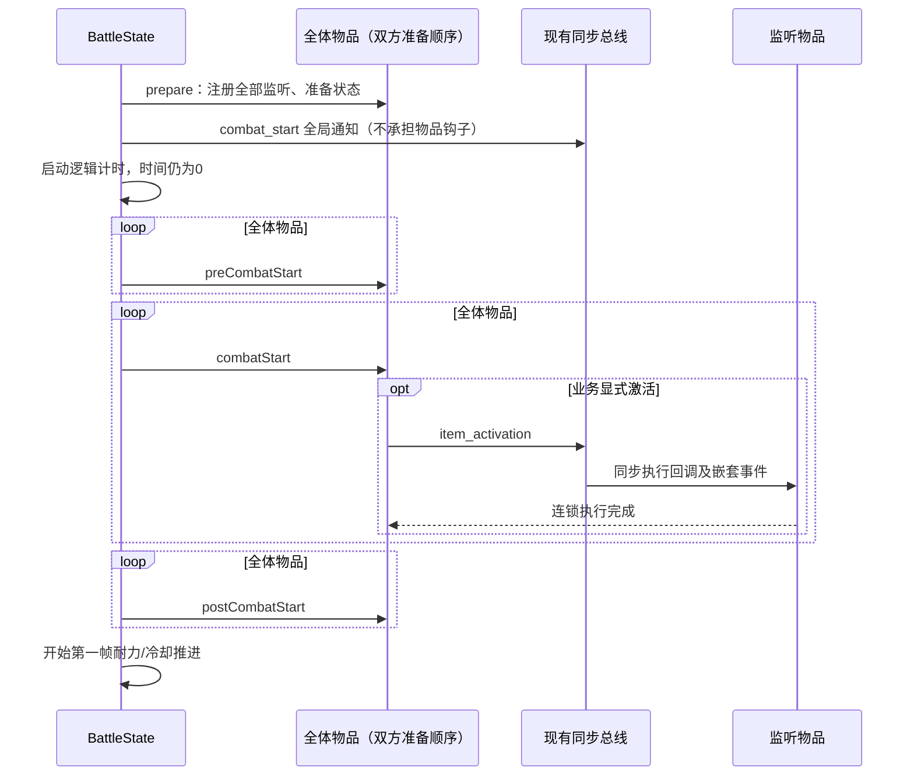

# 原版开战生命周期移植 SPEC

日期：2026-10-09。状态：第一批实现完成，验收通过。新增20个生命周期测试，全套554个 unittest 通过。

## 1. Requirements（需求）

目标：将当前依赖 `frame == 0` 的开局物品效果，改成一次显式的开战过程；复用现有同步事件总线处理开局引发的激活、治疗和受击连锁。

用户故事：同一套摆盘进入战斗时，所有监听关系先建立，所有前置状态先就绪，然后结算开局效果，最后进入正常帧推进；开局中发生的激活也能被黏黏、麻绳等物品立即观察。

范围：开战顺序、现有物品的生命周期入口、开局激活/消耗、首帧推进边界。只实现战斗机制，不加入局外流程。

用户已授权执行本 SPEC；第一批实现与验收已经完成。后续独立范围保留在第3节。

### 用户故事与完成标准

- 作为模拟器调用者，我能在准备完成后单独调用 start_combat，得到时间仍为零的开局结算结果，也能直接通过 run/step 自动进入同一个开战入口。
- 作为物品实现者，我能分别实现 prepare、pre、start、post 业务钩子，无需用 frame==0 表示开局；纯开局物品无需逐帧轮询。
- 作为布局评估调用者，我能让开局激活立即触发关联物品，且关联物品是否已订阅不取决于它在开局列表中的位置。
- 第一批完成必须满足第4节全部验收标准。提供生命周期接口不代表已经支持全部原版开局物品。

### 源码确认

当前工作区的 `Core/Game.gd` 已有本地对手注入改动，因此行号与知识库旧记录有偏移。以下以实际文件为准。

| 行为 | 源码位置 |
| --- | --- |
| 双方各自 shuffle，然后按 trigger priority 降序排序，再拼接玩家、对手列表 | `Backpack Battles/Core/Game.gd:2672–2685,5545–5546` |
| 双方 Character.prepare，再遍历完整列表 Item.prepare | `Backpack Battles/Core/Game.gd:3059–3064` |
| 全局 combat_start → CombatTimer.start → 双方 Character.combatStart → 全体 pre → 全体 start → 全体 post | `Backpack Battles/Core/Game.gd:3066–3082` |
| prepare 缓存 affected instances、重置 RNG、先准备宝石、后执行 onPrepare | `Backpack Battles/Items/Item.gd:3340–3356` |
| pre 先递归宝石，再初始化自己的首轮冷却，再执行 onPreCombatStart | `Backpack Battles/Items/Item.gd:3358–3371` |
| start/post 各自先递归宝石，再执行自己的业务钩子 | `Backpack Battles/Items/Item.gd:3373–3396` |
| repeatCombatStart 只重放三个业务钩子，不重新 prepare、不重置通用首轮冷却、不递归宝石 | `Backpack Battles/Items/Item.gd:3399–3402` |
| activated 经 EventBus 同步分发；回调按连接列表遍历；战斗结束停止后续回调 | `Backpack Battles/Utility/EventBus.gd:64–111` |
| consume 先 activate，再将 consumed 设为 true | `Backpack Battles/Items/Item.gd:4798–4800` |
| 单物品同一 Util.time 最多发出三次激活，背包不发普通 activated | `Backpack Battles/Items/Item.gd:4669–4703` |

原版全局 `combat_start` 是 Game 的原生 signal，物品生命周期由 Game 的显式循环调用。检查当前脚本，它的连接者是战斗界面、属性图标和冷却显示等节点；不能把它解释为“原版通过这个 signal 执行所有物品开局效果”。

`COMBAT_DELAY = 2.5` 用于场景切换后激活的等待。离线模拟器可在 time=0 直接完成这段调用顺序，无需空跑 2.5 秒。

### 实施前的实现与已复现问题

1. `BattleState.prepareItems()` 按玩家字典顺序准备；`onPrepare()` 注册监听。当前生产入口没有发射 `start_of_battle`，虽然 StartOfBattleTrigger 已连接它。
2. `step()` 先恢复耐力，再逐件扫描 active_items。开局效果与冷却推进混在同一次扫描中。
3. StartOfBattleTrigger 只排除 AttackReactionContext，并判断 frame==0；普通激活上下文在 0 帧也可能使它通过。
4. PocketSand、HealingHerbs、Flame、WalrusTusk 已经 emit_activation，会被黏黏监听。知识库中“这些激活尚未实现”的记录已落后于代码；当前仍未建模 consume 状态。
5. Whetstone 已经修改武器并发激活。FoodCooldownTrigger 和 Pan 的食物加成等仍有首次使用才准备的状态。
6. BattleItem 强制至少一个 Trigger，使纯开战钩子物品也必须人为伪装成逐帧主动物品。

只读内存复现（用户指定 Python）：

| 场景 | 结果 |
| --- | --- |
| 香蕉排在火焰前，推进一帧 | 香蕉 progress=0.03333333333333333，Heat=1 |
| 火焰排在香蕉前，推进一帧 | 香蕉 progress=0.034，Heat=1 |
| 0 帧直接以 ItemActivationContext 调用 PocketSand.activate_item | 对手获得 1 Blind，虽然并非开战入口 |

以上证明当前首帧结果受扫描顺序影响，并证明开战 Trigger 未识别事件来源；不构成 Godot 运行轨迹验证。

## 2. Design（设计）

### 架构决策

沿用原版的简单方法调用：BattleState 管理阶段循环，BattleItem 提供生命周期包装方法与业务钩子；现有 emit_signal 继续同步执行业务事件。无需新增阶段调度器、事件队列、依赖图或通用回调注册系统。

采用原版生命周期后，现有五种纯开局物品改写 onCombatStart，不再使用 StartOfBattleTrigger。这样它们不需要在每帧扫描，也没有 frame==0 或事件来源误判；后续重放开局效果也可以直接调用业务钩子。

技术选型维持现有 Python、dataclass、random.Random 和同步总线。所有业务钩子接收已有 BattleContext；生命周期不新增 context 子类。生命周期包装方法负责框架工作，onXxx 方法只负责该物品的业务逻辑。



三次循环必须分别遍历全体物品。不能改成对一个物品执行完 pre/start/post 再处理下一件。

### 数据模型与边界

- `BattleState.battle_items: list[BattleItem]`：默认空列表，只保存本场准备/开局顺序，包含被动监听物品。每方用 battle.rng.shuffle，再按 getTriggerPriority 降序排序，最后按 players 的角色顺序拼接。它与启动标志均为内部维护字段，dataclass 使用 init=False。
- `BattleState.has_prepared: bool`、`combat_started: bool`：默认 false；明确限制一次 prepare、一次开战；继续 run/step 不重做开局。不复用已经开战的物品实例创建另一场战斗。combat_started 表示已经进入开战流程，包含开局结算中即已结束的战斗。
- `BattleItem.consumed: bool`：默认 false；仅 consume 修改。不能把 consumed 当作通用的“跳过所有钩子”标志，因为原版可以重复调用开局业务钩子。
- `BattleItem.last_activation_frame`、`activations_this_frame`：复现单时间步最多三次激活的保护；用 frame 近似原版 Util.time，精确映射待 Godot 轨迹验证。
- `active_items` 继续表示正常帧中需要轮询的物品。纯开局物品 is_active_item=false；不能据此将它们排除出 battle_items。
- 排序只确定 prepare/开局顺序。不能由此推断 Godot 后续 _physics_process 的执行顺序，也不自动按此重排每帧 active_items。
- Python 稳定排序保留洗牌后的同优先级相对次序，这是模拟器的建模选择；不声称与 Godot 排序算法或 RNG 流逐次相同。
- 目前没有可用的宝石实例运行模型。首批接口采用原版命名，宝石递归待实例模型实现后加入；不先加入空的宝石对象体系。

### 调用约定与兼容性

- players[0] 对应玩家角色，players[1] 对应对手角色；player_id 仅作身份，不用于判断双方先后。保留现有恰好两个玩家的初始化要求。
- initialize_battle 仍仅构建角色、物品和布局关联，不隐式 prepare 或启动。布局关联在 prepare 前已建立，开战后本批不支持增删物品、移动物品或重建关联。
- prepareItems 必须在 frame=0、time=0 且 winner 为空的新战斗上调用。失败的 prepare 不保证回滚已执行的钩子或监听；调用者应弃用该场实例，重新 initialize_battle。
- start_combat 必须在 prepare 成功后使用；重复调用直接返回。首次调用后，所有 start/combat 等生命周期钩子只能由框架或未来明确的重放接口执行，调用者不得手工重放以代替推进。
- step/run 不自动 prepare；未 prepare 时清晰抛出 ValueError。main 现有 prepare→run 路径保留。
- frame_delta 在开战前由调用者或 run 设置；开战期间不推进时钟。现有 Regeneration、Poison、Fatigue 的首 tick 调度字段保留，不新增 Character/Timer 模拟对象，不重置输入的生命、耐力或状态。
- 同步回调允许嵌套发射业务事件，不允许回调内重入 step/run 或修改生命周期列表。初次进入 start_combat 即标记 combat_started，避免嵌套 start_combat 重复执行阶段。
- 开局事件仍记录在 frame=0、time=0，沿用 log.sequence 排序。现有玩家历史快照继续在 step 结束时保存；本批不额外插入开局快照。
- prepare 时消耗了 shuffle 的 RNG，因此既有固定随机序列的测试可能需要调整。测试应断言顺序规则、回放可复现和业务结果，不能沿用未洗牌时的随机调用次数。

### 修改文件

| 文件 | 本批改动 |
| --- | --- |
| battle_module_v1.py | 生命周期内部字段、prepareItems、start_combat、step |
| item_factory_registry_v1.py | BattleItem 生命周期与消耗接口、激活保护、五种开局物品迁移 |
| item_triggers_v1.py | 删除 StartOfBattleTrigger；增加 CooldownTrigger 显式初始化 |
| tests/test_combat_start_lifecycle_v1.py | 新增生命周期、顺序和连锁验证 |
| tests/ 下受影响的既有测试 | 迁移准备入口、移除旧 frame==0 和非空 trigger 假设 |

保留 battle_initializer_v1.py 和现有总线分发接口。main_v1.py 删除审查时发现的手动阶段调用及未定义变量，恢复 prepare→run，由 step 统一启动。

### 当前半成品的接入修正

**main_v1.run_battle_from_config(run_config, item_factories, item_catalog=ITEM_CATALOG) -> dict**：保留参数校验和构建；prepareItems 后直接 run，再按既有接口构建返回结果。不得在 main 重复执行三个阶段。

**BattleState.run(self, max_frames: int, frame_delta: float = 1.0 / 30.0) -> object | None**：若未 prepare，抛出 ValueError；设置 frame_delta，然后沿用现有循环调用 step 并返回 winner。max_frames=0 不推进、不启动开局。

**BattleItem.add_gems(self, gem: BattleItem) -> None**：沿用用户新增接口，但统一使用已有 socket_count，并始终创建 gemsockets 列表（实现字段名仍为 gemsocket）。遍历槽位，找到 None 后保存 gem.item_key、belongs_to 和 gem_type；没有空槽时抛出 ValueError。类型注解采用 postponed annotations，避免类定义时自引用错误。

本批不接入宝石实例战斗：prepare 前检查 gemsocket，存在非空槽即明确报错，避免宝石被忽略或作为顶层物品重复执行。插槽存储保留，宝石递归仍属于后续范围。

### 具体函数接口与伪代码

**BattleState.prepareItems(self) -> None**（修改）

```text
若已 prepare 或已开战，报错
若 frame/time 非零或 winner 非空，报错
若不是两个玩家或任何物品已经 prepare，报错
若任意物品存在非空宝石槽，明确报错（宝石战斗另行实施）
对每个玩家：复制其全部 items，shuffle，按 getTriggerPriority 降序排序
将双方列表按玩家角色顺序拼接到 battle_items
先重置双方现有角色 RNG
再按 battle_items 顺序调用 item.prepare(build_context(item))
has_prepared = true
```

**BattleState.start_combat(self) -> None**（新增）

```text
若 combat_started，直接返回；若尚未 prepare，报错
combat_started = true，防止嵌套调用再次开战
emit_signal(None, "combat_start")；它仅表示全局通知
check_battle_end；若 winner 非空，返回
此时表示逻辑计时已开始；沿用已有首 tick 调度字段，无计时启动函数要调用
依次对 preCombatStart、combatStart、postCombatStart 执行独立的全体遍历：
    对每个 item：调用该方法(build_context(item))
    每次调用后 check_battle_end；若 winner 非空，返回
不恢复耐力、不推进 time/frame
```

最后一项是模拟器采用的终止规则；原版 Game 的阶段循环未显式检查 fightEnded，EventBus 才会终止回调。若开局可直接致死，需要另做轨迹对照，不将此差异隐去。

**BattleState.step(self) -> object | None**（修改，沿用当前 winner 返回值）

```text
若尚未 prepare，抛出 ValueError
进入当前已有的战斗终止异常处理区域
check_battle_end；stop_if_battle_ended
调用 start_combat；stop_if_battle_ended
按现有流程恢复本帧耐力、轮询 active_items、递增 frame/time、执行系统 tick
按现有策略保存快照并返回 winner
```

run 和 main 的既有调用路径因此都经过同一开战入口；main 仍先 prepareItems。直接 step 的调用者也需要先 prepare，这项接口变化需更新受影响测试。

**BattleItem.__init__**（修改，完整接口如下）

```python
def __init__(
    self,
    item_id: str | None = None,
    item_key: str | None = None,
    player_id: int | None = None,
    is_active_item: bool = False,
    triggers: Sequence[Trigger] | None = None,
    effects: Sequence[Effect] | None = None,
    linked_items: Sequence[str] | None = None,
    display_name: str | None = None,
    item_classes: tuple[str, ...] | None = None,
    rarity: str | None = None,
    cost: int | None = None,
    item_types: tuple[str, ...] | None = None,
    icon_types: tuple[str, ...] | None = None,
) -> None:
```

```text
保留现有实例字段与触发器/效果绑定
统一采用已有 socket_count，始终初始化 gemsocket 列表，包括零槽物品
允许 triggers 为空；effects 仍须非空，保留现有报错
初始化 consumed=false、last_activation_frame=None、activations_this_frame=0
```

**BattleItem.getTriggerPriority(self) -> int**（新增）

```text
默认返回0；具体物品按原版覆写
```

**BattleItem.prepare(self, context: BattleContext) -> None**（新增）

```text
若 has_prepared，报错
重置现有 chance_rng 和 damage_range_acc
为所有 trigger 调用 connect_bus(context)
调用 onPrepare(context)
has_prepared = true
```

**BattleItem.onPrepare(self, context: BattleContext) -> None**（修改）

```text
默认空操作；注册公共 trigger 的工作移到 prepare 包装方法
具体物品在此缓存布局统计、添加静态属性、注册其专用监听
```

**BattleItem.activate_item(self, context: BattleContext, trigger_index: int | None = None) -> None**（修改）

```text
若没有 triggers 且 trigger_index 为 None，直接返回
否则沿用 update_triggers(context, trigger_index) 与 run_effect(results, context)
```

纯开局物品收到普通激活调用时不执行任何开局钩子。显式传入不存在的 trigger_index 仍由 update_triggers 报错，不静默吞掉非法索引。

**BattleItem.preCombatStart(self, context: BattleContext) -> None**（新增）

```text
对自己的每个 CooldownTrigger 调用 initialize_for_combat(context)
调用 onPreCombatStart(context)
```

**BattleItem.combatStart(self, context: BattleContext) -> None**（新增）

```text
调用 onCombatStart(context)
```

**BattleItem.postCombatStart(self, context: BattleContext) -> None**（新增）

```text
调用 onPostCombatStart(context)
```

**BattleItem.onPreCombatStart(self, context: BattleContext) -> None**、**BattleItem.onCombatStart(self, context: BattleContext) -> None**、**BattleItem.onPostCombatStart(self, context: BattleContext) -> None**（分别新增）

```text
三个基类函数均默认空操作；各具体物品仅覆写它需要的业务阶段
```

**CooldownTrigger.initialize_for_combat(self, context: BattleContext) -> None**（新增）

```text
cooldown_progress = 0
若尚未准备速度修正：prepare_speed_modifiers(context)，标记已准备
不调用 update，不推进任何时间
```

首批保留当前冷却周期算法，因此这里只提供明确初始化阶段。原版 adjustCooldown 每周期随机扰动、双方不同范围以及随机数消耗顺序，应作为独立冷却对齐任务补齐；未完成前不宣称冷却完全等价。

五个构造函数分别修改，完整接口为：

```python
PocketSand.__init__(self, item_id: str | None = None, item_key: str | None = None, player_id: int | None = None) -> None
HealingHerbs.__init__(self, item_id: str | None = None, item_key: str | None = None, player_id: int | None = None) -> None
Flame.__init__(self, item_id: str | None = None, item_key: str | None = None, player_id: int | None = None) -> None
WalrusTusk.__init__(self, item_id: str | None = None, item_key: str | None = None, player_id: int | None = None) -> None
Whetstone.__init__(self, item_id: str | None = None, item_key: str | None = None, player_id: int | None = None) -> None
```

```text
分别保留自己的静态属性和当前 effects
triggers=[]，is_active_item=false
五个具体类的类属性 is_active_item 也同步改为 false
删除各自仅处理旧开战 trigger_results 的 run_effect 覆写
```

**PocketSand.onCombatStart(self, context: BattleContext) -> None**（新增）

```text
effects[0].apply(context) 施加 Blind
consume(context)
```

**HealingHerbs.onCombatStart(self, context: BattleContext) -> None**（新增）

```text
effects[0].apply(context) 给予 Regeneration
consume(context)
```

**Flame.onCombatStart(self, context: BattleContext) -> None**（新增）

```text
effects[0].apply(context) 给予 Heat
consume(context)
```

**WalrusTusk.onCombatStart(self, context: BattleContext) -> None**（新增）

```text
effects[0].apply(context) 给予 Spikes
consume(context)
```

**Whetstone.onCombatStart(self, context: BattleContext) -> None**（新增）

```text
effects[0].apply(context) 修改相连武器伤害
emit_activation(context)
```

Whetstone 当前 LinkedWeaponDamageEffect 用 Weapon 类型过滤，原版使用 canBeEmpowered；这是已有目标筛选差异，后续扩大物品覆盖时另行对齐，不能将该 effect 视为已精确移植。

**BattleItem.consume(self, context: BattleContext) -> None**（新增）

```text
emit_activation(context)
consumed = true
```

按原版顺序，激活监听回调执行期间仍能看到修改前的 consumed。消费状态不替代激活事件。

**BattleItem.emit_activation(self, context: BattleContext) -> None**（修改）

```text
保留上下文归属校验与 winner 判断
若 frame 改变：last_activation_frame=frame，activations_this_frame=0
本帧激活计数+1；超过3则返回
按当前顺序记录日志，创建新的 ItemActivationContext，同步 emit_signal
```

激活上限约束的是激活通知，不撤销此前已经执行的效果。原版拖拽/回位动画限制不引入离线战斗模型。当前根目录未提供可执行背包物品类，因此本批不新增 isBag 或用名称猜测背包身份；未来引入背包物品时必须同时复现其不发普通激活事件的语义。

**BattleItem.repeatCombatStart(self, context: BattleContext) -> None**（预留后续，首批可不实现）

```text
依次调用 onPreCombatStart、onCombatStart、onPostCombatStart
不调用 prepare/preCombatStart 包装方法，不重置通用冷却
```

该接口为 Repeater/EchoingBattlecry 保留原版语义；实施相应物品前再加入即可。

**StartOfBattleTrigger.__init__(self) -> None**、**StartOfBattleTrigger.update(self, context: BattleContext) -> bool**、**StartOfBattleTrigger.connect_bus(self, context: BattleContext) -> None**（删除）

```text
五种开局物品迁移后删除类和引用
移除针对“frame==0 即开战”的测试，改验证显式生命周期
```

### 值得移植的原版例子

| 原版物品 | 阶段及意义 | 对我们的启发 |
| --- | --- | --- |
| LeatherArmor | pre 增加 debuff 抵抗，start 给 Block 并 activate | 敌方开局减益到来前，双方抵抗都应已安装 |
| LeatherHelm | prepare 增加暴击/眩晕抵抗；pre 开启限时减伤；start activate | 属性安装、限时状态开始、激活通知各有时机 |
| Pan | pre 按关联 Food 增加伤害 | 从首次攻击时懒准备转为明确战前初始化 |
| Goobert/Twine | prepare 订阅关联物品 activated | 最后遍历到的监听物品也能收到最先结算的开局激活 |
| PoweroftheMoon | post 推进战斗时间 | post 有实际机制，必须在所有 start 完成后执行；需要独立时间推进支持 |
| Repeater/EchoingBattlecry | 战斗中调用 repeatCombatStart | 一次启动与可重放的物品业务效果必须分开 |

## 3. Tasks（任务拆解）

| 编号 | 任务 | 依赖 | 独立验证方式 | 状态 |
| --- | --- | --- | --- | --- |
| T1 | 完成源码对照、接口和实施范围 SPEC | 无 | 检查四部分、每个改动函数接口及伪代码 | 已完成 |
| T2 | 增加内部顺序/启动字段，拆分 prepare 包装方法与钩子，增加 getTriggerPriority | T1 | 验证两侧独立排序、全体覆盖、重复准备报错 | 已完成 |
| T3 | 增加三个阶段包装方法与 CooldownTrigger 初始化 | T2 | 验证冷却初始化为零且没有推进时间 | 已完成 |
| T4 | 实现 start_combat 并接入 step | T3 | 验证阶段屏障、唯一启动、run/step 继续执行与开局终止 | 已完成 |
| T5 | 迁移五种开局物品、加入 consume、允许空 triggers 安全返回、删除 StartOfBattleTrigger | T4 | 验证效果/激活/消耗顺序、普通事件无法重放开局 | 已完成 |
| T6 | 增加单物品同帧最多三次激活通知的保护 | T5 | 验证嵌套循环可终止、下帧可重新激活 | 已完成 |
| T7 | 完成 tests/ 下的相关验证，迁移既有测试并运行全套回归 | T2–T6 | 第4节全部通过；记录全套测试结果与任何既有失败 | 已完成 |

后续独立范围：逐件迁移懒准备、原版冷却扰动、角色高级准备逻辑、宝石递归、时间推进及开局重放物品；各自补全 SPEC 与验收，不作为本批完成条件。

## 4. Acceptance Criteria / Tests（验收标准）

- 所有 prepare 完成后才允许任何 start 效果；所有 pre 完成后才进入第一个 start；所有 start 完成后才进入 post。
- 生命周期覆盖双方全部物品，包含被动监听物品，采用双方分别排序后拼接的准备顺序。
- start_combat 完成时 frame/time 不变、冷却进度为零、耐力未按帧恢复；再执行第一帧时香蕉始终观察到开局火焰的 Heat。
- 多次 run/step 不重复开战；重复 prepare 清晰报错，不重复注册监听。
- 未 prepare 的 start_combat/step/run 清晰报错；prepare 中途失败的战斗不重试，不承诺事务回滚。
- 同种物品不同实例的准备、消耗和激活计数互相独立；双方即使存在相同 item_key，也不能串线。
- 同一初始输入与同一 rng seed 可复现准备顺序和开局日志；同优先级不按原始摆盘插入顺序固定执行。
- 非开战事件在 0 帧无法使纯开局物品执行开局效果；第1帧以后正常帧轮询也不会重放这些效果。
- 五种现有开局物品仍产生激活事件；四种消耗品在同步激活回调结束后 consumed=true；Whetstone 不被标记为消耗品。
- 黏黏/麻绳即使位于准备列表后部，也能收到开局激活。嵌套事件同步完成，再返回开局物品并继续下一个物品。
- 激活递归最多发出单物品同帧三次通知，后续帧可再次通知；不以此撤销已执行效果。
- 生命周期日志可沿用已有 frame/time/sequence 检查阶段与事件顺序；无需新日志框架。
- 开局导致战斗结束时，剩余钩子与正常帧不再执行，frame/time 保持零；此项按本 SPEC 明确的模拟器终止规则验收。
- 不声称首批已覆盖宝石、精确 RNG、冷却扰动、所有角色机制或 Godot 物理帧边界；这些限制在结果中保留。

### 验证执行约定

实施阶段在 `tests/test_combat_start_lifecycle_v1.py` 覆盖阶段、排序、启动及终止；复用现有总线、物品行为与麻绳/黏黏测试验证连锁。测试辅助物品可记录钩子顺序或产生真实业务事件，但不加入生产物品目录。

先运行新增测试及受影响的总线、战斗、物品、初始化和 main 测试，再运行一次全套 unittest 回归。Windows 统一使用用户指定解释器：

```powershell
& 'C:\Users\win\AppData\Local\Microsoft\WindowsApps\PythonSoftwareFoundation.Python.3.11_qbz5n2kfra8p0\python.exe' -m unittest discover -s tests -p 'test_*.py'
```

本批不要求启动 Godot。其精确 RNG、Util.time 与物理帧顺序的未验证差异须保留在实施报告中。

## 文档执行记录

- 已阅读本地知识库、当前原版解包及根目录模拟器；未使用第三方模拟器裁决机制。
- 已用用户指定 Python 在内存中复现首帧 Heat 顺序差异及错误上下文触发。
- 已将讨论稿整理为实施 SPEC，明确完整函数接口、首批范围、调用兼容性、任务依赖及验收要求。
- 已实现 battle_items、显式准备和唯一 start_combat 入口；三个物品阶段在首帧推进前完成。
- 已迁移 PocketSand、HealingHerbs、Flame、WalrusTusk、Whetstone，删除 StartOfBattleTrigger；实现 consume 及同帧激活通知上限。
- 保留用户新增的插槽存储接口并修复其初始化/空槽判断；准备阶段拒绝已镶嵌实例，宝石战斗未静默启用。
- 已迁移既有测试的 prepare 调用、时间边界设置和旧开局接口。专门验证攻击/总线顺序的测试显式控制 shuffle，生命周期测试独立验证真实的随机排序。
- 新增 `tests/test_combat_start_lifecycle_v1.py`，包含20个测试；最终完整执行 `python -B -m unittest discover -s tests -p 'test_*.py'`，共554个测试，全部通过。使用用户指定的 Windows Python 3.11 绝对路径。
- `git diff --check` 通过。未修改模拟战斗数据，未启动 Godot；原版 RNG、冷却扰动、宝石、时间推进和高级角色机制仍按既定后续范围处理。
