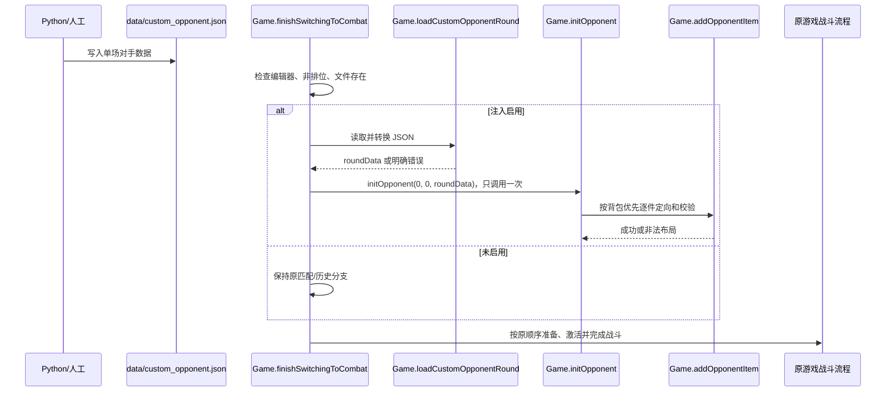

# 自定义对手摆盘注入 SPEC

状态：**已实施并通过 GodotSteam 实际战斗验证**（2026-09-28）。本 SPEC 基于当前完整解包 `Backpack Battles/`，游戏版本 `1.1.8`。源码入口调查见 `docs/opponent_data_entry_spec.md`。

## 1. Requirements（需求）

### 功能目标与用户故事

作为 Python 战斗模拟器开发者，我将一场对照实验的**对手职业、基础生命、基础耐力和摆盘**写成 JSON 文件。运行本机 GodotSteam 编辑器中的解包工程、从非排位商店进入战斗时，游戏读取该文件，按原有物品实例化与战斗流程装载对手，使我能够用原游戏引擎观察同一摆盘的战斗结果。

### 范围

- 本阶段只注入**对手单回合数据**。己方摆盘仍由现有游戏流程提供；战斗调度、物品效果和结算逻辑不改。
- 目标是仓库内已能运行离线战斗的 `Backpack Battles/` GodotSteam 编辑器工程。原安装目录的 exe/PCK 不在本阶段修改范围内。
- 文件固定放在仓库根目录 `data/custom_opponent.json`。游戏在每次进入符合条件的战斗时重新读取。没有该文件时沿用原对手选择逻辑。
- 注入只在 `Game.EDITOR == true`、`Game.curMode == Game.Mode.Unranked` 且文件存在时启用。排位、大厅、历史对战不受该文件影响。
- 文件存在但格式错误、物品缺失或摆放非法时，该次实验必须报出明确错误并停止；不得悄悄改用在线对手或 Dark Reflection，也不得反复重试同一非法摆盘。
- 本阶段不实现 Python 客户端、网络桥接、批量战斗或机器可读的事件回放。这些不是注入单场对手摆盘的必要条件。

### 源码依据

- `Core/Game.gd:2575-2671`：`finishSwitchingToCombat()` 创建对手、调用装载入口，然后准备和激活双方物品；正常分支会先调用 `RunDatabase.sortOpponents()` 并循环重试。
- `Core/Game.gd:2776-2826`：`initOpponent()` 在第 2777 行接收 `roundData`，设置属性，背包优先装载物品并保存 `curOpponentData`。
- `Core/Game.gd:2862-2896`：`addOpponentItem()` 完成定向、布局校验、入包、宝石与 `pd` 的恢复。
- `Utility/RunData.gd:174-271`：原始回合位流解码后的字典字段和物品 tuple 结构。
- `Core/Inventory.gd:186-219`：背包格与普通物品碰撞格合法性检查。
- `Core/Game.gd:3-15,139-145`：编辑器标志、版本与模式枚举。

## 2. Design（设计）

### 注入点和控制流

在 `Game.finishSwitchingToCombat()` 的对手来源分支加一个优先于正常匹配的**实验分支**。实验分支从 JSON 转换出满足 `Game.initOpponent()` 所需字段的 `roundData`，只调用一次 `initOpponent(0, 0, roundData)`。第三个参数是拟添加的可选参数；既有调用方继续使用原有两个参数。非实验分支保持源码现状。

实验分支跳过 `RunDatabase.sortOpponents()`、`RunDatabase.getNextOpponentData()` 及其匹配分数、版本化 run 位流和随机选人流程；也不应用 `roundReduction` 或 `droppedItems`，保证 JSON 中的摆盘就是实际装载的摆盘。`initOpponent()` 之后的 `prepareItems()`、`activateItems()` 和战斗流程保持原有顺序。此分支仍要求 `addOpponentItem()` 检查摆放，不能用 `reflection` 标记绕开。自定义数据失败时不调用 `RunDatabase.notifyOpponentCorrupt()`，以免误删正常对手缓存中的最近条目。

跳过匹配阶段也会改变它原本消耗的随机数；物品准备和战斗本身仍可能随机。本阶段保证**输入摆盘准确**，不承诺多次运行产生逐事件相同的战斗轨迹。若后续需要严格逐事件比对，需另行固定/记录战斗 RNG 并导出事件。



### 文件路径与启用规则

- 固定输入：仓库根目录 `data/custom_opponent.json`。从 `res://project.godot` 的绝对路径取解包工程目录，再取其父目录下的 `data/custom_opponent.json`；这是**编辑器工程专用路径**，不假设安装版 PCK 的 `res://` 能访问仓库。
- 每次进入非排位战斗前检查文件是否存在；不存在就不读文件。存在则整文件读取和解析一次，当前战斗使用这次读到的快照。战斗中修改文件不影响当前对手。
- JSON 编码为 UTF-8。只接受一个顶层对象，不接受注释、尾随逗号、JSON Lines 或多回合数组。
- 本 SPEC 的 `game_version` 必须与运行时 `Game.VERSION` 完全一致；物品索引与持久数据都依赖对应版本。文件格式由整数 `schema_version` 固定为 `1`。

### 文件格式 v1

下面是来自当前 Ranger 初始资源的**可核对示例**：职业、属性与摆盘坐标见 `CharacterClasses/Ranger/Ranger.tres:6-34,66-73`，索引见 `Sheets/CSV/ItemData.csv` 的 `id` 列。它用来验证注入通路；不是要求所有对手照此摆放。

```json
{
  "schema_version": 1,
  "game_version": "1.1.8",
  "class": 0,
  "health": 25,
  "stamina": 5,
  "items": [
    {"item_index": 67, "x": 3, "y": 2, "f": 0},
    {"item_index": 11, "x": 5, "y": 3, "f": 0},
    {"item_index": 11, "x": 1, "y": 3, "f": 0},
    {"item_index": 24, "x": 4, "y": 4, "f": 0},
    {"item_index": 1, "x": 3, "y": 3, "f": 0}
  ]
}
```

| 字段 | 必需 | 含义与校验 |
| --- | --- | --- |
| `schema_version` | 是 | 整数，v1 必须等于 `1`。 |
| `game_version` | 是 | 字符串，必须等于运行时 `Game.VERSION`，当前为 `"1.1.8"`。 |
| `class` | 是 | `Game.Classes_Full` 的整数值，当前为 `0..6`；见 `Core/Game.gd:129-137`。 |
| `health` | 是 | 对手基础最大生命，整数 `1..999`；写入 `setMaxHealth()`。 |
| `stamina` | 是 | 对手基础最大耐力，整数 `0..999`；写入 `setMaxStamina()`。 |
| `items` | 是 | 数组，可为空；每项代表一个独立物品实例。数组顺序不作为战斗触发顺序承诺。 |
| `items[].item_index` | 是 | 当前版本 `ItemData.csv` 的 `id` / `ItemDescriptor.itemIndex`，整数，必须能解析成有场景的描述符。多个实例可重复同一索引。 |
| `items[].x`, `items[].y` | 是 | 物品旋转后左上格的零起点坐标，均为整数；地址空间为 `x=0..8`、`y=0..6`，最终由 Inventory 做形状和碰撞校验。 |
| `items[].f` | 是 | 整数方向：`0=UP`、`1=RIGHT`、`2=DOWN`、`3=LEFT`；见 `Items/Item.gd:157-162`。 |
| `items[].gems` | 否 | 与该物品槽位数相同的数组。每项是**全局 `item_index`** 或 `null`（空槽）；加载器将其转为原生 tuple 的宝石索引/空槽 sentinel。未给出表示所有槽位为空。 |
| `items[].persistent_data` | 条件必需 | 物品实现 `getDataPersistent()` 时必需；值为该版本 `BitStream.toGodotString()` 生成的原生字符串，传给原有 `setData()`。其他物品不允许此字段。v1 不发明物品专用状态格式。 |

上述数字必须是整数值（例如 `5`，不能是 `5.5`）；JSON 解析器即使把它表示为实数，也先检查数学上为整数再转换。根对象和物品对象中未列出的键报错，以避免拼写错误被忽略。`items` 可为空；非空物品必须满足现有背包扩展格与碰撞格规则。直接注入不执行 run 的商店价格、物品获取回合或同职业可购买性检查，因为本任务只验证战斗；不会伪装成一条合法商店经营记录。

从 JSON 到引擎字典的转换如下：

```text
roundData = {
  "health": health, "stamina": stamina, "class": class,
  "name": "Custom Opponent", "chibi": false,
  "skins": [0, 0, 0, 0, 0], "items": nativeItems
}
nativeItems[i] = {"d": ItemDescriptor, "c": Vector2(x, y), "f": f}
nativeItems[i]["g"] = [nativeGemIndex 或 RunDatabase.emptySocketId, ...]  # 有 gems 时
nativeItems[i]["pd"] = persistent_data                         # 有该字段时
```

其中 `ItemDescriptor = ItemBook.getDescriptorFromIndex(item_index)`。每个非空宝石值也先按全局物品索引找描述符，确认它是宝石后，再经 `ItemBook.gemIndex[descriptor.identifier]` 取得原生宝石索引。宝石槽数用 `ItemBook.getNumSockets(item_index)` 核对；宝石数组长度必须完全相等。`persistent_data` 的存在性按该物品场景实例是否实现 `getDataPersistent()` 判断，编码可用 `BitStream.fromGodotString()` 与 `getDataPersistentBits()` 检查；当前完整解包中只有 `Items/Exclusive/MagicRing.gd:283-291` 实现该持久接口。

### 错误与状态处理

1. 没有文件：原流程；不记录错误。
2. 文件存在但打开失败、JSON 失败、版本不符、字段或索引非法：在任何物品装载前记录**文件路径、字段路径、原因**，停止该次编辑器实验，不回退到真实匹配。
3. JSON 合法但摆放非法：`addOpponentItem()` 的原布局检查返回 `-1`。实验分支只调用一次，记录发生错误的装载顺序 `load_order`、物品索引与坐标，随后停止实验；绝不进入原有 `while true` 重试环。`load_order` 是背包优先排序后的序号，可用物品索引和坐标定位 JSON 条目。允许原函数清理失败物品，后续重启实验进程。
4. 文件读取或布局失败时，不调用 `prepareItems()`、`activateItems()`。成功则让原游戏完整运行。错误停止方式是报告错误后退出本次**编辑器运行进程**；后续实施时保留安装版游戏与原 PCK 不变，并在运行验证前使用独立/备份的测试存档，因为原有非排位流程会写 `user://` 运行状态。

### 具体函数接口及伪代码

本阶段拟新增/修改的每个函数如下。保持 GDScript 3.x 的既有风格，不新增管理器、网络层或新数据类。

1. **修改** `func finishSwitchingToCombat():`（`Core/Game.gd`）
   - 输入：无；读取当前模式和固定 JSON 文件。
   - 输出：成功时进入原战斗流程；实验数据失败时报告并结束当前编辑器运行。
   - 伪代码：
     ```text
     若 EDITOR 且 curMode == Unranked 且文件存在：
         customRound = loadCustomOpponentRound(filePath)
         若 customRound 失败：报告原因，退出实验运行，return
     执行现有转场与 OPPONENT 创建流程
     若 customRound 已加载：
         result = initOpponent(0, 0, customRound)    # 只调用一次
         若 result != 0：报告非法摆盘，退出实验运行，return
     否则：执行原有历史/正常匹配分支
     执行现有 prepareItems / activateItems 等后续流程
     ```

2. **新增** `func loadCustomOpponentRound(path: String):`（`Core/Game.gd`）
   - 输入：JSON 文件绝对路径。
   - 输出：成功时为原游戏 `initOpponent()` 可直接消费的 `roundData`；失败时为 `null`，并记录字段级错误。
   - 伪代码：
     ```text
     File.open(path, READ)，JSON.parse(UTF-8 文本)
     检查顶层类型、允许键、schema_version、game_version、class、health、stamina、items
     nativeItems = []
     对 items 中每个条目：
         检查字段、整数范围、索引和描述符场景
         tuple = {d: ItemBook.getDescriptorFromIndex(item_index), c: Vector2(x,y), f: f}
         若有 gems：验证槽数；null 转空槽 sentinel；非空全局物品索引转原生宝石索引；写 tuple.g
         按该物品是否有 getDataPersistent 检查 persistent_data，并验证编码长度；有值时写 tuple.pd
         nativeItems.append(tuple)
     返回 {health, stamina, class, name: "Custom Opponent", chibi: false,
           skins: [0,0,0,0,0], items: nativeItems}
     任一错误：记录 path/字段位置/原因并返回 null
     ```

3. **修改** `func initOpponent(roundReduction, droppedItems, roundData = null):`（`Core/Game.gd`）
   - 输入：原有两个参数及可选的已解码回合字典。
   - 输出：成功返回 `0`；布局非法返回 `-1`；原有调用方行为不变。
   - 伪代码：
     ```text
     若 roundData == null：roundData = RunDatabase.getNextOpponentData(roundReduction)
     清空对手 Inventory；设置生命、耐力、职业
     按原逻辑计算 droppedItems 并将 bags 排到前面
     对每个 tuple：调用 ItemBook.instantiateItem 和 addOpponentItem；自定义数据关闭对手缓存损坏通知
     若装载失败：如为自定义数据，记录背包优先排序后的 load_order、item_index 与坐标；返回 -1
     设置默认/来源皮肤、名字与 curOpponentData；返回 0
     ```

4. **微调** `func addOpponentItem(tuple, item, checkValidity: bool, notifyCorrupt: bool = true):`（`Core/Game.gd`）
   - 输入：原生 tuple、已实例化物品、是否检查布局；可选参数控制非法布局时是否通知在线对手缓存，原调用默认 `true`。
   - 输出：摆放成功 `0`，非法布局 `-1`。
   - 伪代码：设 owner；按 `c/f` 定向；若要求检查且背包/物品不能加入则丢弃实例；仅 `notifyCorrupt` 为真时调用原来的缓存损坏通知；返回 `-1`。否则加入 Inventory、禁用拾取，并依 `g/pd` 恢复宝石与持久状态。

5. **沿用** `func getNextOpponentData(roundReduction: int) -> Dictionary:`（`Core/RunDatabase.gd`）
   - 输入：回合让步量。
   - 输出：正常路径下一名对手的原生回合字典。
   - 伪代码：大厅/镜像走既有分支；否则从已排序候选中取有效 run，解码当前回合，并按 `roundReduction` 选择物品回合。

6. **沿用** `func getDescriptorFromIndex(index: int) -> ItemDescriptor:`、`func getNumSockets(itemIndex):`（`Sheets/ItemBook.gd`）
   - 输入：全局物品索引。
   - 输出：当前版本描述符或该物品宝石槽数。
   - 伪代码：先由加载器检查索引范围；分别读取 `descriptorList[index]`、`numSockets[itemIndex]`。

7. **沿用** `func canAddItemOrBag(item: Item):`（`Core/Inventory.gd`）
   - 输入：已经定向的物品。
   - 输出：当前布局中是否可放置。
   - 伪代码：背包检查扩展格是否仍为潜在空间；普通物品检查碰撞格是否位于动态可放格且未被其他普通物品占用。

## 3. Tasks（任务拆解）

1. 固定 v1 JSON schema、Ranger 示例和错误信息约定；依赖本 SPEC 审阅完成。
2. 在 `Game.gd` 实现 `loadCustomOpponentRound()` 的文件读取、字段校验和原生 tuple 转换；依赖 1。
3. 给 `initOpponent()` 增加可选 `roundData` 参数，保持既有调用行为；依赖 2。
4. 在 `finishSwitchingToCombat()` 增加编辑器非排位的实验分支，跳过匹配/让步并单次调用装载；依赖 3。
5. 把覆盖成功、字段错误、非法布局、无文件回退的验证放入 `tests/`，测试用对手数据放入 `data/`；依赖 4。
6. 在 GodotSteam 编辑器中用 Ranger 示例完成一场战斗，核对屏幕摆盘、生命/耐力及战斗结束；依赖 5。

## 4. Acceptance Criteria / Tests（验收标准）

- SPEC 已先于代码实施并经用户指示执行。
- 无文件或非编辑器/非排位模式保持原始选择对手流程。
- 有效 JSON 在一次战斗中准确生成指定的职业、基础生命、基础耐力、每件物品的索引/坐标/方向，以及可选宝石和 `persistent_data`；正常战斗能结束。
- 示例的五件 Ranger 初始物品在编辑器实验中被全部装入，没有让步删物品。
- JSON 语法错误、版本不匹配、未知字段、越界索引、错误宝石槽数、无效持久编码、非法布局都有可定位错误；不存在对在线对手或 Dark Reflection 的静默回退或无限重试。
- 注入分支只改变对手输入；既有战斗准备、调度和结算代码不改。原安装版 exe/PCK 与 `user://runs_*.cache` 不写入或覆盖。
- 验证结果将区分源码静态检查与 GodotSteam 实际运行结果；战斗结果导出/自动对照另立任务。

## 5. 实施与使用

实现位于 `Backpack Battles/Core/Game.gd` 的 `finishSwitchingToCombat()`、`loadCustomOpponentRound()` 与 `initOpponent()`。固定输入为仓库根目录的 `data/custom_opponent.json`。当前示例是 Ranger 开局五件物品；使用自己的摆盘时，保留根对象字段，把 `items` 改为目标回合的每个物品实例。每次从**非排位商店**进入战斗时重新读取文件。删除或改名该文件后，下一场非排位战斗恢复原有选对手流程。排位、大厅和历史对战不读取该文件。

从 `Backpack Battles/project.godot` 用本机 GodotSteam 编辑器运行项目，在标题选择非排位，进入商店后开始战斗。编辑器的错误输出会打印 `[CustomOpponent]`、文件路径和出错字段；非法摆盘还会打印物品索引、坐标、方向并结束该次运行。这个入口加载到的对手仍进入原有 `prepareItems()`、`activateItems()`、`endCombat()` 流程。该工程的 `user://` 运行存档与正常游玩共用，因此正式手动实验前应使用独立存档目录或自行保留需要的存档；自动测试使用隔离目录。

### 自动验证

PowerShell 在仓库根目录执行：

```powershell
& 'tests/run_custom_opponent_injection.ps1'
& 'tests/run_custom_opponent_injection.ps1' -TestScript 'test_custom_opponent_errors.gd' -ExpectedMarker 'CUSTOM_OPPONENT_ERRORS_PASS'
& 'tests/run_custom_opponent_injection.ps1' -TestScript 'test_custom_opponent_battle.gd' -ExpectedMarker 'CUSTOM_OPPONENT_BATTLE_PASS'
```

运行器临时把一个测试节点加入解包工程的自动加载，并把测试进程的 `APPDATA` 定向到 `data/.godot_test_appdata`；`finally` 恢复 `project.godot` 原始字节，移除临时测试脚本、测试存档和日志。若这些临时路径原先已有内容，运行器拒绝执行，以免覆盖。测试要求关闭正在运行的 GodotSteam 编辑器。战斗测试留下 `data/custom_opponent_battle_capture.png` 作为画面记录。

实际运行结果：

1. 样例解析、五件物品的索引转换、对手背包实际摆放、职业与基础属性均通过；另用有效夹具验证宝石槽转原生索引及 Magic Ring 持久字符串转换。
2. JSON 语法、游戏版本、未知字段、越界物品索引、宝石槽数、不应出现的持久数据、无效原生持久编码、非法摆盘均被拒绝，并在 Godot 错误输出中指明位置。
3. GodotSteam `3.6.2` 从标题启动非排位、切换战斗，画面出现 `Custom Opponent`、`25/25` 生命和 `5/5` 耐力，五件摆盘可见，战斗由原引擎结算。胜负因战斗随机性可不同。截图位于 `data/custom_opponent_battle_capture.png`。
4. 退出测试进程时 GodotSteam 打印 ObjectDB/资源未释放警告；通过标记和进程退出码均为成功。该警告不影响已观察到的摆盘装载和战斗结算。

`persistent_data` v1 仅验证原生编码字符和预期长度。字段内容仍由对应物品的原有 `setData()` 解释；编写 Magic Ring 等持久状态时应从相同版本游戏的 `BitStream.toGodotString()` 取得编码。

### 测试函数接口与伪代码

1. `tests/test_custom_opponent_injection.gd::_process(delta) -> void`：逐帧等待主场景、角色、物品库和动画回调初始化；超时调用 `fail()`；就绪后调用 `run_checks()`。
2. `tests/test_custom_opponent_injection.gd::run_checks() -> void`：读取示例 JSON，核对五个索引；另外构造有效宝石与 Magic Ring 持久数据夹具并核对转换；创建原生 `OPPONENT`，调用 `initOpponent(0,0,roundData)`，核对背包数量、职业、生命、耐力；打印成功标记并退出。
3. `tests/test_custom_opponent_injection.gd::fail(message: String) -> void`：打印带消息的错误，退出码置为 `1`。
4. `tests/test_custom_opponent_errors.gd::_process(delta) -> void`：等主场景就绪；超时失败；就绪后只调用一次 `run_checks()`。
5. `tests/test_custom_opponent_errors.gd::run_checks() -> void`：从示例克隆数据，逐项写入语法/字段/版本/索引/宝石/持久数据错误，要求加载器拒绝；最后给背包非法坐标并要求 `initOpponent()` 返回 `-1` 且不移除最近对手缓存的标记条目；删除临时夹具并打印成功标记。
6. `tests/test_custom_opponent_errors.gd::expect_rejected(path: String, body: String, label: String) -> bool`：用 `write_json()` 写夹具；调用加载器；若返回非空则以标签报错并返回 `false`，否则返回 `true`。
7. `tests/test_custom_opponent_errors.gd::write_json(path: String, body: String) -> bool`：以 UTF-8 写入一份临时 JSON；打开失败时调用 `fail()` 并返回 `false`。
8. `tests/test_custom_opponent_errors.gd::fail(message: String) -> void`：打印错误并以退出码 `1` 结束测试。
9. `tests/test_custom_opponent_battle.gd::_process(delta) -> void`：按标题、商店、战斗、结算四阶段推进原游戏流程；核对注入来源、物品数量、属性；在战斗场景保存截图，等待 `fightEnded`，打印成功标记；90 秒未完成则失败。
10. `tests/test_custom_opponent_battle.gd::fail(message: String) -> void`：打印错误并以退出码 `1` 结束测试。
11. `tests/run_custom_opponent_injection.ps1` 的脚本入口接受 `TestScript` 与 `ExpectedMarker`；伪代码：确认引擎和临时路径可用 → 备份 `project.godot` 字节 → 隔离 `APPDATA` → 临时加入测试自动加载 → 无窗口运行 GodotSteam → 检查退出码和标记 → `finally` 恢复工程并清理临时文件。
