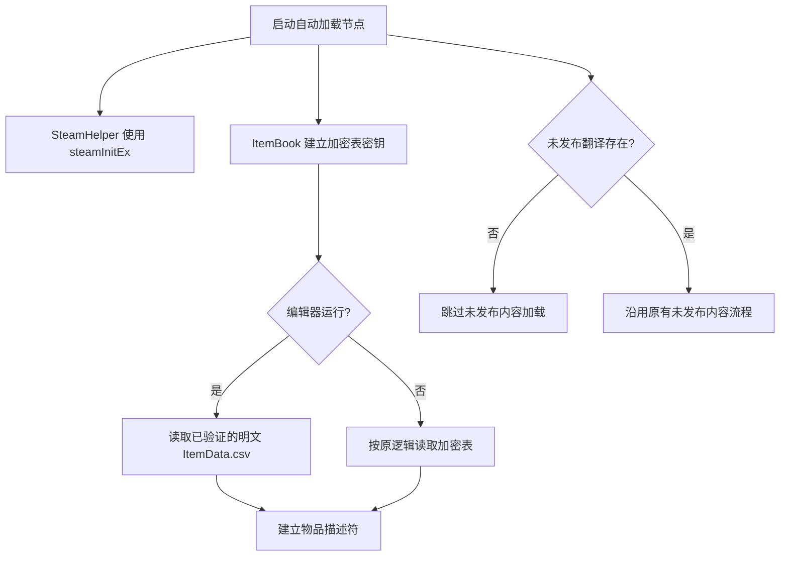

# 解包项目 GodotSteam 启动修复 SPEC

## Requirements（需求）

目标：让 `Backpack Battles/` 在本机 `E:/godotsteam/godotsteam.362.editor.win64.exe` 下启动时，不因已确认的 Steam API 类型不匹配、物品表解密兼容差异、缺失的可选零售资源和离线编辑器网络请求而中断。仅修复解包项目的启动兼容性，不改变战斗逻辑或增加局外发育功能。

用户故事：作为源码研究者，我希望从 Godot 编辑器运行这份零售版解包项目，并保留 PCK 中的加密物品表，以便观察游戏行为。

验收标准：启动时 `SteamHelper` 能解析；加密 `ItemData_e.csv` 保持原样且物品描述符可加载；缺失的可选资源不会被当作存在；离线编辑器不发起已复现会导致本机 GodotSteam 访问冲突的榜单请求；可见窗口完成标题、商店和离线战斗流程。

## Design（设计）

沿用现有自动加载节点、CSV 和内容开关，不新增抽象或数据结构。已安装 GodotSteam 的本机方法元数据显示 `steamInit()` 返回 `bool`，`steamInitEx()` 返回 `Dictionary`。现有代码读取 `status`/`verbal`，因此改用 `steamInitEx()`；该 API 的 `status == 0` 表示成功。编辑器启动时 `Game.EDITOR` 为真，直接读取从原版 PCK 验证解出的明文 `ItemData.csv`，不写回加密文件或校验脚本；非编辑器仍沿用原有加密表校验。未发布翻译的英文资源作为该组未发布资源可用性的检查点；没有它时禁用现有的未发布内容分支。

首次验证又发现：从原版 PCK 读取的 `ItemData_e.csv` 大小及 MD5 与解包记录一致，但 GodotSteam 3.6.2 和官方 Godot 3.6.3 用源码中的 0..31 密钥解密均返回 `ERR_FILE_CORRUPT`。原游戏自带的 Godot 3.6 自定义构建可用同一密钥读取，并解出 80,933 字节 CSV；明文 MD5 `dc977faf19965650e7f462c6c9baeef9` 与加密文件头一致。因此把这份明文放回解包工程供编辑器使用，同时保留原加密文件。现有 `Table.loadFromCsv()` 忽略打开错误，随后无限循环读未打开的文件；修复失败处理，避免日志洪泛。

可见编辑器运行的 Windows 事件日志记录原生异常 `0xc0000005`，故障偏移 `0x1800932`。逐项实验排除了材质预热和 GLES3 独有路径；离线编辑器跳过 `RunDatabase` 的 SilentWolf 榜单请求后，窗口稳定进入标题、商店，并可完成一次 Dark Reflection 战斗。最终保留离线编辑器网络保护，并在该路径隐藏未真正连接的 `Connecting` 标记且不启动重试计时。非编辑器请求流程保持现状。

### 函数接口与伪代码

1. `SteamHelper._ready() -> void`（`Utility/SteamHelper.gd`）
   - 输入：无；读取 `Game` 标志和 GodotSteam 单例。
   - 输出：无；按原逻辑设置 Steam 状态或调用失败处理。
   - 伪代码：执行原有节点初始化与可选 DLL 检查；`INIT: Dictionary = Steam.steamInitEx()`；打印结果；若 `INIT["status"] != 0` 则执行原有失败分支，否则执行原有成功分支。

2. `ItemBook.validateResources() -> void`（`Sheets/ItemBook.gd`）
   - 输入：无；读取 `Game.EDITOR` 和现有资源路径。
   - 输出：无；初始化 `sheetKey`；编辑器不写资源；非编辑器仍按原逻辑校验资源。
   - 伪代码：生成 0..31 的密钥；若为编辑器立即返回；否则实例化现有 `DataValidator.gd`，逐项比较资源 MD5，失败时请求退出。

3. `Game.loadUnreleasedContent() -> bool`（`Core/Game.gd`）
   - 输入：无；读取现有 `FULLVERSION`、`EDITOR`、`PLAYTEST`、`ENGINEER_TEST` 标志及资源存在性。
   - 输出：仅在原有条件成立且 `Unreleased.en.translation` 可加载时返回 `true`。
   - 伪代码：`return FULLVERSION && (EDITOR || PLAYTEST || ENGINEER_TEST) && ResourceLoader.exists("res://Sheets/CSV/Unreleased.en.translation")`。

4. `Table.loadFromCsv(filepath: String, key = null) -> Table | null`（`Sheets/Table.gd`）
   - 输入：CSV 路径和可选的 32 字节密钥。
   - 输出：打开并读取成功时返回当前 `Table`；打开或解密失败时返回 `null`。
   - 伪代码：根据是否有密钥调用 `open_encrypted` 或 `open`；若返回值不是 `OK`，打印一次包含路径的错误并立即返回 `null`；否则按现有流程解析表头、逐行读到 EOF、关闭文件并返回自身。

5. `ItemBook._ready() -> void`（`Sheets/ItemBook.gd`）
   - 输入：无；沿用现有 `sheetKey`、`Game` 状态和表格路径。
   - 输出：正常时建立物品描述符；表格读取失败时停止本次初始化并请求退出场景树。
   - 伪代码：执行现有初始化；编辑器或原有 SteamDeck 测试分支从 `ItemData.csv` 读取，其他构建从 `ItemData_e.csv` 读取；若返回 `null`，请求退出并返回；否则继续原有描述符生成流程。

6. `Game._ready() -> void`（`Core/Game.gd`）
   - 输入：无；读取现有 `EDITOR` / `debugging` 标志及可选调试场景路径。
   - 输出：按原逻辑初始化主场景；仅当对应调试场景确实存在时实例化并挂到原节点。
   - 伪代码：执行既有主场景初始化；若编辑器或调试标志为真且 `ShopDebug.tscn` 可加载，则实例化后挂到 `shopSceneNode`；若编辑器标志为真且 `DebugViewer.tscn` 可加载，则实例化后挂到 `titleScreen`；缺失时跳过对应可选调试节点。

7. `Game.setLocale(locale: String) -> void`（`Core/Game.gd`；启动崩溃定位阶段）
   - 输入：语言代码。
   - 输出：维持原有语言设置效果；暂时在各调用边界打印定位标记。
   - 伪代码：打印设置语言；调用 `TranslationServer.set_locale(locale)`；打印已完成；调用 `Util.updateLocale()`；打印已完成；调用 `updateLocale()`；打印已完成。定位后移除标记，并仅对已确认的阻断点做最小修复。

8. `Settings.initAll() -> void`（`Utility/Settings.gd`；启动崩溃定位阶段）
   - 输入：无；按现有 `settings` 顺序初始化。
   - 输出：无；保持原设置应用效果，并暂时打印每个设置前后的序号与名称。
   - 伪代码：对每个设置序号，打印开始标记，调用现有 `initVal(i)`，打印结束标记；循环后将 `initializing` 置为 `false`。

9. `Game.ready_deferred() -> void`（`Core/Game.gd`；启动崩溃定位阶段）
   - 输入：无；使用既有场景节点与存档。
   - 输出：保持原有延后初始化效果，并暂时打印关键调用边界。
   - 伪代码：执行现有 OS/设置打印与角色实例化；打印标记；等待材质编译器；打印标记；连接动画信号并载入存档；打印标记；按原逻辑恢复大厅或进入标题；打印完成标记。

10. `MaterialCompiler._ready() -> void`（`Utility/MaterialCompiler.gd`；诊断期间）
    - 输入：无；扫描现有 `res://` 下的 `.material` 文件。
    - 输出：保留原有材质预热与 `finished_loading_materials` 信号；暂时记录加载及逐帧等待边界。
    - 伪代码：沿用目录递归与 Sprite/Particles2D 材质加载；逐次等待八个 `idle_frame`，诊断时记录每帧是否返回；`queue_free()`；发出完成信号。定位后移除标记。

11. `RunDatabase.sendRunRequest() -> void`（`Core/RunDatabase.gd`；离线编辑器诊断阶段）
    - 输入：无；读取 `Game.EDITOR` 和 `SteamHelper.is_init()`。
    - 输出：离线编辑器跳过网络请求；其他情况保持原有请求和计时行为。
    - 伪代码：若为编辑器且 Steam 未初始化，立即返回；否则执行现有时间门控、Steam 排行榜与 SilentWolf 请求逻辑。

12. `RunDatabase.ready_deferred() -> void`（`Core/RunDatabase.gd`）
    - 输入：无；读取 `Game.EDITOR`、`SteamHelper.is_init()`、已有缓存条数和大厅开关。
    - 输出：保留计时器与可选 Steam 排行榜初始化；离线编辑器隐藏 `Connecting` 且不启动重试，其余场景保持原有显示和重试；最后按原逻辑初始化大厅。
    - 伪代码：创建并连接重试计时器；若 Steam 已初始化则创建排行榜；调用 `sendRunRequest()`；若离线编辑器则隐藏连接标签，否则按缓存数量显示连接标签并启动 30 秒或 300 秒计时器；若大厅功能启用则创建大厅节点。

## Tasks（任务拆解）

1. 记录 PCK 原始加密表的长度与 MD5，保存本 SPEC。无依赖。
2. 修复 `SteamHelper._ready()` 的 API 调用。依赖任务 1。
3. 从原版 PCK 用原游戏引擎解出明文物品表，以加密文件头的明文 MD5 核对后放到 `Sheets/CSV/ItemData.csv`；使编辑器读取明文且不改写原加密表。依赖任务 1。
4. 修复 `Game.loadUnreleasedContent()` 的资源可用性判断。依赖任务 1。
5. 修正 Steam 成功状态判断，并为 CSV 打开失败增加显式退出，避免无限日志。依赖任务 2–4。
6. 独立检查 PCK 中加密表与解包密钥是否匹配，查找可验证的数据恢复途径。依赖任务 1。已完成：原游戏引擎成功解密，明文 MD5 与 GDEC 文件头一致。
7. 用 GodotSteam 启动主场景，核对首个报错、物品表哈希和主场景初始化；如出现新的独立阻断点，先更新本 SPEC 再继续最小修复。依赖任务 5–6。
8. 根据编辑器调试器的实际错误，处理未随零售 PCK 提供的可选调试场景；在现有 GUI 窗口验证游戏画面是否继续初始化。依赖任务 7。
9. 在可见编辑器复现启动后原生访问冲突，沿 `Game.setLocale()` 后的调用链加临时标记定位；确认原因后移除标记并复验。依赖任务 8。
10. 根据日志显示的 431 份材质预热全部完成但未发出完成信号，编辑器暂时跳过该预热以验证其是否引起退出；若游戏可运行，再删除诊断标记并复验。依赖任务 9。
11. 若跳过材质预热仍在首帧前以相同原生偏移崩溃，则恢复该实验并测试 Godot 的 GLES2 驱动，辨别是否为 GLES3 渲染路径问题。依赖任务 10。
12. 若 GLES2 同样以相同偏移崩溃，恢复原渲染设置；离线编辑器暂时跳过 `RunDatabase` 网络请求，测试是否为首帧中的异步网络调用导致。依赖任务 11。
13. 保留经验证的离线编辑器网络保护，隐藏虚假的连接提示，清除临时诊断输出；重启项目再次验证标题、商店和离线战斗。依赖任务 12。

## Acceptance Criteria / Tests（验收标准）

- `ItemData_e.csv` 启动前后均为 80,976 字节，MD5 为 `98d4080e5c1beddfd95159f841f8efb7`。
- `ItemData.csv` 为 80,933 字节，MD5 为 `dc977faf19965650e7f462c6c9baeef9`，编辑器从该文件成功建立物品描述符。
- 本机 GodotSteam 不再报告 `SteamHelper.gd:94` 的布尔值赋给字典解析错误。
- 不再因缺失 `ItemData.csv` 清空物品表，也不再尝试加载缺失的 `Unreleased.*.translation`。
- 物品表无法解密时进程有限时间内退出，仅报告一次明确的表格错误，不产生无界日志。
- 主场景能够进入可运行状态；如 Steam 服务或其他解包缺口仍阻止完整游戏流程，记录实际错误与边界，不把 `--quit` 的进程退出码误判为成功。
- 编辑器 GUI 调试器不再停在 `Game.gd` 中对缺失 `ShopDebug.tscn` 或 `DebugViewer.tscn` 调用 `instance()` 的位置；游戏窗口显示可操作的画面。

## 2026-09-27 验证记录

- 原游戏自带 Godot 3.6 自定义构建从安装目录 PCK 解出的明文表为 80,933 字节，MD5 与 GDEC 文件头记录一致；本地 `ItemData.csv` 再次核对一致。
- 使用本机 GodotSteam 3.6.2 启动主场景并运行 25 秒：标准错误输出为 0 字节；标准输出到达 `VERSION 1.1.8`，物品表已遍历，未再出现 SteamHelper 解析错误、无界 CSV 错误或未发布翻译加载错误。
- 启动后明文和加密物品表 MD5 均未变化。当前本机 Steam 初始化失败时，编辑器仍可离线运行；完整 GUI 交互和战斗流程尚未在本次启动检查中验证。
- 随后通过用户已打开的 Godot 编辑器 GUI 核查，发现调试器实际停在 `Game.gd:2161`：零售 PCK 缺失 `Utility/Debug/ShopDebug.tscn`，`load(...).instance()` 对空对象调用。游戏窗口仅呈灰色背景。上面的无窗口检查不足以作为 GUI 可运行的验收证据，需完成任务 8 后重新验证。
- 另见用户打开的 Windows 原生崩溃弹窗：编辑器进程写入 `0xFFFFFFFFFFFFFFF8` 时访问冲突。新编辑器运行后游戏进程很快退出，最新日志到达 `SETTING LOCALE TO en`，无 GDScript 报错；需以任务 9 继续定位，不能将当前状态标记为可运行。
- 后续诊断显示 431 份材质均加载完，但首个 `idle_frame` 未返回；即使编辑器跳过全部材质预热，也同样在首帧前退出。Windows 应用程序事件均为 `0xc0000005`，故障模块为 GodotSteam 可执行文件，偏移 `0x1800932`。材质预热不是已证实原因。
- 改为 GLES2 后日志确认使用 OpenGL ES 2.0，但仍在首帧前以同一故障偏移退出。该实验未支持 GLES3 专属问题的假设，项目设置恢复默认驱动。
- 离线编辑器跳过 `RunDatabase.sendRunRequest()` 后，材质节点完成八帧等待并发出完成信号，`Game.ready_deferred()` 完成；可见窗口显示标题画面，点击非排位新游戏进入商店，选择 Dark Reflection 后完成第 1 回合战斗。此时仍显示 `Connecting`，任务 13 将清理该提示并做最终复验。
- 最终清理临时诊断输出，离线编辑器隐藏 `Connecting` 且不启动榜单请求重试。再次从 GodotSteam 3.6.2 编辑器运行：`godot.log` 明确显示 `OpenGL ES 3.0 Renderer`；游戏窗口持续存在，标题、非排位商店以及 Dark Reflection 战斗均可进入，首回合显示 `Round won!`。未出现此前的原生访问冲突。`project.godot` 没有保留 GLES2 覆盖项，明文与加密物品表 MD5 仍分别为 `dc977faf19965650e7f462c6c9baeef9` 与 `98d4080e5c1beddfd95159f841f8efb7`。
- 验收边界：本机 Steam 未初始化，真实在线对手和榜单未验证；Godot 编辑器仍会尝试把加密的 `ItemData_e.csv` 当普通 CSV 导入并显示非阻断的导入错误，运行时使用已验证的明文表。
