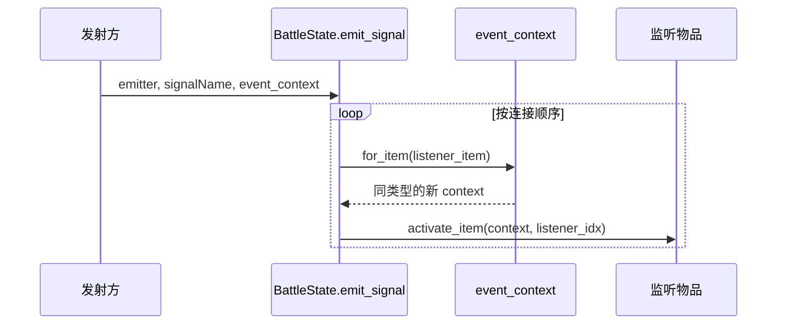

# 事件总线上下文传递 SPEC

日期：2026-10-02。状态：已实施，本 SPEC 验收通过；完整测试的既有迁移问题见执行记录。

## 1. Requirements（需求）

目标：事件总线兼容不同的 context，监听物品获得自己的执行视角，同时保留本次事件数据。

- 发射方创建对应 context；总线保持同步、按连接顺序分发。
- `item / owner / opponent` 随监听物品切换。
- context 的实际子类及事件字段保留；多个监听者共享同一个 `AttackEvent`，使减伤等修改累积。
- 每个监听者获得独立的 context；嵌套事件不覆盖外层 context。

本轮完成上下文传递及激活事件接线。攻击、开战发射入口的完整迁移属于后续总线任务。

## 2. Design（设计）

沿用现有 dataclass：`BattleContext`、`ItemActivationContext`、`AttackReactionContext`。用标准库 `dataclasses.replace()` 浅复制并切换视角；总线无需按事件类型分支，也无需新增注册表或 context 工厂。

| Context | 事件数据 | 分发时处理 |
| --- | --- | --- |
| `BattleContext` | 无 | 切换监听物品视角 |
| `ItemActivationContext` | `source_item` | 保留来源引用 |
| `AttackReactionContext` | `attack_event / attack_phase` | 保留事件引用与阶段 |

原版参考：`Backpack Battles/Utility/EventBus.gd` 的 `emitAndLog()` 把发射参数同步交给监听回调。本方案的 context 视角转换属于 Python 模拟器的实现选择。



### 修改文件与函数

**`battle_module_v1.py`：** 导入 `dataclasses.replace`，修改以下三个函数，删除一个重复覆写。

1. `BattleContext.for_item(self, item: BattleItem) -> BattleContext`

   保留实际类型，只替换三个视角字段；伪代码：

   ```text
   若 item 属于当前 owner：沿用 owner、opponent
   否则若 item 属于当前 opponent：交换 owner、opponent
   否则：抛出 ValueError
   返回 replace(self, item=item, owner=owner, opponent=opponent)
   ```

2. `BattleState.emit_signal(self, emitter: BattleItem | PlayerState | None, signalName: str, event_context: BattleContext | None = None) -> None`

   将现有未使用的 `event` 参数改为 `event_context`。有事件数据的发射方须提供对应 context；无额外数据的事件允许传 `None`。伪代码：

   ```text
   若 event_context 非空且属于其他 BattleState：抛出 ValueError
   按现有规则计算 emitter_key，取得该信号的监听列表
   对每个 (listener_item, listener_idx)：
       若 event_context 非空：context = event_context.for_item(listener_item)
       否则：context = build_context(listener_item)
       listener_item.activate_item(context, listener_idx)
   ```

3. `BattleItem.emit_activation(self, context: BattleContext) -> None`

   为新激活事件创建专用 context，避免把受击等上游 context 当作激活数据。伪代码：

   ```text
   若 context.item 不是 self：抛出 ValueError
   按现有顺序记录 item_activation 日志
   activation_context = ItemActivationContext(
       battle_state=context.battle_state,
       item=self, owner=context.owner, opponent=context.opponent,
       source_item=self
   )
   battle_state.emit_signal(self, "item_activation", activation_context)
   ```

4. 删除 `AttackReactionContext.for_item(self, item: BattleItem) -> AttackReactionContext` 的覆写，继承第 1 项实现。`ItemActivationContext` 也直接继承该实现。

**测试：** 新增 `tests/test_event_bus_context_v1.py`，验证下述验收场景；更新 `tests/test_battle_module_v1.py` 中激活发射委托测试，使其检查新的 `emit_signal()` 调用及 context 内容。

## 3. Tasks（任务拆解）

1. 修改通用 `for_item()`，删除攻击 context 的重复覆写。
2. 修改 `emit_signal()` 接收并转交 context，依赖任务 1。
3. 修改 `emit_activation()` 构造激活 context，依赖任务 2。
4. 增补、调整相关测试并运行验证，依赖任务 1–3；报告全套测试结果及尚未迁移的旧分发接口测试。

## 4. Acceptance Criteria / Tests（验收标准）

- 普通、激活、攻击三种 context 经 `for_item()` 后保持实际类型；原 context 的视角字段不变。
- 同侧监听者视角正确；对侧监听者交换 owner、opponent；未知玩家物品被拒绝。
- 多监听者按连接顺序执行，context 各自独立，`source_item` 或 `attack_event` 引用保持一致。
- 两个攻击监听者对同一个 `AttackEvent` 的修改均保留；嵌套事件结束后外层事件仍正确。
- 无额外数据的事件可使用普通 context；其他战斗的 context 被拒绝。
- 已准备的木剑激活能让 Goobling 正常计数，日志保留来源物品。
- 受击 context 中的物品再发出激活时，监听者收到新的 `ItemActivationContext`，其 `source_item` 为该激活物品。

## 执行记录

- 已修改上述三个函数、删除攻击 context 的覆写；新增 9 项测试并调整激活发射委托测试。
- 相关 12 项测试全部通过，涵盖真实 Goobling 计数、跨侧视角、共享攻击事件和嵌套激活顺序。
- 实施前：493 项，456 通过、36 失败、1 错误。实施后：502 项，466 通过、35 失败、1 错误；失败/错误列表对比没有新增项。
- 剩余问题包括测试仍调用或监视旧 `dispatch_item_activation()`，以及 `ActivationTrigger` 的旧上下文检查契约；随完整总线迁移处理。
- 验证使用项目指定的本机 Python 3.11.9。
