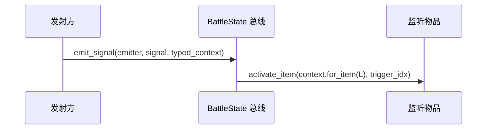

# 事件总线旧接口清理 SPEC

日期：2026-10-02。状态：已实施，验收通过。

## 1. Requirements（需求）

删除已由通用事件总线替代、运行代码不再调用的专用分发函数及其缓存。现有激活、受击、未命中行为保持不变；测试使用当前总线接口。

沿用用户确定的调用约定：每场战斗在运行前调用一次 `prepareItems()`。本次不增加自动准备、防重机制，也不迁移尚未完成的其他事件。

## 2. Design（设计）

运行调用关系已经是 `emit_activation / resolve_attack → emit_signal → for_item → activate_item(context, trigger_idx)`。直接删除下表中的旧函数，不保留兼容包装。

| 删除函数接口 | 原职责与删除后的伪代码替代 |
| --- | --- |
| `BattleState.build_item_activation_context(self, listener: BattleItem, source_item: BattleItem) -> ItemActivationContext` | 旧激活 context 工厂。发射物品构造 `ItemActivationContext`；总线调用 `context.for_item(listener)`。 |
| `BattleState._get_item_activation_listeners(self, source_item: BattleItem) -> tuple[BattleItem, ...]` | 扫描相连物品并缓存。准备时由 `ActivationTrigger.connect_bus(context)` 连接对应来源；发射时读取 `_bus_cache`。 |
| `BattleState.dispatch_item_activation(self, source_item: BattleItem) -> None` | 旧激活分发。调用 `source_item.emit_activation(state.build_context(source_item))`；监听者执行指定触发器。 |
| `BattleState._get_attack_reaction_items(self, responder: PlayerState, attack_phase: str) -> tuple[BattleItem, ...]` | 扫描攻击阶段并缓存。准备时由触发器连接角色信号；发射时读取 `_bus_cache`。 |
| `BattleState.dispatch_attack_reactions(self, phase: str, responder: PlayerState, event: AttackEvent) -> None` | 旧攻击分发。构造 `build_attack_reaction_context(source, phase, event)`；调用对应角色的 `emit_signal(emitter, phase, context)`。 |

同时删除 `_item_activation_listener_cache`、`_responder_item_cache`、仅服务旧激活扫描的 `ITEM_ACTIVATION_PHASE_LINKED`，以及失去用途的导入。`build_attack_reaction_context()` 仍被攻击结算调用，保留。

测试迁移原则：

- 删除仅验证旧扫描、缓存和工厂校验的测试及辅助类；保留实际事件行为断言。
- 原来直接调用激活分发的测试，改为通过物品发射激活；原来手工构造监听 context 的测试，直接构造 `ItemActivationContext`。
- 监听测试在完整装配物品、连接标记后显式准备一次。测试触发器实现 `connect_bus()`，不再靠旧 `phase` 扫描接入。
- 激活 spy 改为观察总线中的 `item_activation` 发射，保持原来“一次激活/未激活”的断言含义，并继续调用真实总线。
- 攻击测试使用有效的来源物品和玩家视角；只迁移测试夹具，不修改攻击公式或触发条件。

涉及测试辅助函数的接口与伪代码：

| 接口 | 伪代码 |
| --- | --- |
| `ActivationListenerItem.__init__(self, *, listen_for_activation=True, should_trigger=False, event_log=None, emit_when_triggered=False, **kwargs)` | 保存是否监听激活；构造现有记录触发器/效果；相连来源映射到 star 标记。 |
| `ActivationListenerItem.onPrepare(self, context) -> None` | 调用基类准备；若监听激活，对每个 star 来源 `connect(source, "item_activation", (self, 0))`。 |
| `BattleModuleV1Test.make_activation_state(self, owner_items, opponent_items=None) -> tuple` | 构造双方与状态；完整装配后调用一次 `prepareItems()`；返回夹具。 |
| `RecordingAttackTrigger.connect_bus(self, context) -> None` | `connect(context.owner, "on_attacked", (self.item, self.idx))`。 |
| `RecordingAttackMissTrigger.connect_bus(self, context) -> None` | `connect(context.opponent, "on_attack_missed", (self.item, self.idx))`。 |
| `AttackResolutionV1Test.make_battle(self, defender_items=(), rng=None, attacker_health=20, attacker_max_health=0, attacker_stamina=2.0, defender_stamina=2.0, defender_block=0) -> tuple` | 沿用现有构造；完整装配后准备一次；返回状态、双方与来源。 |
| `spy_on_item_activation(battle_state) -> Mock`（替代旧 spy 辅助函数） | 包装 `battle_state.emit_signal`；只记录 `item_activation` 的 emitter；继续真实分发；返回记录物品参数的 spy。 |
| spy 内部 `emit_signal(emitter, signal_name, event_context=None) -> None` | 若信号是激活则记录 emitter；调用原 `emit_signal`。 |
| `TwineItemFactoryV1Test.make_twine_state(self, *, health=10, max_health=20, neutral_count=0, include_non_neutral=False) -> tuple` | 沿用物品和标记装配；准备一次；返回原夹具。 |
| `GooblingSpecTest.make_linked_goobling_state(self, *, health=10, max_health=20, linked=True) -> tuple` | 沿用夹具；准备一次；返回来源、监听者、状态、双方与 context。 |
| `GooblingSpecTest.initialize_battle_for_test(self, player_placements, opponent_placements=(), *, health=20, max_health=20, stamina=5.0, max_stamina=5.0, item_factories=DEFAULT_ITEM_FACTORIES, item_catalog=ITEM_CATALOG) -> BattleState` | 初始化；显式准备一次；返回状态。 |
| `ItemFactoryRegistryV1Test.make_broom_context(self, frame_delta=1.0, stamina=5.0, opponent_health=100, opponent_blind=0, rng=None) -> tuple` | 组装扫帚及有效对手攻击来源；构造状态并准备一次；返回原夹具。 |
| `ItemFactoryRegistryV1Test.resolve_opponent_attack(self, context, *, accuracy, attack_types=("melee",), min_damage=1, max_damage=1) -> AttackEvent` | 从对手物品取实际攻击来源；构造 `AttackEvent`；调用现有结算。 |
| `GooblingSpecTest.test_activation_bus_only_routes_connected_sources(self) -> None` | 发射相连、未相连、对侧物品的激活；断言只计入相连来源且不额外取随机数。 |
| `GooblingSpecTest.test_activation_bus_ignores_other_signals(self) -> None` | 发射非激活信号；断言 Goobling 不计数。 |

行为测试方法保持 `test_...(self) -> None` 接口：装配夹具 → 准备 → 发射当前接口 → 保留原物品效果、日志、顺序、事件引用断言。失去对应实现的扫描/缓存测试直接删除。

## 3. Tasks（任务拆解）

1. 确认旧符号在运行代码中仅属于旧分发链，记录当前测试结果。
2. 删除五个函数、两个专用缓存、废弃常量及导入。
3. 迁移直接使用旧接口的行为测试，删除旧实现专属测试；依赖任务 2。
4. 运行测试并搜索旧符号，确认运行代码与测试均无遗留引用；依赖任务 3。

## 4. Acceptance Criteria / Tests（验收标准）

- 五个旧函数、两个旧缓存、废弃阶段常量从运行代码与测试中清除。
- 激活、受击、未命中只经现有总线流转；玩家视角、监听顺序、事件共享与嵌套行为保持。
- Goobling、Twine、WoodenBuckler、Broom 等实际物品行为仍有测试覆盖。
- 无新增运行逻辑，不改变用户明确的一次准备约定。
- 报告完整测试结果；若有本次清理范围外的既有问题，明确说明。

## 执行记录

- 删除五个旧函数、两个专用缓存、一个阶段常量及无用导入；保留现有总线与用户的准备逻辑。
- 迁移六个测试文件，删除七项仅验证旧工厂/扫描/缓存实现的测试，以及两个仅用于旧扫描测试的辅助类。
- 实际物品效果、监听顺序、相同 key 的玩家隔离、不同战斗隔离、事件引用和嵌套行为断言均保留。
- 清理前完整测试：502 项，436 通过、49 失败、17 错误。迁移后：495 项全部通过。
- 验证使用用户指定的本机 Python 3.11.9；运行代码与测试无旧符号引用，`git diff --check` 通过。

## 测试方法接口与伪代码明细

以下接口均为测试方法，返回 None。原有物品效果断言保持；只迁移夹具、发射入口和激活观察点。

### tests/test_battle_module_v1.py

| 接口 | 伪代码 |
| --- | --- |
| `BattleModuleV1Test.test_emit_activation_requires_context_for_same_item(self) -> None` | 装配原夹具；用当前激活发射/总线观察点记录激活；执行物品；断言原效果与激活次数。 |
| `BattleModuleV1Test.test_emit_activation_delegates_to_battle_state_and_returns_none(self) -> None` | 装配原夹具；用当前激活发射/总线观察点记录激活；执行物品；断言原效果与激活次数。 |
| `BattleModuleV1Test.test_activation_bus_preserves_source_reference(self) -> None` | 装配并准备一次；用当前接口发射事件；断言本方法命名所描述的效果、顺序或隔离行为。 |
| `BattleModuleV1Test.test_activation_bus_requires_connection_and_source_link(self) -> None` | 装配并准备一次；用当前接口发射事件；断言本方法命名所描述的效果、顺序或隔离行为。 |
| `BattleModuleV1Test.test_activation_bus_preserves_connection_order(self) -> None` | 装配并准备一次；用当前接口发射事件；断言本方法命名所描述的效果、顺序或隔离行为。 |
| `BattleModuleV1Test.test_activation_bus_isolates_owners_with_identical_source_keys(self) -> None` | 装配并准备一次；用当前接口发射事件；断言本方法命名所描述的效果、顺序或隔离行为。 |
| `BattleModuleV1Test.test_dispatch_builds_fresh_context_for_each_source_event(self) -> None` | 装配并准备一次；用当前接口发射事件；断言本方法命名所描述的效果、顺序或隔离行为。 |
| `BattleModuleV1Test.test_dispatch_continues_to_next_listener_when_first_does_not_trigger(self) -> None` | 装配并准备一次；用当前接口发射事件；断言本方法命名所描述的效果、顺序或隔离行为。 |
| `BattleModuleV1Test.test_nested_activation_dispatch_preserves_outer_source(self) -> None` | 装配并准备一次；用当前接口发射事件；断言本方法命名所描述的效果、顺序或隔离行为。 |
| `BattleModuleV1Test.test_activation_bus_isolates_battle_states(self) -> None` | 装配并准备一次；用当前接口发射事件；断言本方法命名所描述的效果、顺序或隔离行为。 |

### tests/test_attack_resolution_v1.py

| 接口 | 伪代码 |
| --- | --- |
| `AttackResolutionV1Test.test_attack_miss_is_dispatched_only_to_defender(self) -> None` | 装配并准备一次；用当前接口发射事件；断言本方法命名所描述的效果、顺序或隔离行为。 |
| `AttackResolutionV1Test.test_attack_bus_keeps_hit_and_miss_listeners_separate(self) -> None` | 装配并准备一次；用当前接口发射事件；断言本方法命名所描述的效果、顺序或隔离行为。 |
| `AttackResolutionV1Test.test_wooden_buckler_prevents_seven_and_removes_stamina(self) -> None` | 装配原夹具；用当前激活发射/总线观察点记录激活；执行物品；断言原效果与激活次数。 |
| `AttackResolutionV1Test.test_wooden_buckler_does_nothing_when_chance_fails(self) -> None` | 装配原夹具；用当前激活发射/总线观察点记录激活；执行物品；断言原效果与激活次数。 |
| `AttackResolutionV1Test.test_attack_bus_isolates_responder_players(self) -> None` | 装配并准备一次；用当前接口发射事件；断言本方法命名所描述的效果、顺序或隔离行为。 |
| `AttackResolutionV1Test.test_attack_bus_builds_fresh_context_per_attack(self) -> None` | 装配并准备一次；用当前接口发射事件；断言本方法命名所描述的效果、顺序或隔离行为。 |
| `AttackResolutionV1Test.test_attack_bus_isolates_battle_states(self) -> None` | 装配并准备一次；用当前接口发射事件；断言本方法命名所描述的效果、顺序或隔离行为。 |

### tests/test_item_factory_registry_v1.py

| 接口 | 伪代码 |
| --- | --- |
| `ItemFactoryRegistryV1Test.test_initializer_builds_wooden_buckler_as_passive_reaction_item(self) -> None` | 装配并准备一次；用当前接口发射事件；断言本方法命名所描述的效果、顺序或隔离行为。 |
| `ItemFactoryRegistryV1Test.test_wooden_sword_does_not_attack_at_battle_start(self) -> None` | 装配原夹具；用当前激活发射/总线观察点记录激活；执行物品；断言原效果与激活次数。 |
| `ItemFactoryRegistryV1Test.test_wooden_sword_pays_stamina_and_attacks_after_cooldown(self) -> None` | 装配原夹具；用当前激活发射/总线观察点记录激活；执行物品；断言原效果与激活次数。 |
| `ItemFactoryRegistryV1Test.test_wooden_sword_pays_stamina_but_does_not_damage_on_miss(self) -> None` | 装配原夹具；用当前激活发射/总线观察点记录激活；执行物品；断言原效果与激活次数。 |
| `ItemFactoryRegistryV1Test.test_wooden_sword_skips_attack_and_restarts_cooldown_without_stamina(self) -> None` | 装配原夹具；用当前激活发射/总线观察点记录激活；执行物品；断言原效果与激活次数。 |
| `ItemFactoryRegistryV1Test.test_ranged_attack_effect_miss_returns_false_without_damage_roll(self) -> None` | 沿用原夹具与执行流程；通过已迁移的夹具/观察点，断言原物品效果。 |
| `ItemFactoryRegistryV1Test.test_ranged_attack_does_not_apply_spikes_or_vampirism(self) -> None` | 沿用原夹具与执行流程；通过已迁移的夹具/观察点，断言原物品效果。 |
| `ItemFactoryRegistryV1Test.test_shortbow_attacks_after_cooldown(self) -> None` | 装配原夹具；用当前激活发射/总线观察点记录激活；执行物品；断言原效果与激活次数。 |
| `ItemFactoryRegistryV1Test.test_shortbow_pays_stamina_on_miss(self) -> None` | 装配原夹具；用当前激活发射/总线观察点记录激活；执行物品；断言原效果与激活次数。 |
| `ItemFactoryRegistryV1Test.test_shortbow_restarts_cooldown_without_stamina(self) -> None` | 装配原夹具；用当前激活发射/总线观察点记录激活；执行物品；断言原效果与激活次数。 |
| `ItemFactoryRegistryV1Test.test_shiny_shell_triggers_once_and_does_not_retry_at_full_health(self) -> None` | 装配原夹具；用当前激活发射/总线观察点记录激活；执行物品；断言原效果与激活次数。 |
| `ItemFactoryRegistryV1Test.test_wand_of_equilibrium_emits_once_per_cooldown_activation(self) -> None` | 装配原夹具；用当前激活发射/总线观察点记录激活；执行物品；断言原效果与激活次数。 |
| `ItemFactoryRegistryV1Test.test_stone_hits_once_and_removes_block_after_attack(self) -> None` | 装配原夹具；用当前激活发射/总线观察点记录激活；执行物品；断言原效果与激活次数。 |
| `ItemFactoryRegistryV1Test.test_stone_miss_consumes_its_only_throw_without_removing_block(self) -> None` | 装配原夹具；用当前激活发射/总线观察点记录激活；执行物品；断言原效果与激活次数。 |
| `ItemFactoryRegistryV1Test.test_banana_does_not_activate_before_cooldown(self) -> None` | 装配原夹具；用当前激活发射/总线观察点记录激活；执行物品；断言原效果与激活次数。 |
| `ItemFactoryRegistryV1Test.test_banana_heals_and_regenerates_stamina_after_cooldown(self) -> None` | 装配原夹具；用当前激活发射/总线观察点记录激活；执行物品；断言原效果与激活次数。 |
| `ItemFactoryRegistryV1Test.test_garlic_does_not_activate_before_cooldown(self) -> None` | 装配原夹具；用当前激活发射/总线观察点记录激活；执行物品；断言原效果与激活次数。 |
| `ItemFactoryRegistryV1Test.test_garlic_gains_block_and_removes_vampirism_on_success(self) -> None` | 装配原夹具；用当前激活发射/总线观察点记录激活；执行物品；断言原效果与激活次数。 |
| `ItemFactoryRegistryV1Test.test_garlic_still_gains_block_when_removal_roll_fails(self) -> None` | 装配原夹具；用当前激活发射/总线观察点记录激活；执行物品；断言原效果与激活次数。 |
| `ItemFactoryRegistryV1Test.test_melee_attack_effect_starts_with_unprepared_zero_damage_modifier(self) -> None` | 沿用原夹具与执行流程；通过已迁移的夹具/观察点，断言原物品效果。 |
| `ItemFactoryRegistryV1Test.test_melee_attack_effect_stacks_persistent_damage_modifiers(self) -> None` | 沿用原夹具与执行流程；通过已迁移的夹具/观察点，断言原物品效果。 |
| `ItemFactoryRegistryV1Test.test_melee_attack_effect_prepares_intrinsic_modifier_once(self) -> None` | 沿用原夹具与执行流程；通过已迁移的夹具/观察点，断言原物品效果。 |
| `ItemFactoryRegistryV1Test.test_pan_does_not_activate_before_cooldown(self) -> None` | 装配原夹具；用当前激活发射/总线观察点记录激活；执行物品；断言原效果与激活次数。 |
| `ItemFactoryRegistryV1Test.test_pan_pays_stamina_and_attacks_with_base_damage(self) -> None` | 装配原夹具；用当前激活发射/总线观察点记录激活；执行物品；断言原效果与激活次数。 |
| `ItemFactoryRegistryV1Test.test_pan_skips_attack_without_stamina(self) -> None` | 装配原夹具；用当前激活发射/总线观察点记录激活；执行物品；断言原效果与激活次数。 |
| `ItemFactoryRegistryV1Test.test_pan_does_not_activate_star_linked_food_on_hit(self) -> None` | 装配原夹具；用当前激活发射/总线观察点记录激活；执行物品；断言原效果与激活次数。 |
| `ItemFactoryRegistryV1Test.test_pan_miss_still_pays_stamina_without_activating_linked_food(self) -> None` | 装配原夹具；用当前激活发射/总线观察点记录激活；执行物品；断言原效果与激活次数。 |
| `ItemFactoryRegistryV1Test.test_rat_activation_ignores_attack_statuses_and_applies_debuffs(self) -> None` | 装配原夹具；用当前激活发射/总线观察点记录激活；执行物品；断言原效果与激活次数。 |
| `ItemFactoryRegistryV1Test.test_rat_forced_attack_miss_emits_without_status_rng(self) -> None` | 装配原夹具；用当前激活发射/总线观察点记录激活；执行物品；断言原效果与激活次数。 |
| `ItemFactoryRegistryV1Test.test_rat_does_not_emit_before_cooldown(self) -> None` | 装配原夹具；用当前激活发射/总线观察点记录激活；执行物品；断言原效果与激活次数。 |
| `ItemFactoryRegistryV1Test.test_initializer_builds_broom_as_active_and_attack_miss_responder(self) -> None` | 装配并准备一次；用当前接口发射事件；断言本方法命名所描述的效果、顺序或隔离行为。 |
| `ItemFactoryRegistryV1Test.test_broom_waits_for_cooldown_without_rng(self) -> None` | 装配原夹具；用当前激活发射/总线观察点记录激活；执行物品；断言原效果与激活次数。 |
| `ItemFactoryRegistryV1Test.test_broom_gains_two_damage_when_opponent_melee_attack_misses(self) -> None` | 装配原夹具；用当前激活发射/总线观察点记录激活；执行物品；断言原效果与激活次数。 |
| `ItemFactoryRegistryV1Test.test_broom_pays_stamina_and_attacks_with_base_damage(self) -> None` | 装配原夹具；用当前激活发射/总线观察点记录激活；执行物品；断言原效果与激活次数。 |
| `ItemFactoryRegistryV1Test.test_broom_applies_accumulated_bonus_then_clears_it_on_hit(self) -> None` | 装配原夹具；用当前激活发射/总线观察点记录激活；执行物品；断言原效果与激活次数。 |
| `ItemFactoryRegistryV1Test.test_broom_miss_retains_accumulated_bonus_and_skips_blind_roll(self) -> None` | 装配原夹具；用当前激活发射/总线观察点记录激活；执行物品；断言原效果与激活次数。 |
| `ItemFactoryRegistryV1Test.test_broom_insufficient_stamina_retains_bonus_without_rng(self) -> None` | 装配原夹具；用当前激活发射/总线观察点记录激活；执行物品；断言原效果与激活次数。 |
| `ItemFactoryRegistryV1Test.test_brooms_own_independent_miss_bonus_state(self) -> None` | 沿用原夹具与执行流程；通过已迁移的夹具/观察点，断言原物品效果。 |
| `GooblingSpecTest.test_activation_bus_only_routes_connected_sources(self) -> None` | 装配并准备一次；用当前接口发射事件；断言本方法命名所描述的效果、顺序或隔离行为。 |
| `GooblingSpecTest.test_activation_bus_ignores_other_signals(self) -> None` | 装配并准备一次；用当前接口发射事件；断言本方法命名所描述的效果、顺序或隔离行为。 |
| `GooblingSpecTest.test_goobling_heals_four_on_third_linked_activation(self) -> None` | 装配并准备一次；用当前接口发射事件；断言本方法命名所描述的效果、顺序或隔离行为。 |
| `GooblingSpecTest.test_goobling_repeats_after_each_three_activations(self) -> None` | 装配并准备一次；用当前接口发射事件；断言本方法命名所描述的效果、顺序或隔离行为。 |
| `GooblingSpecTest.test_goobling_consumes_third_activation_at_full_health(self) -> None` | 装配并准备一次；用当前接口发射事件；断言本方法命名所描述的效果、顺序或隔离行为。 |
| `GooblingSpecTest.test_goobling_emits_own_activation_even_when_heal_has_no_effect(self) -> None` | 装配原夹具；用当前激活发射/总线观察点记录激活；执行物品；断言原效果与激活次数。 |
| `GooblingSpecTest.test_initializer_deduplicates_source_covering_both_goobling_stars(self) -> None` | 装配并准备一次；用当前接口发射事件；断言本方法命名所描述的效果、顺序或隔离行为。 |
| `GooblingSpecTest.test_two_gooblings_listening_to_same_source_both_advance(self) -> None` | 装配并准备一次；用当前接口发射事件；断言本方法命名所描述的效果、顺序或隔离行为。 |
| `GooblingSpecTest.test_goobling_activation_can_advance_another_goobling(self) -> None` | 装配并准备一次；用当前接口发射事件；断言本方法命名所描述的效果、顺序或隔离行为。 |
| `GooblingSpecTest.test_simple_start_of_battle_items_do_not_emit_activation(self) -> None` | 装配原夹具；用当前激活发射/总线观察点记录激活；执行物品；断言原效果与激活次数。 |

### tests/test_twine_item_factory_v1.py

| 接口 | 伪代码 |
| --- | --- |
| `TwineItemFactoryV1Test.test_twine_diamond_only_activation_does_not_roll(self) -> None` | 装配并准备一次；用当前接口发射事件；断言本方法命名所描述的效果、顺序或隔离行为。 |
| `TwineItemFactoryV1Test.test_twine_star_activation_success_gains_health_and_emits_once(self) -> None` | 装配原夹具；用当前激活发射/总线观察点记录激活；执行物品；断言原效果与激活次数。 |
| `TwineItemFactoryV1Test.test_twine_failed_roll_changes_nothing_and_does_not_emit(self) -> None` | 装配原夹具；用当前激活发射/总线观察点记录激活；执行物品；断言原效果与激活次数。 |

### tests/test_magic_for_dummies_item_factory_v1.py

| 接口 | 伪代码 |
| --- | --- |
| `MagicForDummiesItemFactoryV1Test.test_cooldown_does_nothing_before_five_seconds(self) -> None` | 装配原夹具；用当前激活发射/总线观察点记录激活；执行物品；断言原效果与激活次数。 |
| `MagicForDummiesItemFactoryV1Test.test_success_uses_mana_and_gains_base_max_health(self) -> None` | 装配原夹具；用当前激活发射/总线观察点记录激活；执行物品；断言原效果与激活次数。 |
| `MagicForDummiesItemFactoryV1Test.test_insufficient_mana_skips_effect_and_activation(self) -> None` | 装配原夹具；用当前激活发射/总线观察点记录激活；执行物品；断言原效果与激活次数。 |

### tests/test_battle_logging_v1.py

| 接口 | 伪代码 |
| --- | --- |
| `BattleLoggingV1Test.test_twine_logs_probability_failure_and_success(self) -> None` | 装配夹具；直接构造激活 context；执行物品；断言来源引用、计数或日志。 |
| `BattleLoggingV1Test.test_goobling_logs_each_counter_step_then_heal_and_activation(self) -> None` | 装配夹具；直接构造激活 context；执行物品；断言来源引用、计数或日志。 |
| `BattleLoggingV1Test.test_attack_log_precedes_miss_reaction(self) -> None` | 装配并准备一次；用当前接口发射事件；断言本方法命名所描述的效果、顺序或隔离行为。 |

删除的旧实现专属测试（接口均为 (self) -> None，伪代码均为删除旧断言；事件行为由上述总线测试覆盖）：
- `BattleModuleV1Test.test_build_item_activation_context_rejects_other_owner_or_foreign_source(self) -> None`
- `BattleModuleV1Test.test_second_activation_listener_lookup_uses_cached_tuple(self) -> None`
- `BattleModuleV1Test.test_empty_activation_listener_lookup_is_cached(self) -> None`
- `AttackResolutionV1Test.test_first_reaction_item_lookup_scans_triggers_and_populates_cache(self) -> None`
- `AttackResolutionV1Test.test_second_reaction_item_lookup_does_not_read_attack_phase_again(self) -> None`
- `AttackResolutionV1Test.test_empty_reaction_item_lookup_is_cached(self) -> None`
- `AttackResolutionV1Test.test_cached_reaction_items_preserve_responder_item_order(self) -> None`

删除的旧扫描辅助函数：MissingAttackPhaseTrigger.__init__(self, result=True)、MissingAttackPhaseTrigger.__getattr__(self, name)、CountingAttackPhaseTrigger.__init__(self, result=True)、属性 getter CountingAttackPhaseTrigger.attack_phase(self)。伪代码：随旧扫描测试一起删除，无运行替代接口。
