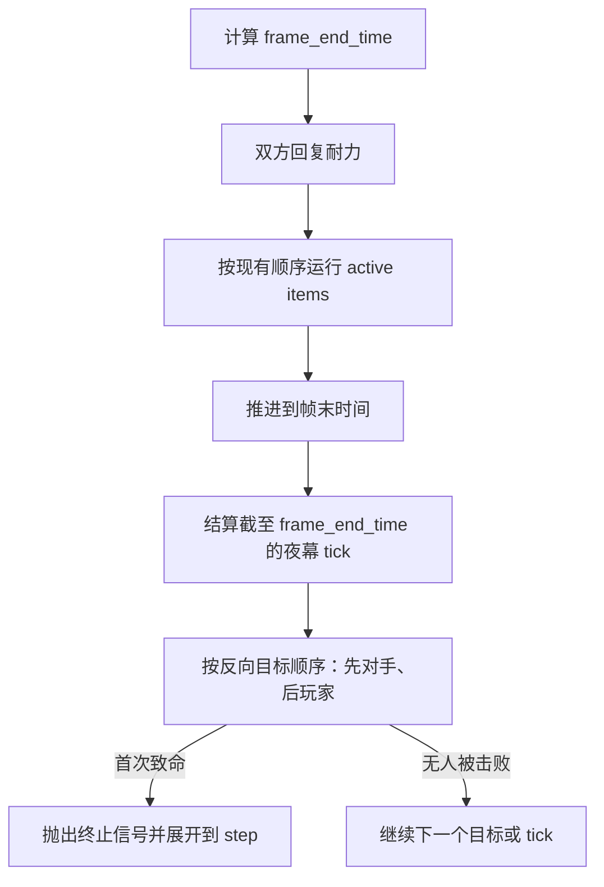

# 疲惫伤害实现简要 SPEC

状态：已实现并验证。统一生命扣减入口、直接减血保护与疲惫伤害均已落地。

## 1. Requirements（需求）

### 1.1 规则依据

- 本地知识库 `docs/backpack_battles_knowledge_base.md`：夜幕降临后，双方每秒受到逐渐增强的疲惫伤害；夜幕递增公式为 `F[i] = F[i-1] + floor(F[i-1] / 10) + 1`。
- 当前 [Fatigue Wiki 页面](https://backpackbattles.wiki.gg/wiki/Fatigue)（查询日期：2026-07-22）：普通夜幕在战斗时间 17.0 秒首次触发，之后每 1.0 秒触发；每名玩家的疲惫伤害独立计算，从 0 开始，因此无其他来源时 17 秒造成 1 点、18 秒造成 2 点，上一击为 10 点时下一击跳到 12 点。
- Wiki 还区分两种递增：夜幕疲惫使用上述加速公式；物品的“造成疲惫伤害”只在原值上加 1 再造成伤害。

### 1.2 本轮目标

1. 实现每名玩家独立的疲惫伤害值。
2. 在 17.0 秒及之后每秒对双方各结算一次夜幕疲惫。
3. 提供统一的疲惫结算函数，后续疲惫物品直接复用，不重复公式。
4. 支持任意正 `frame_delta` 跨过一个或多个整秒触发点，不漏结算。
5. 同一夜幕 tick 的受伤目标顺序固定为“对手 → 玩家”，与 active item 的“玩家 → 对手”结算顺序相反；首次致命结算立即锁定胜者并终止全部嵌套调用，不产生平局。
6. 在结果 JSON 中输出最终疲惫伤害值，便于测试和训练数据检查。
7. 疲惫伤害必须与所有其他生命扣减一样，通过 `BattleState.commit_health_reduction()` 修改生命值。
8. 任何代码直接执行 `player.health -= amount` 或把 `health` 赋为更小值都必须立即失败。

### 1.3 本轮非目标

- 不实现具体疲惫物品、`Power of the Moon` 提前夜幕、`Fatigue starts` 物品触发器或战斗日志。
- 不实现尚不存在的无敌、复活、通用增伤/减伤流水线。
- 不改造 `AttackEvent`；疲惫不是武器攻击，不进行命中、攻击响应、尖刺或吸血结算。

### 1.4 已确认的工程口径

- 疲惫不是武器攻击，不进入 `AttackEvent`，不触发命中、攻击响应、尖刺或吸血。
- 疲惫先消耗 `block`，余量再扣 `health`，且不得直接写 `health`。调用统一入口前计算 `blocked_damage = min(target.block, damage)` 和 `health_damage = damage - blocked_damage`。
- 所有生命扣减只有 `commit_health_reduction()` 一个合法入口。`PlayerState` 拦截外部直接减血；治疗或其他生命增加仍允许直接赋值。
- 玩家列表中的第一名是“玩家”，第二名是“对手”。active item 按玩家注册顺序结算，即“玩家 → 对手”；夜幕疲惫按反向目标顺序结算，即“对手先受伤 → 玩家后受伤”。若双方都会被本次疲惫击败，对手先死亡并立即终止结算，从而给玩家保留微弱优势。
- 首次致命结算可以发生在 `0.00s`；因终止信号离开当前 `step()` 时，不强制增加 `frame` 或 `time`。

## 2. Design（设计）

### 2.1 最小状态扩展

在 `PlayerState` 增加：

```python
fatigue_damage: int = 0
```

它表示“该玩家最近一次承受的、也是下一次递增所依据的疲惫伤害”，属于目标玩家而不是伤害来源。例如一件物品对对手造成疲惫伤害时，更新的是对手的 `fatigue_damage`。

在 `BattleState` 增加：

```python
next_nightfall_fatigue_time: float = 17.0
```

`next_nightfall_fatigue_time` 是下一个夜幕 tick 的绝对战斗时间。使用“下次触发时间”而不是根据帧号取模，可避免 `frame_delta=0.1` 等场景漏掉 17 秒边界。

现有统一生命扣减约束继续生效：

```python
BattleState.commit_health_reduction(
    player,
    blocked_damage,
    health_damage,
)
```

- 入口校验目标玩家属于当前战斗，两个扣减值都是非负整数，且 `blocked_damage` 不超过当前 `block`。
- 入口内部使用受控底层赋值降低 `health`，随后调用 `stop_if_battle_ended()`。
- `PlayerState.__setattr__()` 拒绝入口外的任何 `health` 减少。
- `check_battle_end()` 只设置 `winner`；`stop_if_battle_ended()` 在产生胜者后抛出 `_BattleFinishedSignal`。

### 2.2 两种疲惫递增

设目标玩家当前值为 `previous`：

```text
物品疲惫：next = previous + 1
夜幕疲惫：next = previous + floor(previous / 10) + 1
```

随后执行：

```text
target.fatigue_damage = next
blocked_damage = min(target.block, next)
health_damage = next - blocked_damage
battle_state.commit_health_reduction(
    target,
    blocked_damage=blocked_damage,
    health_damage=health_damage,
)
```

Block 只吸收本次伤害，不改变疲惫值的增长。例：某玩家在 17 秒前已因物品累计到 8 点，则其 17 秒夜幕伤害仍增长为 `8 + 0 + 1 = 9`；若此时有 4 Block，则消耗 4 Block、扣除 5 Health。另一名没有累计的玩家本次疲惫伤害为 1。

### 2.3 每帧流程



同一夜幕 tick 明确使用 `fatigue_targets = (players[1], players[0])`：先更新对手的疲惫值并通过统一入口扣血，再处理玩家。若对手先被击败，终止信号会阻止玩家承受本次疲惫以及后续 tick。这里按受伤目标排序，不按伤害来源排序。

首轮保持现有 V1 顺序：同一帧中 active item 先于帧末夜幕 tick。以后出现精确的“疲惫开始时”物品，再基于 Wiki 单独规定同时间事件优先级。

## 3. Realize（逐函数实现设计）

### 3.1 `calculate_next_fatigue_damage`

位置：`battle_module_v1.py`。

```python
def calculate_next_fatigue_damage(previous: int, *, nightfall: bool) -> int
```

伪代码：

```text
校验 previous 是非负整数
if nightfall:
    return previous + previous // 10 + 1
return previous + 1
```

该纯函数集中公式并便于阈值测试。

### 3.2 `BattleState.inflict_fatigue`

```python
def inflict_fatigue(
    self,
    target: PlayerState,
    *,
    nightfall: bool,
) -> int
```

伪代码：

```text
校验 target 属于本场战斗
next_damage = calculate_next_fatigue_damage(
    target.fatigue_damage,
    nightfall=nightfall,
)
target.fatigue_damage = next_damage
blocked_damage = min(target.block, next_damage)
health_damage = next_damage - blocked_damage
commit_health_reduction(
    target,
    blocked_damage=blocked_damage,
    health_damage=health_damage,
)
return next_damage
```

`commit_health_reduction()` 可能在完成扣血后抛出终止信号，因此致命场景不会执行 `return`，而会直接展开到 `step()`。

### 3.3 `BattleState._apply_due_nightfall_fatigue`

```python
def _apply_due_nightfall_fatigue(self, frame_end_time: float) -> None
```

伪代码：

```text
while next_nightfall_fatigue_time <= frame_end_time（允许极小浮点误差）:
    time = next_nightfall_fatigue_time
    next_nightfall_fatigue_time += 1.0
    fatigue_targets = (players[1], players[0])
    for target in fatigue_targets:
        inflict_fatigue(target, nightfall=True)
time = frame_end_time
```

先登记下一个 tick，再把当前战斗时间推进到本次事件的精确时间，然后调用可能抛出终止信号的扣血流程。若没有产生终局，全部补算完成后把 `time` 设为 `frame_end_time`；若产生终局，异常展开时会保留实际致命 tick 的时间。

### 3.4 `BattleState.step`

保留当前耐力和物品执行逻辑，在同一个终止信号捕获边界内加入帧末疲惫：

```text
frame_end_time = time + frame_delta
try:
    回复耐力
    运行全部 active items
    frame += 1
    _apply_due_nightfall_fatigue(frame_end_time)
except _BattleFinishedSignal:
    return winner
return winner
```

active item 在帧内造成致命伤时，信号发生在推进 `frame/time` 之前，因此保留游戏允许的 `0.00s` 击杀。疲惫属于帧末定时事件，先将 `time` 推进到事件时间再结算，所以 17 秒首次疲惫致命时结果时间为 17.0 秒。

### 3.5 `BattleState.check_battle_end`、`stop_if_battle_ended` 与 `run`

- `check_battle_end()` 只在恰好一名玩家存活时设置 `winner`，不抛出异常。
- `stop_if_battle_ended()` 调用 `check_battle_end()`；若已有 `winner`，抛出 `_BattleFinishedSignal`。
- `step()` 是终止信号的唯一捕获边界。
- `run()` 继续使用 `winner is not None` 作为停止条件。

### 3.6 `main_v1` 结果输出

- `_serialize_player()` 增加 `"fatigue_damage": player.fatigue_damage`。
- `_build_success_result()` 继续使用 `"winner"` 或 `"max_frames_reached"`；先手和终止信号规则不产生 `"simultaneous_defeat"`。
- 输入 JSON 不新增字段；标准战斗的疲惫值固定从 0 开始。

## 4. Tasks（任务拆解）

1. T0（已完成）：建立 `commit_health_reduction()` 唯一入口、直接减血保护和终止信号。
2. T1（已完成）：增加疲惫纯函数与 `PlayerState` / `BattleState` 疲惫字段。
3. T2（已完成）：实现通过统一生命扣减入口工作的单目标疲惫结算。依赖 T0-T1。
4. T3（已完成）：实现按“对手 → 玩家”反向目标顺序运行的夜幕调度。依赖 T2。
5. T4（已完成）：把夜幕调度接入 `step()` 的既有终止信号边界。依赖 T3。
6. T5（已完成）：扩展结果序列化。依赖 T1。
7. T6（已完成）：新增单元与集成测试，并运行仓库全部测试。依赖 T1-T5。

## 5. Acceptance Criteria / Tests（验收标准）

在 `tests/test_battle_module_v1.py` 增加：

1. `test_calculate_item_fatigue_increases_by_one`：0→1、10→11。
2. `test_calculate_nightfall_fatigue_uses_accelerating_formula`：0→1、9→10、10→12、29→32。
3. `test_nightfall_fatigue_first_triggers_at_seventeen_seconds`：16 秒生命不变，17 秒双方各扣 1。
4. `test_nightfall_fatigue_repeats_each_second`：17、18、19 秒伤害依次为 1、2、3。
5. `test_nightfall_fatigue_catches_up_crossed_ticks`：一个 frame 跨过 17 和 18 秒时两次都结算。
6. `test_players_keep_independent_fatigue_damage`：一方预置 8、另一方为 0，各自承受的疲惫值独立。
7. `test_fatigue_damage_uses_commit_health_reduction_and_consumes_block_first`：疲惫先消耗可用 Block，只有余量进入 Health，疲惫递增值不因 Block 吸收而改变。
8. `test_opponent_takes_nightfall_fatigue_before_player`：同一 tick 明确先修改 `players[1]`，再修改 `players[0]`。
9. `test_player_wins_lethal_nightfall_race`：双方均只能承受一次伤害时，对手先承受疲惫并被击败，玩家不再承受本次伤害。
10. `test_lethal_fatigue_unwinds_remaining_targets_and_ticks`：致命疲惫后不会继续后续目标、关联效果或补算 tick。
11. `test_item_kill_before_frame_end_skips_nightfall_fatigue`：active item 已造成终局时直接展开到 `step()`，不再运行帧末疲惫。
12. `test_direct_health_reduction_is_rejected`：任何入口外的 `health` 减少抛出 `ValueError`。
13. `test_direct_health_increase_is_allowed`：治疗式生命增加不受影响。

在 `tests/test_main_v1.py` 增加：

14. `test_result_serializes_fatigue_damage`：结果中回显双方最终值。
15. `test_lethal_fatigue_returns_player_win_without_draw_reason`：结果包含玩家胜者，且 `finish_reason == "winner"`。

整项完成标准：上述测试和仓库全部既有测试通过；默认无物品战斗能由疲惫自然结束；所有 Python 代码中除保护测试外不存在直接降低 `.health` 的赋值；不修改 `AGENTS.md`，不引入事件总线或新的抽象层。

验证结果（2026-07-23）：

- `python -m unittest discover -s tests -p "test_*.py"`：162 项测试全部通过。
- 双方各 100 Health、无物品的实跑在 30.0 秒由疲惫自然结束，胜者为玩家。
- 全仓库 Python 代码审计仅在保护测试中保留故意执行的 `.health -= 1`；生产代码的生命扣减均进入 `BattleState.commit_health_reduction()`。
