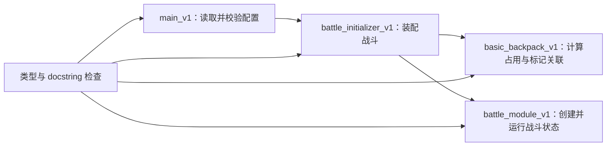

# 函数类型标注与简短注释 SPEC

状态：待用户审阅确认；在确认前不修改生产代码。

## 1. Requirements（需求）

### 1.1 目标

为当前根目录下生产 Python 文件中的所有显式函数和方法补全：

1. 参数类型标注。
2. 返回值类型标注。
3. 简短中文 docstring，简要说明函数功能、输入含义和输出含义。

本任务仅改善代码可读性和静态接口信息，不改变运行行为。

### 1.2 范围

纳入范围：

- `basic_backpack_v1.py`：8 个函数。
- `battle_initializer_v1.py`：5 个函数。
- `battle_module_v1.py`：15 个函数/方法。
- `main_v1.py`：12 个函数。

共 40 个函数/方法。

`item_factory_registry_v1.py` 当前只有 `DEFAULT_ITEM_FACTORIES` 常量，没有函数，因此本轮不修改。

默认不批量修改 `tests/` 中现有测试方法和测试辅助函数；测试方法名称本身已说明场景，本任务只为生产接口补充文档。会新增一个位于 `tests/` 的轻量检查文件，用标准库验证生产函数的标注和 docstring 是否完整。

### 1.3 行为要求

- WHEN 查看任一纳入范围的函数签名，THEN 每个显式参数（`self` 除外）和返回值 SHALL 具有类型标注。
- WHEN 查看任一纳入范围的函数 docstring，THEN docstring SHALL 简短包含“功能”“参数”“返回”三项信息。
- WHEN 函数没有正常返回值，THEN 返回类型 SHALL 为 `None`；若函数按当前实现始终抛出异常，则可使用 `NoReturn`。
- WHEN 输入来自动态 JSON 或字典结构，THEN 类型 SHALL 使用具体的 `list`、`dict` 与少量 `Any` 表达，不为本任务引入额外的抽象容器类型、大批 `TypedDict`、`Protocol` 或新数据类。
- WHEN 完成标注和注释后，THEN 所有既有默认值、异常类型、异常消息、状态修改、遍历顺序和返回数据 SHALL 保持不变。
- WHEN 修改 `battle_module_v1.py`，THEN SHALL 保留当前工作区内用户已有的未提交改动，只补全缺失标注和 docstring。

### 1.4 非目标

- 不修复现有测试或业务逻辑问题。
- 不实现 `evaluate_layout()`。
- 不新增物品、局外发育、商店或强化学习逻辑。
- 不调整类层次、模块边界或数据结构。
- 不引入第三方类型检查工具或新依赖。
- 不修改 `AGENTS.md`。

## 2. Design（设计）

### 2.1 注释格式

统一使用三行式中文 docstring，放在函数体第一条语句：

```python
def rotate_cells(
    cells: list[list[int] | tuple[int, int]],
    rotation: int,
) -> list[tuple[int, int]]:
    """功能：按指定角度旋转物品的局部格子坐标。
    参数：cells 为待旋转坐标；rotation 为旋转角度。
    返回：旋转后的坐标列表。
    """
```

约束：

- 不重复解释类型标注已经明确的信息。
- 输入较多时用分号逐项说明。
- 修改原对象但不返回内容的函数，明确写“返回：无；会原地修改……”。
- 可能抛出的异常只在理解函数契约确有必要时简要提及，不写成长篇异常清单。

### 2.2 类型策略

只使用 Python 标准库和项目现有类：

- `Any`：JSON/动态字典中的值。
- `Callable`：物品工厂。
- `list`：项目中的顺序数据，包括玩家列表、摆放列表、物品列表和二维矩阵。
- `dict`：项目中的键值数据，包括 JSON 对象、物品目录、玩家规格和运行结果。
- `NoReturn`：当前始终抛出 `NotImplementedError` 的 `evaluate_layout()`。
- `Path`：文件路径同时接受 `str | Path`。
- `argparse.Namespace`：命令行解析结果。
- `BattleItem`、`BattleState`、`BattleContext`、`PlayerState`：战斗模块对象。

为避免重复长签名，可在对应模块内定义少量纯类型别名：

```python
JsonObject = dict[str, Any]
ItemSpec = dict[str, Any]
PlacedItem = dict[str, Any]
OccupancyMatrix = list[list[str | None]]
ItemFactory = Callable[..., BattleItem]
```

这些别名只服务类型标注，不创建新的运行时数据结构，也不改变现有字典格式。

### 2.3 兼容性决策

- 在尚未使用延迟标注的模块顶部加入 `from __future__ import annotations`，避免前向引用和复杂引号写法。
- `player_id` 按当前设计文档和全部现有调用标为 `int`。
- 验证函数的待验证值使用 `object`，因为它们本来就负责拒绝错误类型。
- JSON/配置字典不在本任务升级为 `TypedDict`，以保持实现简单。
- 只补标注，不修改函数参数的默认值。特别是 `battle_module_v1.py` 当前工作区中已有的构造函数签名，保持其现状。

### 2.4 调用关系



本任务不改变上述调用关系。

## 3. 逐函数接口与伪代码

### 3.1 `basic_backpack_v1.py`

#### 3.1.1 `_load_item_catalog`

接口：

```python
def _load_item_catalog() -> dict[str, ItemSpec]
```

- 功能：读取物品目录 JSON，并把按旋转角度存储的字符串键转换为整数键。
- 输入：无。
- 输出：以 `item_id` 为键的可变物品规格字典。
- 伪代码：读取相邻 `data/item_catalog_v1.json`；遍历物品和 marker 类型；转换旋转键；返回目录。

#### 3.1.2 `rotate_cells`

接口：

```python
def rotate_cells(
    cells: list[list[int] | tuple[int, int]],
    rotation: int,
) -> list[tuple[int, int]]
```

- 功能：在 y 轴向上的局部坐标系中按指定角度逆时针旋转格子。
- 输入：`cells` 为二维整数坐标；`rotation` 为 `0/90/180/270`。
- 输出：旋转后的坐标列表。
- 伪代码：校验角度；逐坐标套用对应变换；返回新列表。

#### 3.1.3 `place_item`

接口：

```python
def place_item(item_spec: dict[str, Any], placement: dict[str, Any]) -> PlacedItem
```

- 功能：把物品形状和 marker 坐标旋转后平移到背包绝对坐标。
- 输入：`item_spec` 为物品规格；`placement` 为实例键、锚点和旋转信息。
- 输出：包含占用格和各类 marker 绝对坐标的已摆放物品字典。
- 伪代码：校验旋转；旋转形状；读取特殊旋转 marker 或旋转普通 marker；平移；组装结果。

#### 3.1.4 `build_occupancy_matrix`

接口：

```python
def build_occupancy_matrix(
    placements: list[dict[str, Any]],
    item_catalog: dict[str, dict[str, Any]],
) -> tuple[OccupancyMatrix, list[PlacedItem]]
```

- 功能：校验全部摆放并构建背包占用矩阵与已摆放物品列表。
- 输入：`placements` 为摆放序列；`item_catalog` 为物品规格映射。
- 输出：占用矩阵和按输入顺序排列的已摆放物品列表。
- 伪代码：初始化空矩阵；为同名物品生成实例键；调用 `place_item`；校验边界/重叠；写矩阵；返回两个结果。

#### 3.1.5 `find_marker_links`

接口：

```python
def find_marker_links(
    placed_items: list[dict[str, Any]],
    occupancy_matrix: list[list[str | None]],
    marker_type: str,
) -> list[dict[str, Any]]
```

- 功能：查找指定 marker 指向的其他物品实例。
- 输入：已摆放物品、占用矩阵和 marker 类型。
- 输出：来源物品、目标物品和 marker 坐标组成的关联字典列表。
- 伪代码：遍历 marker；跳过越界、空格和自身；记录有效关联；返回列表。

#### 3.1.6 `find_star_links`

接口：

```python
def find_star_links(
    placed_items: list[dict[str, Any]],
    occupancy_matrix: list[list[str | None]],
) -> list[dict[str, Any]]
```

- 功能：查找星标关联。
- 输入：已摆放物品和占用矩阵。
- 输出：星标关联列表。
- 伪代码：以 `"star"` 调用 `find_marker_links` 并返回结果。

#### 3.1.7 `find_diamond_links`

接口与上项相同，返回菱形标记关联列表。

- 伪代码：以 `"diamond"` 调用 `find_marker_links` 并返回结果。

#### 3.1.8 `find_triangle_links`

接口与上项相同，返回三角标记关联列表。

- 伪代码：以 `"triangle"` 调用 `find_marker_links` 并返回结果。

### 3.2 `battle_initializer_v1.py`

#### 3.2.1 `initialize_battle`

接口：

```python
def initialize_battle(
    player_specs: list[dict[str, Any]],
    item_factories: dict[str, ItemFactory],
    item_catalog: dict[str, dict[str, Any]] = ITEM_CATALOG,
) -> BattleState
```

- 功能：把两名玩家的摆放配置和物品工厂装配为可运行战斗状态。
- 输入：玩家规格、物品工厂映射、物品目录。
- 输出：包含玩家、物品和主动物品顺序的 `BattleState`。
- 伪代码：校验两名玩家和唯一 ID；逐玩家构建布局/关联；创建物品；挂接关联；创建玩家；收集主动物品；返回战斗状态。

#### 3.2.2 `_required_field`

接口：

```python
def _required_field(source: dict[str, Any], key: str) -> Any
```

- 功能：读取必填字段。
- 输入：来源映射和字段名。
- 输出：字段值；字段不存在时抛出 `ValueError`。
- 伪代码：检查键；缺失则报错；否则返回值。

#### 3.2.3 `_create_battle_items`

接口：

```python
def _create_battle_items(
    placed_items: list[dict[str, Any]],
    player_id: int,
    item_factories: dict[str, ItemFactory],
) -> dict[str, BattleItem]
```

- 功能：为一名玩家的已摆放物品调用工厂并建立实例键映射。
- 输入：已摆放物品、所属玩家 ID、物品工厂映射。
- 输出：`item_key` 到 `BattleItem` 的字典。
- 伪代码：逐物品查找工厂；检查重复键；创建和校验实例；写入并返回字典。

#### 3.2.4 `_validate_battle_item`

接口：

```python
def _validate_battle_item(
    battle_item: object,
    item_id: str,
    item_key: str,
    player_id: int,
) -> None
```

- 功能：校验工厂返回对象的类型和身份字段。
- 输入：待校验对象及期望的物品 ID、实例键、玩家 ID。
- 输出：无；不一致时抛出 `ValueError`。
- 伪代码：依次校验类型、`item_id`、`item_key`、`player_id`。

#### 3.2.5 `_attach_marker_links`

接口：

```python
def _attach_marker_links(
    marker_links: list[dict[str, Any]],
    items_by_key: dict[str, BattleItem],
) -> None
```

- 功能：把静态 marker 关联登记到来源战斗物品。
- 输入：关联记录和实例键到战斗物品的映射。
- 输出：无；会修改来源物品的 `linked_items`。
- 伪代码：逐关联校验来源/目标存在；调用来源物品的 `add_linked_item`。

### 3.3 `battle_module_v1.py`

#### 3.3.1 `BattleItem.__init__`

接口：

```python
def __init__(
    self,
    item_id: str | None,
    item_key: str,
    player_id: int,
    is_active_item: bool | None,
    triggers: list[Trigger],
    effects: list[Effect],
    linked_items: list[str],
) -> None
```

- 功能：初始化物品身份、触发器、效果器和关联目标，并校验触发器/效果器非空。
- 输入：物品/玩家身份、主动标记、触发器列表、效果器列表和关联键列表。
- 输出：无；初始化当前实例。
- 伪代码：选择实例参数或类默认值；保存字段；设置未触发；校验列表。

#### 3.3.2 `BattleItem.update_triggers`

```python
def update_triggers(self, context: BattleContext) -> None
```

- 功能：具体物品更新自身触发状态的抽象入口。
- 输入：当前物品对应的战斗上下文。
- 输出：无；基类当前抛出 `NotImplementedError`。
- 伪代码：抛出未实现异常。

#### 3.3.3 `BattleItem.is_triggered`

```python
def is_triggered(self) -> bool
```

- 功能：读取当前触发状态。
- 输入：无新增参数。
- 输出：布尔触发结果。
- 伪代码：对 `self.triggered` 取布尔值并返回。

#### 3.3.4 `BattleItem.run_effects`

```python
def run_effects(self, context: BattleContext) -> None
```

- 功能：依次运行当前物品效果和关联物品。
- 输入：当前物品对应的战斗上下文。
- 输出：无；通过上下文和物品状态产生副作用。
- 伪代码：调用 `run_own_effects`；再调用 `run_linked_items`。

#### 3.3.5 `BattleItem.run_own_effects`

```python
def run_own_effects(self, context: BattleContext) -> None
```

- 功能：具体物品执行自身效果的抽象入口。
- 输入：当前物品对应的战斗上下文。
- 输出：无；基类当前抛出 `NotImplementedError`。
- 伪代码：抛出未实现异常。

#### 3.3.6 `BattleItem.run_linked_items`

```python
def run_linked_items(self, context: BattleContext) -> None
```

- 功能：更新并按触发结果递归执行当前物品关联的其他物品。
- 输入：当前物品对应的战斗上下文。
- 输出：无；可能修改关联物品和战斗状态。
- 伪代码：逐关联键查找物品；切换上下文；更新触发；若已触发则运行效果。

#### 3.3.7 `BattleItem.add_linked_item`

```python
def add_linked_item(self, linked_key: str) -> None
```

- 功能：按首次出现顺序登记唯一关联物品键。
- 输入：目标物品实例键。
- 输出：无；可能向 `linked_items` 追加一个键。
- 伪代码：若键尚不存在则追加。

#### 3.3.8 `BattleState.step`

```python
def step(self, frame_delta: float = 1.0) -> int | None
```

- 功能：推进一帧战斗、执行主动物品并检查胜负。
- 输入：本帧经过的秒数。
- 输出：胜者玩家 ID；尚无胜者时为 `None`。
- 伪代码：遍历主动物品；构造上下文并更新/执行；增加帧和时间；检查结束；返回胜者。

#### 3.3.9 `BattleState.run`

```python
def run(self, max_frames: int, frame_delta: float = 1.0) -> int | None
```

- 功能：运行战斗直至出现胜者或达到最大帧数。
- 输入：最大帧数和每帧时长。
- 输出：胜者玩家 ID；未决时为 `None`。
- 伪代码：最多循环 `max_frames` 次；已有胜者则停止；每次调用 `step`；返回胜者。

#### 3.3.10 `BattleState.check_battle_end`

```python
def check_battle_end(self) -> None
```

- 功能：根据存活玩家数量更新胜者。
- 输入：无新增参数。
- 输出：无；恰有一名玩家存活时写入 `winner`。
- 伪代码：少于两名玩家则返回；筛选生命值大于零者；唯一存活者成为胜者。

#### 3.3.11 `BattleState.build_context`

```python
def build_context(self, item: BattleItem) -> BattleContext
```

- 功能：为指定物品构造拥有者/对手视角的战斗上下文。
- 输入：需要执行的战斗物品。
- 输出：对应的 `BattleContext`。
- 伪代码：查找拥有者和对手；构造并返回上下文。

#### 3.3.12 `BattleState.get_player`

```python
def get_player(self, player_id: int) -> PlayerState
```

- 功能：按玩家 ID 查找玩家状态。
- 输入：目标玩家 ID。
- 输出：匹配的 `PlayerState`；不存在时抛出 `ValueError`。
- 伪代码：顺序查找；命中则返回；否则报错。

#### 3.3.13 `BattleState.get_opponent`

```python
def get_opponent(self, player_id: int) -> PlayerState
```

- 功能：在双人战斗中查找指定玩家的唯一对手。
- 输入：当前玩家 ID。
- 输出：对手的 `PlayerState`；数量不唯一时抛出 `ValueError`。
- 伪代码：筛选不同 ID 的玩家；校验恰有一人；返回。

#### 3.3.14 `BattleContext.for_item`

```python
def for_item(self, item: BattleItem) -> BattleContext
```

- 功能：为另一件物品复用战斗状态并切换正确的拥有者/对手视角。
- 输入：目标战斗物品。
- 输出：目标物品对应的新 `BattleContext`。
- 伪代码：比较目标玩家 ID；保持或交换双方；未知 ID 则报错。

#### 3.3.15 `evaluate_layout`

```python
def evaluate_layout(
    placements: list[dict[str, Any]],
    opponent: PlayerState,
) -> NoReturn
```

- 功能：预留的摆盘评分入口。
- 输入：摆放序列和对手状态。
- 输出：当前没有正常返回值，始终抛出 `NotImplementedError`。
- 伪代码：直接抛出未实现异常。

### 3.4 `main_v1.py`

#### 3.4.1 `load_battle_run_file`

```python
def load_battle_run_file(input_path: str | Path) -> JsonObject
```

- 功能：读取并校验战斗运行 JSON 文件。
- 输入：字符串或 `Path` 文件路径。
- 输出：已通过结构校验的配置字典。
- 伪代码：转为 `Path`；读取 JSON；校验；返回。

#### 3.4.2 `normalize_player_specs`

```python
def normalize_player_specs(run_config: dict[str, Any]) -> tuple[list[JsonObject], JsonObject]
```

- 功能：拆分战斗初始化字段与保留的玩家元数据。
- 输入：已加载的运行配置。
- 输出：玩家初始化规格列表和运行元数据字典。
- 伪代码：重新校验；逐玩家复制身份/生命/摆放；单独保存 `class_id`；返回两部分。

#### 3.4.3 `run_battle_from_config`

```python
def run_battle_from_config(
    run_config: dict[str, Any],
    item_factories: dict[str, ItemFactory],
    item_catalog: dict[str, dict[str, Any]] = ITEM_CATALOG,
) -> JsonObject
```

- 功能：从内存配置初始化、运行战斗并生成成功结果。
- 输入：运行配置、物品工厂和物品目录。
- 输出：`battle_result_v1` 结果字典。
- 伪代码：校验；读取设置；规范化玩家；初始化并运行；判断结束原因；构建结果。

#### 3.4.4 `run_battle_from_file`

```python
def run_battle_from_file(
    input_path: str | Path,
    item_factories: dict[str, ItemFactory],
    item_catalog: dict[str, dict[str, Any]] = ITEM_CATALOG,
) -> JsonObject
```

- 功能：从 JSON 文件加载并运行战斗。
- 输入：输入路径、物品工厂和物品目录。
- 输出：战斗结果字典。
- 伪代码：加载配置；调用 `run_battle_from_config`；返回结果。

#### 3.4.5 `main`

```python
def main(argv: list[str] | None = None) -> int
```

- 功能：解析命令行、运行战斗并把成功或错误结果写到文件/标准输出。
- 输入：可选命令行参数序列；`None` 时由 `argparse` 使用进程参数。
- 输出：成功为 `0`、失败为 `1` 的退出码。
- 伪代码：定义参数；解析；尝试加载/覆盖/运行；捕获异常并构建错误；序列化；输出；返回退出码。

#### 3.4.6 `_validate_run_config`

```python
def _validate_run_config(run_config: object) -> None
```

- 功能：校验运行配置的顶层结构、版本、设置和两个玩家的必填字段。
- 输入：任意待验证对象。
- 输出：无；非法时抛出 `ValueError`。
- 伪代码：依次校验字典、版本、设置、数值、日志开关、玩家列表、人数和必填键。

#### 3.4.7 `_validate_positive_int`

```python
def _validate_positive_int(name: str, value: object) -> None
```

- 功能：验证值是非布尔的正整数。
- 输入：字段名和待验证值。
- 输出：无；非法时抛出 `ValueError`。
- 伪代码：排除布尔/非整数/非正数；失败则报错。

#### 3.4.8 `_validate_positive_number`

```python
def _validate_positive_number(name: str, value: object) -> None
```

- 功能：验证值是非布尔的正整数或正浮点数。
- 输入：字段名和待验证值。
- 输出：无；非法时抛出 `ValueError`。
- 伪代码：排除布尔/非数值/非正数；失败则报错。

#### 3.4.9 `_apply_cli_overrides`

```python
def _apply_cli_overrides(run_config: JsonObject, args: argparse.Namespace) -> None
```

- 功能：把命令行提供的帧数和帧时长覆盖到运行配置。
- 输入：可变运行配置和已解析参数。
- 输出：无；在存在覆盖值时原地更新 `run_config["settings"]`。
- 伪代码：没有覆盖则返回；复制设置；写入非空参数；回写配置。

#### 3.4.10 `_build_success_result`

```python
def _build_success_result(
    battle_state: BattleState,
    run_metadata: dict[str, Any],
    finish_reason: str,
) -> JsonObject
```

- 功能：把完成的战斗状态序列化为成功结果。
- 输入：战斗状态、运行元数据和结束原因。
- 输出：包含玩家、主动物品和空日志的结果字典。
- 伪代码：读取玩家元数据；组装版本/胜者/时间；序列化玩家和主动物品；返回。

#### 3.4.11 `_serialize_player`

```python
def _serialize_player(player: PlayerState, metadata: dict[str, Any]) -> JsonObject
```

- 功能：把单个玩家状态和元数据转换为结果字典。
- 输入：玩家状态及其运行元数据。
- 输出：玩家身份、职业、生命、护盾、增减益和物品键组成的字典。
- 伪代码：逐字段读取并复制集合；返回字典。

#### 3.4.12 `_build_error_result`

```python
def _build_error_result(exc: Exception) -> JsonObject
```

- 功能：把捕获的异常转换为标准错误结果。
- 输入：异常对象。
- 输出：包含错误类型和消息的 `battle_result_v1` 字典。
- 伪代码：写入版本、空胜者、错误结束原因和异常详情；返回。

## 4. Tasks（任务拆解）

1. **确认 SPEC**（无依赖）
   - 用户确认生产文件范围、docstring 格式和测试文件是否纳入批量注释范围。

2. **记录实现前基线**（依赖 1）
   - 运行现有单元测试并记录当前通过/失败情况。
   - 只记录现状，不借本任务修复既有失败。

3. **补全 `basic_backpack_v1.py`**（依赖 1）
   - 加入必要的标准库类型导入/别名。
   - 按 3.1 节补全 8 个函数签名和 docstring。

4. **补全 `battle_initializer_v1.py`**（依赖 3）
   - 加入物品工厂等简单类型别名。
   - 按 3.2 节补全 5 个函数签名和 docstring。

5. **补全 `battle_module_v1.py`**（依赖 1）
   - 保留用户当前未提交改动。
   - 按 3.3 节补全 15 个函数/方法签名和 docstring。
   - 不调整构造默认值、Buff/Debuff 数据结构或战斗行为。

6. **补全 `main_v1.py`**（依赖 4、5）
   - 加入必要的类型导入/别名。
   - 按 3.4 节补全 12 个函数签名和 docstring。

7. **新增契约检查测试**（依赖 3-6）
   - 在 `tests/test_function_contract_documentation_v1.py` 中实现第 5 节的 3 个测试。

8. **验证与差异审查**（依赖 7）
   - 运行语法编译、契约检查和全部现有测试。
   - 与基线比较，确保没有新增行为失败。
   - 用 `git diff --check` 检查格式，并人工确认差异只包含类型、docstring、必要导入/别名和测试。

## 5. Acceptance Criteria / Tests（验收标准）

### 5.1 新增测试文件

文件：`tests/test_function_contract_documentation_v1.py`

测试中维护一份显式的 40 个生产函数/方法清单，避免扫描到导入函数、隐式 dataclass 构造器或测试函数。

#### 5.1.1 `test_production_functions_have_complete_annotations(self) -> None`

- 功能：验证所有目标函数的显式参数和返回值都有标注。
- 输入：显式函数清单。
- 输出：无；缺失标注时测试失败并显示函数及参数名。
- 伪代码：遍历函数；读取 `inspect.signature`；忽略 `self/cls`；断言其他参数标注非空；断言返回标注非空。

#### 5.1.2 `test_production_function_type_hints_resolve(self) -> None`

- 功能：验证类型标注中的别名和前向引用均可解析。
- 输入：显式函数清单。
- 输出：无；`typing.get_type_hints` 解析失败时测试失败。
- 伪代码：逐函数调用 `get_type_hints`；确认没有异常。

#### 5.1.3 `test_production_functions_document_function_input_and_output(self) -> None`

- 功能：验证所有目标函数都有约定格式的简短契约 docstring。
- 输入：显式函数清单。
- 输出：无；docstring 缺失或缺少三项标签时测试失败。
- 伪代码：逐函数调用 `inspect.getdoc`；断言非空并包含 `功能：`、`参数：`、`返回：`。

### 5.2 整体验收

- 40 个生产函数/方法全部具有完整参数和返回类型标注。
- 40 个生产函数/方法全部具有简短中文 docstring，且说明功能、输入和输出。
- 类型提示可在运行时解析，不存在拼写错误或失效前向引用。
- `python -m compileall` 对 4 个生产模块和新增测试文件成功。
- 新增的 3 个契约检查测试全部通过。
- 全部现有测试相较实现前基线没有新增失败。
- `git diff --check` 通过。
- 生产代码差异不包含业务流程、返回数据、异常文本或默认值变化。
- `AGENTS.md` 未被修改。

## 6. 待用户确认

开始代码修改前需要确认两点：

1. 是否接受使用上述三行式中文 docstring 作为“简短注释”。
2. 是否同意本轮只覆盖根目录 4 个含函数的生产文件，不批量给既有 `tests/` 测试方法加类型和 docstring；测试目录只新增契约检查文件。
