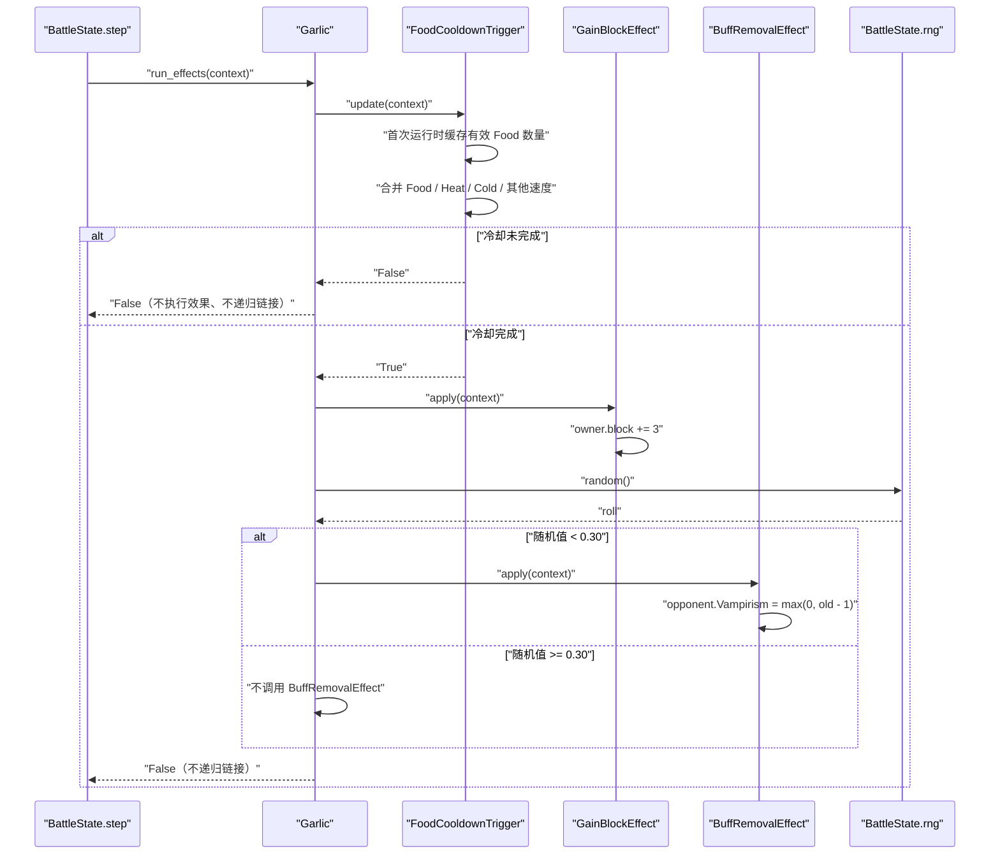

# Garlic item factory SPEC

状态：已实现并验证（2026-07-23）。

查询日期：2026-07-23。

## 1. Requirements（需求）

### 1.1 功能目标

在现有 `BattleItem`、marker link、Food 冷却和默认物品工厂框架中实现 Garlic（大蒜），使其可以通过标准战斗 JSON 实例化并参与逐帧战斗。

Garlic 必须：

- 作为 `is_active_item=True` 的主动物品进入 `BattleState.active_items`。
- 使用 4 秒基础冷却；初始冷却进度为 0，战斗开始时不立即激活。
- 使用现有 `FoodCooldownTrigger`，接受不同 `item_id` 的星标连接 Food 所提供的每件 10% Faster。
- 不把另一件 Garlic 计入自己的 Food 加速。
- Food 连接数量沿用现有行为：第一次运行时统计并写入 `qualifying_food_count`，后续不再扫描连接。
- Food Faster、Heat、Cold 和其他物品速度修饰继续由现有 `CooldownTrigger` 合并，不为 Garlic 复制冷却公式。
- 每次成功结束冷却时，为拥有者增加 3 点 Block。
- 每次成功结束冷却时，由 `Garlic.run_own_effect()` 执行一次 30% 概率判断；成功则移除对手至多 1 层 Vampirism。
- 对手 Vampirism 为 0 时不得变为负数。
- Block 获取和 Vampirism 移除互不短路：概率检定失败或没有可移除层数时仍获得 Block。
- Garlic 激活时不递归调用星标连接物品；星标只提供 Food 冷却加速。
- 每个 Garlic 实例拥有独立的冷却 trigger 和 effect 实例。
- 使用 `BattleState.rng` 完成概率检定，不创建模块级或物品级随机数生成器。

### 1.2 Wiki 事实快照

#### 1.2.1 来源

本 SPEC 只使用项目允许的 `backpackbattles.wiki.gg` 及其 MediaWiki/Cargo API：

- [Garlic](https://backpackbattles.wiki.gg/wiki/Garlic?oldid=10722)：修订 `10722`，修订时间 `2025-09-17T20:01:00Z`。
- [Food](https://backpackbattles.wiki.gg/wiki/Food?oldid=8089)：修订 `8089`，修订时间 `2024-03-20T09:25:43Z`。
- [Cooldown](https://backpackbattles.wiki.gg/wiki/Cooldown?oldid=12142)：修订 `12142`，修订时间 `2026-05-09T06:49:02Z`。
- [Block](https://backpackbattles.wiki.gg/wiki/Block?oldid=8407)：修订 `8407`，修订时间 `2024-03-28T10:19:14Z`。
- [Vampirism](https://backpackbattles.wiki.gg/wiki/Vampirism?oldid=8401)：修订 `8401`，修订时间 `2024-03-28T10:18:59Z`。
- [Cargo `Items` 查询](https://backpackbattles.wiki.gg/api.php?action=cargoquery&format=json&tables=Items&fields=name%2Cclass%2Crarity%2Ccost%2Citemtype%2Cicontype%2Ctags%2Ceffect&where=name%3D%22Garlic%22)：
  `tables=Items&fields=name,class,rarity,cost,itemtype,icontype,tags,effect&where=name="Garlic"`。

Cargo 在查询日返回：

```text
name=Garlic
class=""
rarity=Common
cost=2
itemtype=Food
icontype=nature
tags=Block,Vampirism
effect=Every 4s: Gain 3 Block. 30% chance to remove 1 Vampirism from your opponent.
```

Garlic 页面当前模板的原始网格为：

```text
-2-
212
212
-2-
```

其中 `1` 是 Garlic 占格，`2` 是星标格。按仓库现有坐标约定标准化为：

```python
shape_cells = [[0, 1], [0, 0]]
star_cells = [
    [0, 2],
    [-1, 1],
    [1, 1],
    [-1, 0],
    [1, 0],
    [0, -1],
]
```

Food 页面规定：

- 每个由星标连接、且 `item_id` 不同于来源 Food 的 Food 实例，使来源 Food 快 10%。
- 多个同种的其他 Food 实例可以分别提供加速。
- 同一实例不能因为覆盖多个星标而重复计数。

Cooldown 页面规定 Faster 和 Slower 来源先相加再互相抵消。Garlic 直接复用已实现并验证的 `FoodCooldownTrigger` 和 `CooldownTrigger`，不修改这部分规则。

Block 页面规定每点 Block 吸收 1 点普通伤害。当前 `PlayerState.block` 和伤害结算已经符合这个基础模型。

Vampirism 页面将 Vampirism 定义为 buff。当前 `BuffSlot.Vampirism` 已存在，因此 Garlic 只需减少对手的该字段。

#### 1.2.2 标准化元数据

| 字段 | 建模值 | 依据 |
| --- | --- | --- |
| `item_id` | `"garlic"` | 仓库命名约定 |
| `display_name` | `"Garlic"` | Wiki/Cargo |
| `item_classes` | `("Neutral",)` | Cargo `class` 为空，按项目知识库归一化 |
| `rarity` | `"Common"` | Cargo |
| `cost` | `2` | Cargo |
| `item_types` | `("Food",)` | Cargo |
| `icon_types` | `("nature",)` | Cargo |
| `is_active_item` | `True` | 每 4 秒周期激活 |
| `socket_count` | `0` | 页面未列出 Sockets；按现有物品建模约定推断 |
| 基础冷却 | `4.0` 秒 | Wiki/Cargo |
| Block 获取 | `3` | Wiki/Cargo |
| Vampirism 移除概率 | `0.30` | Wiki/Cargo |
| Vampirism 移除量 | `1` | Wiki/Cargo |

Cargo 的 `tags=Block,Vampirism` 不加入 `BattleItem` 公共字段，因为当前公共元数据没有 `tags`，且 Garlic 运行逻辑不依赖该字段。

### 1.3 用户故事

- 作为战斗 JSON 使用者，我可以在 `placements` 中放置 `garlic`，默认初始化流程会创建真实 `Garlic` 实例。
- 作为摆盘模型使用者，我可以利用 Garlic 的六个星标连接其他种类的 Food，并得到可重复计算的冷却加速。
- 作为战斗模拟调用者，我可以观察 Garlic 每次激活稳定增加 Block，并通过统一 RNG 决定是否移除对手 Vampirism。
- 作为后续防御物品实现者，我可以复用 `GainBlockEffect`，无需在物品类里直接编写 Block 加法。
- 作为测试和训练调用者，我可以通过固定 `BattleState.rng` 获得确定的 Garlic 概率结果。

### 1.4 验收场景

1. 没有相邻 Food 的 Garlic 累计 4 秒后第一次激活。
2. 星标连接 Banana 的 Garlic 每秒累计 1.1 秒冷却进度。
3. 星标只连接另一件 Garlic 时，每秒仍累计 1.0 秒冷却进度。
4. 一个 Banana 实例同时覆盖 Garlic 的两个星标时，只贡献一次 10% Faster。
5. Garlic 首次运行后修改测试中的 `linked_items`，仍复用首次缓存的 Food 数量。
6. Garlic 拥有者初始 `block=2`，激活后变为 `block=5`。
7. 概率检定成功且对手有 2 层 Vampirism 时，激活后对手剩 1 层。
8. 概率检定成功且对手没有 Vampirism 时，对手仍为 0，拥有者仍获得 3 Block。
9. 概率检定失败时，对手 Vampirism 不变，拥有者仍获得 3 Block。
10. 冷却未完成时，不增加 Block，也不消耗随机数。
11. Garlic 激活时不调用星标连接物品的 `run_effects()`。

### 1.5 范围外

- 不实现商店、购买、出售、合成、Stankus' Toothpick 配方或局外成长。
- 不实现 Smelly Wall 对 Garlic Block 获取量的 `+5` 修改及其后续 Poison 交互。
- 不实现 Shield of Valor 等“提高 Block 获取量”的全局修饰。
- 不实现 buff removal protection；当前版本由通用 `BuffRemovalEffect` 直接减少目标 buff。未来实现保护机制时集中改写该 effect。
- 不实现 Nullify、buff steal、Vampirism 的近战吸血结算或治疗联动。
- 不新增事件总线、callback registry 或独立 RNG。
- 不修改 `CooldownTrigger`、`FoodCooldownTrigger` 的既有公式、缓存或外部速度修饰接口。
- 不修改 `PlayerState`、`BuffSlot`、`BattleState` 或伤害结算。
- 不修改最小木剑战斗示例。
- 不修改 `AGENTS.md`。
- Cooldown 页面记录的 Faster/Slower 1000% 上限仍不在本物品 SPEC 中处理。

## 2. Design（设计）

### 2.1 当前仓库状态与缺口

查询当前工作区后：

- `data/item_catalog_v1.json` 尚无 `garlic`，所以 Garlic 当前不能被背包布局器识别。
- `basic_backpack_v1.py` 已支持普通 `shape_cells`、可旋转 `star_cells`、marker link 发现和单实例去重，无需修改。
- `battle_initializer_v1.py` 已从目录和工厂构建物品、装配 marker links，并把主动对象加入 `BattleState.active_items`，无需修改。
- `FoodCooldownTrigger` 已实现不同 `item_id` Food 的首次计数缓存，并复用基础冷却的 Heat、Cold 和其他速度修饰，Garlic 可以直接使用。
- `PlayerState` 已有无上限的整数 `block` 字段。
- `BuffSlot` 已有整数 `Vampirism` 字段。
- `BattleState` 已持有统一的 `rng`，现有概率逻辑使用 `rng.random()`。
- 当前缺少通用 Block 获取 effect、通用 buff 移除 effect、`Garlic` 类和默认工厂注册项。
- 起草本 SPEC 前，完整测试基线为 194 项且全部通过。

因此最小实现只需要：

1. 在目录中加入 Wiki 对应的 Garlic 形状和星标。
2. 新增 `GainBlockEffect`。
3. 新增可按 buff 名称复用的 `BuffRemovalEffect`。
4. 用现有 Food trigger 和两个 effect 组装 `Garlic`，在 `run_own_effect()` 中直接判断 30% 概率。
5. 把 `garlic` 注册到 `DEFAULT_ITEM_FACTORIES`。
6. 添加目录、组件、初始化和运行时测试。

### 2.2 文件级改动

| 文件 | 计划改动 |
| --- | --- |
| `data/item_catalog_v1.json` | 新增 `garlic` 的两格竖直形状和六个星标 |
| `item_factory_registry_v1.py` | 导入 `BuffSlot`；新增 `GainBlockEffect`、`BuffRemovalEffect`、`Garlic`；注册 Garlic |
| `tests/test_basic_backpack_v1.py` | 新增 Garlic Wiki 网格、旋转基础能力的回归测试 |
| `tests/test_item_factory_registry_v1.py` | 新 effect、Garlic 元数据、实例独立性、初始化、Food 加速、概率和运行时测试 |
| `docs/garlic_item_factory_spec.md` | 审阅后记录实施状态和实测结果 |

不计划修改 `battle_module_v1.py`、`battle_initializer_v1.py`、`main_v1.py`、`README.md` 或现有示例 JSON。

### 2.3 架构决策

#### 2.3.1 复用现有 Food trigger

Garlic 使用：

```python
FoodCooldownTrigger(cooldown_seconds=4.0)
```

不新增 `GarlicCooldownTrigger`，原因是 Garlic 没有独有的冷却规则。其星标加速、同类 Food 排除、首次运行缓存、Heat/Cold 和其他速度修饰均已由现有 trigger 覆盖。

#### 2.3.2 新增简单 `GainBlockEffect`

Block 获取是可复用的基础状态变化，适合一个只负责数值增加的小 effect：

```python
class GainBlockEffect(Effect):
    amount: int
```

它不负责 Smelly Wall、Block 增幅或来源事件。这些机制尚不存在，不能为了 Garlic 预先引入复杂的修饰管线。

#### 2.3.3 使用通用 `BuffRemovalEffect`

本 SPEC 选择：

```python
class BuffRemovalEffect(Effect):
    buff_name: str
    amount: int
```

该 effect 固定作用于 `context.opponent.buffs`，通过 `buff_name` 选择要移除的 buff。Garlic 配置为：

```python
BuffRemovalEffect(
    buff_name="Vampirism",
    amount=1,
)
```

`buff_name` 必须在构造时通过 `BuffSlot.__annotations__` 验证，避免运行时静默创建不存在的属性。目标固定为对手，不增加 `target`、callback 或策略对象。

`BuffRemovalEffect.apply()` 只负责确定性减层，不读取 RNG。计算时先声明 `removal = self.amount`，未来所有移除量增减、保护判定和其他 modifier 都集中修改这个局部变量，再计算实际可移除层数。

由于 `buff_name` 是运行时参数，读取和写回目标字段仍必须使用 `getattr/setattr`。直接写 `context.opponent.buffs.Vampirism` 会把通用 effect 重新硬编码为只能处理 Vampirism。动态属性访问只出现在状态读写边界，所有中间计算都使用显式的 `removal` 和 `actual_removal`。

#### 2.3.4 Garlic 内的概率判断

本 SPEC 不新增 `ChanceTrigger`。战斗中的概率判断可能出现在物品激活、攻击命中、次级效果、事件响应等多种语境；一个名为 Chance 的 trigger 只能自然表达“物品是否激活”，无法覆盖这些不同调用位置。

Garlic 的 30% 是“冷却激活后，次级 buff removal 是否发生”，因此由 `Garlic.run_own_effect()` 直接判断：

1. `trigger_results[0]` 为 `False` 时立即返回，不读取 RNG。
2. 冷却完成后先执行 `GainBlockEffect`。
3. 调用一次 `context.battle_state.rng.random()`。
4. 仅当 `roll < 0.30` 时调用确定性的 `BuffRemovalEffect`。
5. 即使对手 Vampirism 为 0，也仍消费该次随机数。

`Garlic` 不覆写 `update_triggers()`，继续完整复用 `BattleItem.update_triggers()`。

#### 2.3.5 不递归触发星标物品

与 Banana 相同，Garlic 的星标是速度修饰关系，不是“激活相邻物品”的关系。因此 `Garlic.run_own_effect()` 在完成自身效果后返回 `False`，阻止 `BattleItem.run_effects()` 调用 `run_linked_items()`。

### 2.4 数据模型

#### 2.4.1 目录记录

```json
"garlic": {
  "item_id": "garlic",
  "shape_cells": [[0, 1], [0, 0]],
  "star_cells": [
    [0, 2],
    [-1, 1],
    [1, 1],
    [-1, 0],
    [1, 0],
    [0, -1]
  ]
}
```

使用普通 `star_cells`，由现有 `rotate_cells()` 处理四个方向；不需要 `star_cells_by_rotation`。

#### 2.4.2 Garlic 组件

```python
Garlic(
    triggers=[
        FoodCooldownTrigger(cooldown_seconds=4.0),
    ],
    effects=[
        GainBlockEffect(amount=3),
        BuffRemovalEffect(
            buff_name="Vampirism",
            amount=1,
        ),
    ],
)
```

所有组件在 `Garlic.__init__()` 中新建，禁止作为类级可变对象共享。

### 2.5 运行流程



### 2.6 状态与返回值契约

| 组件 | 成功/变化时 | 无变化时 |
| --- | --- | --- |
| `GainBlockEffect.apply()` | Block 实际增加，返回 `True` | `amount=0` 时返回 `False` |
| `BuffRemovalEffect.apply()` | 实际移除至少一层时返回 `True` | 目标 buff 为 0 时返回 `False` |
| `Garlic.run_own_effect()` | 执行 Block，并用一次 RNG 判断是否移除 buff；最终返回 `False` | 冷却未完成时不读 RNG，并返回 `False` |

`Garlic.run_own_effect()` 的布尔值控制 linked-item 递归，不代表 Garlic 是否产生状态变化。

### 2.7 数值验证

- `GainBlockEffect.amount`：必须是非负的精确 `int`；拒绝 `bool`、浮点数、字符串和负数。
- `BuffRemovalEffect.buff_name`：必须是精确 `str`，且名称存在于 `BuffSlot.__annotations__`。
- `BuffRemovalEffect.amount`：必须是非负的精确 `int`。
- Garlic 使用常量 `amount=3`、`amount=1`，并在自身调度逻辑中使用固定移除概率 `0.30`。
- 不在本次实现中给 `PlayerState.block` 或 `BuffSlot.Vampirism` 增加新的运行时验证。

### 2.8 兼容性

- Wooden Sword、Wooden Buckler 和 Banana 的组件、元数据和运行逻辑保持不变。
- `FoodCooldownTrigger` 的缓存策略保持不变。
- `CooldownTrigger.speed_modifier_by_others()` 及其累计值保持不变。
- 现有 194 项测试必须继续通过。
- `battle_run_v1` 输入 schema 不变；只是多一个目录和工厂都识别的 `item_id="garlic"`。

## 3. Realize（逐函数实现）

### 3.1 `data/item_catalog_v1.json`

新增键 `"garlic"`，值严格为：

```json
{
  "item_id": "garlic",
  "shape_cells": [[0, 1], [0, 0]],
  "star_cells": [[0, 2], [-1, 1], [1, 1], [-1, 0], [1, 0], [0, -1]]
}
```

不得修改其他目录项。

### 3.2 `GainBlockEffect.__init__`

接口：

```python
def __init__(self, amount: int)
```

伪代码：

```python
if type(amount) is not int or amount < 0:
    raise ValueError("block amount must be a non-negative int")
self.amount = amount
```

### 3.3 `GainBlockEffect.apply`

接口：

```python
def apply(self, context: BattleContext) -> bool
```

伪代码：

```python
old_block = context.owner.block
context.owner.block = old_block + self.amount
return context.owner.block > old_block
```

不设置 Block 上限；当前基础状态也没有 Block 上限。

### 3.4 `BuffRemovalEffect.__init__`

接口：

```python
def __init__(
    self,
    buff_name: str,
    amount: int,
)
```

伪代码：

```python
if (
    type(buff_name) is not str
    or buff_name not in BuffSlot.__annotations__
):
    raise ValueError("unsupported buff name")
if type(amount) is not int or amount < 0:
    raise ValueError("removed buff amount must be a non-negative int")
self.buff_name = buff_name
self.amount = amount
```

为完成名称验证，`item_factory_registry_v1.py` 从 `battle_module_v1` 导入公开数据类 `BuffSlot`。不复制一份支持名称常量，避免它与真实状态字段漂移。

### 3.5 `BuffRemovalEffect.apply`

接口：

```python
def apply(self, context: BattleContext) -> bool
```

伪代码：

```python
old_stacks = getattr(
    context.opponent.buffs,
    self.buff_name,
)
removal = self.amount

# Future modifiers and removal protection adjust removal here.

actual_removal = min(
    old_stacks,
    removal,
)
setattr(
    context.opponent.buffs,
    self.buff_name,
    old_stacks - actual_removal,
)
return actual_removal > 0
```

关键约束：

- 不读取 RNG；概率判断完全由调用该 effect 的具体物品负责。
- `removal` 是应用 modifier 前的请求移除量；当前等于 `self.amount`。
- `actual_removal` 是经过 modifier 后、再受现有层数截断的实际移除量。
- 目标 buff 为 0 或最终 `removal=0` 时返回 `False`。
- 只读取和修改 `context.opponent.buffs` 中由 `buff_name` 指定的字段。
- 当前不检查 buff removal protection；未来保护逻辑必须集中修改 `removal`，并发生在计算 `actual_removal` 之前。

### 3.6 `Garlic` 类级元数据

在 `item_factory_registry_v1.py` 中新增：

```python
class Garlic(BattleItem):
    item_id = "garlic"
    display_name = "Garlic"
    item_classes = ("Neutral",)
    rarity = "Common"
    cost = 2
    item_types = ("Food",)
    icon_types = ("nature",)
    is_active_item = True
    socket_count = 0
```

### 3.7 `Garlic.__init__`

接口：

```python
def __init__(
    self,
    item_id: str | None = None,
    item_key: str | None = None,
    player_id: int | None = None,
)
```

伪代码：

```python
super().__init__(
    item_id=item_id,
    item_key=item_key,
    player_id=player_id,
    is_active_item=True,
    triggers=[
        FoodCooldownTrigger(cooldown_seconds=4.0),
    ],
    effects=[
        GainBlockEffect(amount=3),
        BuffRemovalEffect(
            buff_name="Vampirism",
            amount=1,
        ),
    ],
)
```

### 3.8 `Garlic.run_own_effect`

接口：

```python
def run_own_effect(
    self,
    trigger_results: list[bool],
    context: BattleContext,
) -> bool
```

伪代码：

```python
if not trigger_results[0]:
    return False

self.effects[0].apply(context)
roll = context.battle_state.rng.random()
if roll < 0.30:
    self.effects[1].apply(context)
return False
```

Block effect 的返回值不得控制 buff removal。概率比较使用严格小于；`roll == 0.30` 时不移除。

### 3.9 `DEFAULT_ITEM_FACTORIES`

新增：

```python
"garlic": Garlic,
```

保留所有既有注册项。

### 3.10 明确不修改的函数

以下函数和数据结构不应因 Garlic 改动：

- `CooldownTrigger.__init__`
- `CooldownTrigger.get_additional_faster`
- `CooldownTrigger.speed_modifier_by_others`
- `CooldownTrigger.update`
- `FoodCooldownTrigger.__init__`
- `FoodCooldownTrigger.get_additional_faster`
- `BattleItem.update_triggers`
- `BattleItem.run_effects`
- `BattleItem.run_linked_items`
- `BattleState.step`
- `BattleState.resolve_attack`
- `BattleState.commit_health_reduction`
- `BuffSlot`
- `PlayerState`
- `initialize_battle`
- `build_occupancy_matrix`
- `find_star_links`

## 4. Tasks（任务拆解）

### T1：确认 SPEC

- 用户确认本文第 6 节决策。
- 依赖：无。
- 验证：SPEC 状态可以从“待用户审阅”进入“已批准实现”。

### T2：加入 Garlic 目录网格

- 修改 `data/item_catalog_v1.json`。
- 添加 Wiki 网格回归测试。
- 依赖：T1。
- 验证：目录加载、0° 放置和星标坐标全部正确。

### T3：实现 Block 与 buff removal 组件

- 新增 `GainBlockEffect`。
- 新增 `BuffRemovalEffect`，通过 `buff_name` 支持所有当前 `BuffSlot` 字段。
- 添加参数验证和状态变化测试。
- 依赖：T1。
- 验证：effect 单元测试全部通过。

### T4：组装并注册 Garlic

- 新增 `Garlic`。
- 使用现有 `FoodCooldownTrigger`。
- 在 `Garlic.run_own_effect()` 内执行 30% RNG 判断。
- 注册到 `DEFAULT_ITEM_FACTORIES`。
- 依赖：T2、T3。
- 验证：默认初始化器能创建 Garlic 并将其加入主动列表。

### T5：补充运行时与链接测试

- 验证 4 秒冷却。
- 验证 Food 加速和同 Garlic 排除。
- 验证 Block 与概率移除互不短路。
- 验证不递归运行星标连接物品。
- 依赖：T4。

### T6：回归验证

- 运行完整 `unittest` 测试集。
- 运行包含 Garlic 的最小内存战斗配置或临时测试配置。
- 执行 `git diff --check`。
- 依赖：T5。

### T7：回写文档状态

- 记录最终测试数量和结果。
- 只在实现与验证完成后把状态更新为“已实现并验证”。
- 依赖：T6。

## 5. Acceptance Criteria / Tests（验收标准）

### 5.1 目录与布局

1. `test_garlic_catalog_matches_wiki_grid`
   - 断言 `shape_cells == [[0, 1], [0, 0]]`。
   - 断言六个 `star_cells` 与 Wiki 网格一致。
   - 在 `(2, 2)`、0° 放置后，占格为 `(2, 3)`、`(2, 2)`。
   - 星标为 `(2, 4)`、`(1, 3)`、`(3, 3)`、`(1, 2)`、`(3, 2)`、`(2, 1)`。
   - diamond/triangle 均为空。

2. `test_garlic_catalog_rotates_shape_and_stars`
   - 使用现有 `place_item()` 或 `build_occupancy_matrix()` 验证一个非 0° 方向。
   - 不为 Garlic 添加手写 `star_cells_by_rotation`。

### 5.2 trigger/effect 参数与基础行为

3. `test_gain_block_effect_adds_amount`
   - `block=2, amount=3` 后为 5，返回 `True`。

4. `test_gain_block_effect_returns_false_for_zero_amount`
   - `amount=0` 不改变 Block，返回 `False`。

5. `test_gain_block_effect_rejects_invalid_amount`
   - 负数、浮点数、布尔值和字符串均抛出 `ValueError`。

6. `test_buff_removal_effect_removes_named_buff`
   - 使用 `buff_name="Vampirism"`。
   - 对手 2 层、`amount=1` 时剩 1 层，返回 `True`。
   - 断言不读取 RNG。

7. `test_buff_removal_effect_can_remove_another_supported_buff`
   - 使用 `buff_name="Heat"`、`amount=2`。
   - 对手 3 层 Heat 变为 1，证明 effect 不硬编码 Vampirism。

8. `test_buff_removal_effect_caps_at_available_stacks`
   - 对手 1 层、`amount=3` 时实际只移除 1 层，结果为 0，返回 `True`。

9. `test_buff_removal_effect_returns_false_with_no_stacks`
   - 对手 0 层时仍为 0，返回 `False`。

10. `test_buff_removal_effect_rejects_invalid_buff_name`
    - 不存在的字段、空字符串、布尔值和非字符串均抛出 `ValueError`。

11. `test_buff_removal_effect_rejects_invalid_amount`
   - 负数、浮点数、布尔值和字符串均抛出 `ValueError`。

### 5.3 Garlic 工厂与实例

12. `test_garlic_is_registered_with_metadata_and_components`
    - 默认 registry 能创建 `Garlic`。
    - 断言全部元数据。
    - 断言唯一 trigger 是 `FoodCooldownTrigger(4.0)`。
    - 断言 effects 依次为 `GainBlockEffect(3)` 和 `BuffRemovalEffect("Vampirism", 1)`。

13. `test_garlics_own_independent_component_instances`
    - 两件 Garlic 的 trigger 和两个 effect 均不是同一对象。
    - 修改第一件的冷却进度或 Food 缓存不影响第二件。

14. `test_initializer_builds_garlic_as_active_item_with_deduplicated_star_link`
    - 用默认目录和 registry 初始化 Garlic 与 Banana。
    - Banana 一个实例覆盖 Garlic 两个星标。
    - Garlic 的 `linked_items` 中只出现一次 Banana key。
    - Garlic 出现在拥有者 `items` 和 `BattleState.active_items`。

### 5.4 Food 冷却

15. `test_garlic_food_cooldown_counts_linked_banana`
    - Garlic 链接 Banana 后首次运行缓存 `qualifying_food_count=1`。
    - `frame_delta=1` 时增加 1.1 秒冷却进度。

16. `test_garlic_food_cooldown_ignores_linked_garlic`
    - Garlic 只链接另一件 Garlic 时缓存为 0。
    - `frame_delta=1` 时只增加 1.0 秒冷却进度。

17. `test_garlic_food_cooldown_keeps_first_cached_count`
    - 首次运行链接 Banana，缓存为 1。
    - 测试中再添加其他 Food，后续仍使用 1。
    - Heat/Cold 与外部速度修饰仍由当前帧状态读取。

### 5.5 Garlic 运行逻辑

18. `test_garlic_does_not_activate_before_cooldown`
    - 冷却不足时 Block 和 Vampirism 均不变。
    - RNG 不被调用。

19. `test_garlic_gains_block_and_removes_vampirism_on_success`
    - 冷却完成且 `rng.random() < 0.30`。
    - Block 增加 3，对手 Vampirism 减少 1。
    - `run_effects()` 返回 `False`。

20. `test_garlic_still_gains_block_when_removal_roll_fails`
    - `rng.random()=0.30`，验证严格边界属于失败。
    - Block 增加 3，对手 Vampirism 不变。

21. `test_garlic_still_gains_block_when_opponent_has_no_vampirism`
    - 概率成功但对手为 0。
    - Block 增加 3，对手保持 0。
    - RNG 仍恰好调用一次。

22. `test_garlic_does_not_run_star_linked_items`
    - 冷却完成、固定 RNG 为成功，且 linked item 带有 mock `run_effects()`。
    - 断言 Garlic 自身两个 effect 已执行。
    - 断言 linked item 未调用。

23. `test_battle_step_runs_garlic_at_four_seconds`
    - `frame_delta=1.0`，连续执行四帧。
    - 前三帧不触发，第四帧增加 3 Block。
    - 固定 RNG 后验证 Vampirism 结果。

### 5.6 回归与完成标准

- 修改前已有的 194 项测试全部继续通过。
- 上述新增测试全部通过。
- `data/item_catalog_v1.json` 除新增 `garlic` 外不发生变化。
- `Garlic` 能从标准 `battle_run_v1` 的 `placements` 经默认目录和 registry 初始化。
- Garlic 使用现有 Food 首次计数缓存；不重复实现或修改缓存逻辑。
- Garlic 每次实际激活只消耗一个概率随机数；冷却未完成时不消耗。
- 不新增 `ChanceTrigger`，也不覆写 `Garlic.update_triggers()`。
- Block 获取不会因 Vampirism 概率失败或层数为 0 而跳过。
- 对手 Vampirism 永不因 Garlic 变为负数。
- Garlic 不递归激活星标连接物品。
- Wooden Sword、Wooden Buckler、Banana 和既有攻击结算行为不变。
- 不新增第三方依赖、事件总线、callback registry 或新目录层级。

## 6. 已确认决策

本次实现采用以下已确认决定：

1. Garlic 直接复用已经存在的 `FoodCooldownTrigger`，包括首次运行缓存 `qualifying_food_count` 的行为；本次不修改 Food 冷却代码。
2. 新增简单通用的 `GainBlockEffect` 和 `BuffRemovalEffect`；后者通过经 `BuffSlot.__annotations__` 验证的 `buff_name` 复用，固定作用于对手，不新增 target 策略或事件总线。
3. 不新增 `ChanceTrigger`，也不覆写 `update_triggers()`；Garlic 在 `run_own_effect()` 中直接执行 30% 判断，因此每次实际激活消费一次随机数，冷却未完成则不消费。
4. Garlic 的 `run_own_effect()` 始终返回 `False`，因为它的星标只代表 Food 加速，不代表递归激活相邻物品。
5. Smelly Wall、Block 增幅和 buff removal protection 属于尚未实现的外部机制；本次直接移除 buff，未来通过改写 `BuffRemovalEffect.apply()` 集中接入保护判定。

## 7. 实施结果

- 已在物品目录中加入 Garlic 的两格竖直形状和六个星标。
- 已实现 `GainBlockEffect`、通用 `BuffRemovalEffect`、`Garlic` 及默认工厂注册。
- `BuffRemovalEffect` 使用 `removal` 和 `actual_removal` 两阶段结算，为后续 modifier 和 removal protection 保留集中扩展点。
- 已新增 23 项测试；完整测试集共 217 项，全部通过。
- 已通过标准 `battle_run_v1` 端到端冒烟测试：第 4 帧 Garlic 激活并使拥有者获得 3 Block。
