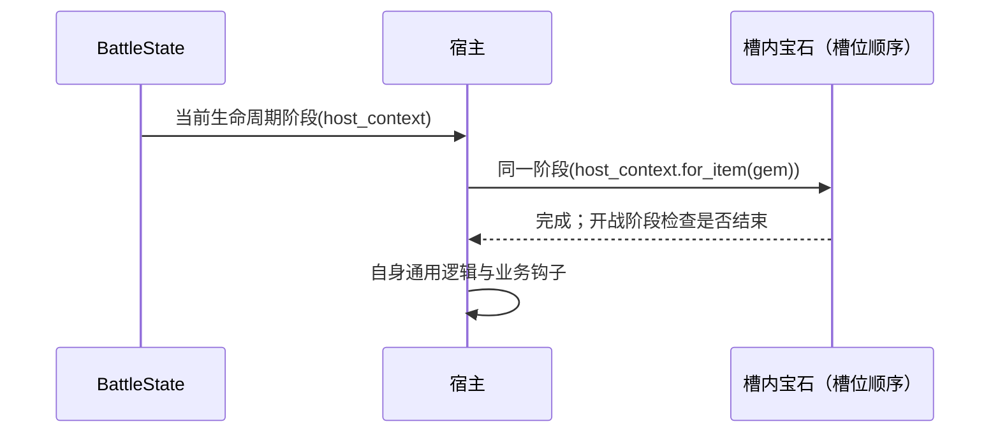

# 宝石插槽与战斗生命周期 SPEC

日期：2026-10-09。状态：实现完成，验收通过。本 SPEC 接续 `combat_start_lifecycle_spec.md`，替代其中“暂不支持非空宝石槽”的限制。

## 1. Requirements（需求）

沿用已有宝石逻辑：宿主的 `gemsocket` 保存宝石 `item_key`；宝石的 `belongs_to` 保存宿主 key，`gem_type` 保存宿主 `item_types`。调用者将宿主和宝石注册进同侧 `PlayerState.items`，再调用 `host.add_gems(gem)`。

作为物品实现者，我能让镶嵌宝石先于宿主完成准备和各开战阶段，并用宝石自己的 context 注册监听、执行效果与记录来源；同一宝石每个阶段只执行一次。未镶嵌的宝石仍按独立物品运行。

本批完成插槽关系、生命周期和轮询接入。具体红宝石等物品的数值效果、工厂与目录数据另行逐项实现；暂不扩展 JSON 摆盘输入，不实现战斗中拆装或宝石嵌套。验收用测试宝石验证接入，不宣称已支持全部原版宝石。

## 2. Design（设计）

### 原版依据与实现选择

- `Backpack Battles/Items/Item.gd` 的 `prepare/preCombatStart/combatStart/postCombatStart`：各阶段先调用槽内宝石，再处理宿主自身逻辑。
- `Backpack Battles/Items/Gems/Gem.gd` 的 `getGemMode/hasCooldown`：插在武器上使用 Weapon 模式，插在其他宿主上使用 Armor 模式；独立摆放使用 Inventory 模式。镶嵌后不运行普通冷却。
- 继续使用现有 `BattleItem`、字典查找和同步事件总线，无需新增 Socket 类、调度器或宝石注册系统。本批无需单独增加 Gem 基类；后续具体宝石可根据已有字段选择效果分支。

### 数据约定

| 字段 | 约定 |
| --- | --- |
| `BattleItem.gemsocket: list[str \| None]` | 长度等于 `socket_count`；按槽位顺序存 key，空槽为 None |
| `BattleItem.belongs_to: str \| None` | 默认 None；镶嵌宝石保存同侧宿主 key |
| `BattleItem.gem_type: tuple[str, ...]` | 默认空元组；镶嵌时复制宿主类型，保留原字段含义 |
| 宝石识别 | `"Gem" in item.item_types`；宝石自身没有插槽 |
| `PlayerState.items` | 保留全部实例，包括槽内宝石，供查找与事件总线使用 |
| `BattleState.battle_items` | 只包含 `belongs_to is None` 的实例；槽内宝石由宿主调用 |
| `BattleState.active_items` | 从现有轮询列表排除槽内宝石；独立宝石保留既有轮询资格 |

宝石模式可直接判断：`belongs_to is None` → Inventory；否则 `"Weapon" in gem_type` → Weapon；否则 → Armor。Armor 是原版的非武器插槽分支，不要求宿主本身带 Armor 类型。宿主类型与插槽关系在准备后固定。

插槽宝石不新增摆盘坐标，不参与普通占格和星位关系计算。原有 initializer 本批不改；内存调用者负责先创建并注册实例。

关系校验独立为 `battle_module_v1.py` 中的模块函数 `validate_gem_sockets(players)`，由调用者按需显式调用。`prepareItems` 不执行或自动触发该校验，也不要求“已校验”标记；它按输入关系合法的前提准备战斗。

### 接口与伪代码

**`BattleItem.__init__`**：现有参数签名完整保留，不增加必填参数：

```python
def __init__(self, item_id: str | None = None,
             item_key: str | None = None, player_id: int | None = None,
             is_active_item: bool = False,
             triggers: Sequence[Trigger] | None = None,
             effects: Sequence[Effect] | None = None,
             linked_items: Sequence[str] | None = None,
             display_name: str | None = None,
             item_classes: tuple[str, ...] | None = None,
             rarity: str | None = None, cost: int | None = None,
             item_types: tuple[str, ...] | None = None,
             icon_types: tuple[str, ...] | None = None):
    执行原有初始化，包括固定长度的 gemsocket
    belongs_to = None
    gem_type = ()
```

其余修改/新增函数如下；业务钩子与 `BattleContext.for_item` 的接口和实现保持不变。

| 接口 | 伪代码 |
| --- | --- |
| `BattleItem.add_gems(self, gem: BattleItem) -> None` | 校验双方未 prepare、宿主不是宝石、对象不同、双方有非空且不同的 key、同一 player_id、gem 带 Gem 类型且无插槽、gem 未绑定；找到第一个空槽；无空槽抛 ValueError；全部校验通过后才同时写入槽位 key、gem.belongs_to 和 gem.gem_type |
| `validate_gem_sockets(players: Sequence[PlayerState]) -> None`（新增独立函数） | 只读遍历玩家物品并校验插槽关系，具体步骤见下方；合法时返回 None，非法时抛 ValueError；不修改实例、战斗状态、RNG 或事件总线 |
| `BattleItem.get_gems(self, context: BattleContext) -> list[BattleItem]`（新增） | 按 gemsocket 顺序跳过 None，用 context.owner.items[key] 取得宝石并返回；假定输入关系合法，不缓存第二份实例列表 |
| `BattleState.prepareItems(self) -> None` | 保留原有战斗状态校验，不校验插槽关系；每侧仅取 belongs_to 为 None 的实例进行原有 shuffle、优先级排序、拼接；从 active_items 排除已镶嵌实例；重置角色 RNG；依次 root.prepare(build_context(root))；最后置 has_prepared |
| `BattleItem.prepare(self, context: BattleContext) -> None` | 保留重复准备检查并重置自己的 RNG；按槽位顺序 gem.prepare(context.for_item(gem))；连接自身 triggers；调用自身 onPrepare；置 has_prepared |
| `BattleItem.preCombatStart(self, context: BattleContext) -> None` | 按槽位顺序 gem.preCombatStart(context.for_item(gem))，每次返回后检查战斗结束，结束则立即 return；自身未镶嵌时才初始化 CooldownTrigger；调用自身 onPreCombatStart |
| `BattleItem.combatStart(self, context: BattleContext) -> None` | 按槽位顺序 gem.combatStart(context.for_item(gem))，每次返回后检查战斗结束，结束则 return；调用自身 onCombatStart |
| `BattleItem.postCombatStart(self, context: BattleContext) -> None` | 按槽位顺序 gem.postCombatStart(context.for_item(gem))，每次返回后检查战斗结束，结束则 return；调用自身 onPostCombatStart |

独立函数 `validate_gem_sockets` 使用普通循环和集合，伪代码如下：

```text
对每侧 player.items：
    字典 key 必须等于实例 item_key，player_id 必须匹配所在玩家
    不允许同一对象以多个 key 注册
    对每个宿主：校验槽位数量；宝石自身必须没有槽位
        对每个非空槽：
            key 必须存在于同侧 items，且指向 Gem 类型实例
            宿主不能是宝石；gem.belongs_to 必须等于宿主 key
            gem.gem_type 必须等于宿主 item_types
            用集合确保宝石 key 没有被其他槽位重复使用
    对每个 belongs_to 非空的实例：
        必须是宝石，且已出现在上述合法槽位中
任一关系非法：抛 ValueError
全部合法：返回 None
```

调用者需要检查外部构造的数据时，可在 `battle.prepareItems()` 前显式调用 `validate_gem_sockets(battle.players)`。跳过校验时，非法输入不保证得到统一异常，也不保证准备过程没有部分副作用。

`start_combat` 继续依次完成全体 pre → 全体 start → 全体 post，各阶段内部才由宿主调用宝石；不会把单个宿主的三个阶段一次跑完。无需修改该函数。



宝石在准备阶段即可监听宿主事件，使用 `context.owner.items[self.belongs_to]` 找宿主；宝石发出的事件与日志使用宝石自己的身份。不会因镶嵌自动发出激活；是否激活由具体宝石源码决定。

## 3. Tasks（任务拆解）

1. [x] **字段与挂接**：初始化 belongs_to/gem_type，补齐 add_gems 校验，实现 get_gems。验证空槽顺序和失败时不修改状态。
2. [x] **独立校验函数**（依赖1）：以普通循环实现 validate_gem_sockets；验证合法返回、非法报错及调用前后无状态变化。不接入 prepareItems。
3. [x] **准备列表**（依赖1）：移除非空槽禁用检查，过滤顶层生命周期列表和轮询列表，保留原有战斗状态校验。
4. [x] **生命周期**（依赖3）：四个包装方法按槽位调用宝石，切换 context，保留全局阶段顺序，补齐结束检查与镶嵌冷却跳过。
5. [x] **验收**（依赖2、4）：在 `tests/test_gem_socket_lifecycle_v1.py` 增加接入测试；替换原有“非空槽一律拒绝”测试，运行相关测试及全套 unittest。

## 4. Acceptance Criteria / Tests（验收标准）

- 空槽、多个槽位、满槽均正确；跨玩家、非宝石、重复绑定、宝石嵌套及准备后插入被拒绝，拒绝时双方字段不变。
- 显式调用 validate_gem_sockets 时，缺失 key、错误反向绑定、重复槽位引用、孤立 belongs_to、字典身份/玩家不匹配均抛 ValueError；合法输入返回 None。成功或失败均不修改实例、战斗状态、RNG 或监听。
- 合法布局无需先调用校验函数即可准备战斗；prepareItems 不调用该函数，也不新增已校验状态标记。
- 两名玩家、多宿主、多宝石的 prepare/pre/start/post 调用顺序符合“全局分阶段、槽内先于宿主”；每实例每阶段恰好一次。
- 宝石 context.item 是宝石本身，owner/opponent 正确；同侧 key 查找隔离双方相同 key；事件来源和日志身份不串成宿主。
- 宝石准备时注册的宿主监听能收到开局连锁；镶嵌宝石不被普通逐帧扫描、不初始化普通冷却；独立宝石正常运行。
- 宝石开局效果结束战斗后，剩余宝石、宿主钩子及后续阶段不再执行；开局时间/帧仍为0，重复 start_combat 不重放。
- 无宝石布局的既有行为和测试保持通过。本批验收不包含任何具体宝石数值效果。

验收记录：新增10个宝石接入测试（含参数化非法挂接、关系校验和致死阶段场景），更新1个旧插槽测试；宝石与开战生命周期专项30个测试通过，全套564个 unittest 通过，`git diff --check` 通过。
