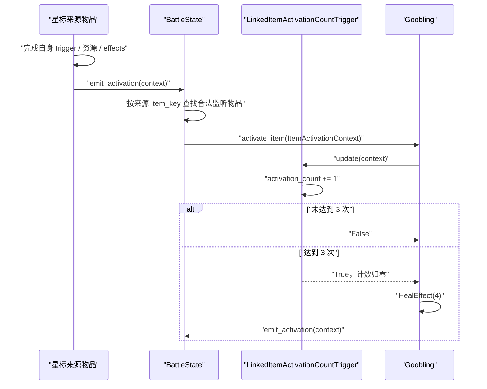

# Goobling（黏宝宝）被动物品与物品激活通知 SPEC

状态：已按本文档实现，待用户最终验收。

编写日期：2026-07-25。

批准与实现日期：2026-07-26。

## 0. 需要先讨论的结论

推荐方案：

1. 黏宝宝使用代码标识 `goobling`，本体占 1 格，左右各一个星标。
2. 黏宝宝是被动物品，`is_active_item=False`，不进入逐帧 active item 循环。
3. 星标连接物品真正激活后，由该物品显式发出一次“物品已激活”通知。
4. `BattleState` 只把通知派发给监听该来源物品的黏宝宝；不恢复已经删除的
   `linked_items` 通用递归激活。
5. 黏宝宝每收到一次合法通知就把实例级计数器加 1；第 3 次治疗 4 点，然后计数
   归零并开始下一轮。
6. 黏宝宝达到第 3 次时即视为自身激活，即使生命已满、实际治疗为 0，也应继续
   发出一次自身激活通知，允许多个黏宝宝形成合法触发链。
7. 现有 `activate_item(context) -> None` 与
   `run_effect(trigger_results, context) -> None` 契约保持不变。
8. 本轮不把五个简单的 start-of-battle 物品算作激活；Broom 的
   `Opponent misses attack` 分支也只叠加伤害，不发出激活通知。

本方案的主要代价是：每个具体物品必须在自己真正激活的业务分支显式调用一次
`emit_activation()`。这是有意选择，因为现有 trigger 为真不必然表示物品成功激活：
例如武器冷却完成但耐力不足时，`CooldownTrigger` 为真，而武器并未激活。

## 1. Requirements（需求）

### 1.1 Wiki 事实

查询日期：2026-07-25。只使用项目批准的 `backpackbattles.wiki.gg`。

| 资料 | 修订 | 本 SPEC 使用的事实 |
| --- | --- | --- |
| [Goobling](https://backpackbattles.wiki.gg/wiki/Goobling?oldid=10757) | `10757`，2025-09-17 23:29:01 UTC | Common / Neutral / Pet / 2 金币；3 个星标物品激活后治疗 4；`grid=212`；需要 `It's Slime Time!` 才进入商店 |
| [Interactions FAQ](https://backpackbattles.wiki.gg/wiki/Interactions_FAQ?oldid=12504) | `12504`，2026-07-22 08:14:21 UTC | trigger 与 activation 在游戏规则中同义；战斗开始效果算激活；On hit 只在命中时激活 |
| [Weapon](https://backpackbattles.wiki.gg/wiki/Weapon?oldid=10449) | `10449`，2024-11-08 15:27:58 UTC | 武器冷却完成时尝试激活，但只有耐力足够才成功激活；成功激活后再进行命中判定 |

本轮实现依用户确认采用比 FAQ 更窄的项目口径：当前五个简单
`StartOfBattleTrigger` 物品不发出激活通知，Broom 的 `AttackMissTrigger`
成功也不发出激活通知。这里保留 Wiki 原始事实，同时明确记录项目实现差异。

`grid=212` 与项目已经实现的 Shiny Shell 网格相同：

```text
2 1 2
⭐ 物品 ⭐
```

项目目录坐标：

```json
{
  "item_id": "goobling",
  "shape_cells": [[0, 0]],
  "star_cells": [[-1, 0], [1, 0]]
}
```

Wiki 页面没有 `icontype`，因此运行时使用 `icon_types = ()`，不擅自添加
`nature`、`magic` 或其他图标类型。

### 1.2 功能目标

实现黏宝宝的战斗内被动效果，并补上当前战斗框架缺失的“实际物品激活通知”：

- 黏宝宝只监听自身星标连接的物品实例。
- 每个被监听物品每次真正激活，给该黏宝宝增加 1 次计数。
- 第 1、2 次只累计，不治疗。
- 第 3 次治疗拥有者 4 点，并把计数归零。
- 第 4、5 次属于下一轮的第 1、2 次；第 6 次再次治疗。
- 多个黏宝宝拥有互相独立的 trigger、effect 和计数器。
- 同一个来源物品可以同时被多个黏宝宝监听，每个黏宝宝都获得一次计数。
- 一个多格来源物品即使同时覆盖同一黏宝宝的两个星标，也只计一次；现有
  `add_linked_item()` 去重规则继续生效。
- 黏宝宝本身可以作为另一个黏宝宝的星标来源。

### 1.3 “真正激活”的项目口径

本 SPEC 不把“调用了 `activate_item()`”或“某个基础 trigger 返回 True”直接当成
真正激活。当前已实现物品采用以下口径：

| 物品分支 | 是否发出一次激活通知 |
| --- | --- |
| 当前五个简单 `StartOfBattleTrigger` 物品成功 | 否，只执行自身效果 |
| 无耐力成本的 cooldown / after-time 效果到时 | 是，即使治疗已满或攻击未命中 |
| 武器冷却完成但耐力不足 | 否 |
| 武器耐力支付成功但攻击未命中 | 是 |
| `OnAttackedTrigger` 概率成功 | 是，即使实际阻止伤害或移除耐力为 0 |
| Broom 的 `AttackMissTrigger` 成功 | 否，只叠加下一次命中的伤害 |
| trigger 未满足，只是逐帧检查了物品 | 否 |
| 一次激活中的多个 effect | 合计一次，不按 effect 数量重复计数 |

当前 Broom 只有 cooldown 攻击分支发出激活通知；`Opponent misses attack`
分支只增加下一次命中的伤害，不算 Broom 激活。Broom 命中后附带的 Blind 概率
属于该次攻击的内部 effect，不额外发第二次通知。

### 1.4 用户故事

- 作为摆盘模型使用者，我可以把两个物品分别放在黏宝宝左右，使这两个物品的
  激活共同推进同一个三次计数器。
- 作为战斗框架维护者，我可以区分“框架检查物品”和“物品真正激活”，避免耐力
  不足的武器错误推进黏宝宝。
- 作为后续黏黏系列物品实现者，我可以复用“监听星标物品激活并计数”的 trigger，
  但自行定义所需次数和自身 effects。
- 作为测试维护者，我可以直接检查通知来源、监听顺序和实例级计数，不依赖
  combat log。

### 1.5 验收行为

1. 只有左右星标连接的来源物品会推进计数。
2. 合法来源的第 3 次激活治疗 4 点。
3. 治疗使用现有 `HealEffect` / `BattleState.heal()`，不得绕过最大生命值。
4. 满生命时第 3 次仍消耗该轮计数，不在下一次来源激活时重试治疗。
5. 满生命时黏宝宝仍算自身激活，可以通知另一个监听它的黏宝宝。
6. 黏宝宝不进入 `BattleState.active_items`。
7. 来源物品的命中、伤害、状态效果和 RNG 顺序保持不变。
8. 监听器按拥有者 `items` 的插入顺序派发，保证结果可重复。
9. 通知和监听只在同一玩家的物品之间发生。
10. `activate_item()` 与 `run_effect()` 仍返回 `None`，且连接关系仍不产生通用
    “激活所有 linked items”行为。

### 1.6 范围外

- 不实现 `It's Slime Time!` 技能的购买、商店解锁、生成黏宝宝或每 3 秒推进计数。
- 不实现两个黏宝宝合成 Goobert（黏黏）。
- 不实现其他 Goobert 派生物。
- 不实现商店、合成和局外发育。
- 不增加通用事件总线、订阅/取消订阅 API、事件优先级 DSL 或 combat log。
- 不为未来技能预先增加“直接推进 N 次”的公开接口。
- 不修改 `AGENTS.md`。

## 2. Design（设计）

### 2.1 为什么不能直接复用现有 `activate_item()`

当前公共入口的含义是“检查并运行这件物品本次可能的业务逻辑”：

```text
activate_item(context)
  -> update_triggers(context)
  -> run_effect(trigger_results, context)
```

`BattleState.step()` 每帧都会对 active item 调用它；绝大多数调用的 trigger 都是
False。因此以下实现错误：

```python
active_item.activate_item(context)
dispatch_item_activation(active_item)  # 每帧错误计数
```

也不能只看 `any(active_item.trigger_results)`：

```text
CooldownTrigger=True
  -> StaminaConsumptionEffect=False
  -> 武器没有激活
```

是否真正激活属于具体物品的业务分支，必须在 `run_effect()` 已经判断完 trigger 和
资源前提后才能确定。

### 2.2 推荐架构：专用通知路径，不恢复 linked 通用递归

新增一条只表达“来源物品已经真正激活”的专用途径：



这条路径不会：

- 遍历来源物品自己的全部 `linked_items`；
- 激活连接的 Food、Weapon 或其他普通物品；
- 读取 `run_effect()` 返回值；
- 改变 `Effect.apply() -> bool` 的现有语义。

### 2.3 责任边界

| 组件 | 负责 | 不负责 |
| --- | --- | --- |
| 具体来源物品 `run_effect()` | 判断本次是否真正激活；在正确时点调用一次 `emit_activation()` | 查找黏宝宝；推进其他物品的计数 |
| `BattleItem.emit_activation()` | 校验 context 属于自身；委托 `BattleState` 派发 | 判断业务是否成功 |
| `BattleState._get_item_activation_listeners()` | 按来源实例查找并缓存监听物品 | 更新监听 trigger；执行治疗 |
| `BattleState.dispatch_item_activation()` | 为每个监听物品构造显式 context 并调用其公共入口 | 推断来源是否真正激活 |
| `ItemActivationContext` | 显式携带本次来源物品引用 | 保存全局“当前来源”状态 |
| `LinkedItemActivationCountTrigger` | 校验事件、累计次数、每 N 次返回 True | 治疗；主动遍历来源 |
| `Goobling.run_effect()` | 第 3 次治疗并发出自身激活通知 | 自己逐帧检查；实现商店/合成 |

### 2.4 激活事件使用显式 context

新增：

```python
@dataclass
class ItemActivationContext(BattleContext):
    source_item: BattleItem
```

不在 `BattleState`、`BattleItem` 或普通 `BattleContext` 上保存
`current_activated_item`。显式参数可以让嵌套链自然使用 Python 调用栈：

```text
Wooden Sword activates
  -> Goobling A reaches 3
       -> Goobling A activates
            -> Goobling B receives A
  -> outer Wooden Sword dispatch resumes
```

内层来源不会覆盖外层来源。

### 2.5 监听识别

新增常量：

```python
ITEM_ACTIVATION_PHASE_LINKED = "linked_item_activated"
```

`LinkedItemActivationCountTrigger` 声明：

```python
item_activation_phase = ITEM_ACTIVATION_PHASE_LINKED
```

`BattleState` 查找监听器时同时要求：

1. 监听物品的某个 trigger 声明上述 phase；
2. `source_item.item_key in listener.linked_items`；
3. source 和 listener 属于同一个 `PlayerState`。

这种识别方式与现有 attack reaction trigger 通过 `attack_phase` 被发现的方式一致，
但保持两个独立缓存，不抽象成通用事件注册系统。

### 2.6 监听缓存和顺序

`BattleState` 新增逐实例缓存：

```python
_item_activation_listener_cache: dict[
    object,
    dict[str, tuple[BattleItem, ...]],
]
```

第一层 key 为 `player_id`，第二层 key 为来源 `item_key`。值按
`owner.items.values()` 插入顺序保存。

布局和玩家物品在当前战斗内不变化，因此缓存无需失效机制。未来若允许战斗中生成、
删除或移动物品，应为该功能另写 SPEC，不能静默复用此假设。

### 2.7 派发时点

通用规则：来源物品完成本次自身 effects 后再发通知。

例外不是额外规则，而是现有调用层级带来的自然顺序：

- Wooden Buckler 在 `on_attacked` 伤害响应阶段运行，所以它的通知发生在最终攻击
  伤害提交前。
- Broom 的 `opponent missed` 分支在未命中响应阶段运行，但该分支只叠加伤害，
  不发出激活通知。
- 武器的通知发生在该次 `AttackEffect.apply()` 返回后；如果攻击已经致命，
  `commit_health_reduction()` 会立即终止战斗，后续通知不会运行。

同一物品的一次业务激活只通知一次，不根据本次调用了多少个 effects 重复通知。

### 2.8 不改变无返回值激活接口

本 SPEC 明确保留：

```python
def activate_item(self, context: BattleContext) -> None
def run_effect(
    self,
    trigger_results: list[bool],
    context: BattleContext,
) -> None
```

不采用 `run_effect() -> bool`，原因是 2026-07-24 已确认的接口重构刚刚删除了
“用物品返回值驱动 linked item”的框架语义。重新引入 bool 会再次把以下概念混在一起：

- effect 是否改变了状态；
- 武器是否命中；
- 物品是否真正激活；
- 是否激活连接物品。

本 SPEC 使用命名明确的 `emit_activation()` 表达单一事实。

### 2.9 被否决的其他方案

#### 方案 A：每帧检查后根据 trigger_results 自动派发

否决原因：耐力不足武器会误计数；多 trigger 物品的 OR/NOT/事件分支也不能由框架
统一推断。

#### 方案 B：让所有 `run_effect()` 返回是否激活

否决原因：推翻当前无返回值接口；容易再次演变为隐式 linked 递归；需要修改所有
调用者对返回值的契约。

#### 方案 C：完整通用事件总线

否决原因：当前只有一个具体需求。注册、优先级、传播取消、生命周期和递归保护都会
引入未经实际物品验证的复杂度。

#### 方案 D：Goobling 每帧读取其他物品内部计数

否决原因：现有物品没有统一的累计激活数字段；轮询增加每帧成本，并使 Goobling
依赖所有来源物品的内部实现。

## 3. Realize（逐函数实现设计）

### 3.1 `BattleItem.emit_activation`

文件：`battle_module_v1.py`

接口：

```python
def emit_activation(self, context: BattleContext) -> None
```

伪代码：

```text
if context.item is not self:
    raise ValueError("activation context item mismatch")
context.battle_state.dispatch_item_activation(self)
```

它不检查 trigger/effect，不返回业务值，也不自动在 `activate_item()` 中调用。

### 3.2 `ItemActivationContext`

文件：`battle_module_v1.py`

接口：

```python
@dataclass
class ItemActivationContext(BattleContext):
    source_item: BattleItem
```

字段要求：

- `item`：正在接收通知的监听物品。
- `owner`：监听物品与来源物品的共同拥有者。
- `opponent`：该拥有者的对手。
- `source_item`：本次真正激活的来源物品，保持原对象引用。

### 3.3 `BattleState.build_item_activation_context`

文件：`battle_module_v1.py`

接口：

```python
def build_item_activation_context(
    self,
    listener: BattleItem,
    source_item: BattleItem,
) -> ItemActivationContext
```

伪代码：

```text
listener_context = self.build_context(listener)
if source_item.player_id != listener.player_id:
    raise ValueError
if listener_context.owner.items.get(source_item.item_key) is not source_item:
    raise ValueError
return ItemActivationContext(
    battle_state=self,
    item=listener,
    owner=listener_context.owner,
    opponent=listener_context.opponent,
    source_item=source_item,
)
```

### 3.4 `BattleState._get_item_activation_listeners`

文件：`battle_module_v1.py`

接口：

```python
def _get_item_activation_listeners(
    self,
    source_item: BattleItem,
) -> tuple[BattleItem, ...]
```

伪代码：

```text
owner = self.get_player(source_item.player_id)
if owner.items.get(source_item.item_key) is not source_item:
    raise ValueError

player_cache = self._item_activation_listener_cache.setdefault(
    owner.player_id,
    {},
)
if source_item.item_key in player_cache:
    return player_cache[source_item.item_key]

matching_items = tuple(
    item
    for item in owner.items.values()
    if source_item.item_key in item.linked_items
    and any(
        getattr(trigger, "item_activation_phase", None)
        == ITEM_ACTIVATION_PHASE_LINKED
        for trigger in item.triggers
    )
)
player_cache[source_item.item_key] = matching_items
return matching_items
```

禁止从对手的 items 中寻找监听器。

### 3.5 `BattleState.dispatch_item_activation`

文件：`battle_module_v1.py`

接口：

```python
def dispatch_item_activation(
    self,
    source_item: BattleItem,
) -> None
```

伪代码：

```text
for listener in self._get_item_activation_listeners(source_item):
    context = self.build_item_activation_context(
        listener,
        source_item,
    )
    listener.activate_item(context)
```

函数不读取 `activate_item()` 返回值；一个监听器未达到次数时，不影响后续监听器。

### 3.6 `LinkedItemActivationCountTrigger.__init__`

文件：`item_factory_registry_v1.py`

接口：

```python
def __init__(self, required_activations: int)
```

状态：

```python
self.required_activations: int
self.activation_count: int = 0
```

伪代码：

```text
if type(required_activations) is not int or required_activations <= 0:
    raise ValueError
保存 required_activations
activation_count = 0
```

不接受 bool；`True` 不能作为 1 次。

### 3.7 `LinkedItemActivationCountTrigger.update`

文件：`item_factory_registry_v1.py`

接口：

```python
def update(self, context: BattleContext) -> bool
```

伪代码：

```text
if not isinstance(context, ItemActivationContext):
    return False
if context.source_item.player_id != context.item.player_id:
    return False
if context.source_item.item_key not in context.item.linked_items:
    return False

activation_count += 1
if activation_count < required_activations:
    return False

activation_count -= required_activations
return True
```

每次 context 只表示一个来源物品的一次激活，因此单次 update 最多触发一次。

### 3.8 `Goobling`

文件：`item_factory_registry_v1.py`

类元数据：

```python
class Goobling(BattleItem):
    item_id = "goobling"
    display_name = "Goobling"
    item_classes = ("Neutral",)
    rarity = "Common"
    cost = 2
    item_types = ("Pet",)
    icon_types = ()
    is_active_item = False
    socket_count = 0
```

构造接口：

```python
def __init__(
    self,
    item_id: str | None = None,
    item_key: str | None = None,
    player_id: int | None = None,
)
```

组装：

```python
super().__init__(
    item_id=item_id,
    item_key=item_key,
    player_id=player_id,
    is_active_item=False,
    triggers=[
        LinkedItemActivationCountTrigger(
            required_activations=3,
        )
    ],
    effects=[HealEffect(amount=4)],
)
```

### 3.9 `Goobling.run_effect`

文件：`item_factory_registry_v1.py`

接口：

```python
def run_effect(
    self,
    trigger_results: list[bool],
    context: BattleContext,
) -> None
```

伪代码：

```text
if not trigger_results[0]:
    return
self.effects[0].apply(context)
self.emit_activation(context)
```

不得根据 HealEffect 返回值决定是否 emit；满生命治疗为 0 时仍已完成三次计数并激活。

### 3.10 简单 start-of-battle 物品的 `run_effect`

涉及：

- `PocketSand`
- `HealingHerbs`
- `Flame`
- `WalrusTusk`
- `Whetstone`

接口保持现有 `run_effect(...) -> None`。

共同伪代码：

```text
if not trigger_results[0]:
    return
self.effects[0].apply(context)
# 不调用 self.emit_activation(context)
```

五种物品都只执行现有 start-of-battle effect，不算做激活，也不推进黏宝宝。

### 3.11 `ShinyShell.run_effect`

伪代码：

```text
if not trigger_results[0]:
    return
self.effects[0].apply(context)
self.emit_activation(context)
```

即使满生命，AfterTimeTrigger 仍只使用一次，且该次算激活。

### 3.12 `WoodenBuckler.run_effect`

伪代码：

```text
if not trigger_results[0]:
    return
self.effects[0].apply(context)
self.effects[1].apply(context)
self.emit_activation(context)
```

概率 trigger 成功即视为激活，不要求实际阻止正伤害或实际移除正耐力。

### 3.13 `WoodenSword.run_effect` 与 `Shortbow.run_effect`

伪代码：

```text
if not trigger_results[0]:
    return
if not self.effects[0].apply(context):  # stamina
    return
self.effects[1].apply(context, attack_type)
self.emit_activation(context)
```

攻击 effect 返回 False 只表示未命中；耐力已支付，所以仍发出激活通知。

### 3.14 `Stone.run_effect`

伪代码：

```text
if not trigger_results[0]:
    return
hit = self.effects[0].apply(context, "ranged")
if hit:
    self.effects[1].apply(context)
self.emit_activation(context)
```

未命中时不移除 Block，但仍消耗唯一投掷并算一次激活。

### 3.15 `Banana.run_effect`

伪代码：

```text
if not trigger_results[0]:
    return
self.effects[0].apply(context)
self.effects[1].apply(context)
self.emit_activation(context)
```

生命和耐力均已满也不取消激活。

### 3.16 `Garlic.run_effect`

伪代码：

```text
if not trigger_results[0]:
    return
self.effects[0].apply(context)
if rng.random() < 0.30:
    self.effects[1].apply(context)
self.emit_activation(context)
```

通知不读取 RNG；原有 RNG 调用数量和顺序不变。

### 3.17 `Pan.run_effect`

伪代码：

```text
if not trigger_results[0]:
    return
if not self.effects[0].apply(context):
    return
self.effects[1].apply(context, "melee")
self.emit_activation(context)
```

耐力不足不通知；支付成功后即使未命中也通知。

### 3.18 `Rat.run_effect`

伪代码：

```text
if not trigger_results[0]:
    return
if not self.effects[0].apply(context, "effect"):
    self.emit_activation(context)
    return
if rng.random() < 0.75:
    self.effects[1].apply(context)
if rng.random() < 0.10:
    self.effects[2].apply(context)
self.emit_activation(context)
```

Rat 当前命中率 100%。若攻击 effect 返回 False，则不读取 Poison / Blind 的两次
概率 RNG，但仍立即通知；命中时通知继续放在两次概率检查之后，避免改变状态效果与
监听器的相对顺序。

### 3.19 `Broom.run_effect`

需要消除当前“攻击未命中就直接 return”与“未命中仍算武器激活”之间的冲突。

伪代码：

```text
if trigger_results[1]:  # opponent attack missed
    miss_damage_bonus += 2
    attack_effect.stack_damage_modifier(2)

if not trigger_results[0]:
    return
if not stamina_effect.apply(context):
    return

hit = attack_effect.apply(context, "melee")
if hit:
    if miss_damage_bonus > 0:
        移除并清零本物品的 miss bonus
    if rng.random() < 0.33:
        blind_effect.apply(context)

self.emit_activation(context)
```

要求：

- 攻击未命中时保留 miss bonus，不进行 Blind RNG，但仍通知一次。
- 攻击命中时原有 bonus 清理和 Blind RNG 顺序不变。
- 对手攻击未命中分支只增加 miss bonus，不通知；只有 Broom 自己支付耐力后的
  cooldown 攻击算激活。

### 3.20 目录与默认注册

文件：`data/item_catalog_v1.json`

```json
"goobling": {
  "item_id": "goobling",
  "shape_cells": [[0, 0]],
  "star_cells": [[-1, 0], [1, 0]]
}
```

文件：`item_factory_registry_v1.py`

```python
DEFAULT_ITEM_FACTORIES = {
    ...
    "goobling": Goobling,
    ...
}
```

### 3.21 本地知识库更新

文件：`docs/backpack_battles_knowledge_base.md`

实施时新增：

- 黏宝宝已核对数据、来源 URL、Wiki revision 和查询日期。
- 项目区分“调用 `activate_item` 进行检查”和“物品真正激活”。
- 真正激活由具体物品在业务成功分支显式 `emit_activation`。
- 记录五个简单 start-of-battle 物品及 Broom 的 opponent-miss 分支不发通知，
  并注明这是经用户确认的项目口径。
- `activate_item` / `run_effect` 继续无返回值，且 `linked_items` 不自动递归激活。

不得修改知识库中的无关游戏事实。

## 4. Tasks（任务拆解）

1. T1：确认第 6 节的待决事项；未确认前不修改代码。
2. T2：新增 `ITEM_ACTIVATION_PHASE_LINKED`、`ItemActivationContext` 和
   `BattleItem.emit_activation()`；依赖 T1。
3. T3：新增 `BattleState` 监听缓存、context 构造、监听查找和派发函数；依赖 T2。
4. T4：新增框架级 context、缓存、顺序、嵌套派发和错误校验测试；依赖 T3。
5. T5：新增 `LinkedItemActivationCountTrigger` 及其单元测试；依赖 T2。
6. T6：实现 `Goobling` 类、默认注册和目录网格；依赖 T3、T5。
7. T7：添加 Goobling 元数据、组件独立性、三次计数、循环计数和满生命测试；依赖 T6。
8. T8：统一现有 15 个生产物品的通知语义：10 个物品接入显式通知，五个简单
   start-of-battle 物品保持不通知；在各自现有测试中增加派发或不派发断言；依赖 T3。
9. T9：增加武器耐力不足不计数、武器未命中仍计数、Wooden Buckler 响应计数、
   start-of-battle 不计数和 Broom opponent-miss 不计数的集成测试；依赖 T6、T8。
10. T10：增加目录旋转、左右连接去重、被动初始化、多个监听器顺序和黏宝宝链式
    激活测试；依赖 T6、T8。
11. T11：更新本地知识库的已核对物品与激活语义；依赖 T1、T6、T8。
12. T12：运行定向测试、完整回归、标准 battle JSON 冒烟和 `git diff --check`；
    依赖 T4-T11。
13. T13：把实际测试数与结果回写本 SPEC，并再次提交用户验收；依赖 T12。

实施状态：T1-T13 均已完成。

## 5. Acceptance Criteria / Tests（验收标准）

### 5.1 `BattleItem` 与显式 context

文件：`tests/test_battle_module_v1.py`

1. `test_emit_activation_requires_context_for_same_item`
   - 使用 `context.item is not source` 的 context。
   - 断言抛出 `ValueError`，且没有派发。

2. `test_emit_activation_delegates_to_battle_state_and_returns_none`
   - spy `dispatch_item_activation`。
   - 断言只收到当前 source 一次，返回 `None`。

3. `test_build_item_activation_context_preserves_source_reference`
   - 断言结果是 `ItemActivationContext`。
   - `source_item is source`，owner/opponent/listener 正确。

4. `test_build_item_activation_context_rejects_other_owner_or_foreign_source`
   - 分别传入对手物品和未放入当前 owner.items 的伪来源。
   - 断言抛出 `ValueError`。

### 5.2 监听查找、缓存与派发

文件：`tests/test_battle_module_v1.py`

5. `test_activation_listener_lookup_requires_phase_and_source_link`
   - 一个物品有 phase 且链接 source；一个只有链接；一个只有 phase。
   - 只返回第一个。

6. `test_activation_listener_lookup_preserves_owner_item_order`
   - 两个监听器按 owner.items 插入顺序返回。

7. `test_activation_listener_lookup_never_reads_opponent_items`
   - 对手具有相同 item_key 和 phase trigger。
   - 断言不返回。

8. `test_second_activation_listener_lookup_uses_cached_tuple`
   - 首次查询后修改测试 trigger 的 phase 属性。
   - 第二次仍返回同一个 tuple 对象，证明未重新扫描。

9. `test_empty_activation_listener_lookup_is_cached`
   - 首次为空。
   - 后续人工加入监听器仍返回已缓存的空 tuple。

10. `test_dispatch_builds_fresh_context_for_each_source_event`
    - 同一 source 连续派发两次。
    - listener 收到两个不同 context，但 source 引用相同。

11. `test_dispatch_continues_to_next_listener_when_first_does_not_trigger`
    - 第一个 listener 计数未满。
    - 第二个 listener 仍更新一次。

12. `test_nested_activation_dispatch_preserves_outer_source`
    - listener A 在响应 source 时发出自身激活，触发 listener B。
    - 内层完成后，外层后续 listener 仍观察到原 source。

13. `test_battle_states_own_independent_activation_listener_caches`
    - 两个 BattleState 不共享缓存字典或 tuple。

### 5.3 `LinkedItemActivationCountTrigger`

文件：`tests/test_item_factory_registry_v1.py`

14. `test_linked_activation_count_trigger_rejects_invalid_required_count`
    - `0`、负数、float、bool、None 均抛出 `ValueError`。

15. `test_linked_activation_count_trigger_ignores_base_context`
    - 普通 `BattleContext` 返回 False，计数仍为 0。

16. `test_linked_activation_count_trigger_ignores_unlinked_source`
    - `ItemActivationContext` 来源不在 listener.linked_items。
    - 返回 False，计数仍为 0。

17. `test_linked_activation_count_trigger_fires_every_third_event`
    - 连续结果为 `False, False, True, False, False, True`。
    - 两次 True 后计数均归零。

18. `test_linked_activation_count_trigger_instances_are_independent`
    - 两个 trigger 交错更新。
    - 各自按自己的三次计数触发。

### 5.4 Goobling 工厂和目录

文件：`tests/test_item_factory_registry_v1.py`

19. `test_goobling_is_registered_with_metadata_and_components`
    - 核对全部类元数据。
    - `is_active_item=False`、`socket_count=0`。
    - trigger 为 required 3 的 `LinkedItemActivationCountTrigger`。
    - effect 为 amount 4 的 `HealEffect`。

20. `test_gooblings_own_independent_trigger_and_effect_instances`
    - 两个工厂实例不共享 trigger/effect/计数。

21. `test_goobling_heals_four_on_third_linked_activation`
    - 前两次不治疗，第三次恰好治疗 4。

22. `test_goobling_repeats_after_each_three_activations`
    - 六次来源激活治疗两次，共 8 点。

23. `test_goobling_consumes_third_activation_at_full_health`
    - 第三次在满生命时治疗 0。
    - 第四次不治疗，证明没有延迟重试。

24. `test_goobling_emits_own_activation_even_when_heal_has_no_effect`
    - 满生命下第三次触发。
    - spy 断言 Goobling 自身派发一次。

25. `test_initializer_links_goobling_left_and_right_stars`
    - 左右各放一件物品。
    - `linked_items` 按 marker 顺序包含两个 item_key。

26. `test_initializer_deduplicates_source_covering_both_goobling_stars`
    - 一个多格来源同时占两个星标。
    - 只保存一个 linked key，一次来源激活只推进一次。

27. `test_goobling_catalog_rotates_shape_and_two_stars`
    - 0/90/180/270 度的本体和两个星标坐标正确。

28. `test_initializer_builds_goobling_as_passive_item`
    - Goobling 存在于 owner.items。
    - 不存在于 `battle_state.active_items`。

### 5.5 来源物品激活语义集成

文件：`tests/test_item_factory_registry_v1.py` 与
`tests/test_attack_resolution_v1.py`

29. `test_linked_start_of_battle_item_does_not_advance_goobling`
    - 星标来源为 Healing Herbs 或 Flame。
    - 第 0 帧自身效果正常执行，但 Goobling 计数保持不变；后续帧也不变化。

30. `test_linked_weapon_without_stamina_does_not_advance_goobling`
    - Wooden Sword 冷却完成但耐力不足。
    - Goobling 计数保持不变。

31. `test_linked_weapon_miss_still_advances_goobling`
    - Wooden Sword 支付耐力后未命中。
    - 计数增加 1。

32. `test_linked_wooden_buckler_advances_on_successful_reaction`
    - `OnAttackedTrigger` 概率成功。
    - 即使 pending damage 为 0，也推进一次。

33. `test_linked_wooden_buckler_does_not_advance_when_chance_fails`
    - trigger 概率失败。
    - 计数不变。

34. `test_linked_broom_opponent_miss_branch_does_not_advance_goobling`
    - 对手攻击未命中。
    - Broom 获得 bonus，但 Goobling 计数保持不变。

35. `test_linked_broom_weapon_miss_advances_without_blind_roll`
    - Broom 自己支付耐力但未命中。
    - 保留 bonus、不读取 Blind RNG、计数增加 1。

36. `test_two_gooblings_listening_to_same_source_both_advance`
    - 一个 source 同时位于两个 Goobling 的星标。
    - 两个实例各增加 1。

37. `test_goobling_activation_can_advance_another_goobling`
    - A 第三次触发并治疗。
    - B 的星标连接 A，B 增加 1。

### 5.6 现有生产物品通知覆盖

在以下已有测试中增加 spy 断言。表中标为“派发”的成功分支要求
`dispatch_item_activation(current_item)` 恰好一次；标为“不派发”的分支以及
trigger 未满足、资源失败分支要求调用次数为 0：

| 物品 | 派发口径与代表测试 |
| --- | --- |
| Pocket Sand | start-of-battle effect 正常执行，但不派发 |
| Healing Herbs | start-of-battle effect 正常执行，但不派发 |
| Flame | start-of-battle effect 正常执行，但不派发 |
| Walrus Tusk | start-of-battle effect 正常执行，但不派发 |
| Shiny Shell | after-time 成功派发；未到时不派发 |
| Whetstone | start-of-battle linked weapon damage 正常执行，但不派发 |
| Wooden Buckler | trigger 成功派发；概率失败不派发 |
| Broom | cooldown hit / miss 派发；insufficient stamina / opponent miss 不派发 |
| Wooden Sword | cooldown hit / miss 派发；insufficient stamina 不派发 |
| Shortbow | cooldown hit / miss 派发；insufficient stamina 不派发 |
| Stone | hit / miss 均派发；后续帧不派发 |
| Banana | cooldown 成功派发；cooldown 未到不派发 |
| Garlic | removal 成功或失败均派发；cooldown 未到不派发 |
| Pan | hit / miss 派发；insufficient stamina 不派发 |
| Rat | hit 或强制 attack-effect miss 均派发；miss 不读取状态 RNG；cooldown 未到不派发 |

这组断言用于防止未来遗漏某个现有来源物品；不得只测试 Goobling 自身。

### 5.7 回归与静态验收

38. `BattleItem.activate_item()` 仍返回 `None`，且不自动调用 `emit_activation()`。
39. `BattleItem.run_effect()` 仍为无返回值业务入口。
40. `BattleItem` 仍不存在 `run_effects`、`run_own_effect`、`run_linked_items`。
41. Banana、Garlic、Pan 等物品的 `linked_items` 空间加成行为保持不变。
42. 现有攻击 RNG 顺序测试全部通过；通知派发本身不读取 RNG。
43. 现有攻击响应缓存与新增激活监听缓存相互独立。
44. 标准 `data/minimal_wooden_battle_v1.json` 仍得到相同 winner 和结束帧。
45. 仓库全部测试通过。
46. `git diff --check` 通过。
47. 未新增第三方依赖，未修改 `AGENTS.md`。

## 6. 已确认口径

用户于 2026-07-26 要求严格按照本文档执行，因此以下口径均视为已确认：

1. 五个简单 start-of-battle 物品不算激活，不调用 `emit_activation()`。
2. Broom 的 opponent-miss 分支只增加 miss bonus，不算激活。
3. 使用显式 `emit_activation()` 方案，并保持现有两个无返回值激活接口。
4. 同一次业务激活无论有多少内部 effects，只给黏宝宝计 1 次。
5. 武器耐力支付成功后，即使未命中仍计 1 次；耐力不足计 0 次。
6. 黏宝宝第 3 次时即使实际治疗为 0，也消耗计数并视为自身激活。
7. 同步统一全部 15 个当前生产物品的语义：其中 10 个接入显式通知，五个简单
   start-of-battle 物品保持不通知。
8. `It's Slime Time!`、商店解锁和两个黏宝宝合成继续排除在本轮之外。

## 7. 实施与验证结果

实施日期：2026-07-26。

- 已完成 `BattleItem.emit_activation()`、`ItemActivationContext`、
  `BattleState` 监听缓存/查找/派发、`LinkedItemActivationCountTrigger`、
  `Goobling` 工厂和目录数据。
- 已按第 3 节统一 15 个当前生产物品的通知语义，没有改变五个简单
  start-of-battle 物品和 Broom opponent-miss 分支的不通知决定。
- 在实施前工作区 367 个测试的基线上新增 40 个测试：第 5 节编号的 37 个测试全部
  落地，另增加五个 start-of-battle 物品统一不派发、Rat 强制未命中派发且不读取
  状态 RNG、Rat 冷却未到不派发 3 个覆盖测试。
- 定向运行 `tests.test_battle_module_v1`、`tests.test_item_factory_registry_v1` 和
  `tests.test_attack_resolution_v1`：343 个测试全部通过。
- 完整运行 `python -m unittest discover -s tests -p 'test_*.py'`：407 个测试全部
  通过。
- `data/minimal_wooden_battle_v1.json` 未提供固定随机种子；使用固定种子
  `20260726` 做启用/禁用通知路径的对照，两次结果均为 winner `a`、结束帧 `167`，
  证明通知路径不改变该标准战斗的胜者和结束帧。
- `git diff --check` 通过；未新增第三方依赖，未修改 `AGENTS.md`。
