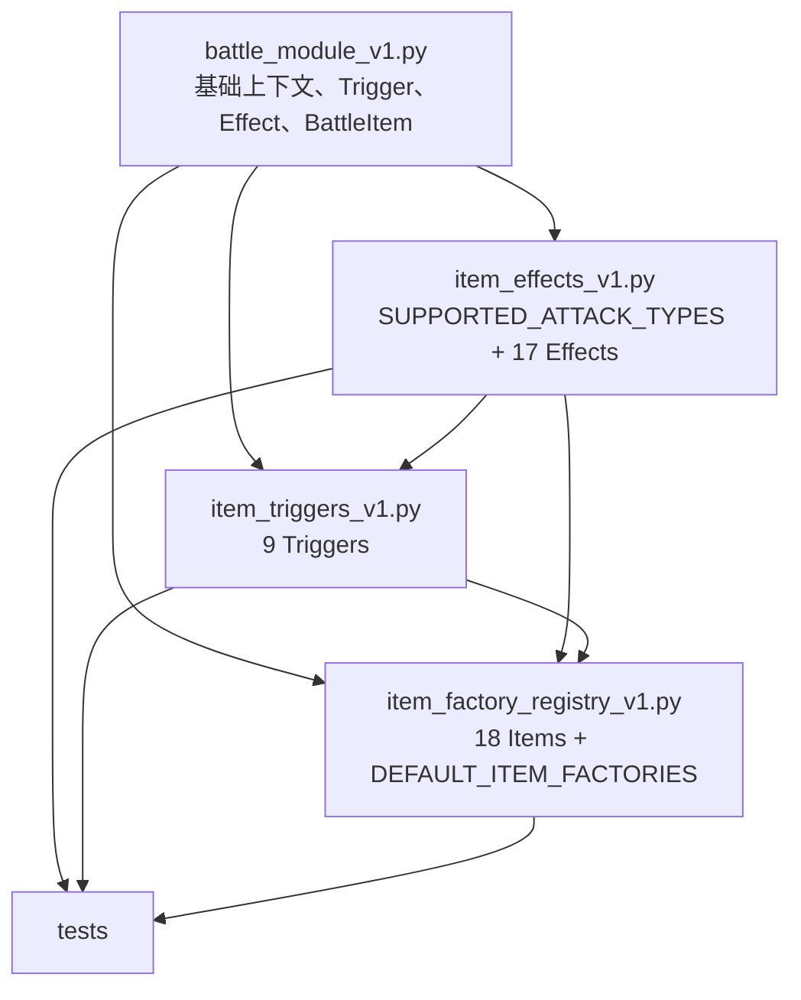

# Item Factory Registry 模块拆分 SPEC

状态：待用户确认后实施  
目标文件：`item_factory_registry_v1.py`  
拟新增文件：`item_triggers_v1.py`、`item_effects_v1.py`  
编写日期：2026-07-26

## 1. Requirements（需求）

### 1.1 功能目标

`item_factory_registry_v1.py` 当前同时承担 Trigger、Effect、具体物品和默认工厂注册表四类职责，文件已经过长。本次重构将：

1. 把所有具体 Trigger 类移动到 `item_triggers_v1.py`。
2. 把所有具体 Effect 类移动到 `item_effects_v1.py`。
3. `item_factory_registry_v1.py` 只保留具体物品类定义、这些物品所需的导入，以及 `DEFAULT_ITEM_FACTORIES`。
4. 保持所有游戏行为、构造参数、异常类型与消息、实例状态、继承关系、触发顺序、随机数调用顺序和注册表内容不变。

### 1.2 用户故事

作为后续继续添加物品和战斗机制的开发者，我希望 Trigger、Effect 和物品定义各自位于职责清晰的模块中，以便：

- 查找和修改触发条件时只阅读 Trigger 模块；
- 查找和修改效果执行逻辑时只阅读 Effect 模块；
- 查找物品组合方式和工厂注册时只阅读 Item Factory Registry；
- 新增物品时复用 Trigger/Effect，而不继续扩大注册表文件中的基础组件区域。

### 1.3 验收口径

- `item_triggers_v1.py` 定义当前全部 9 个具体 Trigger 类。
- `item_effects_v1.py` 定义当前全部 17 个具体 Effect 类及其共享攻击类型常量。
- `item_factory_registry_v1.py` 不再定义任何 `Trigger` 或 `Effect` 子类。
- 18 个具体物品类和 `DEFAULT_ITEM_FACTORIES` 的键值映射不变。
- 所有受影响测试改为从组件的所属模块导入，物品和注册表仍从 `item_factory_registry_v1.py` 导入。
- 定向测试与全套测试全部通过。

### 1.4 不在范围内

- 不修改任何游戏机制、数值、概率或 Wiki 数据。
- 不重命名现有类、方法、参数或公开常量。
- 不拆分具体物品类，不拆分 `tests/test_item_factory_registry_v1.py` 的测试正文。
- 不修改 `battle_module_v1.py` 的基类或攻击结算接口。
- 不引入包目录、注册装饰器、依赖注入、自动发现或额外兼容层。
- 不修改 `AGENTS.md`、数据文件或知识库。

## 2. Design（设计）

### 2.1 文件职责

| 文件 | 职责 |
| --- | --- |
| `item_triggers_v1.py` | 具体 Trigger 类；只判断某次上下文是否满足触发条件及维护 Trigger 自身缓存 |
| `item_effects_v1.py` | 具体 Effect 类、`SUPPORTED_ATTACK_TYPES`；执行资源、状态、攻击和伤害修改 |
| `item_factory_registry_v1.py` | 具体 `BattleItem` 子类；把 Trigger 与 Effect 组合为物品；维护 `DEFAULT_ITEM_FACTORIES` |

### 2.2 类归属

`item_triggers_v1.py` 定义：

1. `StartOfBattleTrigger`
2. `ActivationTrigger`
3. `SlimeActivationTrigger`
4. `CooldownTrigger`
5. `AfterTimeTrigger`
6. `FoodCooldownTrigger`
7. `ItemAcceleratedCooldownTrigger`
8. `AttackMissTrigger`
9. `OnAttackedTrigger`

`item_effects_v1.py` 定义：

1. `StaminaConsumptionEffect`
2. `HealEffect`
3. `GainMaxHealthEffect`
4. `HolyLinkedHealEffect`
5. `RegenerateStaminaEffect`
6. `GainBlockEffect`
7. `RemoveOpponentBlockEffect`
8. `GainBuffEffect`
9. `UseBuffEffect`
10. `BuffRemovalEffect`
11. `InflictDebuffEffect`
12. `CleanseDebuffEffect`
13. `AttackEffect`
14. `LinkedWeaponDamageEffect`
15. `FoodLinkedMeleeAttackEffect`
16. `PreventAttackDamageEffect`
17. `RemoveOpponentStaminaEffect`

`item_factory_registry_v1.py` 保留：

1. `PocketSand`
2. `HealingHerbs`
3. `Flame`
4. `WalrusTusk`
5. `ShinyShell`
6. `WandOfEquilibrium`
7. `Whetstone`
8. `Twine`
9. `Goobling`
10. `WoodenBuckler`
11. `Broom`
12. `WoodenSword`
13. `Shortbow`
14. `Stone`
15. `Banana`
16. `Garlic`
17. `Pan`
18. `Rat`
19. `DEFAULT_ITEM_FACTORIES`

### 2.3 依赖关系



`SUPPORTED_ATTACK_TYPES` 保留单一来源，移动到 `item_effects_v1.py`：

- `AttackEffect` 在本模块直接使用；
- `OnAttackedTrigger` 所在的 `item_triggers_v1.py` 从 Effect 模块导入；
- Effect 模块不导入 Trigger 模块，因此不会形成循环依赖。

不为了一个三元素常量新增第三个公共模块，保持实现简单。

### 2.4 导入设计

`item_effects_v1.py` 从 `battle_module_v1.py` 导入：

- `ATTACK_PHASE_ON_ATTACKED`
- `AttackEvent`
- `AttackReactionContext`
- `BattleContext`
- `BattleItem`
- `BuffSlot`
- `DebuffSlot`
- `Effect`

`item_triggers_v1.py` 从 `battle_module_v1.py` 导入：

- `ATTACK_PHASE_ON_ATTACKED`
- `ATTACK_PHASE_ON_ATTACK_MISSED`
- `ITEM_ACTIVATION_PHASE_LINKED`
- `ITEM_MARKER_TYPES`
- `AttackReactionContext`
- `BattleContext`
- `BattleItem`
- `ItemActivationContext`
- `Trigger`

并从 `item_effects_v1.py` 导入：

- `SUPPORTED_ATTACK_TYPES`

`item_factory_registry_v1.py` 从 `battle_module_v1.py` 只保留物品定义直接使用的：

- `BattleContext`
- `BattleItem`
- `BuffSlot`

它从两个新模块显式导入物品组合实际需要的具体 Trigger/Effect。这里不使用通配符导入。

### 2.5 兼容性

- 类对象的 `__module__` 会变为新的所属模块，这是本次结构调整的预期变化。
- 生产代码的稳定入口 `DEFAULT_ITEM_FACTORIES` 仍位于 `item_factory_registry_v1.py`。
- 测试和后续代码应从 `item_triggers_v1.py` / `item_effects_v1.py` 导入具体组件。
- 注册表为了定义物品仍会显式导入组件，因此旧式 `from item_factory_registry_v1 import CooldownTrigger` 可能在 Python 名称解析层面继续可用，但不将其承诺为公共 API，也不为此添加转发代码。

### 2.6 关键约束

本次采用“移动，不改写”：

- 方法体按当前工作区版本原样移动。
- 保留当前格式和语义，包括已有的缓存字段与惰性准备时机。
- 不借重构顺手修复风格、类型、参数校验或潜在缺陷。
- 不改变任何物品类方法体。

## 3. Realize（逐函数实现）

### 3.1 `item_triggers_v1.py`

#### `StartOfBattleTrigger`

- `__init__(self) -> None`
  - 伪代码：设置 `has_triggered = False`。
- `update(self, context: BattleContext) -> bool`
  - 伪代码：攻击响应上下文返回 `False`；若已触发或当前帧不是 0，返回 `False`；否则锁定已触发并返回 `True`。

#### `ActivationTrigger`

- 类属性：`item_activation_phase = ITEM_ACTIVATION_PHASE_LINKED`。
- `__init__(self, marker_type: str = "star") -> None`
  - 伪代码：校验 `marker_type` 属于 `ITEM_MARKER_TYPES`；保存标记类型。
- `update(self, context: BattleContext) -> bool`
  - 伪代码：要求 `ItemActivationContext`；要求来源物品与监听物品同属一个玩家；检查来源 `item_key` 是否位于监听物品对应标记的连接集合中。

#### `SlimeActivationTrigger`

- `__init__(self, required_activations: int) -> None`
  - 伪代码：初始化父类为 star 监听；校验正整数；保存阈值并将计数设为 0。
- `update(self, context: BattleContext) -> bool`
  - 伪代码：父类不匹配则返回 `False`；匹配则计数加一；未达到阈值返回 `False`；达到阈值后减去阈值并返回 `True`。

#### `CooldownTrigger`

- `__init__(self, cooldown_seconds: float) -> None`
  - 伪代码：保存冷却时长；进度、额外加速归零；标记尚未准备额外加速。
- `stack_speed_modifier(self, amount: float) -> None`
  - 伪代码：把 `amount` 累加到 `speed_modifiers`。
- `prepare_speed_modifiers(self, context: BattleContext) -> None`
  - 伪代码：基类空实现。
- `update(self, context: BattleContext) -> bool`
  - 伪代码：忽略攻击响应上下文；首次更新准备额外加速；按 Heat-Cold 计算并限制状态加速；叠加额外加速；选择加速/减速公式；累积本帧进度；未到阈值返回 `False`；达到后扣除一次冷却并返回 `True`。

#### `AfterTimeTrigger`

- `__init__(self, delay_seconds: float) -> None`
  - 伪代码：以延迟初始化父类；设置一次性触发状态与锁定状态。
- `lock_has_triggered_false(self) -> None`
  - 伪代码：把 `has_triggered` 保持为 `False` 并开启锁定，使该 Trigger 可按冷却重复返回成功。
- `update(self, context: BattleContext) -> bool`
  - 伪代码：已触发则返回 `False`；父类冷却未完成则返回 `False`；未锁定时记录已触发；返回 `True`。

#### `FoodCooldownTrigger`

- `__init__(self, cooldown_seconds: float) -> None`
  - 伪代码：初始化父类；`qualifying_food_count = None`。
- `prepare_speed_modifiers(self, context: BattleContext) -> None`
  - 伪代码：首次调用统计连接物品中的其他同类以外 Food 实例并缓存；每个合格 Food 叠加 10% 速度。

#### `ItemAcceleratedCooldownTrigger`

- 类属性：`FILTER_KEYS` 与 `ALLOWED_KEYS` 原值不变。
- `__init__(self, cooldown_seconds: float, acceleration_conditions: list[dict[str, object]]) -> None`
  - 伪代码：初始化父类；校验条件列表、字典字段、非空字符串过滤值和非负数值加速；复制并把加速转为 float；初始化缓存。
- `_matches_condition(self, linked_item: BattleItem, condition: dict[str, object]) -> bool`
  - 伪代码：依次检查 class、rarity、item_type、icon_type；任一指定条件不匹配返回 `False`，全部匹配返回 `True`。
- `prepare_speed_modifiers(self, context: BattleContext) -> None`
  - 伪代码：首次调用遍历所有连接物品和条件，累计每个匹配条件的加速并缓存；把缓存值叠加到冷却速度。

#### `AttackMissTrigger`

- 类属性：`attack_phase = ATTACK_PHASE_ON_ATTACK_MISSED`。
- `update(self, context: BattleContext) -> bool`
  - 伪代码：只接受匹配阶段的 `AttackReactionContext`；当攻击结果明确为 miss 时返回 `True`。

#### `OnAttackedTrigger`

- 类属性：`attack_phase = ATTACK_PHASE_ON_ATTACKED`。
- `__init__(self, attack_types: tuple[str, ...], chance: float = 1.0) -> None`
  - 伪代码：要求至少一种攻击类型；全部类型必须受支持；概率必须位于 `[0, 1]`；保存不可变类型元组和概率。
- `update(self, context: BattleContext) -> bool`
  - 伪代码：校验上下文与阶段；要求命中；要求至少一个攻击类型匹配；最后进行一次概率判定。

### 3.2 `item_effects_v1.py`

#### 模块常量

- `SUPPORTED_ATTACK_TYPES = ("melee", "ranged", "effect")`
  - 值和顺序保持不变。

#### `StaminaConsumptionEffect`

- `__init__(self, stamina_cost: float) -> None`
  - 伪代码：保存耐力成本。
- `apply(self, context: BattleContext) -> bool`
  - 伪代码：耐力不足返回 `False`；否则扣除成本并返回 `True`。

#### `HealEffect`

- `__init__(self, amount: int) -> None`
  - 伪代码：校验非负整数并保存。
- `apply(self, context: BattleContext) -> bool`
  - 伪代码：调用战斗状态治疗 owner；实际治疗量大于 0 时返回 `True`。

#### `GainMaxHealthEffect`

- `__init__(self, amount: int) -> None`
  - 伪代码：校验正整数并保存。
- `apply(self, context: BattleContext) -> bool`
  - 伪代码：同时增加 owner 的最大生命和当前生命；返回 `True`。

#### `HolyLinkedHealEffect`

- `__init__(self, base_amount: int, amount_per_holy: int) -> None`
  - 伪代码：由父类校验基础治疗；校验每个 holy 的非负整数增量；初始化数量与准备状态缓存。
- `prepare_amount(self, context: BattleContext) -> None`
  - 伪代码：首次统计已连接、非自身且拥有 holy icon 的物品；把治疗量设为基础值加计数乘单件增量。
- `apply(self, context: BattleContext) -> bool`
  - 伪代码：只准备一次治疗量；调用父类治疗。

#### `RegenerateStaminaEffect`

- `__init__(self, amount: float) -> None`
  - 伪代码：拒绝 bool、非数字与负数；转为 float 保存。
- `apply(self, context: BattleContext) -> bool`
  - 伪代码：恢复 owner 耐力并限制到最大值；仅实际增加时返回 `True`。

#### `GainBlockEffect`

- `__init__(self, amount: int) -> None`
  - 伪代码：校验非负整数并保存。
- `apply(self, context: BattleContext) -> bool`
  - 伪代码：增加 owner 格挡；实际增加时返回 `True`。

#### `RemoveOpponentBlockEffect`

- `__init__(self, amount: int) -> None`
  - 伪代码：校验非负整数并保存。
- `apply(self, context: BattleContext) -> bool`
  - 伪代码：移除量限制为 opponent 当前格挡；扣除并返回是否实际移除。

#### `GainBuffEffect`

- `__init__(self, buff_name: str, amount: int) -> None`
  - 伪代码：用 `BuffSlot` 字段校验名称；校验非负整数层数；保存。
- `apply(self, context: BattleContext) -> bool`
  - 伪代码：给 owner 对应 Buff 增加层数；增加量大于 0 时返回 `True`。

#### `UseBuffEffect`

- `__init__(self, buff_name: str, amount: int) -> None`
  - 伪代码：用 `BuffSlot` 字段校验名称；校验非负整数层数；保存。
- `apply(self, context: BattleContext) -> bool`
  - 伪代码：可用层数不足则不修改并返回 `False`；否则完整扣除并返回 `True`。

#### `BuffRemovalEffect`

- `__init__(self, buff_name: str, amount: int) -> None`
  - 伪代码：用 `BuffSlot` 字段校验名称；校验非负整数层数；保存。
- `apply(self, context: BattleContext) -> bool`
  - 伪代码：从 opponent 移除不超过现有值的指定 Buff；返回是否实际移除。

#### `InflictDebuffEffect`

- `__init__(self, debuff_name: str, amount: int) -> None`
  - 伪代码：用 `DebuffSlot` 字段校验名称；校验非负整数层数；保存。
- `apply(self, context: BattleContext) -> bool`
  - 伪代码：给 opponent 增加指定 Debuff；增加量大于 0 时返回 `True`。

#### `CleanseDebuffEffect`

- `__init__(self, debuff_name: str, amount: int) -> None`
  - 伪代码：用 `DebuffSlot` 字段校验名称；校验非负整数层数；保存。
- `apply(self, context: BattleContext) -> bool`
  - 伪代码：从 owner 清除不超过现有值的指定 Debuff；返回是否实际清除。

#### `AttackEffect`

- `__init__(self, min_damage: int, max_damage: int, accuracy: float) -> None`
  - 伪代码：校验最小伤害非负、最大伤害不小于最小伤害；保存攻击值；初始化持久伤害修正与准备状态。
- `apply(self, context: BattleContext, attack_type: str) -> bool`
  - 伪代码：校验攻击类型；首次调用准备固有伤害修正；若来源是 Weapon，则叠加 Empower 和 Luck-Blind 命中修正；构造 `AttackEvent` 并交由统一结算器；仅命中时返回 `True`。
- `stack_damage_modifier(self, amount: int) -> None`
  - 伪代码：把 amount 累加到持久伤害修正。
- `prepare_damage_modifier(self, context: BattleContext) -> None`
  - 伪代码：基类空实现。

#### `LinkedWeaponDamageEffect`

- `__init__(self, amount: int) -> None`
  - 伪代码：校验非负整数并保存。
- `apply(self, context: BattleContext) -> bool`
  - 伪代码：遍历连接的 Weapon；对每个 `AttackEffect` 累加伤害修正；至少修改一个攻击效果时返回 `True`。

#### `FoodLinkedMeleeAttackEffect`

- `__init__(self, min_damage: int, max_damage: int, accuracy: float, damage_per_food: int) -> None`
  - 伪代码：初始化父类攻击参数；校验每个 Food 的非负整数伤害；初始化 Food 数量缓存。
- `prepare_damage_modifier(self, context: BattleContext) -> None`
  - 伪代码：首次统计连接 Food 实例并缓存；把数量乘单件伤害叠加到父类伤害修正。

#### `PreventAttackDamageEffect`

- `__init__(self, amount: int) -> None`
  - 伪代码：校验非负值并保存。
- `apply(self, context: BattleContext) -> bool`
  - 伪代码：要求未结算的 on-attacked 响应上下文和非负 pending damage；阻止量限制为当前待结算伤害；同步更新 pending/prevented；返回是否实际阻止。

#### `RemoveOpponentStaminaEffect`

- `__init__(self, amount: float) -> None`
  - 伪代码：校验非负值并保存。
- `apply(self, context: BattleContext) -> bool`
  - 伪代码：从 opponent 耐力扣除并限制到 0；返回耐力是否变化。

### 3.3 `item_factory_registry_v1.py`

以下方法体全部保持原样，只调整其依赖类的导入来源：

| 类 | 保留的方法 |
| --- | --- |
| `PocketSand` | `__init__`、`run_effect` |
| `HealingHerbs` | `__init__`、`run_effect` |
| `Flame` | `__init__`、`run_effect` |
| `WalrusTusk` | `__init__`、`run_effect` |
| `ShinyShell` | `__init__`、`run_effect` |
| `WandOfEquilibrium` | `__init__`、`_least_resource_name`、`_most_resource_name`、`run_effect` |
| `Whetstone` | `__init__`、`run_effect` |
| `Twine` | `__init__`、`_prepare_neutral_item_count`、`run_effect` |
| `Goobling` | `__init__`、`run_effect` |
| `WoodenBuckler` | `__init__`、`run_effect` |
| `Broom` | `__init__`、`run_effect` |
| `WoodenSword` | `__init__`、`run_effect` |
| `Shortbow` | `__init__`、`run_effect` |
| `Stone` | `__init__`、`run_effect` |
| `Banana` | `__init__`、`run_effect` |
| `Garlic` | `__init__`、`run_effect` |
| `Pan` | `__init__`、`run_effect` |
| `Rat` | `__init__`、`run_effect` |

这些函数的共同伪代码边界为：

1. `__init__`：继续以当前参数与元数据创建独立 Trigger/Effect 实例并传给 `BattleItem`。
2. `run_effect`：继续使用当前 `trigger_results`、效果索引、短路条件、概率判定和 `emit_activation()` 时机。
3. 三个私有辅助方法：继续按当前稳定顺序选择资源或缓存连接物品数量。
4. 不更改任何物品类属性与注册表键值。

### 3.4 测试导入调整

#### `tests/test_item_factory_registry_v1.py`

- 从 `item_triggers_v1` 导入 9 个 Trigger。
- 从 `item_effects_v1` 导入该测试当前使用的 17 个 Effect。
- 从 `item_factory_registry_v1` 仅导入 18 个物品类和 `DEFAULT_ITEM_FACTORIES`。
- 所有测试函数正文保持不变。

#### `tests/test_attack_resolution_v1.py`

- `AttackMissTrigger`、`CooldownTrigger`、`OnAttackedTrigger` 改从 `item_triggers_v1` 导入。
- `AttackEffect`、`PreventAttackDamageEffect`、`RemoveOpponentStaminaEffect` 改从 `item_effects_v1` 导入。
- `WoodenBuckler` 继续从 `item_factory_registry_v1` 导入。
- 所有测试函数正文保持不变。

#### `tests/test_twine_item_factory_v1.py`

- `ActivationTrigger`、`SlimeActivationTrigger` 改从 `item_triggers_v1` 导入。
- `GainMaxHealthEffect` 改从 `item_effects_v1` 导入。
- `Twine`、`Stone`、`WoodenSword`、`DEFAULT_ITEM_FACTORIES` 继续从 `item_factory_registry_v1` 导入。
- 所有测试函数正文保持不变。

### 3.5 结构验证

不新增使用 AST 或反射锁死类清单的架构测试，避免以后每新增一个物品或组件都必须同步维护重复清单。使用简单静态命令验证职责：

```powershell
rg -n "^class .*Trigger" item_factory_registry_v1.py
rg -n "^class .*Effect" item_factory_registry_v1.py
rg -n "^class .*Trigger" item_triggers_v1.py
rg -n "^class .*Effect" item_effects_v1.py
rg -n "^class .*\\(BattleItem\\)" item_factory_registry_v1.py
```

前两个命令应无输出；后三个命令应分别列出 9、17、18 个类。

## 4. Tasks（任务拆解）

1. T1：创建 `item_effects_v1.py`，移动常量和 17 个 Effect 类，保持方法体不变。
2. T2：创建 `item_triggers_v1.py`，移动 9 个 Trigger 类，从 Effect 模块复用 `SUPPORTED_ATTACK_TYPES`。依赖 T1。
3. T3：删除 `item_factory_registry_v1.py` 中已移动的定义，收窄 `battle_module_v1` 导入，新增两个组件模块的显式导入。依赖 T1、T2。
4. T4：调整三份测试文件的导入来源，测试正文不变。依赖 T3。
5. T5：运行静态职责检查与 Python 编译检查。依赖 T4。
6. T6：运行三个受影响测试模块。依赖 T5。
7. T7：运行全套测试并检查工作区差异，确认未混入行为变化。依赖 T6。

## 5. Acceptance Criteria / Tests（验收标准）

### 5.1 静态验收

1. `item_factory_registry_v1.py` 中没有 `class ...Trigger` 和 `class ...Effect`。
2. `item_triggers_v1.py` 中恰有当前 9 个具体 Trigger 定义。
3. `item_effects_v1.py` 中恰有当前 17 个具体 Effect 定义。
4. `item_factory_registry_v1.py` 中仍有当前 18 个 `BattleItem` 子类。
5. `DEFAULT_ITEM_FACTORIES` 的 18 个 key 和对应类完全不变。
6. 新依赖图中不存在循环导入。

### 5.2 编译检查

```powershell
python -m py_compile item_triggers_v1.py item_effects_v1.py item_factory_registry_v1.py
```

预期：退出码为 0，无语法或导入错误。

### 5.3 定向回归

```powershell
python -m unittest `
  tests.test_item_factory_registry_v1 `
  tests.test_attack_resolution_v1 `
  tests.test_twine_item_factory_v1
```

预期：

- Trigger 的上下文判定、缓存、冷却、概率与连接规则全部不变。
- Effect 的参数校验、状态变化、攻击结算和返回值全部不变。
- 物品构造、运行逻辑、初始化器集成和注册表全部不变。
- 测试全部通过。

### 5.4 全量回归

```powershell
python -m unittest discover -s tests -p "test_*.py"
```

预期：全套测试全部通过，无新增失败。

### 5.5 差异验收

- 新增文件仅为 `item_triggers_v1.py`、`item_effects_v1.py` 和本 SPEC。
- 目标源文件的变化仅为导入调整与 Trigger/Effect 定义删除。
- 三份测试文件的变化仅为导入来源调整。
- 不修改已有未提交业务逻辑、数据和文档。
