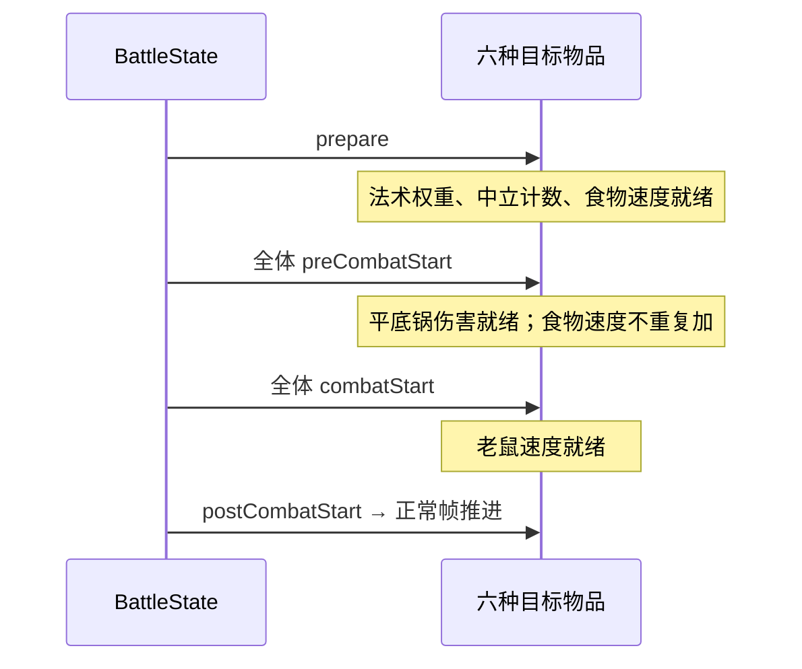

# 物品状态准备时机迁移 SPEC

日期：2026-10-10。状态：实现完成，验收通过。范围：迁移评估的第一批，用户已授权实施。

## 1. Requirements（需求）

让布局派生状态在原版对应阶段就绪：魔法入门法术权重、麻绳中立计数、香蕉与大蒜食物速度在 prepare；平底锅食物伤害在 preCombatStart；老鼠 Pet/Food 速度在 combatStart。

调用者完成准备和开战后，首次效果无需再扫描这些布局关系。准备不得提前消耗法力/耐力、治疗、增加生命上限或发出激活；首次攻击不得重复加食物伤害，pre 初始化不得重复加食物速度。

保持现有同步总线、伤害流程及物品数值。不涉及贝壳/石头收尾、公共武器攻击重构、木盾订阅顺序、冷却随机扰动或速度限幅。

## 2. Design（设计）

复用当前生命周期、缓存辅助方法和 Effect/Trigger，无新增父类、事件协议或状态管理层。布局在准备后固定；业务运行只读取已准备状态。保留当前 CooldownTrigger.update 不做延迟初始化的修改。

原版依据：`Items/Exclusive/BookofBasics.gd:onPrepare`；`Items/Food.gd:prepare`；`Items/Pan.gd:onPreCombatStart`；`Items/Exclusive/ForestFriend.gd:combatStart`。麻绳源代码在回调中读取已缓存的副 affected 数量，本项目提前计算固定布局计数。

只处理主 star / 副 diamond 对应关系：法术、食物伤害和老鼠使用 star；麻绳中立计数使用 diamond。食物现有 Trigger 的关系计数辅助实现保留，当前食物仅有主 marker。

### 函数接口与伪代码

| 新增/修改函数 | 伪代码 |
| --- | --- |
| `MagicForDummies.onPrepare(self, context: BattleContext) -> None` | 调用既有 _prepare_spell_weight(context)，使权重及生命上限 Effect.amount 就绪 |
| `MagicForDummies.run_effect(self, trigger_results: list[bool], context: BattleContext) -> None` | 未触发则返回；法力使用成功才应用已准备的生命上限 Effect；最后发激活；删除首次触发计算 |
| `Twine.onPrepare(self, context: BattleContext) -> None` | 调用既有 _prepare_neutral_item_count(context)；只读 diamond 中立目标 |
| `Twine.run_effect(self, trigger_results: list[bool], context: BattleContext) -> None` | 原概率、日志、生命上限和激活顺序不变；删除首次触发计算 |
| `Banana.onPrepare(self, context: BattleContext) -> None` | 自身 FoodCooldownTrigger.prepare_speed_modifiers(context)；置 speed_modifiers_prepared=True；不初始化或推进冷却 |
| `Garlic.onPrepare(self, context: BattleContext) -> None` | 同香蕉；继续排除同种食物 |
| `Pan.onPreCombatStart(self, context: BattleContext) -> None` | 自身 FoodLinkedMeleeAttackEffect.prepare_damage_modifier(context)；置 damage_modifier_prepared=True，首次 apply 不重复准备；显式再次调用 pre 仍可按原版再次加成 |
| `FoodLinkedMeleeAttackEffect.prepare_damage_modifier(self, context: BattleContext) -> None` | 保留原缓存及累加方式；目标关系改读 marker_items["star"]，只计 Food |
| `Rat.__init__(self, item_id: str \| None = None, item_key: str \| None = None, player_id: int \| None = None)` | 原字段/效果保留；唯一冷却 Trigger 改为普通 CooldownTrigger(3.3)，不再在 pre 通过通用过滤器加速 |
| `Rat.onCombatStart(self, context: BattleContext) -> None` | 从 star 中逐实例计数 Pet OR Food，双类型只计一次；向冷却 Trigger 累加 count × 0.15；不初始化/推进冷却，不发激活 |

已有 `_prepare_spell_weight`、`_prepare_neutral_item_count` 接口及实现不改；现有重复 key 去重由 add_marker_item 保证。已有通用 ItemAcceleratedCooldownTrigger（包括用户新增的 allow_same_item）保留，不改其语义。

## 3. Tasks（任务拆解）

1. [x] 增加魔法入门、麻绳、香蕉、大蒜的 onPrepare，移除前两者运行阶段的布局初始化。
2. [x] 增加平底锅 onPreCombatStart，调整食物伤害计数使用主 marker（依赖1的生命周期约定）。
3. [x] 将老鼠改为普通冷却 Trigger，在 onCombatStart 添加主 marker 目标速度。
4. [x] 更新旧测试的准备过程和阶段断言；新增 `tests/test_item_state_preparation_timing_v1.py` 验证阶段边界、去重与无副作用（依赖1–3）。
5. [x] 运行专项及全套测试，记录结果并更新本 SPEC（依赖4）。

## 4. Acceptance Criteria / Tests（验收标准）

- prepare 后法术权重、麻绳中立计数和食物速度已就绪；无蓝也准备权重；同种食物不加速；普通/合成 Spell 分别计1/2，重复星位只计一次。
- pre 后平底锅按主 marker 食物数增加伤害；无耐力也准备加成；与磨刀石加成叠加；首次及后续攻击不重复增加。
- 食物速度在 pre 初始化及首次 update 后不重复叠加；已有外部速度修饰保留；准备/开战时间与帧保持0。
- 老鼠在 prepare/pre 时没有布局加速，start 后 Pet OR Food 每实例加0.15，双类型只计一次；副 marker 和无关类型不计；重复 start_combat 不重复叠加。
- 准备/开战钩子本身不消耗资源或发送激活，运行阶段读取准备结果；物品实例之间状态独立。
- 旧直接调用 activate_item/update 的测试先显式完成所需准备。通用 Trigger 的初始化测试改为 initialize_for_combat 后再 update；多条件叠加测试显式传 allow_same_item=True。受击测试走指定 Trigger 下标，验证不会轮询冷却。
- 基线：实施前568项测试，11项失败、3项错误，涉及已删除的延迟初始化及旧多条件/受击调用方式。通过更新测试调用约定解决，不回滚用户的 Trigger 修改。

验收记录：2026-10-10，新增8个阶段边界与联动测试；全套576个 unittest 通过，`git diff --check` 通过。覆盖准备无资源副作用、全局 combat_start 通知时可见的状态、缺蓝/无耐力准备、布局缓存不在运行时重算、磨刀石叠加、显式 pre 重放与 start 幂等性。未进行 Godot 运行时对照。
