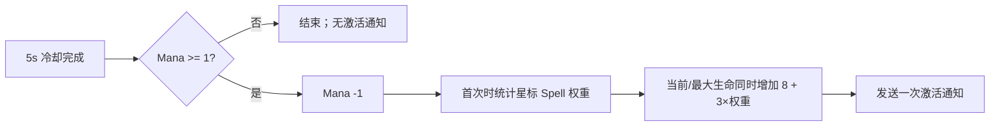

# 魔法入门指南（Magic For Dummies）简要 SPEC

状态：已批准并实现（2026-07-26）。  
查询日期：2026-07-26。

## 1. Requirements（需求）

实现战斗物品 `magic_for_dummies`，使其可由默认工厂和战斗 JSON 创建。

Wiki 当前事实：

| 字段 | 值 |
| --- | --- |
| 英文名 / 中文名 | `Magic For Dummies` / 魔法入门指南 |
| 职业 / 稀有度 / 价格 | `Mage` / `Common` / `4` |
| 类型 / 图标类型 | `Book` / `magic` |
| 商店效果 | `Book` 和 `Spell` 的打折几率 `+10%` |
| 战斗效果 | 每 `5s` 消耗 `1 Mana`，获得 `8 + 3 × 星标 Spell 权重` 点最大生命 |
| Spell 权重 | 普通 Spell 为 `1`；可由配方打造的 Spell 为 `2` |
| 网格 | 纵向 2 格，周围 6 个星标；无方片、三角和镶嵌位 |

来源：

- [英文 Wiki，修订 11970（2026-05-08）](https://backpackbattles.wiki.gg/wiki/Magic_For_Dummies?oldid=11970)
- [中文 Wiki，修订 6192（2026-03-23）](https://backpackbattles.wiki.gg/zh/wiki/%E9%AD%94%E6%B3%95%E5%85%A5%E9%97%A8%E6%8C%87%E5%8D%97?oldid=6192)
- [Cargo `Items` 行](https://backpackbattles.wiki.gg/api.php?action=cargoquery&format=json&tables=Items&fields=name%2Cclass%2Crarity%2Ccost%2Citemtype%2Cicontype%2Ctags%2Ceffect&where=name%3D%22Magic%20For%20Dummies%22)
- [Interactions FAQ，修订 12504（2026-07-22）](https://backpackbattles.wiki.gg/wiki/Interactions_FAQ?oldid=12504)

验收行为：

- 冷却未完成时不改变状态。
- 冷却完成但 Mana 不足时，不消耗 Mana、不增加生命、不发送激活通知；冷却进入下一周期。
- 成功时先消耗 `1 Mana`，再同时增加等量当前生命和最大生命，且只发送一次激活通知。
- 每个不同的星标 Spell 实例只计一次；同一实例覆盖多个星标不重复计数。
- Spell 权重在首次成功触发时按静态布局计算并缓存。
- 每个物品实例拥有独立 trigger、effect 和缓存。

本轮范围仅为战斗框架、物品目录、注册、测试和知识库更新。商店打折逻辑仅记录事实，
待商店框架实施时另写 SPEC；不实现合成系统、局外发育或其他 Book/Spell。

## 2. Design（设计）

### 2.1 最小接口扩展（请审阅）

为 `BattleItem` 增加静态元数据：

```python
is_crafted = False
```

- 是什么：标记该物品种类是否属于“可由配方打造的物品”。
- 为什么：FAQ 说明这是物品种类的固定分类，即使该物品从商店获得仍算 crafted；
  因此不能根据本局实际来源判断，也不能只靠 `item_types` 推导。
- 怎么做：基类默认 `False`；未来可打造 Spell 类声明 `is_crafted = True`。
  本轮不增加构造参数、配方对象或新数据模型。

### 2.2 `MagicForDummies`

文件：`item_factory_registry_v1.py`

```python
class MagicForDummies(BattleItem):
    BASE_MAX_HEALTH = 8
    MAX_HEALTH_PER_SPELL_WEIGHT = 3

    def __init__(
        self,
        item_id: str | None = None,
        item_key: str | None = None,
        player_id: int | None = None,
    ) -> None: ...

    def _prepare_spell_weight(
        self,
        context: BattleContext,
    ) -> None: ...

    def run_effect(
        self,
        trigger_results: list[bool],
        context: BattleContext,
    ) -> None: ...
```

元数据：

```python
item_id = "magic_for_dummies"
display_name = "Magic For Dummies"
item_classes = ("Mage",)
rarity = "Common"
cost = 4
item_types = ("Book",)
icon_types = ("magic",)
is_active_item = True
is_crafted = False
socket_count = 0
```

`__init__()` 伪代码：

```text
创建独立 CooldownTrigger(5.0)
创建独立 UseBuffEffect("Mana", 1)
创建独立 GainMaxHealthEffect(8)
spell_weight = None
```

`_prepare_spell_weight()` 伪代码：

```text
若 spell_weight 已缓存：return
spell_weight = 0
遍历自身 marker_items["star"] 中的去重 item_key：
    linked_item = owner.items[item_key]
    若 "Spell" 不在 linked_item.item_types：continue
    spell_weight += 2 if linked_item.is_crafted else 1
设置 GainMaxHealthEffect.amount = 8 + 3 * spell_weight
```

`run_effect()` 伪代码：

```text
若 cooldown trigger 为 False：return
若 UseBuffEffect("Mana", 1) 返回 False：return
_prepare_spell_weight(context)
执行 GainMaxHealthEffect
emit_activation(context) 一次
```

流程：



### 2.3 注册与目录

- `DEFAULT_ITEM_FACTORIES["magic_for_dummies"] = MagicForDummies`。
- `data/item_catalog_v1.json` 新增：

```json
{
  "item_id": "magic_for_dummies",
  "shape_cells": [[0, 1], [0, 0]],
  "star_cells": [
    [0, 2], [-1, 1], [1, 1],
    [-1, 0], [1, 0], [0, -1]
  ]
}
```

## 3. Realize / Tasks（实现拆解）

1. T1：确认 `is_crafted` 静态元数据方案及 Mana 不足口径。
2. T2：给 `BattleItem` 增加默认 `is_crafted = False`；依赖 T1。
3. T3：实现 `MagicForDummies` 三个函数及元数据；依赖 T2。
4. T4：增加默认注册和目录网格；依赖 T3。
5. T5：增加逐项测试并更新本地知识库；依赖 T2-T4。
6. T6：运行定向测试、完整回归和 `git diff --check`；依赖 T5。

## 4. Acceptance Criteria / Tests（验收标准）

建议新建 `tests/test_magic_for_dummies_item_factory_v1.py`：

1. `test_battle_item_defaults_to_not_crafted`
   - 普通 `BattleItem`/现有物品类的 `is_crafted` 为 `False`。
2. `test_magic_for_dummies_metadata_components_and_instance_isolation`
   - 核对全部元数据、`5.0s` trigger、两个 effect；两实例不共享状态。
3. `test_cooldown_does_nothing_before_five_seconds`
   - `4.9s` 时 Mana、生命和通知均不变。
4. `test_success_uses_mana_and_gains_base_max_health`
   - 无星标 Spell 时，`Mana -1`，当前/最大生命各 `+8`，通知一次。
5. `test_insufficient_mana_skips_effect_and_activation`
   - Mana 为 0 时生命不变、不通知；再经过一个完整冷却周期后可重试。
6. `test_counts_only_starred_spell_instances`
   - 星标 Book、Accessory 和未连接 Spell 不计数；星标 Spell 每件权重 1。
7. `test_crafted_spell_counts_twice`
   - 一个 `is_crafted=True` 的星标 Spell 使生命增加量为 `14`。
8. `test_same_spell_covering_multiple_stars_counts_once`
   - 同一实例覆盖多个星标仍只按一件计数。
9. `test_spell_weight_is_cached_per_item_instance`
   - 首次成功触发后复用权重，多个指南实例的缓存互不影响。
10. `test_initializer_builds_active_magic_for_dummies`
    - 标准 JSON 创建真实物品并加入 `active_items`，星标链接正确。
11. `test_catalog_rotates_two_cell_shape_and_six_stars`
    - 四种旋转均核对本体与 6 个星标坐标，无其他 marker。
12. 定向测试、全量测试和 `git diff --check` 通过；不新增依赖，不修改
    `AGENTS.md`。

## 5. 实施与验证结果

- 已按批准口径实现 `BattleItem.is_crafted`、`MagicForDummies`、默认注册和目录网格。
- 已新增本 SPEC 列出的 11 项独立测试；全部通过。
- 新物品及相关战斗、初始化、布局、工厂、细绳测试共 367 项，全部通过。
- 仓库完整回归共 447 项，全部通过。
- 未新增依赖，未修改 `AGENTS.md`；商店打折效果仍在本轮范围外。
