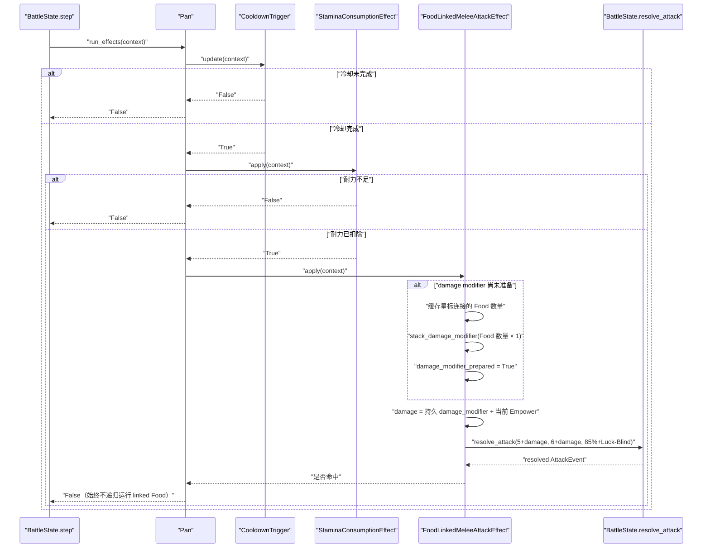

# Pan item factory SPEC

状态：已按统一 modifier 架构实现并验证。

查询日期：2026-07-23。

重写时仓库基线：现有 217 项测试全部通过。

## 1. Requirements（需求）

### 1.1 功能目标

在现有 `BattleItem`、星标连接、冷却 trigger、耐力消耗和近战攻击框架中实现 Pan（平底锅），使其能够通过默认物品目录和默认工厂从战斗 JSON 中实例化并参与逐帧战斗。

Pan 必须：

- 作为 `is_active_item=True` 的主动物品进入 `BattleState.active_items`。
- 使用 2.2 秒基础冷却；Food 连接不加速 Pan，自身冷却只使用现有 Heat、Cold 和外部速度修饰。
- 冷却完成后先消耗 2 点耐力；耐力不足时不攻击、不读取命中或伤害 RNG，并按现有武器规则重新累计冷却。
- 发起一次基础伤害为 5–6、基础命中率为 85% 的 Melee 攻击。
- 每个由 Pan 星标连接且 `item_types` 包含 `"Food"` 的物品实例，使本次攻击的最小和最大伤害都增加 1。
- 多件相同类型的 Food 分别计数；Pan 的效果没有 Food 自身冷却规则中的“不同类型”限制。
- 未被 Pan 星标连接的 Food 和星标连接的非 Food 均不计数。
- 同一 Food 实例即使覆盖多个星标，也只计数一次；继续复用 `BattleItem.add_linked_item()` 的去重结果。
- 战斗中连接不会改变；第一次实际准备攻击伤害时保存 `qualifying_food_count`，并通过 `stack_damage_modifier()` 将 Food 增伤写入 `MeleeAttackEffect.damage_modifier` 一次。
- Food 增伤、其他物品通过 `stack_damage_modifier()` 施加的持久增伤与现有 Empower 动态增伤相加，且不得改写 `MeleeAttackEffect.min_damage`、`max_damage`。
- 其他物品可以通过 Pan 的 `CooldownTrigger.stack_speed_modifier()` 持久修改 Pan 的触发速度；该外部速度修饰与 Heat、Cold 使用现有公式合并。
- Luck 和 Blind 继续通过现有 `MeleeAttackEffect` 修改命中率。
- Pan 的星标只用于计算增伤；Pan 命中后也不得递归激活星标连接的 Food。
- 每个 Pan 实例拥有独立的 trigger、effect 和 Food 数量缓存。

### 1.2 Wiki 事实快照

#### 1.2.1 来源

本 SPEC 只使用项目允许的 `backpackbattles.wiki.gg` 及其 MediaWiki/Cargo API：

- [Pan](https://backpackbattles.wiki.gg/wiki/Pan?oldid=10704)：修订 `10704`，修订时间 `2025-09-16T22:09:59Z`。
- [Food](https://backpackbattles.wiki.gg/wiki/Food?oldid=8089)：修订 `8089`，修订时间 `2024-03-20T09:25:43Z`。
- [Weapon](https://backpackbattles.wiki.gg/wiki/Weapon?oldid=10449)：修订 `10449`，修订时间 `2024-11-08T15:27:58Z`。
- [Accuracy](https://backpackbattles.wiki.gg/wiki/Accuracy?oldid=12141)：修订 `12141`，修订时间 `2026-05-09T06:48:10Z`。
- [Cooldown](https://backpackbattles.wiki.gg/wiki/Cooldown?oldid=12142)：修订 `12142`，修订时间 `2026-05-09T06:49:02Z`。
- [Game Mechanics](https://backpackbattles.wiki.gg/wiki/Game_Mechanics?oldid=12566)：修订 `12566`，修订时间 `2026-07-22T15:48:39Z`。
- [Cargo `Items` 查询](https://backpackbattles.wiki.gg/api.php?action=cargoquery&format=json&tables=Items&fields=name%2Cclass%2Crarity%2Ccost%2Citemtype%2Cicontype%2Ctags%2Ceffect&where=name%3D%22Pan%22)：
  `tables=Items&fields=name,class,rarity,cost,itemtype,icontype,tags,effect&where=name="Pan"`。

Cargo 在查询日返回：

```text
name=Pan
class=""
rarity=Common
cost=4
itemtype=Weapon
icontype=melee
tags=""
effect=Deals +1 damage for each ⭐ Food.
```

Pan 页面原始模板还给出：

```text
mindamage=5
maxdamage=6
stamina=2
accuracy=85
cooldown=2.2
sockets=1
```

Weapon 页面规定普通武器在冷却完成且耐力足够时尝试攻击，先按命中率判断命中，再在最小和最大伤害间随机取值。Accuracy 页面说明 Luck/Blind 分别以每层 5% 修改命中率；这两项均已有仓库实现，本次不重复实现。

Game Mechanics 页面规定通常一件物品只能填充另一件物品的一个星标。当前初始化器即使发现同一实例覆盖多个 marker，也通过 `BattleItem.add_linked_item()` 去重，符合该规则。

Food 页面中的“不同种类 Food 才提供 10% 加速”是 Food 自身的通用冷却规则。Pan 的独立描述是“每个 Food 增加 1 伤害”，没有不同种类限制，因此两个分别连接的 Banana 实例应提供总计 `+2` 伤害。

#### 1.2.2 网格与标准化坐标

Pan 页面模板中的原始网格为：

```text
--2-
-212
2112
-22-
```

其中 `1` 是 Pan 占格，`2` 是星标格。以底部横向两格中的左格为 `(0, 0)`，向右为 x 正方向、向上为 y 正方向，标准化为：

```json
{
  "shape_cells": [[1, 1], [0, 0], [1, 0]],
  "star_cells": [
    [1, 2],
    [0, 1],
    [2, 1],
    [-1, 0],
    [2, 0],
    [0, -1],
    [1, -1]
  ]
}
```

该网格使用普通 `star_cells`，由现有 `rotate_cells()` 统一旋转，不需要 `star_cells_by_rotation`。

#### 1.2.3 标准化元数据

| 字段 | 建模值 | 依据 |
| --- | --- | --- |
| `item_id` | `"pan"` | 仓库命名约定 |
| `display_name` | `"Pan"` | Wiki/Cargo |
| `item_classes` | `("Neutral",)` | 页面显示 Neutral；Cargo 空 class 按知识库约定归一化 |
| `rarity` | `"Common"` | Wiki/Cargo |
| `cost` | `4` | Wiki/Cargo |
| `item_types` | `("Weapon",)` | Wiki/Cargo |
| `icon_types` | `("melee",)` | Cargo |
| `is_active_item` | `True` | 有周期冷却的武器 |
| `socket_count` | `1` | Wiki 原始模板 |
| 基础伤害 | `5`–`6` | Wiki 原始模板 |
| 基础耐力消耗 | `2.0` | Wiki 原始模板 |
| 基础命中率 | `85` | Wiki 原始模板 |
| 基础冷却 | `2.2` 秒 | Wiki 原始模板 |
| 每个 Food 增伤 | `1` | Wiki/Cargo |

Cargo 的空 `tags` 不加入 `BattleItem` 公共字段。Socket 本阶段只记录 `socket_count` 元数据，不实现宝石安装。

### 1.3 用户故事

- 作为战斗 JSON 使用者，我可以在 `placements` 中放置 `pan`，默认初始化流程会创建真实 `Pan` 实例。
- 作为摆盘模型使用者，我可以把 Food 放在 Pan 的星标上，使 Pan 的攻击伤害按实际连接实例数增加。
- 作为战斗模拟调用者，我可以观察 Pan 按统一武器流程消耗耐力、判定命中并结算伤害。
- 作为后续物品实现者，我可以通过目标 trigger 的 `stack_speed_modifier()` 修改其他物品的触发速度，也可以通过目标攻击 effect 的 `stack_damage_modifier()` 修改武器伤害。
- 作为后续武器实现者，我可以复用 `MeleeAttackEffect.prepare_damage_modifier()` 的一次性准备阶段，而不需要临时改写基础伤害。
- 作为后续 Pan 升级物实现者，我可以复用 `FoodLinkedMeleeAttackEffect` 的连接统计和缓存逻辑。

### 1.4 验收场景

1. 无相邻 Food 的 Pan 在累计 2.2 秒后消耗 2 耐力并按 5–6 伤害攻击。
2. 星标连接一个 Food 时，攻击区间变为 6–7。
3. 星标分别连接两个 Banana 实例时，攻击区间变为 7–8。
4. 同一个 Banana 覆盖 Pan 的两个星标时只提供 `+1`。
5. 星标连接非 Food 或存在未连接 Food 时不增伤。
6. 两个 Food、外部持久增伤 `+4` 与 3 层 Empower 同时存在时，攻击区间为 14–15。
7. 其他物品给 Pan 叠加 `+20%` 速度后，无 Heat/Cold 时每秒累计 1.2 秒冷却进度。
8. 连续攻击不会把缓存增伤重复写入 `damage_modifier`，也不会改写 `min_damage`、`max_damage`。
9. 第一次统计后，即使测试代码修改连接列表，仍使用首次缓存的 Food 数量。
10. 耐力不足时不执行攻击 effect 的首次伤害准备、不读取攻击 RNG、不造成伤害。
11. Pan 命中时仍返回 `False` 给 linked-item 调度层，星标连接的 Food 不被递归激活。

### 1.5 范围外

- 商店、价格结算、合成配方、出售和局外发育。
- Socket 中宝石的安装及效果。
- 暴击、Vampirism、Spikes 和尚未进入当前攻击管线的其他命中后机制。
- 运行时改变背包布局或星标连接。
- 为所有可能的伤害修饰建立通用 modifier 对象、事件总线或策略框架。
- 临时 modifier 的到期、回滚和来源追踪；本阶段 `stack_*` 表示在战斗实例生命周期内持久累加。
- 改变现有武器在耐力不足时重置冷却的行为。

## 2. Design（设计）

### 2.1 当前仓库能力与缺口

当前仓库已经具备：

- `CooldownTrigger.speed_modifiers`：保存物品自身和其他物品施加的持久速度修饰。
- `CooldownTrigger.stack_speed_modifier(amount)`：把新的持久速度来源累加到统一字段。
- `CooldownTrigger.prepare_speed_modifiers(context)` 与 `speed_modifiers_prepared`：在第一次 `update()` 时只准备一次物品自身的静态速度来源；后续外部物品仍可直接 stack。
- `CooldownTrigger.update()`：每帧动态读取 Heat、Cold，并与当前 `speed_modifiers` 合并。
- `StaminaConsumptionEffect`：耐力足够时扣除固定值。
- `MeleeAttackEffect.damage_modifier` 和 `stack_damage_modifier(amount)`：保存并累加持久武器增伤。
- `MeleeAttackEffect.prepare_damage_modifier(context)`：已经提供默认空实现，但尚未接入只执行一次的生命周期。
- `MeleeAttackEffect.apply()`：合并 `damage_modifier`、Empower、Luck、Blind，创建 `AttackEvent` 并交给 `BattleState.resolve_attack()`。
- `BattleItem.linked_items`：保存初始化阶段发现并去重后的星标目标 key。
- 默认目录、默认工厂与 JSON 初始化流程。

Pan 还缺少三项：

1. 完成 `MeleeAttackEffect` 的一次性 `prepare_damage_modifier()` 调度。
2. 按 `linked_items` 中 Food 实例数量调用一次 `stack_damage_modifier()`。
3. 命中后明确阻止 `BattleItem.run_effects()` 递归执行这些 Food。

本次不修改空间系统、攻击事件数据模型或 BattleState。

### 2.2 最简扩展方案

#### 2.2.1 modifier 的统一语义

`speed_modifiers` 和 `damage_modifier` 都是组件实例上的持久累计值。来源分为三类：

- 物品自身的静态关系：通过 `prepare_*` 在组件第一次实际运行时计算，并只 stack 一次。例如 Food 的相邻加速、Pan 的相邻 Food 增伤。
- 其他物品施加的持久修饰：直接调用目标组件的 `stack_*`，可以发生在 `prepare_*` 之前或之后；累计值不会被准备阶段覆盖。
- 每帧或每次攻击动态读取的状态：Heat、Cold、Empower、Luck、Blind 不写入持久 modifier，继续在结算时读取当前层数。

因此，`stack_*` 的含义是“新增一个修饰量”，不是“设置当前总值”，也不得在每帧或每次攻击中无条件重复调用。

#### 2.2.2 完成 `MeleeAttackEffect` 的准备生命周期

在 `MeleeAttackEffect.__init__()` 中新增：

```python
self.damage_modifier_prepared = False
```

`MeleeAttackEffect.apply()` 在创建 `AttackEvent` 前执行：

```python
if not self.damage_modifier_prepared:
    self.prepare_damage_modifier(context)
    self.damage_modifier_prepared = True
```

该结构与现有 `CooldownTrigger.speed_modifiers_prepared` 一致：

- 普通 `MeleeAttackEffect.prepare_damage_modifier()` 是空操作，Wooden Sword 行为不变。
- 子类可以在第一次实际攻击时准备自身静态增伤。
- 外部物品在准备前写入的 modifier 会保留，准备阶段只追加自身来源。
- 外部物品在准备后继续调用 `stack_damage_modifier()` 也会立即影响后续攻击。
- Pan 不需要修改 `min_damage`、`max_damage`，连续攻击不会重复叠加 Food 增伤。

#### 2.2.3 新增 `FoodLinkedMeleeAttackEffect`

新增 `FoodLinkedMeleeAttackEffect(MeleeAttackEffect)`，只负责：

- 保存 `damage_per_food`。
- 保存初始为 `None` 的 `qualifying_food_count`。
- 第一次调用 `prepare_damage_modifier()` 时扫描 `context.item.linked_items`。
- 对 `context.owner.items[linked_key].item_types` 包含 `"Food"` 的实例计数。
- 调用一次 `stack_damage_modifier(qualifying_food_count * damage_per_food)`。

它不排除相同 `item_id`，因为 Pan 与 Food 自身的加速规则不同。

缓存放在 effect 实例上，而不是 Pan 类或 `CooldownTrigger` 上：

- 该状态直接属于“Food 如何修改攻击伤害”的职责。
- Pan 继续只负责按顺序组装 trigger/effects。
- 后续 Eggscalibur 等同类武器可直接复用。
- 每件 Pan 在构造时新建 effect，因此缓存不会跨实例共享。

#### 2.2.4 跨物品 modifier 接口

Pan 使用的普通 `CooldownTrigger` 和 `FoodLinkedMeleeAttackEffect` 都保留公共 stack 入口：

```python
pan.triggers[0].stack_speed_modifier(amount)
pan.effects[1].stack_damage_modifier(amount)
```

未来其他物品可以在自身效果逻辑中调用这些接口，而无需知道 Pan 如何计算基础冷却或基础伤害。Pan 的自身准备阶段只追加自己的 Food 增伤，不能重置外部已经写入的值。

本次不新增 modifier 来源列表、来源 id、移除接口或临时持续时间；这些需求出现后再扩展，避免提前引入复杂数据结构。

#### 2.2.5 不采用的方案

- 不使用 `FoodCooldownTrigger`：Pan 不是 Food，Food 连接不应加快 Pan；外部速度修饰仍可通过普通 `CooldownTrigger.stack_speed_modifier()` 写入。
- 不在 `Pan.run_own_effect()` 中修改 `MeleeAttackEffect.min_damage/max_damage`：这会混淆基础值和 modifier。
- 不在 Pan 每次激活时无条件调用 `stack_damage_modifier()`：这会让同一批 Food 在连续攻击中重复累计。
- 不复制一份 `MeleeAttackEffect.apply()` 到 Pan 专用 effect：会重复命中、Luck/Blind、AttackEvent 和结算逻辑。
- 不新增 getter 型即时增伤分支：所有持久伤害来源统一进入 `damage_modifier`，便于其他物品复用同一个入口。

### 2.3 Pan 组件组装

```python
Pan(
    triggers=[
        CooldownTrigger(cooldown_seconds=2.2),
    ],
    effects=[
        StaminaConsumptionEffect(stamina_cost=2.0),
        FoodLinkedMeleeAttackEffect(
            min_damage=5,
            max_damage=6,
            accuracy=85,
            damage_per_food=1,
        ),
    ],
)
```

所有组件均在 `Pan.__init__()` 中新建。

### 2.4 运行流程



### 2.5 返回值约定

`FoodLinkedMeleeAttackEffect.apply()` 继承 `MeleeAttackEffect.apply()` 的约定：命中返回 `True`，未命中返回 `False`。

`Pan.run_own_effect()` 不把该返回值继续返回，而是在调用攻击 effect 后固定返回 `False`。这里的布尔值控制 linked-item 递归，不代表 Pan 是否命中；若直接返回命中结果，Pan 命中会错误激活全部星标 Food。

### 2.6 兼容性

- 普通 `MeleeAttackEffect.prepare_damage_modifier()` 是空操作；首次调用后只把 `damage_modifier_prepared` 设为 `True`，现有 Wooden Sword 数值行为不变。
- 已有 `damage_modifier` 和 `stack_damage_modifier()` 保留，Pan 只接入一次性准备时机。
- `MeleeAttackEffect.apply()` 仍由 `BattleState.resolve_attack()` 统一完成命中、随机伤害、Block 和 health 结算。
- `CooldownTrigger`、`FoodCooldownTrigger`、`speed_modifiers_prepared` 及其缓存行为不变；Pan 实现不修改这些函数。
- 外部物品通过 `stack_speed_modifier()` 或 `stack_damage_modifier()` 写入的值不会被 Pan 的自身准备逻辑覆盖。
- `BattleItem.run_effects()`、`run_linked_items()` 和 `add_linked_item()` 不变。
- JSON 输入 schema 不变；只增加目录和默认工厂可识别的 `item_id="pan"`。
- 不增加第三方依赖。

## 3. Realize（逐函数实现）

### 3.1 `data/item_catalog_v1.json`

新增：

```json
"pan": {
  "item_id": "pan",
  "shape_cells": [[1, 1], [0, 0], [1, 0]],
  "star_cells": [
    [1, 2],
    [0, 1],
    [2, 1],
    [-1, 0],
    [2, 0],
    [0, -1],
    [1, -1]
  ]
}
```

不得修改其他目录项。

### 3.2 `MeleeAttackEffect.__init__` 的准备状态

现有接口不变：

```python
def __init__(
    self,
    min_damage: int,
    max_damage: int,
    accuracy: float,
)
```

在现有 `self.damage_modifier = 0` 旁新增：

```python
self.damage_modifier_prepared = False
```

各字段语义：

- `min_damage`、`max_damage`：不可被 Pan 或其他 modifier 改写的基础伤害。
- `damage_modifier`：通过 `stack_damage_modifier()` 累计的持久伤害修饰总值。
- `damage_modifier_prepared`：当前 effect 是否已经执行过自身静态修饰准备。

### 3.3 `MeleeAttackEffect.stack_damage_modifier`

接口沿用当前代码：

```python
def stack_damage_modifier(self, amount: int) -> None
```

伪代码沿用当前代码：

```python
self.damage_modifier += amount
```

本方法既可由 `prepare_damage_modifier()` 调用，也可由其他物品调用。它只追加，不重置现有值。当前阶段不新增来源记录或回滚逻辑。

### 3.4 `MeleeAttackEffect.prepare_damage_modifier`

接口沿用当前代码：

```python
def prepare_damage_modifier(
    self,
    context: BattleContext,
) -> None
```

基础伪代码沿用当前代码：

```python
pass
```

普通武器不具有需要首次计算的自身静态增伤，因此默认空操作。具体子类只负责追加自己的固有 modifier，不得清空 `damage_modifier`。

### 3.5 `MeleeAttackEffect.apply`

接口保持不变：

```python
def apply(self, context: BattleContext) -> bool
```

伪代码：

```python
if not self.damage_modifier_prepared:
    self.prepare_damage_modifier(context)
    self.damage_modifier_prepared = True

damage = self.damage_modifier
damage += context.owner.buffs.Empower

event = AttackEvent(
    attacker=context.owner,
    defender=context.opponent,
    source_item=context.item,
    attack_types=("melee",),
    min_damage=self.min_damage + damage,
    max_damage=self.max_damage + damage,
    accuracy=(
        self.accuracy
        + (
            context.owner.buffs.Luck
            - context.owner.debuffs.Blind
        ) * 5
    ),
)
resolved_event = context.battle_state.resolve_attack(event)
return resolved_event.hit is True
```

准备调用发生在构建 `AttackEvent` 前，但只有真正执行攻击 effect 时才发生；Pan 因耐力不足而在前一个 effect 返回时，不应提前准备 Food 增伤。

### 3.6 `FoodLinkedMeleeAttackEffect.__init__`

接口：

```python
def __init__(
    self,
    min_damage: int,
    max_damage: int,
    accuracy: float,
    damage_per_food: int,
)
```

伪代码：

```python
super().__init__(
    min_damage=min_damage,
    max_damage=max_damage,
    accuracy=accuracy,
)
if type(damage_per_food) is not int or damage_per_food < 0:
    raise ValueError(
        "damage per food must be a non-negative int"
    )
self.damage_per_food = damage_per_food
self.qualifying_food_count: int | None = None
```

不放宽或重复修改父类对基础伤害区间的校验。

### 3.7 `FoodLinkedMeleeAttackEffect.prepare_damage_modifier`

接口：

```python
def prepare_damage_modifier(
    self,
    context: BattleContext,
) -> None
```

伪代码：

```python
if self.qualifying_food_count is None:
    qualifying_food_count = 0
    for linked_key in context.item.linked_items:
        linked_item = context.owner.items[linked_key]
        if "Food" in linked_item.item_types:
            qualifying_food_count += 1
    self.qualifying_food_count = qualifying_food_count

damage = self.qualifying_food_count * self.damage_per_food
self.stack_damage_modifier(damage)
```

关键约束：

- 不检查 `linked_item.item_id != context.item.item_id`，因为 Pan 规则没有“不同类型”限制。
- 不读取未连接物品。
- 不修改 `self.min_damage` 或 `self.max_damage`。
- 不重置调用前已经存在的 `self.damage_modifier`；Food 增伤追加到外部 modifier 上。
- 不读取 RNG。
- 父类准备标志保证本方法只被调度一次；`qualifying_food_count` 仍保留 `None` 检查，避免直接调用时重复扫描。
- 缓存后不再扫描连接；连接缺失的 key 仍按现有内部状态错误直接暴露，不增加静默跳过。

### 3.8 `Pan` 类级元数据

```python
class Pan(BattleItem):
    item_id = "pan"
    display_name = "Pan"
    item_classes = ("Neutral",)
    rarity = "Common"
    cost = 4
    item_types = ("Weapon",)
    icon_types = ("melee",)
    is_active_item = True
    socket_count = 1
```

### 3.9 `Pan.__init__`

接口：

```python
def __init__(
    self,
    item_id: str | None = None,
    item_key: str | None = None,
    player_id: int | None = None,
)
```

伪代码：

```python
super().__init__(
    item_id=item_id,
    item_key=item_key,
    player_id=player_id,
    is_active_item=True,
    triggers=[
        CooldownTrigger(cooldown_seconds=2.2),
    ],
    effects=[
        StaminaConsumptionEffect(stamina_cost=2.0),
        FoodLinkedMeleeAttackEffect(
            min_damage=5,
            max_damage=6,
            accuracy=85,
            damage_per_food=1,
        ),
    ],
)
```

### 3.10 `Pan.run_own_effect`

接口：

```python
def run_own_effect(
    self,
    trigger_results: list[bool],
    context: BattleContext,
) -> bool
```

伪代码：

```python
if not trigger_results[0]:
    return False

if not self.effects[0].apply(context):
    return False

self.effects[1].apply(context)
return False
```

不得写成 `return self.effects[1].apply(context)`，否则命中时会触发 `BattleItem.run_linked_items()`。

### 3.11 `DEFAULT_ITEM_FACTORIES`

新增：

```python
"pan": Pan,
```

保留所有已有注册项。

### 3.12 明确不修改的函数

- `CooldownTrigger.__init__`
- `CooldownTrigger.stack_speed_modifier`
- `CooldownTrigger.prepare_speed_modifiers`
- `CooldownTrigger.update`
- `FoodCooldownTrigger.__init__`
- `FoodCooldownTrigger.prepare_speed_modifiers`
- `StaminaConsumptionEffect`
- `BattleItem.update_triggers`
- `BattleItem.run_effects`
- `BattleItem.run_linked_items`
- `BattleItem.add_linked_item`
- `BattleState.resolve_attack`
- `BattleState.commit_health_reduction`
- `initialize_battle`
- `build_occupancy_matrix`
- `find_star_links`

## 4. Tasks（任务拆解）

### T1：确认 SPEC

- 用户确认第 6 节中的实现决策。
- 依赖：无。
- 验证：SPEC 状态由“待用户审阅”改为“已批准实现”。

### T2：加入 Pan 目录网格

- 修改 `data/item_catalog_v1.json`。
- 在 `tests/test_basic_backpack_v1.py` 添加网格和旋转测试。
- 依赖：T1。
- 验证：三格形状、七个星标及 90° 旋转全部匹配 Wiki 网格。

### T3：完成近战伤害 modifier 准备生命周期

- 保留现有 `damage_modifier`、`stack_damage_modifier()` 和默认空 `prepare_damage_modifier()`。
- 新增 `damage_modifier_prepared`，并让 `apply()` 在第一次实际攻击前调用一次准备方法。
- 在 `apply()` 中通过局部 `damage` 合并持久 `damage_modifier` 和当前 Empower。
- 补充基础 effect 回归测试。
- 依赖：T1。
- 验证：现有 Wooden Sword、命中率和攻击结算测试不变；外部 modifier 可以在准备前后继续 stack。

### T4：实现 Food 连接增伤 effect

- 新增 `FoodLinkedMeleeAttackEffect`。
- 实现参数验证、首次统计缓存、Food 过滤，并通过 `stack_damage_modifier()` 追加一次固定增伤。
- 依赖：T3。
- 验证：Food、多件同类 Food、非 Food、未连接 Food 和缓存测试通过。

### T5：组装并注册 Pan

- 新增 `Pan` 类。
- 使用 `CooldownTrigger`、`StaminaConsumptionEffect` 和 `FoodLinkedMeleeAttackEffect`。
- 在 `DEFAULT_ITEM_FACTORIES` 注册。
- 依赖：T2、T4。
- 验证：默认初始化器可创建 Pan 并建立去重星标连接。

### T6：补充运行时和端到端测试

- 验证冷却、耐力、命中、基础伤害、Food 增伤、外部速度/伤害 modifier、Empower 合并和无递归激活。
- 验证连续攻击不重复 stack Food 增伤，也不修改基础伤害。
- 依赖：T5。

### T7：回归验证与文档回写

- 运行完整 `unittest` 测试集。
- 运行包含 Pan 与 Food 的最小内存战斗配置。
- 运行 `git diff --check`。
- 只在全部通过后，把本文状态更新为“已实现并验证”并记录测试总数。
- 依赖：T6。

## 5. Acceptance Criteria / Tests（验收标准）

### 5.1 目录与布局

1. `test_pan_catalog_matches_wiki_grid`
   - 断言 `shape_cells == [[1, 1], [0, 0], [1, 0]]`。
   - 断言七个 `star_cells` 与 Wiki 原始网格一致。
   - 在 `(2, 2)`、0° 放置后，占格为 `(3, 3)`、`(2, 2)`、`(3, 2)`。
   - 星标为 `(3, 4)`、`(2, 3)`、`(4, 3)`、`(1, 2)`、`(4, 2)`、`(2, 1)`、`(3, 1)`。
   - diamond/triangle 均为空。
2. `test_pan_catalog_rotates_shape_and_stars`
   - 在 `(3, 3)`、90° 放置后，占格为 `(2, 4)`、`(3, 3)`、`(3, 4)`。
   - 星标为 `(1, 4)`、`(2, 3)`、`(2, 5)`、`(3, 2)`、`(3, 5)`、`(4, 3)`、`(4, 4)`。
   - 不新增 `star_cells_by_rotation`。

### 5.2 `MeleeAttackEffect` modifier 生命周期

3. `test_melee_attack_effect_starts_with_unprepared_zero_damage_modifier`
   - 直接构造 `MeleeAttackEffect(1, 3, 90)`。
   - 断言 `damage_modifier == 0`、`damage_modifier_prepared is False`。
   - 第一次攻击后准备标志变为 `True`，无 Empower 时事件仍为 1–3 伤害。
4. `test_melee_attack_effect_stacks_persistent_damage_modifiers`
   - 依次调用 `stack_damage_modifier(2)` 和 `stack_damage_modifier(3)`。
   - 断言持久总值为 5。
   - 拥有者 1 层 Empower 时，基础 1–3 变为 7–9。
   - accuracy 仍按原公式计算。
5. `test_melee_attack_effect_prepares_intrinsic_modifier_once`
   - 使用测试子类在 `prepare_damage_modifier()` 中记录调用次数并 stack 2。
   - 连续攻击两次，准备方法只调用一次，两次伤害区间一致。
   - 第二次攻击不会再次增加 `damage_modifier`。
   - `effect.min_damage` 和 `effect.max_damage` 保持构造值。

### 5.3 Food 连接增伤 effect

6. `test_food_linked_melee_attack_effect_counts_all_linked_food_instances`
   - 链接两个 `item_id="banana"` 的不同实例。
   - 首次攻击准备得到 `qualifying_food_count=2` 和 `damage_modifier=2`。
7. `test_food_linked_melee_attack_effect_ignores_non_food_and_unlinked_food`
   - 链接一件 Weapon，同时在拥有者 items 中放一件未链接 Food。
   - 计数和 Food 追加伤害均为 0。
8. `test_food_linked_melee_attack_effect_uses_first_cached_count`
   - 首次仅链接一个 Food，缓存为 1。
   - 测试代码再加入第二个 Food 后，后续仍使用 1，且不再次 stack。
9. `test_food_linked_melee_attack_effect_rejects_invalid_damage_per_food`
   - `-1`、`1.5`、`True` 和 `"1"` 均抛出 `ValueError`。
10. `test_food_linked_melee_attack_effect_preserves_external_modifier_and_base_damage`
    - 首次准备前先通过外部调用 stack 4，再连接两个 Food。
    - 准备后 `damage_modifier == 6`，证明 Food 增伤追加而非覆盖外部值。
    - 父类 `min_damage=5`、`max_damage=6` 始终不变。

### 5.4 Pan 工厂与初始化

11. `test_pan_is_registered_with_metadata_and_components`
    - 默认 registry 创建 `Pan`。
    - 断言全部标准化元数据。
    - 唯一 trigger 为 `CooldownTrigger(2.2)`，不是 `FoodCooldownTrigger`。
    - effects 依次为 `StaminaConsumptionEffect(2.0)` 和 `FoodLinkedMeleeAttackEffect(5, 6, 85, 1)`。
12. `test_pans_own_independent_component_instances`
    - 两件 Pan 的 trigger、两个 effect、准备标志、modifier 和 `qualifying_food_count` 状态互相独立。
13. `test_initializer_builds_pan_as_active_item_with_deduplicated_food_link`
    - 使用默认目录与 registry 放置 Pan 和 Banana。
    - Pan 放在 `(2, 2)`、0°，Banana 放在 `(4, 2)`、0°；同一 Banana 覆盖 Pan 的 `(4, 3)` 与 `(4, 2)` 两个星标。
    - `pan.linked_items` 中只出现一次 Banana key。
    - Pan 出现在拥有者 items 和 `BattleState.active_items` 中。

### 5.5 Pan 运行逻辑

14. `test_pan_does_not_activate_before_cooldown`
    - `frame_delta < 2.2` 时不扣耐力、不读取 RNG、不造成伤害。
15. `test_pan_pays_stamina_and_attacks_with_base_damage`
    - 无 Food，冷却完成且耐力足够。
    - 耐力减少 2。
    - RNG 伤害范围为 5–6。
    - `run_effects()` 固定返回 `False`。
16. `test_pan_adds_one_damage_per_linked_food`
    - 两个链接 Food 时，RNG 伤害范围为 7–8。
    - 两个 Food 可以拥有相同 `item_id`。
17. `test_pan_combines_food_external_damage_modifier_and_empower`
    - 两个 Food、外部 `stack_damage_modifier(4)` 与 3 层 Empower 时事件范围为 14–15。
    - Food 准备不会覆盖外部的 4 点 modifier。
18. `test_pan_accepts_external_damage_modifier_after_preparation`
    - Pan 首次攻击准备一个 Food 的 `+1`，此后外部再 stack 2。
    - 后续攻击使用总计 `+3` 的 `damage_modifier`，无需重新准备 Food。
19. `test_pan_food_links_do_not_speed_up_cooldown`
    - 链接 Food、无 Heat/Cold、`frame_delta=1.0`。
    - 冷却进度只增加 1.0，而不是 1.1。
20. `test_pan_accepts_external_speed_modifier`
    - 对 Pan 的普通 `CooldownTrigger` 调用 `stack_speed_modifier(0.20)`。
    - 无 Heat/Cold、`frame_delta=1.0` 时冷却进度增加 1.2。
    - 第一次 `update()` 后 `speed_modifiers_prepared is True`，外部 0.20 未被默认准备覆盖。
21. `test_pan_skips_attack_without_stamina`
    - 冷却完成但耐力小于 2。
    - 冷却进度按现有武器约定重置。
    - 不统计 Food、不读取命中/伤害 RNG、不造成伤害。
    - 攻击 effect 的 `damage_modifier_prepared` 仍为 `False`。
22. `test_pan_does_not_run_star_linked_food_on_hit`
    - 固定攻击命中，链接 Food 使用 mock `run_effects()`。
    - Pan 正常扣耐力并造成伤害。
    - linked Food 未被调用。
23. `test_pan_repeated_attacks_do_not_stack_food_damage_again`
    - 两个 Food，连续完成两次冷却和攻击。
    - 两次 RNG 范围均为 7–8，而不是第二次变为 9–10。
    - `qualifying_food_count == 2`、`damage_modifier == 2`，准备方法只执行一次。
24. `test_pan_miss_still_pays_stamina_without_running_linked_food`
    - 固定命中 RNG 大于等于 0.85。
    - 耐力仍减少 2，伤害 RNG 不读取，对手生命不变，linked Food 不运行。

### 5.6 回归与完成标准

- 修改前已有的 217 项测试全部继续通过。
- 上述 24 项新增测试全部通过，完整测试集预期为 241 项。
- `data/item_catalog_v1.json` 除新增 `pan` 外无其他变化。
- Pan 可从标准 `battle_run_v1` 的 `placements` 经默认目录和 registry 初始化。
- Pan 复用现有冷却、耐力和攻击结算，不复制攻击管线。
- Food 数量只在第一次实际伤害准备时扫描；Food 增伤只 stack 一次。
- Pan 能接收其他物品在准备前或准备后施加的持久速度/伤害 modifier，且自身准备逻辑不会覆盖外部值。
- Pan 的 Food 星标不产生 Food 冷却加速，也不递归激活 Food。
- 现有 Wooden Sword、Wooden Buckler、Banana、Garlic 及通用攻击行为不变。
- 不新增第三方依赖、事件总线、modifier 容器或 callback 配置层。

## 6. 已确认实现决策

1. 保留并采用当前统一 modifier 设计：`stack_speed_modifier()` 和 `stack_damage_modifier()` 都表示向组件实例追加持久修饰，供物品自身和其他物品共同使用。
2. `MeleeAttackEffect` 增加与 `CooldownTrigger` 对称的 `damage_modifier_prepared` 生命周期；第一次实际攻击时调用一次 `prepare_damage_modifier()`，之后外部 modifier 仍可继续 stack。
3. 新增 `FoodLinkedMeleeAttackEffect`，首次准备时缓存 `qualifying_food_count`，并把 `Food 数量 × 1` 通过 `stack_damage_modifier()` 追加一次；同类 Food 的不同实例均计数。
4. Pan 使用普通 `CooldownTrigger(2.2)`；Food 连接只增伤，不提供 Food 的 10% 冷却加速，但其他物品可以通过该 trigger 的 `stack_speed_modifier()` 修改 Pan 速度。
5. `Pan.run_own_effect()` 在攻击后固定返回 `False`，避免命中时递归激活星标 Food。
6. 本阶段只记录 `socket_count=1`，不实现宝石安装；modifier 来源追踪、临时到期/回滚、配方和商店逻辑继续留在范围外。

## 7. 实施与验证结果

实施日期：2026-07-23。

- 已在 `MeleeAttackEffect` 中补齐一次性 `prepare_damage_modifier()` 生命周期；准备逻辑只运行一次，之后仍可继续通过 `stack_damage_modifier()` 追加外部持久修饰。
- 已实现 `FoodLinkedMeleeAttackEffect`，第一次实际攻击时缓存链接 Food 数量，并把对应增伤追加到通用 `damage_modifier`。
- 已实现并注册 `Pan`，加入标准物品目录、星标网格、默认工厂和战斗初始化链路。
- 已新增本 SPEC 第 5 节列出的 24 项测试；修改前 217 项测试与新增测试共同组成的 241 项完整测试集全部通过。
- 已用标准 `battle_run_v1` 配置完成默认目录和默认 registry 冒烟验证：Pan 与一件链接 Banana 成功初始化；首帧时间推进至 2.2 秒，Pan 消耗 2 点耐力并造成 7 点伤害，结果正常返回 `battle_result_v1`。
