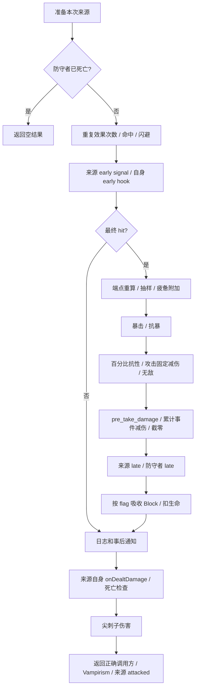

# resolve_attack：伤害字段的原版生效位置

调查日期：2026-10-06。对应 SPEC：`docs/resolve_attack_damage_fields_audit_spec.md`。

本报告依据当前 `Backpack Battles/` 解包源码和当前工作区代码。机制以原版为准，历史设计文档不参与裁决。首轮为静态调查；2026-10-06 后续按用户要求用两个 GPT-6.1-Sol 子agent完成两项可见 Godot 战斗实验，见第11节。模拟器生产代码未修改，实验临时观测插桩已恢复。文中 Python 行号是调查时快照。

## 1. 结论与插入位置

**不能把伤害相关字段统一放到 `commit_health_reduction`。** 原版在物品回调之前、之间和之后分别读取它们，回调看到的数值会因此不同。

以 `A` 表示受击方的对手、`D` 表示受击方、`I` 表示可空的来源物品。普通对敌攻击中 `A = event.attacker`、`D = event.defender`、`I = event.source_item`。原版角色暴击层和反伤目标使用 `D.opponent`，并非通过 `origin` 查找；扩展自伤时不能直接沿用“来源拥有者一定等于 A”的假设。

| 阶段 | 当前 `battle_module_v1.py` 落点 | 应处理内容 | 原版依据 |
| --- | --- | --- | --- |
| S0 来源准备 | `AttackEffect.apply:465–475`，调用前 | 本次类型与 flags；命中率由基础值、物品 bonus、Lucky/Blind 得到。效果伤害在此预先修改数值 | `Item.gd:3800–3808,4115–4124`；`DamageSource.gd:57–83,115–121` |
| S1 入口 | `resolve_attack:535` 后、命中前 | 新结算单；`D.is_dead` 返回；有物品时计算一次 `attackEffectCount = 1 + rollDoubleAttackEffect()` | `Character.gd:495–514` |
| S2 命中 | 替换 `541–546` | `can_miss`；使用 **D.accuracy_rng**；命中才消耗 D 的闪避层；不可 miss 时显式 `hit=True` | `Character.gd:516–523` |
| S3 early | `548–555` | 仅有 I 且类型含 melee/ranged；来源 signal 一次，物品自身 hook 执行 attackEffectCount 次；可改 hit、当前伤害、物品属性和本次 flags | `Character.gd:530–534` |
| S4 伤害抽样 | 替换 `576–583` | early 后重读攻击端点和物品暴击率；Empower、类型加成、物品倍率进入端点；物品使用独立 BalancedRange；抽样加到已有 pending_damage；fatigue 再加 **D.bonus_fatigue_damage** | `DamageSource.gd:163–171`；`Item.gd:3659–3690`；`Character.gd:536–540` |
| S5 暴击 | `583` 后、构造 pre_take context 前 | can_crit → D.crit_rng → I 的暴击层 → A.crit_tokens → D 的抗暴概率/层 → 伤害乘暴击倍率，写 crit | `Character.gd:542–561`；`DamageResult.gd:28–33` |
| S6 抗性/固定减伤/无敌 | S5 后、`584–587` 前 | 百分比抗性并 round → 仅攻击扣固定减伤 → 无敌置零；此处不提前截非负 | `Character.gd:563–574` |
| S7 pre_take 与事件减伤 | `584–588` | 先防守方 signal；随后统一减 prevented_damage，再 `max(0, ...)` | `Character.gd:574–578`；`DamageResult.gd:35–41` |
| S8 late | `589–601` | 来源 late signal 一次、自身 hook 若干次；然后 D 的 pre_take_damage_late。这里可以移除/增加 Block、设 spectral | `Character.gd:580–586` |
| S9 Block / 生命 | 替换 `608–609` 并检查提交边界 | 此时再读 can_be_blocked 和 D.block；拆出 block_damage/health_damage，扣生命。伤害结果不得被“实际扣了多少血”覆盖 | `Character.gd:587–599` |
| S10 通知 / 死亡 | `635–646` 后 | 日志和物品伤害统计 → character_attacked → character_damaged → 来源自身 onDealtDamage → 检查当前生命并 death | `Character.gd:629–649` |
| S11 尖刺 | `647` 的第一部分 | D 的尖刺与比例上限，本次 can_be_spiked；创建独立 Spikes 伤害，走完整受伤流程 | `Character.gd:651,709–724` |
| S12 吸血 | `647` 的第二部分，但限正确调用路径 | `Character.dealDamage` 返回路径才自动应用 A 的 Vampirism；按结算伤害和比例上限算治疗，再进入 heal | `Character.gd:482–487,726–737` |
| S13 来源 attacked | `648–652` | 原版发生在 `Item.dealDamage` 返回路径，位于尖刺/吸血之后；不是所有含 attack 类型的任意 takeDamage 调用都自动拥有此阶段 | `Item.gd:4115–4124` |



## 2. PlayerState：全部 21 个新增字段

原版字段定义见 `Character.gd:55–96`。下表逐个列出，不意味着每项都在 `resolve_attack` 直接做乘加。

| 字段 | 读取方、单位 | 生效点与精确规则 |
| --- | --- | --- |
| `is_dead` | D，bool | S1：为真时返回 hit=false、damage=0、healthDamage=0 的新结果，不抽样、不发受伤通知。不要把入口改成 `health <= 0`：原版死亡标记在事后回调之后才设置（`Character.gd:504–505,648–649,997–999`） |
| `damage_resistance` | D，百分数，25 表示 25% | S6：`r=clamp(value/100,-10,1)`；`damage=round(damage*(1-r))`。所有进入 takeDamage 的命中伤害均适用；允许负抗性，不是 0～1 字段（`Character.gd:563–564`） |
| `damage_reduction` | D，固定整数 | S6：只在类型包含 melee 或 ranged 时扣除；在百分比抗性之后、无敌之前，不是事件 prevented_damage（`Character.gd:567–569`） |
| `invulnerable` | D，bool | S6：把当前 damage 置 0，仍继续 pre_take/late 和事后流程，不是入口 return，也不回滚此前暴击层/随机消耗（`Character.gd:571–586`） |
| `dodge_stacks` | D，次数 | S2：仅 can_miss 且初始命中时减 1 并改 miss；初始 miss 不耗层，can_miss=false 不耗层；early 仍可把 hit 改回 true（`Character.gd:516–534`） |
| `crit_tokens` | A，次数 | S5：can_crit 内，在物品暴击层后检查；若结果 critical 尚为假且 A 有层则消耗 1。自然暴击命中并不使这次消耗自动跳过（`Character.gd:543–561`） |
| `crit_resistance` | D，百分数 | S5：仅有暴击候选时，以 D.crit_resistance_rng 判断；不是削减暴击倍率（`Character.gd:557–561,1390–1397`） |
| `crit_resist_stacks` | D，次数 | S5：概率抗暴失败时才消耗 1 层、强制抵抗；概率成功不耗层（`Character.gd:1390–1397`） |
| `bonus_fatigue_damage` | D，整数 | S4：类型含 fatigue 时在抽样后相加，随后照常抗性/无敌/事件减伤。不在此单独截零（`Character.gd:539–578`） |
| `healing_efficiency` | 被治疗者，倍率 | S12/任何 heal：`round(requested * max(0, efficiency))`，然后处理缺血、过量治疗、通知和反治疗；不乘进攻击伤害（`Character.gd:739–772,1421–1422`） |
| `unhealing_amount` | 被治疗者，倍率 | heal 通知之后，若大于 0：`ceil(effective_heal * value * (1+typed_damage_factors['unhealing']))`；正值对对手发起独立 Unhealing 伤害。effective_heal 包含过量治疗（`Character.gd:763–772,1418–1419`） |
| `empower_damage` | I 拥有者，每层 Empower 加伤 | S4 攻击端点：仅 `I.canBeEmpowered()`，加 `buffs.Empower * empower_damage`。原版系数为 float，当前注解 int 过窄（`Item.gd:3639–3640,3663–3687`；`Character.gd:91,1350–1351`） |
| `typed_damage_factors` | I 拥有者，增量倍率 | S4 攻击端点用 `1 + sum(factor[t] for t in 本次类型)`；不同类型相加。效果伤害在来源 updateEffect 中只读 effect；Unhealing 在 heal 中只读 unhealing。不要在抽样后对所有来源统一乘（见第 4 节） |
| `melee_spikes_limit` | D，比例 | S11：非 ranged 时选此值（连纯 effect 的 fallback 也是此值）；与 effect 上限组合后乘 damage 再 round（`Character.gd:709–723`） |
| `ranged_spikes_limit` | D，比例 | S11：只要含 ranged 就优先选此值，即使同时有 melee（同上） |
| `effect_spikes_limit` | D，比例 | S11：含 effect 时，对已选比例执行 `max(effect_spikes_limit, selected)`，不是无条件改用 effect 值（同上） |
| `melee_vampirism_limit` | A，比例 | S12：非 ranged 时选此值；`min(Vampirism, round(damage*limit))`（`Character.gd:726–737`） |
| `ranged_vampirism_limit` | A，比例 | S12：含 ranged 时选此值；默认 0 不代表 ranged 禁止触发，flag 与上限是两道判断（同上） |
| `accuracy_rng` | **D**，平衡随机历史 | S2 命中，不能用 A 的状态（`Character.gd:518`） |
| `crit_rng` | **D**，平衡随机历史 | S5 自然暴击；暴击率大于 0 才调用（`Character.gd:545–547`） |
| `crit_resistance_rng` | **D**，平衡随机历史 | S5 抗暴，独立于 crit_rng（`Character.gd:1390–1397`） |

现有角色字段也有边界：`buffs.Luck` 对应原版 Lucky，和 `debuffs.Blind` 在 S0 以 `(Luck-Blind)*5` 加命中率；`buffs.Empower` 进 S4；`buffs.Spikes` 与 `buffs.Vampirism` 是 S11/S12 的数量上限；`block` 在 S9 读取最新值；`health` 在 S9 扣除、S10 再检查，`max_health` 用于 heal。`fatigue_damage` 是系统疲惫基数，不是 `bonus_fatigue_damage`；`debuffs.Poison` 是毒跳来源值，不是普通武器伤害加项；`buffs.Regeneration` 调用 heal。`stamina`/`max_stamina`、Heat/Cold 的通用作用是攻击能否发生与冷却推进，Mana 等由具体 hook 消耗，不应再凭这些层数给通用伤害公式添加项。依据：`Character.gd:401–414,1350–1354`；`Weapon.gd:7–13`；`Item.gd:3725–3743,4196–4207`。

## 3. AttackEvent：字段语义与门控

`DamageSource` 对应本次输入，`DamageResult` 对应可变结果；Python 将两者合在一个 AttackEvent 可以继续使用，但要保留不同数值的含义。

| 字段 | 生效位置 / 对应语义 |
| --- | --- |
| `attacker`, `defender` | 普通对敌链中的 A/D。若支持系统来源/自伤，必须单独明确原版 D.opponent 与来源拥有者的关系 |
| `source_item` | 原版 `origin is Item` 才进入物品专用分支；系统来源允许没有物品。当前非空注解和 context 构造尚不支持这点 |
| `attack_types` | 全程；不是互斥枚举。melee/ranged 控制攻击 hook 与固定减伤；fatigue 控制附加伤害；ranged/effect 控制尖刺上限；所有本次类型参与攻击端点类型加成 |
| `min_damage`, `max_damage` | S4 抽样输入。原版 attack + Item 会在 early 后重新从物品取得；非攻击 Item 来源保留构造好的区间。字段必须区分“未经修饰的基础值”与“本次已修饰端点”，避免二次加成 |
| `accuracy` | S2 使用的百分数，来源应在 S0 更新；可以超过 100。early 修改准确率不重做已经完成的命中检定 |
| `hit` | S2 初判、S3 可修改，S4 之前才决定走伤害分支。最终 miss 时仍有事后日志/通知 |
| `can_miss` | S2；false 必须设置 hit=true，且不消费命中 RNG/闪避层 |
| `can_crit` | S5；false 跳过自然暴击、暴击层和抗暴整段 |
| `crit_chance` | S4 origin 为 Item 时刷新，S5 clamp 到 0～100 后使用；没有物品时使用伤害源携带的值 |
| `crit_multiplier` | S5 真正 makeCritical 时取 I 的当前 critSeverity；没有物品为 2.0。不要只在 AttackEvent 创建时快照后再忽略 early 修改 |
| `crit` | 对应结果 critical，而非局部“是否有暴击候选”；只有实际 makeCritical 才设 true。抗暴成功保持 false |
| `can_be_blocked` | S9 使用当时值；false 时 block_damage=0、health_damage=damage。spectral 只关闭这项，仍接受抗性、固定减伤、盾牌事件减伤 |
| `can_be_spiked` | S11 与 hit、damage>0 同时判断；不是仅判断 melee |
| `can_be_vampiric` | S12 与 hit、damage>0 同时判断，且调用路径必须会执行 applyVampirism |
| `can_activate_item` | 原版 CanTriggerItems。由 triggerOnHit/Attacked/Damaged 等判断函数读取；**不能用它整体关闭信号或所有来源 hook**，见下文 |
| `rolled_damage` | S4 的一次区间抽样，仅调试/追踪；不含 early 的直接加伤、fatigue 或暴击 |
| `pending_damage` | 对应 DamageResult.damage：early 可以先加值，S4 使用 +=；经过暴击、减伤、late 后保留总伤害，**Block 不从此字段扣除** |
| `prevented_damage` | 对应 DamageResult.damageReduction 的累计请求量；S7 统一扣一次。当前实现累计实际挡下量，两者在扣血结果上常相同，但字段语义不同 |
| `block_damage` | S9 分配给 Block 的部分，当前模型新增的显式结果；原版直接 loseBlock |
| `health_damage` | S9 对应 DamageResult.healthDamage，减去 Block 后的整段生命伤害，**未按剩余 HP 截断** |
| `final_blocked_damage`, `final_health_damage` | 项目实际提交的变化量；不能替代 pending_damage/health_damage，也不能成为尖刺/吸血基数 |
| `is_resolved` | 项目的重复提交保护，原版无对应字段；不能作为跳过原版事后回调/嵌套伤害的理由 |
| `log_handle`, `trigger_log_handle` | 日志结果及因果父事件，不参与伤害公式；S10 建立结果事件，传给尖刺、治疗及物品后续效果 |

flags 默认值来自 `DamageSource.gd:19–37,57–83`、`Character.gd:159–163`、`Game.gd:2139–2146`：

| 标准来源 | Block | Spikes | Vampirism | Items | Miss | Crit |
| --- | --- | --- | --- | --- | --- | --- |
| Melee / Ranged | 是 | 是 | 是 | 是 | 是 | 是 |
| Effect | 是 | 否 | 否 | 是 | 否 | 是 |
| SelfDamage | 是 | 否 | 否 | 是 | 否 | 否 |
| Unhealing | 是 | 否 | 否 | 是 | 否 | 否 |
| Poison / Spikes | 是 | 否 | 否 | 否 | 否 | 是 |
| Fatigue | 是 | 否 | 否 | 否 | 否 | 否 |

这是标准构造的默认值，不是见到一个类型就覆盖已有 flags。`setItem` 对多类型先判断 Melee，再 Ranged，再 SelfDamage，再走 effect 默认。`ArmoredCouragePuppy.gd:3–5` 会单独关 Items/Spikes，`SunShield.gd:9–11` 会关 Crit。

**已实测的例外：雷神之锤的纯Effect子伤害。** `Exclusive/ThorsHammer.gd:11–13` 使用 `DamageSource.new().init(self, Type.Effect, effectDmg)`，`init` 不按类型重设flags，因此保留默认 `All=63`。`onDealtDamage:22–24` 实际使用该来源。它能触发尖刺；不能把所有Effect来源强制规范化为effectFlags=41。第11节有原引擎父子伤害事件证据。

`DamageResult.gd:43–70` 的门控应逐项保留：

- triggerOnHit = hit && Items；triggerOnDamaged = damage>0 && Items（源码没有额外写 hit）。
- triggerOnMeleeAttacked = hit && Items && 含 melee；triggerOnAttacked = hit && Items && 是 attack。
- canTriggerSpikes / canTriggerVampirism = hit && damage>0 && 各自 flag。
- `Character.takeDamage` 本身仍发出 pre_take/late/character_attacked/character_damaged。`Shield.gd:21–27` 使用上述门控；`FullBodyProtection.gd:52–54` 只检查类型，没有检查 Items。统一屏蔽信号会改变这类物品。
- `willBeLethal(character)` 的源码是 `damage >= currentHealth + Block`，没有检查 spectral。`SpellScrollIce.gd:22–30` 据此在 late 加 Block；不要为它擅自换成更“合理”的新公式。

## 4. 伤害端点、暴击与取整

### 4.1 攻击端点在 early 之后重算

对 min/max 分别执行（`Item.gd:3659–3690`）：

```text
若对应 statDisplayOverrides 为真值：直接返回 override
x = ceil(descriptor端点 + bonusMinDam或bonusMaxDam)
若物品有角色：
    若 canBeEmpowered：x += Empower * empowerDamage
    x *= 1 + Σ character.typedDamageFactors[type]，遍历本次 damageSource.types
x = round(x * bonusDamageFactor)
return max(0, x)
```

这里 `bonusDamageFactor` 默认 1.0，`typedDamageFactors[t]` 默认 0.0；两个字段不能用相同默认值。`canBeEmpowered = isWeapon && canDamage`，`canDamage = baseMinDamage>0 || Lifesteal tag`，不是“所有攻击或所有伤害都吃 Empower”（`Item.gd:3639–3640,5356–5357`；`ItemDescriptor.gd:308–309`）。

物品相关字段的剩余定位：

| 原版物品字段 | 在结算中的作用 |
| --- | --- |
| descriptor.minDam/maxDam、bonusMinDam/bonusMaxDam | S4 端点的原始值和加法修饰；bonus 是 float，先 ceil 两者之和 |
| removableDam | 记录可被清除的加伤；清除时同步修改 bonusMinDam/bonusMaxDam；不要在 S4 再加一次（`Item.gd:4035–4077`） |
| bonusDamageFactor | S4 两端点最终倍率；效果来源 updateEffect 也用它 |
| descriptor.accuracy、bonusAccuracy | S0 命中率，与角色 Lucky/Blind 相加 |
| critChancePercent、critTokens、critSeverity | 分别对应 S4/S5 暴击率、S5 物品暴击层、S5 暴击倍率；角色没有通用 critChance 字段 |
| damageRangeRng.acc | S4 的物品独立区间平衡历史；所有同物品 Item 来源使用同一状态 |
| doubleAttackEffectChance | S1 抽一次；概率用 0～1 存储；重复的是自身 early/late/onDealtDamage hook，**不是整次伤害乘二，也不是所有监听器触发两次**（`Item.gd:4108–4112`；`Character.gd:511–514,532–534,582–584,642–646`） |
| hasPreDealDamageEarlyEffect / hasPreDealDamageLateEffect / hasDealtDamageEffect | 各自决定是否调用物品自身对应 hook；signal 与 hook 分开计数 |
| statDisplayOverrides | min/max/accuracy 的真值 override 会直接返回；critChance 检查的是 `!= null`。虽名为 display，运行函数也会读，不能把它们误当纯展示（`Item.gd:3659–3661,3676–3678,3800–3802,3978–3982`） |

`MagicStaff.gd:9–13` 在 early 既直接加本次 damage，又永久修改 bonus；`MoltenSpear2.gd:24–34` 在 early 改 hit、加 bonus、改 Blind；`CritwoodStaff.gd:15–23` 在 early 提高物品暴击率。因此：

- early 的直接 damage 加值保留在 pending_damage，不再乘物品端点的类型/伤害倍率；它随后参加暴击、抗性和减伤。
- early 修改物品 bonus/Empower/类型加成会通过 S4 重读影响本次端点。
- early 修改物品暴击率会影响本次 S5；修改 Blind 不重判已经结束的 S2。
- 只在 `AttackEffect.apply` 复制一次 damage_modifier，然后在 S4 使用旧区间，无法完整复现这些行为。

### 4.2 类型加成没有统一的全局乘法入口

- 攻击 Item 来源：端点使用本次所有类型加成的和。
- `Item.dealEffectDamage → DamageSource.updateEffect`：`baseEffect * (1+owner.typedDamageFactors[Effect]) * item.bonusDamageFactor`，随后写入 int 区间；没有 Empower、bonusMinDam/bonusMaxDam，也不遍历全部类型（`Item.gd:4121–4124,5113–5117`；`DamageSource.gd:118–121`）。
- Unhealing：在 Character.heal 内使用被治疗者的 unhealing factor，见第 6 节。
- 系统 Poison/Spikes/Fatigue：设置来源基础值后直接 takeDamage，不会经过 Item.getTypedDamageFactor。不能仅因字典存在 poison/spikes/fatigue/self_damage 键就统一乘上它们（`Character.gd:401–411,709–723,1598–1600`；`CombatTimer.gd:153–178`）。

### 4.3 暴击层的条件必须照源码保留

`Character.gd:543–561` 有两个变量：局部 `critical` 表示候选，结果 `damageRes.critical` 表示已经应用暴击。物品层和角色层都检查后者。

```text
critical = false
若暴击率 > 0 且 D.critRng 成功：critical = true
若 !result.critical 且物品层>0：物品层减1；critical=true
若 !result.critical 且 A角色层>0：角色层减1；critical=true
若 critical：
    先判断 D 的概率抗暴
    概率失败才判断并消耗 D 的抗暴层
    未抵抗：damage *= 当前暴击倍率；result.critical=true
```

因此通常一次攻击可以同时消耗两种暴击层，即使自然暴击已成功；随后被抗暴也不退层。不能写成 `if not critical` 或互斥的 `elif`。这是当前解包的明确控制流；是否为开发者预期不是本轮裁决对象。

上述“概率成功后仍耗两种暴击层”已在后续图形实验中复现：Critwood Staff由真实物品效果取得100%暴击率时，物品层/角色层3/3→2/2，随后结果critical才变true。抗暴相关其他分支仍是静态核对，详见第11节。

### 4.4 数值转换是流程的一部分

原版 DamageResult.damage/healthDamage 和 DamageSource.minDamage/maxDamage 为 int。`makeCritical` 只做乘法后赋回 int，源码没有 round；效果来源写入 int 也没有 round。应保留写入 int 字段的转换位置，而不是全流程使用 float 到最后一次 round。

报告用 `G_int` 表示向零转换、`G_round` 表示原版 round（半数远离零）。例如 `G_int(5*1.5)=7`，`G_round(2.5)=3`，`G_round(-2.5)=-3`；不要直接替换成 Python 的银行家舍入。语言语义参考 [Godot 3.6 round](https://docs.godotengine.org/en/3.6/classes/class_%40gdscript.html#class-gdscript-method-round) 和 [Godot 3.6 int](https://docs.godotengine.org/en/3.6/classes/class_int.html)；游戏使用这些操作的位置仍由本地源码确定。具体解包表达式的隐式转换建议用匹配引擎轨迹复核。

## 5. 三种伤害量与死亡边界

必须区分：

1. `pending_damage` / 原版 damage：全部减伤和 late 后、Block 吸收前的伤害总量。
2. `health_damage` / 原版 healthDamage：扣除 Block 吸收份额后，计划从生命扣除的整段数值。
3. `final_health_damage`：项目当前提交器裁到剩余生命后的实际变化量；原版本步骤并不把 healthDamage 裁到剩余生命。

例如总伤害 20、Block 5、剩余生命 3：原版 damage=20、healthDamage=15，`curHealth -= 15` 暂时到 -12。当前提交器保存的实际扣血是 3。尖刺和 Vampirism 的基数仍为 **20**，不是 15，也不是 5+3。即使伤害全被 Block 吸收，damage 仍大于 0，仍可触发尖刺和吸血（`Character.gd:587–599,720,734`）。

当前 `commit_health_reduction:760–773` 既裁 HP 又立即判断胜负/抛异常，会跳过 character_attacked、character_damaged、来源 onDealtDamage。原版在这些回调完成后才看当前生命是否 <=0；回复、转化、嵌套伤害会影响这里的结果。

更精确的终局顺序：`death()` 设置 isDead 并同步发 character_died；Game.endCombat 设置 fightEnded 并安排 deferred 清理；takeDamage 的直接代码仍继续 applySpikes，再返回外层 dealDamage/applyVampirism。但 EventBus 每次派发监听器前检查 fightEnded，可能不再执行监听器，不能简单宣称“致死后所有回调照常运行”或“致死后一律不反伤/不吸血”。依据：`Character.gd:648–653,997–999`；`Game.gd:2263,2642,3084–3089,3112–3130`；`EventBus.gd:85–96`。胜负一经 endCombat 决定也不能用后续 HP 简单重算。

固定减伤之后允许临时负数；只有 S7 减去事件减伤后才统一 max(0,...)。因此 pre_take 的物品要能面对负的 pending_damage。原版在 late 后没有再次抗性/无敌检查，也没有第二次非负截断，不应悄悄补一遍；任何新增 late 数值效果必须核对原版对应实现。

## 6. 尖刺、吸血、治疗和反治疗

### 尖刺

```text
条件：D.Spikes>0 && hit && damage>0 && can_be_spiked
limit = D.ranged_spikes_limit if 包含ranged else D.melee_spikes_limit
如果包含effect：limit=max(limit,D.effect_spikes_limit)
spike_damage=min(D.Spikes,G_round(damage*limit))
正值才创建Spikes子伤害，对D.opponent调用takeDamage
```

子伤害会再吃其受击者的百分比抗性、无敌、事件阶段和 Block；其标准 flags 无 miss/尖刺/吸血/Items，但有 Crit，来源可携带额外的尖刺暴击率（`Character.gd:159–163,1231–1235`）。因此当前 `_apply_melee_hit_statuses` 直接扣血不等价。

### Vampirism 与其他吸血效果

```text
条件：正确调用路径 && A.Vampirism>0 && hit && damage>0 && can_be_vampiric
limit=A.ranged_vampirism_limit if 包含ranged else A.melee_vampirism_limit
requested=min(A.Vampirism,G_round(damage*limit))
正值才 A.heal(requested, Vampirism, 当前伤害事件)
```

自动 Vampirism 位于 `Character.dealDamage`；`Item.dealEffectDamage`、系统 takeDamage 不走这个包装，即使人为开启 can_be_vampiric 也不能凭 flag 自动补一层调用。建议继续让当前 resolve_attack 服务已有攻击入口时，明确这一调用约定；将来接入一般伤害时先区分调用链，不必现在引入新的框架。

物品专属 lifesteal 另有来源：`Item.stealLife(damage, lifestealFactor, triggerEvent)` 在独立效果伤害返回后以 damage*factor 调用 Item.heal；`Ruby.gd:12–14` 等在来源 attacked 回调中调用 heal；`DragonSet.gd:75–78` 等按 canApplyLifesteal（attack 或 effect 类型）判断。这些不受 Vampirism 层数上限约束，不应塞进通用 Vampirism 分支（`Item.gd:5119–5123`；`DamageSource.gd:157–158`）。

### 治疗与 Unhealing

```text
effective = G_round(requested * max(0, target.healing_efficiency))
missing = target.max_health - target.health
overheal = max(0, effective - missing)
target.health = min(target.max_health, target.health + effective)
记录 effective 与 overheal；发 character_healed，必要时 character_overhealed
若 target.unhealing_amount>0：
    u=ceil(effective * target.unhealing_amount * (1+target.typed_damage_factors['unhealing']))
    若u>0：对其对手发独立Unhealing伤害，父事件为本次治疗事件
```

heal 的效率计算在治疗事件之前，unhealing 参数读取在治疗事件之后，监听器可以改变后者。满血治疗仍有 effective/overheal 和反治疗，不能像当前 `heal:424–425` 一样直接退出。物品调用 Item.heal 的 amount 参数为 int，可能先发生一次转换；changeHealAmp 修改的是物品 heal/lifesteal 参数，不是每次 heal 都重复施加的通用倍率（`Item.gd:4809–4810,4868–4870`）。

## 7. 接口与伪代码

以下是后续修改所需的语义说明，**不是本轮新增的运行时接口**。保留现有类和线性流程即可；是否抽成小函数可以在实现时决定，无需新增结算框架。文中 `emit` 表示原版 EventBus 的同步派发规则，包括 fightEnded 门控；具体物品 hook 的内容由对应物品实现。

### 7.1 `BattleState.resolve_attack(self, event: AttackEvent) -> AttackEvent`

输入是本次独立事件；输出同一事件，并改变双方状态。下面将受伤核心与调用方尾部明确分段，避免将“有某种伤害类型”误作“走过某个调用入口”。

```text
校验重复提交和双方身份；确定本次来源I、受击者D、D.opponent为A
结果初始damage=0、healthDamage=0、critical=false、hit=false
若D.is_dead：受伤核心立即结束，跳到原调用方的返回阶段

n = 1
若I存在：n += I.rollDoubleAttackEffect()
若can_miss：
    hit = D.accuracyRng.rollPercent(accuracy)
    若hit且D.dodge_stacks>0：消耗1层；hit=false
否则：hit=true

若I存在且是attack：
    emit(I, pre_deal_damage_early, event) 一次
    若I有自身early效果：执行n次I.onPreDealDamage_early(event)

若hit：
    若I存在：
        crit_chance = I.getCritChancePercent()
        若是attack：min_damage/max_damage = I.getMinDamage/MaxDamage(本次source)
        rolled_damage = I.damageRangeRng.randIntRange(min_damage,max_damage)
    否则：rolled_damage = 全局rng的randi_range(min_damage,max_damage)
    pending_damage = G_int(pending_damage + rolled_damage)
    若包含fatigue：pending_damage += D.bonus_fatigue_damage

    若can_crit：
        candidate=false
        chance=clamp(crit_chance,0,100)
        若chance>0且D.critRng.rollPercent(chance)：candidate=true
        若!crit且I存在且I.critTokens>0：I层减1；candidate=true
        若!crit且A.crit_tokens>0：A层减1；candidate=true
        若candidate且!D.critResisted()：
            multiplier=I.getCritSeverity()若I存在，否则2.0
            pending_damage=G_int(pending_damage*multiplier)
            crit=true

    resistance=clamp(D.damage_resistance/100,-10,1)
    pending_damage=G_round(pending_damage*(1-resistance))
    若此时source是attack：pending_damage-=D.damage_reduction
    若D.invulnerable：pending_damage=0
    emit(D,pre_take_damage,event)
    pending_damage=max(0,pending_damage-prevented_damage)

    若I存在且此时source是attack：
        emit(I,pre_deal_damage_late,event)一次
        若I有自身late效果：执行n次I.onPreDealDamage_late(event)
    emit(D,pre_take_damage_late,event)

    block_damage=min(D.block,pending_damage)若can_be_blocked，否则0
    health_damage=pending_damage-block_damage
    扣除上述Block和health_damage；不在此结束整条调用栈
否则：
    不抽伤害、不暴击、不运行pre_take/late、不扣血
    保留early可能留下的pending_damage；health_damage仍为0

建立日志；若I存在则I.dealtDamage(event)统计命中/伤害或miss
emit(D,character_attacked,event)
emit(D,character_damaged,health_damage及伤害日志)
若I存在且source是attack且有自身onDealtDamage：执行n次
若D当前health<=0：D.death()，并执行原版终局标记顺序
D.applySpikes(event)
受伤核心结束

原调用方返回阶段：
    若来自Character.dealDamage：A.applyVampirism(event)
    若来自Item.dealDamage：emit(I,attacked,event)
    若来自Item.dealEffectDamage或直接takeDamage：没有上述自动尾部
    若来自Item.stealLife：该调用方另外按lifestealFactor执行Item.heal
标记项目事件已完成并返回event
```

类型和 flags 是可变来源状态。原版在不同节点重新调用 isAttack 等判断；如果未来某物品改 types，不能靠函数开头的永久缓存判断全程。原版新建 DamageResult 并复制 DamageSource（types 也复制），spectral 等本次修改不应泄漏到物品下次攻击（`DamageSource.gd:45–54`）。当前通过每次新建 AttackEvent 可保持这一隔离。

miss 有一个容易忽略的细节：early 的直接加伤不一定检查 hit，`MagicStaff.gd:9–13` 就没有检查。因此 miss 路径不能笼统宣称“结果 damage 必为 0”，也不能在 early 后把其累加值重置；原版仅跳过命中分支并保持 healthDamage=0。Spikes/Vampirism 因另有 hit 条件仍不触发。

### 7.2 `BattleState.commit_health_reduction(self, player: PlayerState, blocked_damage: int, health_damage: int, *, log_handle: LogHandle | None = None) -> tuple[int, int]`

当前接口可以保留为唯一扣血入口，但其副作用边界必须调整才与第 7.1 节一致。

```text
验证目标、整数份额、Block份额不超过当前Block
扣Block、提交生命变化、完成项目所需日志
返回提交的两项变化量
不在这里再乘抗性、扣角色减伤、判断无敌或计算暴击
不在这里抛出战斗结束异常来中断本次事后通知
```

原版精确语义是 `health -= health_damage`，允许事后 hook 之前短暂负生命。若项目继续要求 HP 非负，单纯多保存一个 final_health_damage 仍无法还原该时点的回血行为，需要另外设计等价状态；最简单的源码对应方案是让提交保留原版原始生命值，按原时机判死/清理。**这是后续必要的数据约束调整，本轮没有替用户修改。**

### 7.3 `BattleState._apply_melee_hit_statuses(self, event: AttackEvent, final_damage: int) -> None`

当前名称/参数表达了旧假设。原版语义应按第 6 节执行：

```text
读取event.pending_damage，不能使用裁到剩余HP的final_damage
按hit、伤害>0、各自flag分别判断尖刺与Vampirism
尖刺比例读D；Vampirism比例读A；ranged优先
尖刺以独立伤害事件完整结算
Vampirism仅在正确调用方返回阶段执行heal
```

如继续保留此辅助函数，应把参数含义改为结算伤害总量，移除只能 melee 的限制，并由调用点保证正确的调用路径。原版两者本来在不同函数中；将它们拆成两个普通步骤也是直接对应源码的方案，不需要层级化的处理器。

### 7.4 `BattleState.heal(self, target: PlayerState, amount: int) -> int`

输入为治疗请求，输出仍可保留项目原有“实际恢复生命”约定；原版 Character.heal 没有显式 return。计算/记录用 effective 数值不能被这个返回值取代。

```text
验证target和输入；记录old_health
按第6节计算effective、overheal、health
在通知之前保存本次health-old_health作为实际恢复量
记录治疗与过量治疗；按原顺序发通知
以effective计算Unhealing子伤害并结算
返回此前保存的本次实际恢复量，避免把嵌套事件变化算入（项目接口约定）
```

不能因 actual heal=0 提前跳过日志和 Unhealing。若需要传递原版 origin/triggerEvent，则应在正式实现 SPEC 中明确扩展参数；本轮不增加接口。

### 7.5 原版直接依赖函数的接口及伪代码

下表的名字是原版已有函数，右列是语义伪代码，供对应到当前模型；不是要求逐个新建 Python 类。

| 接口 | 伪代码 / 副作用 |
| --- | --- |
| `DamageSource.fromDamageSource(other) -> self` | 复制min/max、accuracy、critChance、flags、origin；types复制数组 |
| `DamageSource.setItem(item, type=null) -> self` | 指定type则单项，否则依次收集Ranged/Melee/Effect，空则Effect；按Melee>Ranged>SelfDamage>Effect选默认flags；init物品、类型、当前端点、命中率 |
| `DamageSource.init(origin=null, type=Effect, min=0, max=null, accuracy=100) -> self` | 保存origin/type数组；调用setDamage；保存accuracy |
| `DamageSource.setDamage(min, max=null) -> void` | int字段minDamage=min；若max为真值则maxDamage=max，否则maxDamage=minDamage（不是仅检查None） |
| `DamageSource.addDamage(amount) -> void` | 两端点各加amount并按int字段转换 |
| `DamageSource.updateItem(item) -> void` | accuracy=item.getAccuracy；不在这里重算攻击端点 |
| `DamageSource.updateEffect(item, damage) -> void` | origin=item；setDamage(item.getModifiedEffectDamage(damage))；critChancePercent=item.getCritChancePercent |
| `DamageSource.getCritChancePercent() -> float` | 返回clamp(critChancePercent,0,100) |
| `DamageSource.randDamage() -> int` | Item来源先更新critChance；attack再更新两端点；走item.damageRangeRng；其他来源用全局randi_range |
| `DamageSource.makeSpectral() -> void` | 只unset CanBeBlocked |
| `Item.getAccuracy() -> float` | 真值override优先，否则descriptor.accuracy+bonusAccuracy；有角色再加(Lucky-Blind)*5 |
| `Item.canBeEmpowered() -> bool` | descriptor包含Weapon且(baseMinDamage>0或有Lifesteal标签) |
| `Item.getTypedDamageFactor(source) -> float` | 1加上每个source.types对应角色factor |
| `Item.getMinDamage(source=damageSource) -> int` | 执行第4.1节min端点公式 |
| `Item.getMaxDamage(source=damageSource) -> int` | 执行第4.1节max端点公式 |
| `Item.getModifiedEffectDamage(base) -> number` | base*(1+owner.effectFactor)*bonusDamageFactor；此函数不主动round |
| `Item.getCritChancePercent() -> float` | override!=null则返回override，否则clamp(item.critChancePercent,0,100) |
| `Item.getCritSeverity() -> float` | 返回当前critSeverity |
| `Item.rollDoubleAttackEffect() -> int` | int(Util.flip(doubleAttackEffectChance))，抽样在命中之前 |
| `Character.critResisted() -> bool` | critResistanceRng.rollPercent；成功则true；失败且层>0则减层返回true；否则false |
| `DamageResult.makeCritical() -> void` | damage=G_int(damage*(origin物品的critSeverity或2))；critical=true |
| `DamageResult.applyDamageReduction(amount, item) -> void` | remaining=max(0,damage-damageReduction)；actual=min(amount,remaining)用于物品统计；damageReduction+=amount |
| `Character.applySpikes(result) -> void` | 第6节尖刺公式；对opponent递归takeDamage，传入父伤害事件 |
| `Character.applyVampirism(result) -> void` | 第6节Vampirism公式；正值调用自身heal |
| `Character.heal(amount, origin=null, triggerEvent=null) -> void` | 第6节治疗公式及事件、Unhealing流程 |
| `Character.death() -> void` | isDead=true；同步发character_died，连接Game.endCombat |
| `Item.dealDamage(triggerEvent=null) -> DamageResult` | updateItem；character.dealDamage；发来源attacked；返回结果 |
| `Character.dealDamage(source, triggerEvent=null) -> DamageResult` | opponent.takeDamage；自身applyVampirism；返回结果 |
| `Character.takeDamage(source, triggerEvent=null) -> DamageResult` | 第7.1节的受伤核心，不含调用方尾部 |
| `Item.dealEffectDamage(damage, triggerEvent=null, source=damageSource) -> DamageResult` | source.updateEffect；opponent.takeDamage；直接返回 |
| `Item.stealLife(damage, lifestealFactor=1.0, triggerEvent=null) -> DamageResult` | 共享Effect来源updateEffect；opponent.takeDamage；自身Item.heal(result.damage*factor,result.event)；返回result |
| `Item.heal(amount: int=getP_m('heal'), triggerEvent=null) -> void` | amount先转int，character.heal(amount,self,triggerEvent) |
| `Item.preDealDamage_early(result) / preDealDamage_late(result) -> void` | 各发一次来源对应signal；自身onPreDealDamage_*由Character另行调用 |
| `Item.dealtDamage(result) -> void` | hit则累计damage指标，否则累计miss指标 |
| `Item.onPreDealDamage_early(result) / onPreDealDamage_late(result) / onDealtDamage(result)` | 具体物品脚本负责修改结果/状态；仅在相应has*Effect启用时按本次n次调用；实例见第4节和第8节 |

门控函数 `triggerOnHit()/triggerOnDamaged()/triggerOnMeleeAttacked()/triggerOnAttacked()/canTriggerSpikes()/canTriggerVampirism()/willBeLethal(character)` 均返回 bool，伪代码完整列在第 3 节；来源的 `hasType(type)/isAttack()/isEffectDamage()/isAttackOrEffect()/canApplyLifesteal()` 分别是集合包含、melee或ranged、effect或unhealing、前两者的或、attack或effect。`setFlag(flag)/unsetFlag(flag)` 分别按位或/按位清除，其余 can* 访问器读取对应位（`DamageSource.gd:99–158`）。

### 7.6 平衡随机接口

`BalancedRng.rollPercent(target: float) -> bool` 调用 `roll(target/100)`。`BalancedRng.roll(target: float) -> bool` 的输入是概率，读写 expectedWins/wins/lastResult，源码 `BalancedRandom.gd:15–49`：

```text
target<=0：return false；target>=1：return true（不改历史、不抽随机）
chance=target；dif=expectedWins-wins
若dif>0.3：chance*=3*min(1,dif)
若dif<-0.3：chance/=3*min(1,-dif)
expectedWins+=target
若lastResult且target<0.4：chance*=0.5
否则若!lastResult且target>0.6：chance*=2
result = Util.rng.randf() <= chance
lastResult=result
若result：wins+=1
return result
```

3 来自 `balancedness=3.0`；当前三个 `BalancedRngState` 可承载这条路径的历史，无需每份状态单独创建随机发生器。`reset() -> void` 把三项归零；`setBias(bias) -> void` 只加 expectedWins，原版有特定准备分支会调用 bias（`Character.gd:299–310`）。不要混用 BalancedRandom 里另两个未被 rollPercent 调用的 roll1/roll2 算法。

`BalancedRange.randIntRange(from: int, to: int) -> int` 读写物品独有 acc（`BalancedRange.gd:9–32`）：

```text
r=全局randi_range(from,to)
dif=r-(from+to)/2
若acc>=1：delta=min(r-from,G_int(acc))；acc-=delta；r-=delta
否则若acc<=-1：delta=min(to-r,G_int(abs(acc)))；acc+=delta；r+=delta
acc+=dif  # 用修正前抽样计算的dif
return r
```

`BalancedRange.reset() -> void` 令 acc=0。当前 `rng.randint` 缺少这个跨攻击历史。`Util.flip(chance=0.5) -> bool` 是直接 `rng.randf() <= chance`，与 BalancedRng 的 0/1 提前返回不同（`Util.gd:1010–1011`）；doubleAttackEffect 的零概率也不能随便跳过抽样。如果追求同 seed 逐抽样一致，伤害数字位置/方向、动画等同样会消费全局 RNG，本报告的“跳过视觉”伪代码不声称满足该层级的复现。

数值辅助记号接口：`G_int(x: number) -> int` 为去掉小数向零取整；`G_round(x: number) -> int` 为 `floor(x+0.5)`（x>=0）或 `ceil(x-0.5)`（x<0）。原版 round 返回浮点整数值，在当前整数伤害模型可转为 int。

## 8. 当前代码缺口与回调证据

这是静态审查结果，没有修改用户当前代码或以运行测试代替原版证据。

| 位置 | 当前缺口 | 对应处理 |
| --- | --- | --- |
| `resolve_attack:541–546` | 用普通随机，缺不可miss的else | 使用D.accuracy_rng，补hit=True，保留闪避消耗顺序 |
| `AttackEffect.apply:465–475` | accuracy直接用基础值 | S0接入物品bonusAccuracy及角色Lucky/Blind；不能在early后重算命中 |
| `resolve_attack:535` 后 | 没有is_dead入口检查/重复效果次数 | 按S1补入，系统来源不得强建物品context |
| `resolve_attack:576–583` | 所有命中类型都加Empower；端点早已快照；普通randint | 按来源路径与canBeEmpowered限定，early后重读数值和暴击率，物品使用BalancedRange |
| `resolve_attack:583–584` | 缺暴击、疲惫bonus、抗性、角色固定减伤、无敌 | 按S4尾部→S5→S6的顺序接入 |
| `PreventAttackDamageEffect.apply:590–594` | 拒绝负中间伤害；累计实际挡量 | 原版pre_take允许负中间值；累计请求量和实际统计量分开 |
| `resolve_attack:608–609` | 无条件消耗Block | S9检查当时can_be_blocked，读取late之后的Block |
| `resolve_attack:633,647` | final_damage只在命中分支赋值，miss仍传参 | 当前miss分支可出现UnboundLocalError；后续不要依赖这个局部截断值，读取event结果并保留hit门控 |
| `commit_health_reduction:759–773` | 注释建议在提交器做减伤；裁HP并立即终战 | 减伤放S6；调整扣血与判死边界，保留回调前原始生命语义 |
| `_apply_melee_hit_statuses:660–705` | 仅melee，忽略两个flag和比例，以实际扣血基数，尖刺直扣 | 使用damage总量及原版flags/上限/嵌套伤害/调用路径 |
| `heal:424–427` | 缺效率、过量治疗事件、Unhealing，满血提前退出 | 按第6节治疗流程 |
| `AttackEvent:159–168` 与触发器 | 大部分flag/暴击字段只有定义，没有读取 | 除结算器的读取外，triggerOn*条件要在具体响应器接入；不统一屏蔽事件 |
| `resolve_attack:648–652` | 仅按is_attack决定来源attacked | 原版由Item.dealDamage调用路径决定；不把伤害类型和调用路径混为一谈 |
| 系统毒/疲惫入口 | 当前各自直分Block并调用commit，绕过共同受伤流程 | 后续接入伤害语义时必须一起审计；仅修武器resolve_attack不会自动覆盖它们 |

关键物品已核实的落点：

- `SpectralDagger.gd:5–10`：early 直接加 damage 并关 CanBeBlocked；`Gems/LumpofCoal.gd:8–13`：early signal 加 damage。
- `MagicStaff.gd:9–13` / `CritwoodStaff.gd:15–23` / `Exclusive/MoltenSpear2.gd:24–34`：early 变更物品伤害、暴击率、hit、Blind，要求上述快照时机。
- `Shield.gd:6–32`：pre_take累计事件减伤，character_attacked才运行afterBlock。
- `Gems/Sapphire.gd:14–23`：来源late才设spectral，因此CanBeBlocked不能入口缓存。
- `PiercingArrow.gd:12–23` / `Exclusive/MoltenSpear.gd:28–29`：来源late移除对手Block；`Exclusive/SpellScrollIce.gd:22–30`：防守late增Block，因此Block数值也不能入口缓存。
- `Exclusive/BadgerRune.gd:23–25`：使用triggerOnAttacked门控；`Exclusive/FullBodyProtection.gd:52–54`：只按伤害类型门控，证明Items flag不能在信号总入口一刀切。

## 9. 后续实现验收场景

这些是源码导出的验收要求，本轮未新增或执行战斗测试。

| 场景 | 必须观察到的结果 |
| --- | --- |
| can_miss=false，D有闪避层 | hit=true；不耗命中历史/随机/闪避层 |
| 自然miss，D有闪避层 | 不耗闪避；early仍执行，可改为hit |
| 两件物品连续打同一角色 | 共用受击者accuracy/crit历史；区间BalancedRange分别归各物品 |
| 同时有自然暴击、物品层、角色层、抗暴层 | 两种进攻暴击层都可消耗；概率抗暴失败才耗抗暴层；抵抗后不退进攻层 |
| 5点伤害×1.5暴击倍率 | int赋值后7；后续抗性round独立进行，不能先round到8 |
| 20伤害，25%抗性，固定减伤3，事件减伤4，Block5 | 20→15→12→8；Block扣5、healthDamage=3；pre_take看12，late看8 |
| 伤害2、固定减伤5 | pre_take看到-3；事件减伤后才统一截0；响应器不能抛“伤害负值” |
| 无敌且对方有暴击层 | 先进行暴击/层消耗，再伤害置0；仍进入pre_take和late |
| early加永久伤害及直接伤害，同时改变Blind | 永久加伤参与本次端点，直接加伤不再乘端点倍率；Blind不重判本次命中 |
| 同时有melee+ranged类型，两项factor分别0.2/0.3 | 端点类型系数1.5；尖刺/吸血取ranged比例，其他类型判断保留集合语义 |
| late设spectral或改Block | 按late后flag和Block结算；spectral仍受到S6/S7减伤 |
| 来源关闭Items | 使用triggerOn*的响应器受限；明确不检查flag的响应器按其原版条件运行 |
| 总伤害20、Block5、剩余HP3 | damage=20、healthDamage=15；回调前原始HP=-12；尖刺/吸血基数20 |
| 所有伤害被Block挡完 | healthDamage=0，但damage>0，允许尖刺/吸血 |
| 满血治疗10、效率1.5、unhealing0.5、unhealing factor0 | effective=15、overheal=15、实际恢复0；反治疗ceil(7.5)=8 |
| 尖刺子伤害目标有抗性/Block | 子伤害独立走减伤与Block；不触发无限尖刺链 |
| doubleAttackEffect触发 | 自身early/late/onDealtDamage各重复；signal一次、基础抽伤害一次 |
| early直接加伤但最终miss | 不抽基础伤害，不扣HP，healthDamage=0，保留early的damage；不得引用未赋值final_damage |
| 致死但事后回调能改变生命 | 先通知及物品onDealtDamage，再检查当前生命；胜负按原版endCombat边界锁定 |
| D.is_dead=true | 受伤核心无随机/通知；外层包装是否发attacked仍由真实调用路径决定 |

## 10. 调查范围与未验证事项

已覆盖当前 PlayerState 的21个新增字段、AttackEvent全部字段、原版通用伤害所依赖的物品字段、四类随机历史、各伤害来源flags以及关键回调实例。物品局部参数（例如某武器消耗多少Mana、某宝石概率）由各自hook提供，本报告定位其进入结算单的位置，不枚举全部物品数值。

除第11节两项图形实测外，尚未做完整匹配 Godot 运行轨迹验证：隐式转换的实际轨迹、同帧嵌套signal/终局的完整回放、视觉逻辑所消耗的随机序列，以及其他抗暴/致死判断边界。静态实现应首先忠实保留当前源码，取得运行证据后再处理疑似解包问题。无需查询Wiki来推翻本地控制流。

文档校验：使用用户指定的 Python 3.11，在沙箱外执行只读检查，AST 提取的21个新增 PlayerState 字段和27个 AttackEvent 字段全部在报告中出现；73处核心源码引用的首个行号区间均在实际文件范围内。该检查仅验证字段名称覆盖和引用范围，不代替逐条机制核对。工作区 `git diff --check` 报告既有 `battle_module_v1.py:578` 行尾空白，本轮未修改该文件。

## 11. 后续两项原引擎图形实测（2026-10-06）

按用户要求，由两个GPT-6.1-Sol子agent先找真实物品、再经 `data/custom_opponent.json` 注入对手，串行运行可见GodotSteam3.6.2窗口；游戏版本1.1.8。伤害逻辑只临时增加观测print，不改flags、暴击条件、层数、反伤比例或随机结果。详情、复现脚本与实验边界分别见 `docs/crit_token_gui_results.md`、`docs/effect_spikes_gui_results.md`。

### 概率暴击成功后仍消耗暴击层：确认

真实组合：Obsidian Dragon → Critwood Staff，配合Draconic Orb、3个Flame Badge和Sapphire Whelp。法杖early效果自然给100%暴击率。

最终日志 `data/crit_token_gui_stdout.log:44–47`：进入暴击时物品层3、角色层3 → 自然概率分支成功（chance100）→ 两类层数均为2、结果critical仍false → 应用暴击后critical=true、damage26。

该100%场景验证分支顺序，不验证中间概率的随机分布。它足以排除“只有概率失败才消耗暴击层”的实现。子agent在最终运行完成后遇到模型额度限制，主agent接续审查、恢复核对和报告。

### 纯Effect采用近战尖刺比例：有实际可达案例，确认

真实组合：对手Thors Hammer与2份Blueberries；防守者4根Walrus Tusk自然提供4Spikes，无修改反伤比例的物品。

`data/effect_spikes_gui_stdout.log` 记录5对独立父子事件：18→19、33→34、51→52、63→64、80→81。

```text
Effect父事件：origin=Thors Hammer，types=[2]，flags=63，hit=true，damage=12
防守状态：Spikes=4，melee_limit=1，ranged_limit=0，effect_limit=0
实际公式：selected_limit=1，spike_damage=4
尖刺子事件：types=[104]，parent=对应Effect事件id，damage=4，health_damage=4
```

同一锤子的主攻击为types=[0]，另有自己的反伤子事件，上述证据没有混用主攻击反伤。默认effectFlags=41的来源仍不具备尖刺资格；精确规则是先检查可触发flag，再在非ranged分支取近战比例，最后含effect时执行max。仅按melee类型触发反伤、或纯effect只读effect_limit的实现均会漏掉这个真实案例。

两项最终stderr没有SCRIPT ERROR；保留Godot退出资源清理警告/错误。截图为真实渲染viewport，窗口存在另由窗口枚举或进程窗口句柄确认。原 `Character.gd`、`project.godot`、`custom_opponent.json` 恢复后哈希与实验前一致。

