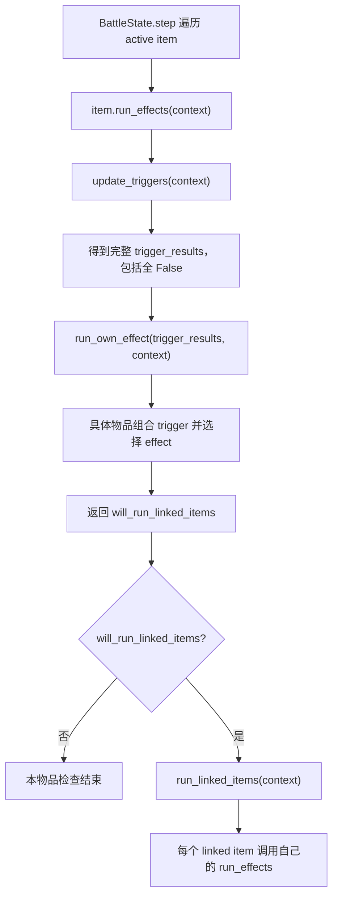

# BattleItem Trigger / Effect 调度 SPEC

状态：已确认并实现（2026-07-22）。

实现验证：`python -m unittest discover -s tests` 共 71 项测试通过。

## 1. Requirements（需求）

### 1.1 目标

修改战斗物品调度，使所有物品统一执行以下流程：

```text
trigger_results = update_triggers(context)
will_run_linked_items = run_own_effect(trigger_results, context)
if will_run_linked_items:
    run_linked_items(context)
```

其中：

- `update_triggers()` 只更新基本 trigger，返回与 trigger 顺序一致的 bool 列表。
- `run_own_effect()` 是具体物品的逻辑入口，负责所有业务判断：trigger 的 AND/OR/NOT、哪些 effect 应执行、如何解释 effect 返回值，以及是否继续检查 linked items。
- 基本 effect 只执行自身效果，不接收 trigger 结果，也不判断自己是否应被物品调用。
- `BattleState.step()` 不再判断 `is_triggered()`，只调用主动战斗物品的统一调度入口。

### 1.2 用户故事

- 作为 trigger 实现者，我只负责更新一个基础条件并返回 bool。
- 作为 effect 实现者，我只负责执行一种可复用效果并返回该效果结果，不了解具体物品的 trigger 排列。
- 作为具体物品实现者，我在 `run_own_effect()` 中完整表达本物品的触发组合、effect 调用顺序、失败后的分支及 linked item 传播条件。
- 作为框架维护者，我可以让所有主动物品和 linked item 走同一条 `run_effects()` 调度路径，避免在 `BattleState.step()` 和 `run_linked_items()` 重复判断。

### 1.3 行为要求

- WHEN `BattleState.step()` 遍历一个 active item，THEN SHALL 构建 context 并调用 `active_item.run_effects(context)`，不得在 step 中调用或判断 `is_triggered()`。
- WHEN `BattleItem.run_effects(context)` 被调用，THEN SHALL 无条件先调用一次 `update_triggers(context)`。
- WHEN所有基础 trigger 都返回 `False`，THEN 仍 SHALL 调用一次 `run_own_effect(trigger_results, context)`，以支持 NOT trigger 逻辑。
- WHEN `update_triggers()` 完成，THEN SHALL 返回并保存与 `self.triggers` 等长、顺序一致且只包含精确 bool 的列表。
- WHEN `run_own_effect()` 被调用，THEN 它 SHALL 接收本轮完整 `trigger_results` 和当前 `BattleContext`。
- WHEN具体物品需要组合 trigger，THEN AND/OR/NOT SHALL 在该物品的 `run_own_effect()` 内表达。
- WHEN具体物品决定某个 effect 不应激活，THEN `run_own_effect()` SHALL 不调用该 effect。
- WHEN某个 effect 返回 `False`，THEN框架 SHALL 不做统一解释；是否调用后续 effect 由当前物品的 `run_own_effect()` 决定。
- WHEN `run_own_effect()` 返回 `False`，THEN `run_effects()` SHALL 不调用 `run_linked_items()`。
- WHEN `run_own_effect()` 返回 `True`，THEN `run_effects()` SHALL 调用一次 `run_linked_items()`。
- WHEN遍历 linked item，THEN SHALL 直接调用 `linked_item.run_effects(linked_context)`；不得在 `run_linked_items()` 中重复调用 `update_triggers()` 或 `is_triggered()`。
- WHEN trigger 或 `run_own_effect()` 返回非精确 bool，THEN框架 SHALL 抛出 `ValueError`，避免隐式真值参与调度。具体 effect 的 bool 返回类型由组件测试保证，不在框架中重复校验。
- trigger/effect 实例和 `trigger_results` SHALL 归单个物品实例所有，不得跨物品共享可变状态。

### 1.4 API 变更

- 保留 `update_triggers(context)`，返回类型改为 `list[bool]`。
- 保留 `run_effects(context)` 作为框架统一调度入口，返回 `will_run_linked_items: bool`。
- 用 `run_own_effect(trigger_results, context)` 取代现有复数方法 `run_own_effects(context)`。
- 从调度接口中移除 `is_triggered()`；V1 尚无外部调用契约，不保留一个不参与调度的冗余状态指标。
- `Effect.apply()` 使用简单接口 `apply(context) -> bool`，不接收 trigger/effect 结果列表。
- 不新增独立逻辑层、`effect_activations` 或通用 `effect_results` 容器。

### 1.5 兼容性要求

- `CooldownTrigger` 仍只推进冷却并返回是否就绪，不读取、不判断、不消耗耐力。
- `StaminaConsumptionEffect` 仍只尝试支付耐力并返回是否成功。
- 木剑在 `run_own_effect()` 中先判断冷却 trigger，再调用耐力 effect；只有支付成功才调用 melee effect。
- 不改变现有物品元数据、玩家状态、背包关联顺序和 active item 顺序。
- 不实现 combat log。

### 1.6 非目标

- 本任务不实现木剑、冷却、耐力或近战伤害组件。
- 不引入规则 DSL、表达式树、条件对象、回调映射或新的设计模式。
- 不抽取多个物品间尚未实际出现的共享 `run_own_effect()` 流程。
- 不处理 linked item 循环关联。
- 不修改 `AGENTS.md`。

## 2. Design（设计）

### 2.1 责任边界

| 层级 | 负责 | 不负责 |
| --- | --- | --- |
| `Trigger.update()` | 更新并返回一个基础条件 | 组合其他 trigger；调用 effect |
| `Effect.apply()` | 执行一个基础效果并返回结果 | 判断具体物品是否应调用自己 |
| 具体物品 `run_own_effect()` | 组合 trigger；选择/排序 effect；解释 effect 结果；决定 linked item | 更新基础 trigger；递归 linked item |
| `BattleItem.run_effects()` | 固定调度顺序和 bool 契约校验 | 物品业务条件 |
| `BattleState.step()` | 遍历 active items | trigger/effect/linked 分支判断 |

### 2.2 核心接口

```python
class Trigger:
    def update(self, context: BattleContext) -> bool:
        raise NotImplementedError


class Effect:
    def apply(self, context: BattleContext) -> bool:
        raise NotImplementedError


class BattleItem:
    def update_triggers(self, context: BattleContext) -> list[bool]:
        ...

    def run_own_effect(
        self,
        trigger_results: list[bool],
        context: BattleContext,
    ) -> bool:
        raise NotImplementedError

    def run_effects(self, context: BattleContext) -> bool:
        ...
```

`run_own_effect()` 的返回值只有一个统一含义：`will_run_linked_items`。effect 自己的 bool 返回值没有框架级含义，只由当前物品解释。

### 2.3 无条件进入物品判断

`run_effects()` 不使用 `any(trigger_results)` 或 `all(trigger_results)` 做提前返回。即使结果为 `[False, False]`，仍调用 `run_own_effect()`：

```python
def run_own_effect(self, trigger_results, context):
    first, second = trigger_results
    if not first and not second:
        self.effects[0].apply(context)
        return True
    return False
```

这样 NOT-only 条件不需要额外的 always/tick trigger。

### 2.4 Effect 结果由物品解释

木剑示意：

```python
def run_own_effect(self, trigger_results, context):
    cooldown_ready = trigger_results[0]
    if not cooldown_ready:
        return False

    stamina_paid = self.effects[0].apply(context)
    if not stamina_paid:
        return False

    attack_result = self.effects[1].apply(context)
    return attack_result
```

这里只是木剑的选择：耐力支付失败时不调用 melee effect。其他物品完全可以在前一个 effect 返回 `False` 后继续调用后续 effect：

```python
first_result = self.effects[0].apply(context)
second_result = self.effects[1].apply(context)
return first_result or second_result
```

因此不存在框架级 effect 短路规则。

木剑首版没有 linked marker；示例暂以 `attack_result` 作为 `will_run_linked_items`。未来某件物品的 linked 语义是“使用时”“命中时”还是其他条件，由该物品自己的 `run_own_effect()` 明确返回，不修改框架。

### 2.5 统一递归入口

active item 和 linked item 都使用 `run_effects()`：

```text
BattleState.step
  -> active_item.run_effects(context)
       -> update_triggers(context)
       -> run_own_effect(trigger_results, context)
       -> [可选] run_linked_items(context)
            -> linked_item.run_effects(linked_context)
```

这样每个物品每次被检查时只更新一次 trigger，也不会在不同调用位置出现不同粗筛规则。

### 2.6 调用流程



### 2.7 其他待审 SPEC

`docs/function_type_annotations_and_docstrings_spec.md` 是另一项尚未确认的工作，仍按旧战斗接口列出 `is_triggered()` 和 `run_own_effects()`。本 SPEC 确认并实现后，那份文档必须先重新生成受影响的函数签名，再继续其代码任务；本轮不直接改写该用户未完成文档。

## 3. Realize（逐函数、逐测试实现设计）

### 3.1 `Trigger.update`

接口：

```python
def update(self, context: BattleContext) -> bool
```

伪代码：基础类抛出 `NotImplementedError`；具体 trigger 更新自身状态并返回基础 bool。

### 3.2 `Effect.apply`

接口：

```python
def apply(self, context: BattleContext) -> bool
```

伪代码：基础类抛出 `NotImplementedError`；具体 effect 执行自身原子效果并返回具体组件定义的 bool 结果。

### 3.3 `BattleItem.__init__`

接口保持现有构造参数不变。

新增/删除伪代码：

```python
校验 triggers/effects 非空
self.trigger_results = 与 triggers 等长的 False 列表
不再创建 self.triggered 或 self.effect_results
```

### 3.4 `BattleItem.update_triggers`

接口：

```python
def update_triggers(self, context: BattleContext) -> list[bool]
```

伪代码：

```python
results = []
for trigger in self.triggers:
    result = trigger.update(context)
    if type(result) is not bool:
        raise ValueError
    results.append(result)
self.trigger_results = results
return results
```

所有 trigger 都必须更新，不允许短路。

### 3.5 `BattleItem.run_own_effect`

接口：

```python
def run_own_effect(
    self,
    trigger_results: list[bool],
    context: BattleContext,
) -> bool
```

伪代码：基础类抛出 `NotImplementedError`。每个具体物品实现以下职责：

```text
读取并组合 trigger_results
按物品规则选择要调用的 self.effects
读取 effect 返回值并决定是否继续调用其他 effect
返回是否调用 linked items
```

### 3.6 `BattleItem.run_effects`

接口：

```python
def run_effects(self, context: BattleContext) -> bool
```

伪代码：

```python
trigger_results = self.update_triggers(context)
will_run_linked_items = self.run_own_effect(trigger_results, context)
if type(will_run_linked_items) is not bool:
    raise ValueError
if will_run_linked_items:
    self.run_linked_items(context)
return will_run_linked_items
```

### 3.7 `BattleItem.run_linked_items`

接口：

```python
def run_linked_items(self, context: BattleContext) -> None
```

伪代码：

```python
for linked_key in self.linked_items:
    linked_item = context.owner.items[linked_key]
    linked_context = context.for_item(linked_item)
    linked_item.run_effects(linked_context)
```

不在此处直接更新 trigger，也不判断 `is_triggered()`。

### 3.8 `BattleState.step`

接口保持现状：

```python
def step(self, frame_delta: float = 1.0)
```

相关循环伪代码：

```python
for active_item in list(self.active_items):
    context = self.build_context(active_item)
    active_item.run_effects(context)
```

step 不读取 trigger 结果，不判断 effect 激活，不判断 linked item。

### 3.9 测试辅助类

- `RecordingTrigger(result, log)`：记录 `update()` 并返回配置 bool。
- `RecordingEffect(result, log)`：记录 `apply(context)` 并返回配置 bool。
- `RecordingItem`：在 `run_own_effect()` 中记录收到的 trigger 列表，按测试配置调用 effect，并返回配置的 `will_run_linked_items`。
- `NotTriggerItem`：仅在指定 trigger 为 `False` 时调用 effect，用于验证全 False 仍进入物品逻辑。
- `WoodenSwordLikeItem`：耐力 effect 失败时不调用 melee effect。
- `ContinueAfterFailureItem`：第一个 effect 失败后仍调用第二个 effect。

## 4. Tasks（任务拆解）

1. T1：为 `Trigger.update()` 和 `Effect.apply()` 声明基础接口。
2. T2：在 `BattleItem.__init__()` 初始化逐实例 `trigger_results`，移除调度用 `triggered`。依赖 T1。
3. T3：实现 `update_triggers()` 的完整收集、严格 bool 校验、保存与返回。依赖 T1-T2。
4. T4：用 `run_own_effect(trigger_results, context)` 取代 `run_own_effects(context)`，基类保持抽象。依赖 T3。
5. T5：实现 `run_effects()` 固定调度和返回值校验。依赖 T3-T4。
6. T6：简化 `run_linked_items()`，让 linked item 直接进入自己的 `run_effects()`。依赖 T5。
7. T7：简化 `BattleState.step()`，移除 trigger 与 `is_triggered()` 分支。依赖 T5。
8. T8：更新测试辅助类并新增调度、NOT、物品专用 effect 分支及 linked item 测试。依赖 T1-T7。
9. T9：运行战斗模块测试和仓库全部测试。依赖 T8。
10. T10：实现通过后再次核对战斗模块、木剑和知识库文档。依赖 T9。

## 5. Acceptance Criteria / Tests（验收标准）

### 5.1 Trigger 更新

1. `test_update_triggers_returns_and_stores_results_in_order`
   - trigger 返回 `[False, True, False]`。
   - 断言全部 trigger 各调用一次，返回值和实例字段顺序一致。

2. `test_update_triggers_does_not_short_circuit`
   - 首个 trigger 返回 `False`。
   - 断言后续 trigger 仍更新。

3. `test_update_triggers_rejects_non_bool_result`
   - trigger 返回 `1` 或 `None`。
   - 断言抛出 `ValueError`。

### 5.2 统一调度

4. `test_run_effects_updates_triggers_before_run_own_effect`
   - 记录调用顺序。
   - 断言先记录全部 trigger update，再记录 `run_own_effect`。

5. `test_run_effects_calls_run_own_effect_when_all_triggers_are_false`
   - trigger 结果全假。
   - 断言 `run_own_effect()` 仍被调用并收到完整列表。

6. `test_not_trigger_item_can_apply_effect_when_trigger_is_false`
   - trigger 返回 `False`。
   - 物品在 `run_own_effect()` 中使用 NOT 条件。
   - 断言 effect 被调用。

7. `test_run_effects_rejects_non_bool_will_run_linked_items`
   - `run_own_effect()` 返回 `1` 或 `None`。
   - 断言抛出 `ValueError`。

### 5.3 物品专用 Effect 分支

8. `test_item_can_stop_own_effect_sequence_after_effect_failure`
   - 木剑式物品第一个 effect 返回 `False`。
   - 断言第二个 effect 不调用。

9. `test_item_can_continue_own_effect_sequence_after_effect_failure`
   - 另一物品第一个 effect 返回 `False`。
   - 其 `run_own_effect()` 仍调用第二个 effect。
   - 断言两个 effect 都调用。

10. `test_effect_apply_receives_only_context`
    - recording effect 按 `apply(context)` 调用成功。
    - 断言框架没有向 effect 传入 trigger/effect 结果列表。

### 5.4 Linked item 与 step

11. `test_run_own_effect_false_skips_linked_items`
    - `run_own_effect()` 返回 `False`。
    - 断言 linked item 不更新 trigger、不执行自身逻辑。

12. `test_run_own_effect_true_runs_linked_items_through_full_pipeline`
    - 父物品返回 `True`。
    - 断言 linked item 按 `update_triggers -> run_own_effect` 执行一次。

13. `test_run_linked_items_does_not_update_or_filter_linked_item_directly`
    - 使用记录顺序验证 linked item 仅通过 `run_effects()` 入口运行。

14. `test_battle_state_step_delegates_each_active_item_to_run_effects`
    - active item trigger 全假。
    - 断言 step 仍调用其 `run_own_effect()`，证明 step 不再粗筛。

15. `test_false_will_run_linked_items_does_not_stop_other_active_items`
    - 第一个 active item 返回 `False`，第二个仍正常执行。

### 5.5 状态隔离与回归

16. `test_battle_items_own_independent_trigger_result_lists`
    - 两个物品分别更新。
    - 断言 `trigger_results` 不共享。

17. 现有 metadata、背包关联、战斗结束和初始化器测试全部继续通过。

整项完成标准：新增测试及仓库全部既有测试通过；`BattleState.step()` 与 `run_linked_items()` 中不存在 `is_triggered()` 或 trigger 业务判断；所有具体物品判断集中在 `run_own_effect()`；未实现 combat log。
