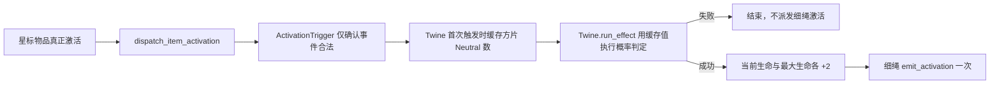

# 细绳（Twine）物品实现简短 SPEC

状态：已实现（2026-07-26）。  
查询日期：2026-07-26。

本文对 `docs/goobling_item_factory_spec.md` 中
`LinkedItemActivationCountTrigger` 的职责划分构成后续修订：基础
`ActivationTrigger` 只识别物品激活事件；其子类
`SlimeActivationTrigger` 保存并处理 Goobling 计数。

## 1. Requirements（需求）

### 1.1 已核对事实

- [中文 Wiki：细绳，修订 4863（2025-10-13）](https://backpackbattles.wiki.gg/zh/wiki/%E7%BB%86%E7%BB%B3?oldid=4863)
- [Cargo `Items`：Twine](https://backpackbattles.wiki.gg/api.php?action=cargoquery&format=json&tables=Items&fields=name%2Cclass%2Crarity%2Ccost%2Citemtype%2Cicontype%2Ctags%2Ceffect&where=name%3D%22Twine%22)
- [Interactions FAQ，修订 12504（2026-07-22）](https://backpackbattles.wiki.gg/wiki/Interactions_FAQ?oldid=12504)

物品数据：

| 字段 | 值 |
| --- | --- |
| `item_id` | `twine` |
| 名称 | `Twine` / 细绳 |
| 职业 | `Adventurer` |
| 稀有度 | `Common` |
| 类型 | `Accessory` |
| 价格 | 2 |
| 图标类型 | 空 |
| 网格 | `33312`：3 个方片、1 格本体、1 个星标 |

战斗效果：

- 星标物品激活时，以 `20% + 20% × 方片连接的通用物品数` 的概率获得 2 点最大生命。
- 概率最高按 100% 处理；随机判定统一使用 `battle_state.rng.random() < chance`。
- 获得最大生命会同时增加等量当前生命，但不属于治疗；因此不得调用 `BattleState.heal()`。
- 概率成功并获得最大生命时，细绳自身算激活一次并调用现有 `emit_activation()`；概率失败时不算激活。
- 基础 `ActivationTrigger` 只判断“合法的 marker 物品激活事件”。
- `SlimeActivationTrigger(ActivationTrigger)` 负责 Goobling 计数。
- Twine 概率判定仍由 Twine 自身业务方法负责。

### 1.2 用户故事与范围

- 给定细绳、一个星标物品和若干方片物品，战斗能按布局、物品实例身份和职业正确计算触发概率。
- 多件细绳、同类物品实例和旋转布局必须互相独立。
- 本轮只实现战斗物品、marker 语义、目录和测试；不实现商店补货、合成配方、局外发育或最大生命增减修饰器。

## 2. Design（设计）

### 2.1 当前缺口

初始化器目前把星标、方片和三角目标全部合并进 `BattleItem.linked_items`。细绳必须区分：

- `star`：哪些物品激活时通知细绳；
- `diamond`：哪些 `Neutral` 物品增加概率。

只使用合并列表会把两种语义混淆。

### 2.2 最小兼容设计（需确认）

为 `BattleItem` 增加：

```python
marker_items: dict[str, list[str]]
# 固定键："star"、"diamond"、"triangle"
```

并保留现有 `linked_items` 作为所有 marker 目标的去重并集。这样现有物品和物品激活监听缓存无需迁移；细绳只读取 `marker_items`。

是什么：给现有空间连接增加 marker 类型信息。  
为什么：细绳的两个效果条件使用不同 marker，合并列表无法表达。  
怎么做：初始化器按 marker 类型分别附加目标，同时继续维护旧并集；不新增事件总线、规则引擎或继承层次。

### 2.3 组件

```python
class ActivationTrigger(Trigger):
    item_activation_phase = ITEM_ACTIVATION_PHASE_LINKED

    def __init__(
        self,
        marker_type: str = "star",
    ): ...

    def update(self, context: BattleContext) -> bool: ...


class SlimeActivationTrigger(ActivationTrigger):
    def __init__(self, required_activations: int): ...
    def update(self, context: BattleContext) -> bool: ...


class GainMaxHealthEffect(Effect):
    def __init__(self, amount: int): ...
    def apply(self, context: BattleContext) -> bool: ...


class Twine(BattleItem):
    def __init__(
        self,
        item_id: str | None = None,
        item_key: str | None = None,
        player_id: int | None = None,
    ): ...

    def _prepare_neutral_item_count(
        self,
        context: BattleContext,
    ) -> None: ...

    def run_effect(
        self,
        trigger_results: list[bool],
        context: BattleContext,
    ) -> None: ...
```

关键流程：



## 3. Realize（逐函数实现）

### 3.1 `battle_module_v1.py`

#### `BattleItem.__init__`

接口保持现状；每个实例额外创建独立的：

```python
self.marker_items = {
    "star": [],
    "diamond": [],
    "triangle": [],
}
```

不得使用类级共享字典或列表。

#### `BattleItem.add_marker_item(marker_type, linked_key) -> None`

伪代码：

```text
若 marker_type 不在固定三类中：抛 ValueError
若 linked_key 尚未在 marker_items[marker_type]：追加
调用 add_linked_item(linked_key)，维护旧并集且去重
```

同一目标可以同时属于星标和方片分组，但在 `linked_items` 中只出现一次。

### 3.2 `battle_initializer_v1.py`

#### `initialize_battle(...)`

不再先把三类链接拼成一个无类型列表；依次调用：

```text
_attach_marker_links(star_links, items_by_key, "star")
_attach_marker_links(diamond_links, items_by_key, "diamond")
_attach_marker_links(triangle_links, items_by_key, "triangle")
```

#### `_attach_marker_links(marker_links, items_by_key, marker_type) -> None`

沿用现有 source/target 存在性校验，然后调用：

```python
items_by_key[source_key].add_marker_item(marker_type, target_key)
```

### 3.3 `item_factory_registry_v1.py`

#### `ActivationTrigger.__init__(marker_type="star")`

- `marker_type` 必须是 `"star"`、`"diamond"`、`"triangle"` 之一，否则抛
  `ValueError`。
- Twine 构造 `ActivationTrigger("star")`。
- 基础 trigger 不保存计数、概率、物品职业或 effect 业务状态。

#### `ActivationTrigger.update(context) -> bool`

伪代码：

```text
若 context 不是 ItemActivationContext：返回 False
若 source_item 与监听物品不同属主：返回 False
若 source_item.item_key 不在监听物品 marker_items[marker_type]：返回 False
返回 True
```

该方法不得访问 RNG，也不得修改监听物品状态。

#### `SlimeActivationTrigger.__init__(required_activations)`

- 必须调用 `super().__init__(marker_type="star")`。
- `required_activations` 必须是正整数且不能是 `bool`，否则抛
  `ValueError`。
- 实例字段为 `required_activations` 和 `activation_count = 0`；不得使用
  类级共享计数。

#### `SlimeActivationTrigger.update(context) -> bool`

伪代码：

```text
若 super().update(context) 为 False：返回 False
activation_count += 1
若 activation_count < required_activations：返回 False
activation_count -= required_activations
返回 True
```

基类负责事件合法性，子类只增加黏黏计数语义；非法事件不得改变计数。

#### `Goobling.__init__`

把现有 `LinkedItemActivationCountTrigger(3)` 替换为：

```python
triggers = [SlimeActivationTrigger(required_activations=3)]
```

不同 Goobling 实例各自拥有独立的 `SlimeActivationTrigger` 和计数。

#### `Goobling.run_effect(trigger_results, context) -> None`

这是当前代码中承担用户所称 `run_own_effect` 职责的方法；本轮不做全局改名。

伪代码：

```text
若 trigger_results[0] 为 False：返回
应用 HealEffect(4)
调用 self.emit_activation(context) 一次
```

第三次激活在满生命时仍被消费并派发 Goobling 自身激活，保持现有行为。

#### `GainMaxHealthEffect.__init__(amount)`

`amount` 必须是正整数且不能是 `bool`，否则抛 `ValueError`。

#### `GainMaxHealthEffect.apply(context) -> bool`

伪代码：

```text
owner.max_health += amount
owner.health += amount
返回 True
```

不得调用治疗接口，也不在本轮引入最大生命增强/削弱修饰器。

#### `Twine.__init__`

构造被动物品：

```python
is_active_item = False
triggers = [ActivationTrigger("star")]
effects = [GainMaxHealthEffect(2)]
socket_count = 0
self.neutral_item_count: int | None = None
```

每个实例必须拥有独立 trigger、effect 和计数缓存。

#### `Twine._prepare_neutral_item_count(context) -> None`

首次调用时统计并缓存方片连接的通用物品实例数：

```text
若 neutral_item_count 已不是 None：直接返回
neutral_item_count = 对 marker_items["diamond"] 去重后逐实例统计：
    owner.items[key].item_classes 包含 "Neutral"
```

方片连接的 `Adventurer` 或其他非 `Neutral` 物品不计数；同一实例覆盖多个方片仍只计一次。缓存属于 Twine 实例，不得由多件细绳共享。

当前战斗框架不支持战斗中改变布局或物品归属，因此缓存无需失效机制；未来若加入该能力，必须另行设计缓存失效。

#### `Twine.run_effect(trigger_results, context) -> None`

概率逻辑全部位于本方法，而不是 trigger。基础概率和每个通用物品的增量可使用
类常量 `BASE_CHANCE = 0.20`、`CHANCE_PER_NEUTRAL = 0.20`，不引入新的概率
effect 或策略对象。

伪代码：

```text
若 trigger_results[0] 为 False：返回
调用 _prepare_neutral_item_count(context)
chance = min(1.0, BASE_CHANCE + neutral_item_count * CHANCE_PER_NEUTRAL)
若 battle_state.rng.random() >= chance：返回
应用 GainMaxHealthEffect
调用 self.emit_activation(context) 一次
```

概率成功或失败后都保留缓存；非法激活事件在提前返回时不得准备缓存。

最后把 `"twine": Twine` 加入 `DEFAULT_ITEM_FACTORIES`。

### 3.4 `data/item_catalog_v1.json`

```json
"twine": {
  "item_id": "twine",
  "shape_cells": [[0, 0]],
  "star_cells": [[1, 0]],
  "diamond_cells": [[-3, 0], [-2, 0], [-1, 0]]
}
```

普通旋转逻辑自动旋转本体、星标和方片，不增加特例。

## 4. Tasks（任务拆解）

1. T1：为 `BattleItem` 和初始化器保留 marker 类型，同时兼容 `linked_items`。
2. T2：实现基础 `ActivationTrigger`，并以
   `SlimeActivationTrigger(ActivationTrigger)` 替换
   `LinkedItemActivationCountTrigger`；依赖 T1。
3. T3：实现并测试 `GainMaxHealthEffect`；依赖 T1。
4. T4：实现 `Twine` 的通用物品数实例缓存，在 `Twine.run_effect()` 内使用缓存完成概率逻辑，并注册工厂和目录网格；依赖 T1、T3。
5. T5：补齐 Goobling 回归、Twine 集成测试并运行完整测试套件；依赖 T2、T4。

## 5. Acceptance Criteria / Tests（验收）

新增或扩展测试，至少覆盖以下逐测试用例：

1. `test_add_marker_item_keeps_marker_groups_and_union`
2. `test_add_marker_item_rejects_unknown_marker_type`
3. `test_battle_item_marker_groups_are_instance_independent`
4. `test_initializer_preserves_star_diamond_and_triangle_groups`
5. `test_duplicate_cells_count_one_item_once_per_marker_type`
6. `test_gain_max_health_increases_current_and_max_health`
7. `test_gain_max_health_does_not_call_heal`
8. `test_activation_trigger_rejects_unknown_marker_type`
9. `test_activation_trigger_only_validates_matching_activation_event`
10. `test_activation_trigger_does_not_read_rng_or_hold_count`
11. `test_slime_activation_trigger_rejects_invalid_required_count`
12. `test_slime_activation_trigger_counts_only_valid_activations`
13. `test_slime_activation_trigger_fires_every_third_activation`
14. `test_goobling_instances_own_independent_slime_triggers`
15. `test_goobling_consumes_third_activation_at_full_health`
16. `test_twine_prepares_only_diamond_neutral_item_count`
17. `test_twine_keeps_first_cached_neutral_item_count`
18. `test_twine_invalid_activation_does_not_prepare_count`
19. `test_twine_instances_own_independent_count_caches`
20. `test_twine_run_effect_uses_strict_random_boundary_and_caps_chance`
21. `test_twine_metadata_components_and_factory_registration`
22. `test_twine_instances_own_independent_components`
23. `test_twine_catalog_rotates_one_star_and_three_diamonds`
24. `test_twine_star_activation_success_gains_two_health_and_emits_once`
25. `test_twine_failed_roll_changes_nothing_and_does_not_emit`
26. `test_twine_is_passive_and_not_added_to_active_items`

完成标准：

- 上述测试与仓库全部既有测试通过。
- 基础 `ActivationTrigger` 不含 Goobling 计数和 Twine 概率业务。
- Goobling 的计数只存在于其独立的 `SlimeActivationTrigger` 实例中。
- `SlimeActivationTrigger` 必须通过继承复用基础激活事件判定。
- Twine 的概率只在 `Twine.run_effect()` 中计算和判定。
- Twine 首次合法激活时缓存方片连接的 `Neutral` 实例数，后续判定不得重复遍历。
- 星标来源只负责触发；方片目标只负责 `Neutral` 概率加成。
- 成功一次后 `health`、`max_health` 都恰好增加 2，且未记录为治疗。
- 本轮未实现商店、合成、局外发育或通用最大生命修饰系统。

## 6. 实现结果

- Twine、marker 分组、`ActivationTrigger`、
  `SlimeActivationTrigger(ActivationTrigger)` 和最大生命效果均已实现。
- Twine 与 Goobling 的 41 项定向测试通过。
- 完整套件共运行 436 项；本任务未新增失败。仍有执行前已存在的 3 个失败和
  1 个错误，均来自工作区中尚未完成的 `commit_health_reduction()` 返回值变更。
