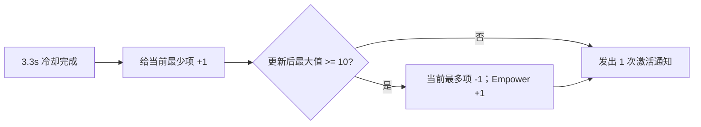

# 平衡魔棒（Wand of Equilibrium）物品工厂 SPEC

状态：已实现；本功能验收通过。查询日期：2026-07-26。

## 1. Requirements（需求）

实现 `wand_of_equilibrium`，使其可由默认工厂和战斗 JSON 创建并参与战斗。

Wiki 事实：

| 字段 | 值 |
| --- | --- |
| 职业 / 稀有度 / 价格 | `Mage` / `Common` / `4` |
| 类型 / 图标类型 | `Accessory` / 空 |
| 冷却效果 | 每 `3.3s`，在 `Mana`、`Luck`、`Regeneration` 中获得当前最少的一项 `1` 层 |
| 转换效果 | 随后若三项中至少一项达到 `10`，消耗当前最多的一项 `1` 层并获得 `1 Empower` |
| 格子 | 纵向 `2` 格，无星标、菱形或镶嵌位 |

来源：[Wiki 当前修订 10782（2025-09-18）](https://backpackbattles.wiki.gg/wiki/Wand_of_Equilibrium?oldid=10782)；
Cargo `Items` 行与页面一致，且 `icontype` 为空。

验收行为：

- 先增加“最少项”，再根据增加后的三项数值判断并执行转换。
- 每次冷却成功只发出一次物品激活通知，不因内部两个效果重复通知。
- 复用现有 `CooldownTrigger`、`GainBuffEffect`、`UseBuffEffect`，不新增通用框架。

范围外：商店与合成、彩虹魔棒、失调法杖、增益复制/无效化的新机制、战斗日志。

## 2. Design（设计）

### 2.1 并列口径（已确认）

Wiki 没有说明并列最少/最多时的选择规则。为保证模拟可复现，建议按页面顺序
`Mana -> Luck -> Regeneration` 取第一个并列项；本轮不读取 RNG。



### 2.2 `WandOfEquilibrium`

文件：`item_factory_registry_v1.py`

```python
class WandOfEquilibrium(BattleItem):
    RESOURCE_NAMES = ("Mana", "Luck", "Regeneration")

    def __init__(
        self,
        item_id: str | None = None,
        item_key: str | None = None,
        player_id: int | None = None,
    ) -> None: ...

    def _least_resource_name(self, buffs: BuffSlot) -> str: ...
    def _most_resource_name(self, buffs: BuffSlot) -> str: ...
    def run_effect(
        self,
        trigger_results: list[bool],
        context: BattleContext,
    ) -> None: ...
```

元数据：

```python
item_id = "wand_of_equilibrium"
display_name = "Wand of Equilibrium"
item_classes = ("Mage",)
rarity = "Common"
cost = 4
item_types = ("Accessory",)
icon_types = ()
is_active_item = True
socket_count = 0
```

`__init__()` 伪代码：

```text
创建独立的 CooldownTrigger(3.3)
分别创建 Mana/Luck/Regeneration 的 GainBuffEffect(name, 1)
分别创建 Mana/Luck/Regeneration 的 UseBuffEffect(name, 1)
创建 GainBuffEffect("Empower", 1)
保存按资源名查找 gain/use effect 的实例字典
```

`_least_resource_name()` / `_most_resource_name()` 伪代码：

```text
按 RESOURCE_NAMES 顺序读取层数
返回最小值/最大值对应的第一个名字
```

`run_effect()` 伪代码：

```text
若 cooldown trigger 为 False：return
least = _least_resource_name(owner.buffs)
执行 least 对应的 gain effect
若三项更新后的最大值 >= 10：
    most = _most_resource_name(owner.buffs)
    执行 most 对应的 use effect
    执行 Empower gain effect
emit_activation(context) 一次
```

### 2.3 注册与目录

- `DEFAULT_ITEM_FACTORIES["wand_of_equilibrium"] = WandOfEquilibrium`。
- `data/item_catalog_v1.json` 新增纵向两格：

```json
{
  "item_id": "wand_of_equilibrium",
  "shape_cells": [[0, 1], [0, 0]],
  "star_cells": []
}
```

- 实施后在本地知识库追加来源 URL、修订号、查询日期和上述事实。

## 3. Realize / Tasks（实现拆解）

1. T1：确认第 2.1 节并列口径。
2. T2：实现 `WandOfEquilibrium` 三个方法及元数据；依赖 T1。
3. T3：增加默认注册和目录网格；依赖 T2。
4. T4：增加下列测试并更新知识库；依赖 T2-T3。
5. T5：运行定向测试、完整回归和 `git diff --check`；依赖 T4。

## 4. Acceptance Criteria / Tests（验收标准）

文件：`tests/test_item_factory_registry_v1.py`

1. `test_wand_of_equilibrium_is_registered_with_metadata_and_components`
   核对元数据、`3.3s` trigger、七个既有 effect 及实例互不共享。
2. `test_wand_of_equilibrium_gains_the_least_resource`
   分别构造唯一最少的 Mana、Luck、Regeneration，断言只增加目标项。
3. `test_wand_of_equilibrium_uses_stable_order_for_minimum_ties`
   从 `0/0/0` 连续触发，前三次依次选择 Mana、Luck、Regeneration。
4. `test_wand_of_equilibrium_checks_threshold_after_gain`
   从 `9/9/9` 触发，断言先增加 Mana、再消耗 Mana并获得 `1 Empower`。
5. `test_wand_of_equilibrium_uses_the_most_resource`
   唯一最大项达到 `10` 时，只消耗该项 `1` 层并获得 `1 Empower`。
6. `test_wand_of_equilibrium_uses_stable_order_for_maximum_ties`
   最大值并列时按 Mana、Luck、Regeneration 的顺序选择。
7. `test_wand_of_equilibrium_does_not_convert_below_threshold`
   更新后三项均小于 `10`，断言不消耗资源且不增加 Empower。
8. `test_wand_of_equilibrium_emits_once_per_cooldown_activation`
   冷却前不通知；每次 `3.3s` 成功后恰好通知一次。
9. `test_initializer_builds_wand_of_equilibrium_as_active_item`
   标准 JSON 能创建物品并放入 `active_items`。
10. `test_wand_of_equilibrium_catalog_rotates_vertical_shape`
    四种旋转下均占两格且无 marker。
11. 仓库全部既有测试通过；`git diff --check` 通过；不新增依赖，不修改 `AGENTS.md`。

## 5. 实施与验证结果

实施日期：2026-07-26。

- T1-T4 已完成；并列最少/最多均按
  `Mana -> Luck -> Regeneration` 的固定顺序选择。
- 新增的 10 个平衡魔棒测试全部通过。
- `tests.test_item_factory_registry_v1`：212 项全部通过。
- 物品工厂、战斗初始化和背包布局三个相关模块：256 项全部通过。
- 完整回归共 417 项，413 项通过；3 个失败和 1 个错误均来自实施前已有的
  `battle_module_v1.py` 未提交改动：`commit_health_reduction()` 已改为返回二元组，
  但既有测试及一处 mock 仍按整数返回值处理。本实现未修改该文件。
- 标准 `data/minimal_wooden_battle_v1.json` 冒烟运行成功。
- JSON/导入检查和 `git diff --check` 通过；未新增依赖，未修改 `AGENTS.md`。
