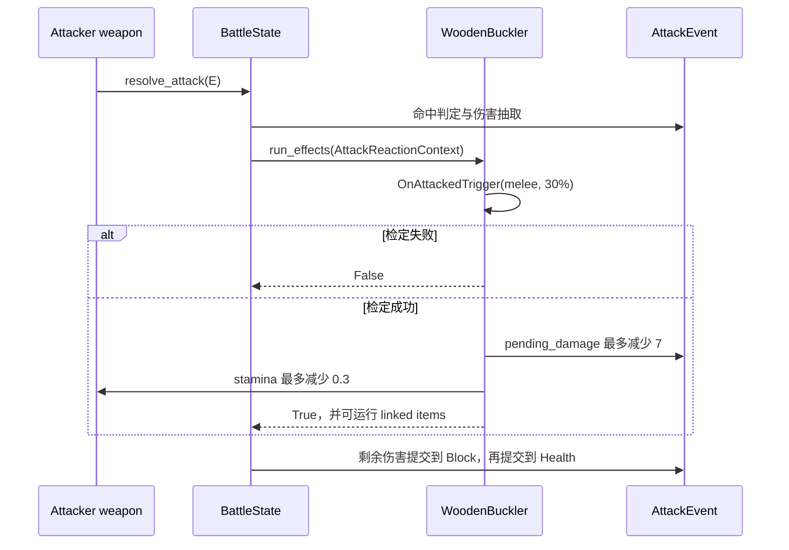

# Wooden Buckler item factory SPEC

## 1. Requirements（需求）

### 1.1 功能目标

在现有攻击事件与攻击响应框架中实现完整的 Wooden Buckler（木盾）战斗物品，使其可以通过默认物品工厂和物品目录从战斗 JSON 中实例化。

Wooden Buckler 必须：

- 只响应已经命中的 melee 攻击。
- 每次符合条件的攻击使用 `BattleState.rng` 进行一次 30% 概率检定。
- 检定成功时，在伤害提交到 Block/Health 前最多阻止 7 点伤害。
- 检定成功时从攻击者移除 0.3 耐力，最低降到 0。
- 即使待结算伤害已经是 0，也仍执行耐力移除。
- 检定成功即视为物品激活并允许 linked items 运行，不要求实际阻止到伤害或实际移除到耐力。
- 检定失败、攻击未命中或攻击类型不是 melee 时不产生任何效果。

### 1.2 Wiki 数据快照

查询日期：2026-07-22。

来源：<https://backpackbattles.wiki.gg/wiki/Wooden_Buckler>，页面修订 `oldid=10848`，页面记录的最后编辑时间为 2025-09-20。

| 字段 | 建模值 |
| --- | --- |
| item_id | `wooden_buckler` |
| display_name | `Wooden Buckler` |
| class | `Neutral` |
| rarity | `Common` |
| cost | `4` |
| item type | `Shield` |
| icon type | Wiki/Cargo 未列出额外 icon type，归一化为 `()` |
| effect | 被 melee 攻击时，30% 概率阻止 7 点伤害并移除对手 0.3 耐力 |
| sockets | `1` |
| grid | `2x2` |

### 1.3 用户故事

- 作为战斗 JSON 使用者，我可以在 `placements` 中填写 `wooden_buckler`，初始化器会创建真实木盾实例。
- 作为防守者，我的木盾只在被命中的 melee 攻击结算期间响应。
- 作为测试或训练调用者，我可以注入固定 RNG，复现木盾成功或失败的结果。
- 作为后续盾牌实现者，我可以复用现有响应 trigger 和两个 effect，无需复制伤害结算代码。

### 1.4 范围外

- 不实现 combat log。
- 不增加新的攻击阶段、事件总线或全局临时攻击字段。
- 不实现战斗过程中动态增删物品后的响应缓存失效。
- 不实现 Shielded 等改变盾牌触发概率的额外机制。
- 不实现合成、商店或宝石插槽效果。

## 2. Design（设计）

### 2.1 类与组件组合

在 `item_factory_registry_v1.py` 中新增：

```python
class WoodenBuckler(BattleItem):
    item_id = "wooden_buckler"
    display_name = "Wooden Buckler"
    item_classes = ("Neutral",)
    rarity = "Common"
    cost = 4
    item_types = ("Shield",)
    icon_types = ()
    is_active_item = False
    socket_count = 1
```

每个木盾实例在构造函数中创建独立组件：

```python
triggers = [
    OnAttackedTrigger(
        attack_types=("melee",),
        chance=0.3,
    ),
]
effects = [
    PreventAttackDamageEffect(amount=7),
    RemoveOpponentStaminaEffect(amount=0.3),
]
```

木盾是被动攻击响应物品，因此 `is_active_item=False`，不由 `BattleState.step()` 每帧直接调用。`BattleState._get_attack_reaction_items()` 会根据 trigger 的 `attack_phase=ATTACK_PHASE_ON_ATTACKED` 将其加入防守方对应缓存。

### 2.2 物品级逻辑

`WoodenBuckler.run_own_effect()` 负责所有组合与短路逻辑：

```python
def run_own_effect(self, trigger_results, context):
    if not trigger_results[0]:
        return False

    self.effects[0].apply(context)
    self.effects[1].apply(context)
    return True
```

两个 effect 的返回值不参与短路：

- `PreventAttackDamageEffect` 返回 `False` 可能只是待结算伤害已经为 0。
- `RemoveOpponentStaminaEffect` 返回 `False` 可能只是攻击者耐力已经为 0。
- trigger 成功才代表木盾激活，因此最终返回 `True`。

### 2.3 数据与注册

默认工厂注册：

```python
DEFAULT_ITEM_FACTORIES = {
    "wooden_sword": WoodenSword,
    "wooden_buckler": WoodenBuckler,
}
```

目录数据：

```json
"wooden_buckler": {
  "item_id": "wooden_buckler",
  "shape_cells": [[0, 0], [1, 0], [0, 1], [1, 1]],
  "star_cells": []
}
```

木盾没有 star/diamond/triangle 标记。本轮只用 `socket_count=1` 记录插槽数量，不增加插槽系统。

### 2.4 关键流程



## 3. Realize（逐函数实现）

### 3.1 `WoodenBuckler.__init__`

接口：

```python
def __init__(
    self,
    item_id: str | None = None,
    item_key: str | None = None,
    player_id: int | None = None,
):
```

伪代码：

```text
调用 BattleItem.__init__：
    转发 item_id、item_key、player_id
    明确 is_active_item=False
    创建一个新的 OnAttackedTrigger(melee, 0.3)
    创建新的 PreventAttackDamageEffect(7)
    创建新的 RemoveOpponentStaminaEffect(0.3)
```

验收点：两件木盾不得共享 trigger/effect 实例。

### 3.2 `WoodenBuckler.run_own_effect`

接口：

```python
def run_own_effect(
    self,
    trigger_results: list[bool],
    context: BattleContext,
) -> bool:
```

伪代码：

```text
若 trigger_results[0] 为 False：
    返回 False
调用防伤 effect，不读取其返回值
调用移除耐力 effect，不读取其返回值
返回 True
```

### 3.3 `DEFAULT_ITEM_FACTORIES`

保留 `wooden_sword`，新增 `wooden_buckler: WoodenBuckler`。不得覆盖或改变木剑注册。

### 3.4 `data/item_catalog_v1.json`

新增 `wooden_buckler` 的四个 `shape_cells` 和空 `star_cells`，保证 0 度旋转时占据参考点及其右、上、右上四格。

### 3.5 测试辅助迁移

`tests/test_attack_resolution_v1.py` 不再定义 `WoodenBucklerLikeItem`。已有完整响应测试直接实例化生产类 `WoodenBuckler`，避免测试辅助实现与真实实现漂移。

## 4. Tasks（任务拆解）

1. T1：新增 Wooden Buckler SPEC。
2. T2：实现 `WoodenBuckler` 类及默认工厂注册，依赖 T1。
3. T3：增加 `wooden_buckler` 目录形状，依赖 T1。
4. T4：把木盾式攻击响应测试改为使用生产类，依赖 T2。
5. T5：增加元数据、组件独立性、被动初始化和目录形状测试，依赖 T2-T3。
6. T6：运行相关测试、全量测试和真实木剑对木盾烟雾测试，依赖 T4-T5。

## 5. Acceptance Criteria / Tests（验收标准）

### 5.1 工厂与元数据

1. `test_wooden_buckler_is_registered_with_metadata_and_components`
   - 默认 registry 可创建木盾。
   - 断言 identity、公共元数据、`socket_count=1` 和 `is_active_item=False`。
   - 断言一个 trigger 和两个按指定顺序排列的 effect。

2. `test_wooden_bucklers_own_independent_component_instances`
   - 创建两个木盾并断言三组组件都不是同一个对象。

3. `test_initializer_builds_wooden_buckler_as_passive_reaction_item`
   - 使用默认目录和默认工厂初始化。
   - 断言木盾在玩家 `items` 中但不在 `active_items` 中。
   - 首次攻击响应 lookup 后，断言木盾进入 `on_attacked` 缓存。

### 5.2 目录形状

4. `test_wooden_buckler_occupies_two_by_two_cells_without_markers`
   - 断言四个占格位置正确。
   - 断言 marker 列表为空。

### 5.3 攻击响应

5. 现有 `test_wooden_buckler_prevents_seven_and_removes_stamina`
   - 固定攻击命中、伤害 10、盾牌检定成功。
   - 断言阻止 7、提交 3、攻击者耐力减少 0.3。

6. 现有 `test_wooden_buckler_still_removes_stamina_when_damage_is_zero`
   - 前置响应已经把伤害降为 0。
   - 断言木盾仍移除攻击者耐力。

7. 现有 `test_wooden_buckler_does_nothing_when_chance_fails`
   - 固定概率失败。
   - 断言伤害和耐力不变。

8. `test_missed_attack_does_not_consume_damage_or_reaction_rng`
   - 未命中时木盾不运行且不消耗盾牌概率 RNG。

9. `test_on_attacked_trigger_rejects_non_matching_attack_type_without_rng`
   - ranged/effect 攻击不触发木盾概率检定。

### 5.4 整体完成标准

- 默认 JSON 初始化路径可以同时创建木剑与木盾。
- 木盾只通过显式 `AttackReactionContext` 修改当前 `AttackEvent`。
- 木盾不是逐帧 active item，但会被 responder/phase 缓存发现。
- trigger 成功后两个 effect 均执行，且 linked item 决策为 `True`。
- 不增加 combat log。
- 仓库全部测试通过。
